# 글로벌 패션·악세사리 트렌드 리포트

- **날짜**: 2026-10-16
- **생성**: 2026-10-16 09:10 KST
- **센싱 국가**: 7개
- **센싱 사이트**: 34개 (성공 28)
- **수집 페이지**: OK 31 / FAIL 10
- **다운로드 이미지**: 212장

---

## 1. Executive Summary

오늘 7개국 34개 사이트에서 31개 페이지를 수집하고, 212장의 대표 이미지를 정규화/저장했습니다.

## 2. 글로벌 트렌드 TOP 10

### 키워드

| # | keyword | count | 출처 사이트 수 |
|---:|---|---:|---:|
| 1 | `online` | 17 | 7 |
| 2 | `berrybenka` | 14 | 1 |
| 3 | `design` | 12 | 1 |
| 4 | `mua` | 12 | 4 |
| 5 | `lazada` | 10 | 2 |
| 6 | `sofia` | 8 | 1 |
| 7 | `shopee` | 8 | 2 |
| 8 | `pinkoi` | 8 | 1 |
| 9 | `great` | 8 | 1 |
| 10 | `ファッション` | 7 | 1 |

### 컬러

| # | keyword | count | 출처 사이트 수 |
|---:|---|---:|---:|
| 1 | `pink` | 8 | 1 |
| 2 | `beige` | 4 | 1 |
| 3 | `black` | 2 | 1 |
| 4 | `red` | 2 | 2 |
| 5 | `ivory` | 1 | 1 |
| 6 | `khaki` | 1 | 1 |
| 7 | `brown` | 1 | 1 |
| 8 | `blue` | 1 | 1 |
| 9 | `gold` | 1 | 1 |

### 소재

| # | keyword | count | 출처 사이트 수 |
|---:|---|---:|---:|
| 1 | `lace` | 8 | 3 |
| 2 | `corduroy` | 4 | 1 |
| 3 | `cotton` | 4 | 2 |
| 4 | `cashmere` | 3 | 1 |
| 5 | `tweed` | 3 | 1 |
| 6 | `satin` | 2 | 1 |
| 7 | `suede` | 1 | 1 |
| 8 | `leather` | 1 | 1 |
| 9 | `knit` | 1 | 1 |

### 스타일

| # | keyword | count | 출처 사이트 수 |
|---:|---|---:|---:|
| 1 | `wide` | 6 | 3 |
| 2 | `classic` | 1 | 1 |

### 카테고리

| # | keyword | count | 출처 사이트 수 |
|---:|---|---:|---:|
| 1 | `sweater` | 6 | 1 |
| 2 | `shoes` | 5 | 2 |
| 3 | `dress` | 5 | 2 |
| 4 | `accessories` | 4 | 2 |
| 5 | `pants` | 3 | 1 |
| 6 | `hat` | 3 | 2 |
| 7 | `scarf` | 2 | 1 |
| 8 | `shirt` | 2 | 1 |
| 9 | `skirt` | 2 | 1 |
| 10 | `blazer` | 2 | 1 |

## 3. 국가별 핵심 트렌드 요약

### 인도네시아

- **키워드** (10): `berrybenka`(14), `sofia`(8), `online`(5), `flat`(4), `beige`(4)- **컬러** (4): `beige`(4), `black`(2), `ivory`(1), `khaki`(1)- **소재** (1): `lace`(3)- **카테고리** (4): `shoes`(2), `dress`(2), `scarf`(2), `blouse`(1)
### 일본

- **키워드** (10): `ファッション`(7), `楽天`(6), `cookie`(5), `rakuten`(5), `fashion`(5)
### 한국

- **키워드** (10): `취향`(2), `곁에`(2), `패션`(1), `라이프스타일`(1), `컬처까지`(1)
### 대만

- **키워드** (10): `design`(12), `pinkoi`(8), `great`(8), `momo`(5), `asia`(4)- **컬러** (2): `pink`(8), `red`(1)- **소재** (1): `lace`(4)
### 태국

- **키워드** (10): `central`(6), `lazada`(6), `online`(4), `thailand`(4), `shopee`(4)- **컬러** (1): `red`(1)- **스타일** (1): `wide`(3)- **카테고리** (3): `tee`(1), `bag`(1), `accessories`(1)
### 미국

- **키워드** (10): `open`(7), `new`(6), `edit`(6), `sweater`(6), `now`(5)- **컬러** (1): `brown`(1)- **소재** (7): `corduroy`(4), `cashmere`(3), `cotton`(2), `satin`(2), `lace`(1)- **스타일** (2): `wide`(1), `classic`(1)- **카테고리** (10): `sweater`(6), `dress`(3), `pants`(3), `accessories`(3), `shoes`(3)
### 베트남

- **키워드** (10): `mua`(12), `online`(8), `trang`(7), `nam`(7), `canifa`(5)- **컬러** (2): `blue`(1), `gold`(1)- **소재** (3): `tweed`(3), `cotton`(2), `knit`(1)- **스타일** (1): `wide`(2)- **카테고리** (2): `knit`(1), `hat`(1)

## 4. 국가별 상세 센싱 결과

### 4.1 인도네시아 _( Indonesia )_

- 한국 수출규모 순위: **#5** · region: `asia` · tier `1` · currency `IDR`
- 수집 사이트: **5개** (성공 4)
- 메모: 동남아 최대 인구, modest fashion 비중 큼
#### [Berrybenka](https://www.berrybenka.com/)

- URL: <https://www.berrybenka.com/>
- 페이지: **OK 1 · FAIL 0**

**대표 상품 이미지** (상위 6장, 출처 URL 포함)

-  — 출처 <https://berrybenka.com/cdn/shop/files/logo.jpg?height=288&v=1791288203>
-  — 출처 <https://berrybenka.com/cdn/shop/files/Shopee1.png?v=1791286518&width=3840>
-  — 출처 <https://berrybenka.com/cdn/shop/files/Shopee2.png?v=1791282529&width=3840>
-  — 출처 <https://berrybenka.com/cdn/shop/files/Banner-3-1.jpg?v=1791283147&width=3840>
-  — 출처 <https://berrybenka.com/cdn/shop/files/Banner-3-2.jpg?v=1791283866&width=3840>
-  — 출처 <https://berrybenka.com/cdn/shop/files/Banner-3-3.jpg?v=1791283948&width=3840>

**페이지 메타 정보**

| page | title | description |
|---|---|---|
| [`home`](https://berrybenka.com/) | Berrybenka | #berrybenka #trendy fashion # berrybenka_Thailand #Trendy Shoes #Flat shoes |

#### [Hijup](https://www.hijup.com/)

- URL: <https://www.hijup.com/>
- 페이지: **OK 1 · FAIL 0**

**페이지 메타 정보**

| page | title | description |
|---|---|---|
| [`home`](https://www.hijup.com/) | Latest Scarf, Tunic, Long Dress Collection | HIJUP | Trusted Muslim Women's Clothing Online Shopping Site. Buy latest collection of Abaya, Blouse, Dress, Tunic, Printed Scarf. International shi |

#### [Shopee Indonesia](https://shopee.co.id/)

- URL: <https://shopee.co.id/>
- 페이지: **OK 1 · FAIL 0**

**대표 상품 이미지** (상위 6장, 출처 URL 포함)

-  — 출처 <https://deo.shopeemobile.com/shopee/shopee-pcmall-live-sg/assets/1c8bdaaf45e1fd48.png>
-  — 출처 <https://deo.shopeemobile.com/shopee/shopee-pcmall-live-sg/homepagefe/42ba6075c82a85ab.png>

**페이지 메타 정보**

| page | title | description |
|---|---|---|
| [`home`](https://shopee.co.id/verify/captcha?anti_bot_tracking_id=gqRjZGVrxHSFomtptTE0MjUxOnRyYWNraW5nX2lkX2tleaJrdtEAAqRhbGdv0gAAAGSjZGVrwKJjdMRAAAAADLyQlHjbhu_tIJoVd59UO0aGI3u8EPZbMRUCgbeCPd4w23IClM5T1bD7-qxvztQnbHA8L7r5z24rbHP-k6pjaXBoZXJ0ZXh0xQLPAAAADF7kpuh8U4LfwCmmmqr-53Xq67muaga7pwGWM3HBFE_C1aQq6Qo4fwrrLcyu5QZ38ZHooXISz7l9jwl6BBwFh5urfM_H-MSZT1eHiWK0TzOkfH4i-6MISFcRiUtR87iNXWSGxERsgfvixlcgYFDUDCFKZmksBP9pZFw7dC-b_BJeCAYvKiscHe_ULp20xdo6IltZkp_11uCyvMdRr-JMHD8TyoF7pdPqTXSrsQJp53YH4d-ox8ts-UBYnxaaYKOA9z4Ag_Bgwy2m2RffXIYM9U8MZ0vHQCUVG9-oE7Q4aXgQbV05nuwwkahJa5Im62UydsdDtjKW6XJ67AS1BzRbzuohQ2W9NpZvnqvcPah-7J2-KTOAW195wqsZYYEa6cg-yD0S3o5FT_fx9X2T4Ph2zDBU1bFFpRqE1L5gKGERh4qVTRI_98x6y7zDW6CnJ48BbPA4GtveVTydYo0LKLth7vm8KqgowbKlan8zCdwNY3Y4JlHktsON4tphkaN2dyx1GcFcrQCFUzGLYRiTnWVAwIL2aRbA1vFJ_j639NdmeCuQBRjTUvzy4tUsn4915oNENHEW0SJxKqCZ8VF7IcwcdDbFW6qlnHhAtUeoJGMj7rTzD8879kQ3K85gqoa8PoHex17-4L6UKHsgBCBBnzUNMtL_F3_iPxrBcF_IamojvGVd7vlo_T6HxS7yh3-W9fiNZTbWutTY-o7DQM5hQZZXuS52PcuWKD0bFAOBId1AAqqrxjzwPamyXa0MVHkezedDRd89ObpKo_ncCNJIEWH5cNPEs0QtfUY_2tz2JKHAB-lJ5oaGhqG2BtKrOGFexqvoc_uTkk6iOCaNfevHAwZeOFmgH0Vx6mif82JrwS4R_RXtC75k6f0hJBzxpxbwOuDVJbU2y4i4LZVgUxlRzBDiLHOmfodx26x8uqI_kmvu3C0pu_F_2CZNQQ5WqrQ&app_key=FlashSale.PC&client_id=1&next=https%3A%2F%2Fshopee.co.id%2Fverify%2Ftraffic%3F%3Fclient_id%3D%26next%3Dhttps%253A%252F%252Fshopee.co.id%252F%26redirect_type%3D2%26should_replace_history%3Dfalse&redirect_type=2&scene=crawler_item&should_replace_history=false) | Shopee Indonesia | Belanja Online Terlengkap & Terpercaya | Belanja Online di Shopee Indonesia!  Nikmati Keuntungan Jual Beli Online Mudah dengan Shopee COD (Bayar di Tempat), Gratis Ongkir, & Pengiri |

#### [Tokopedia](https://www.tokopedia.com/)

- URL: <https://www.tokopedia.com/>
- 페이지: **OK 0 · FAIL 1**

**실패 페이지**

- `home` — playwright_error: Error: Page.goto: net::ERR_HTTP2_PROTOCOL_ERROR at https://www.tokopedia.com/
Call log:
  - navigating to "https://www.tokopedia.com/", waiting until "domcontentloaded"

#### [Zalora Indonesia](https://www.zalora.co.id/)

- URL: <https://www.zalora.co.id/>
- 페이지: **OK 1 · FAIL 0**

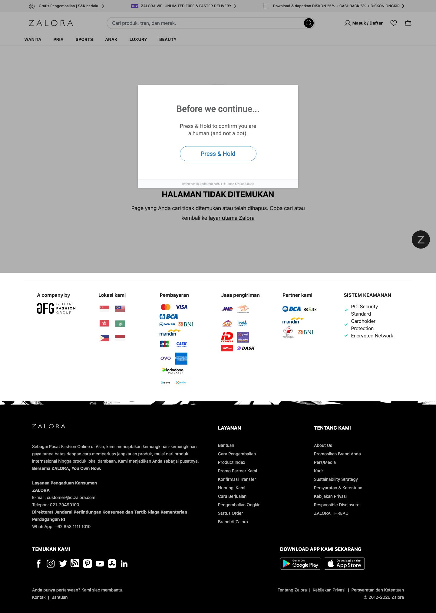

**대표 상품 이미지** (상위 6장, 출처 URL 포함)

-  — 출처 <https://static-id.zacdn.com/next-assets/static-assets/images/logo/icon_mastercard.png>
-  — 출처 <https://static-id.zacdn.com/next-assets/static-assets/images/logo/icon_visa.png>
-  — 출처 <https://static-id.zacdn.com/next-assets/static-assets/images/logo/icon_ovo.png>

**페이지 메타 정보**

| page | title | description |
|---|---|---|
| [`new_women`](https://www.zalora.co.id/wanita/new-arrivals) | Halaman tidak ditemukan | ZALORA |  |

### 4.2 일본 _( Japan )_

- 한국 수출규모 순위: **#2** · region: `asia` · tier `1` · currency `JPY`
- 수집 사이트: **5개** (성공 4)
- 메모: K-패션 선호도 높고 온라인 패션몰 발달
#### [GU Japan](https://www.gu-global.com/jp/)

- URL: <https://www.gu-global.com/jp/>
- 페이지: **OK 1 · FAIL 0**

**대표 상품 이미지** (상위 6장, 출처 URL 포함)

-  — 출처 <https://image.uniqlo.com/GU/ST3/jp/imagesother/Navigation/Category-icon_V2/2026/0724/Categoy_Limited-offers.jpg>
-  — 출처 <https://image.uniqlo.com/GU/ST3/jp/imagesother/Navigation/Category-icon_V2/2026/0724/Categoy_SALE.jpg>
-  — 출처 <https://image.uniqlo.com/GU/ST3/jp/imagesother/Navigation/collaboration_Category/26FW/rokh_category_icon.png>
-  — 출처 <https://image.uniqlo.com/GU/ST3/jp/imagesother/Navigation/WOMEN_Category/2026/260901/Category_w_Outer_361430.png>
-  — 출처 <https://image.uniqlo.com/GU/ST3/jp/imagesother/Navigation/WOMEN_Category/2026/261008/category_w_knit-and-cardigan_360549.png>
-  — 출처 <https://image.uniqlo.com/GU/ST3/jp/imagesother/Navigation/WOMEN_Category/2026/261008/category_w_tops_361505.png>

**페이지 메타 정보**

| page | title | description |
|---|---|---|
| [`new_arrivals`](https://www.gu-global.com/jp/ja/not-found) | 申し訳ありません、お客様がアクセスしようとしたページが見つかりませんでした。恐れ入りますが、正しくアドレスが入力されているか、もう一度ご確認ください。 | ジーユー | 申し訳ありません、お客様がアクセスしようとしたページが見つかりませんでした。恐れ入りますが、正しくアドレスが入力されているか、もう一度ご確認ください。 |

#### [Rakuten Fashion](https://brandavenue.rakuten.co.jp/)

- URL: <https://brandavenue.rakuten.co.jp/>
- 페이지: **OK 1 · FAIL 1**

**대표 상품 이미지** (상위 6장, 출처 URL 포함)

-  — 출처 <https://brandavenue.r10s.jp/img/library/index/sbn_flagshipstore_20231003.png>
- 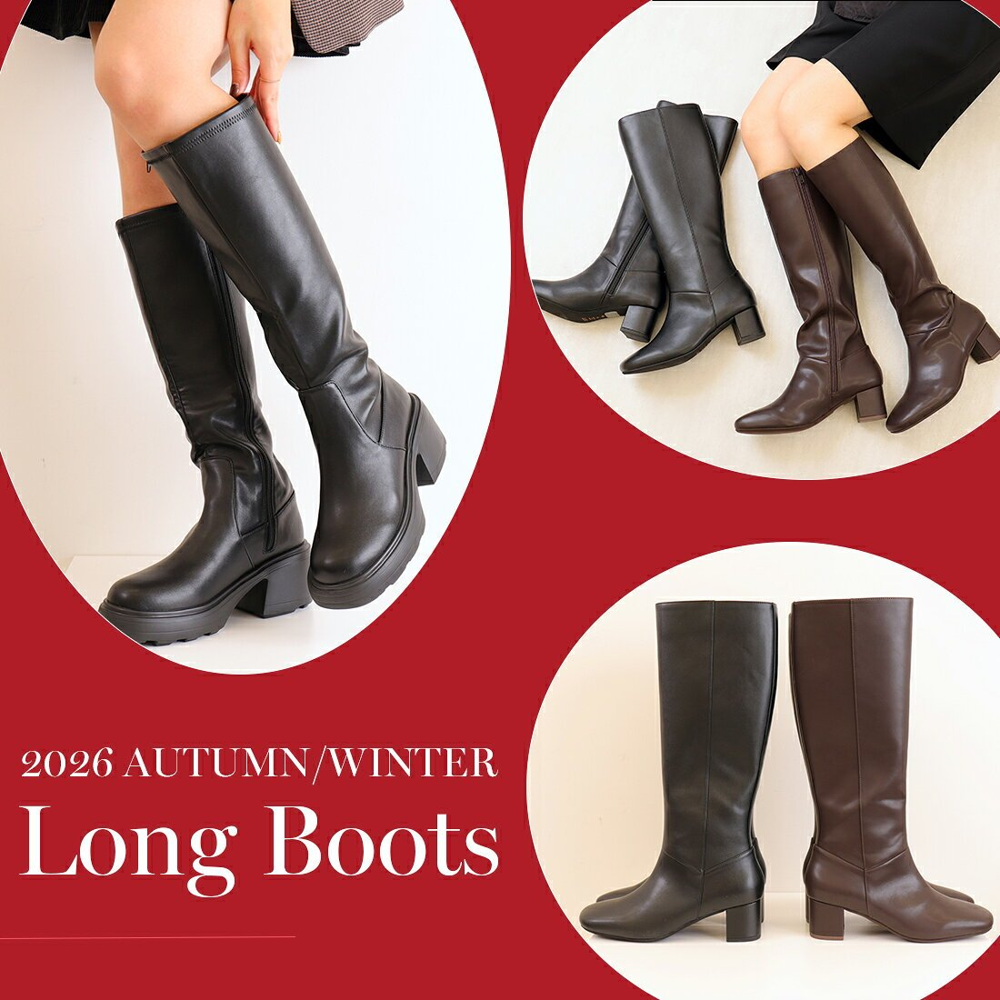 — 출처 <https://brandavenue.r10s.jp/img/news/01/402657/pc_n.jpg>
- 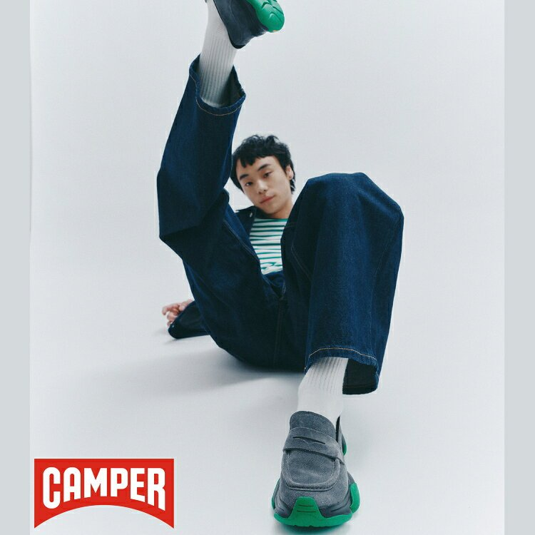 — 출처 <https://brandavenue.r10s.jp/img/news/01/403297/pc_n.jpg>
- 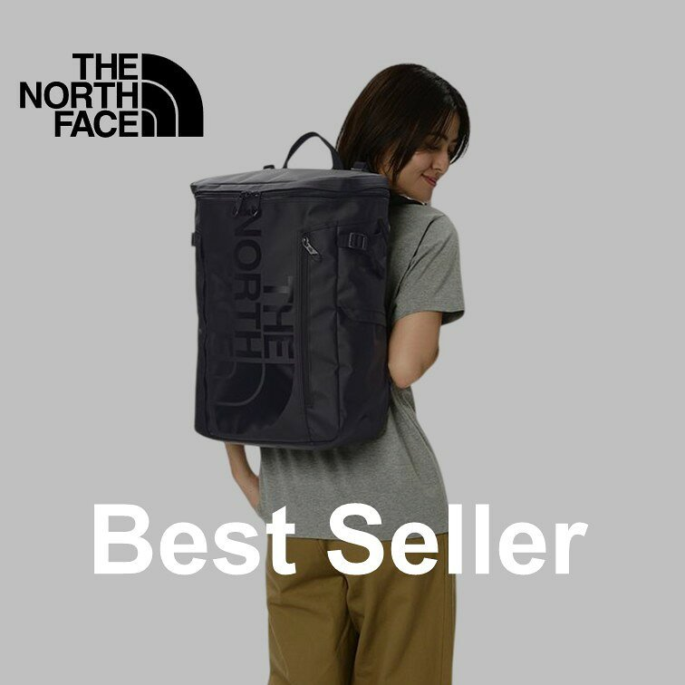 — 출처 <https://brandavenue.r10s.jp/img/news/01/403448/pc_n.jpg>
- 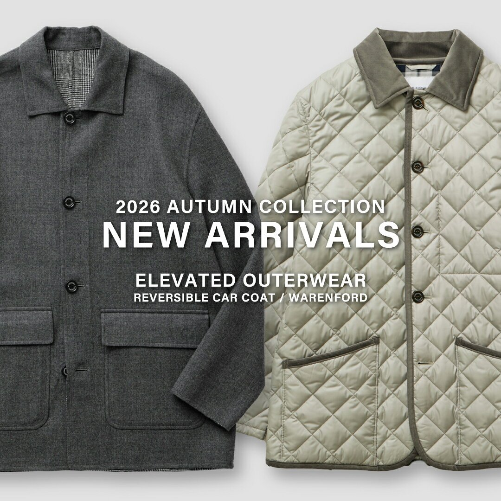 — 출처 <https://brandavenue.r10s.jp/img/news/01/402086/pc_n.jpg>
- 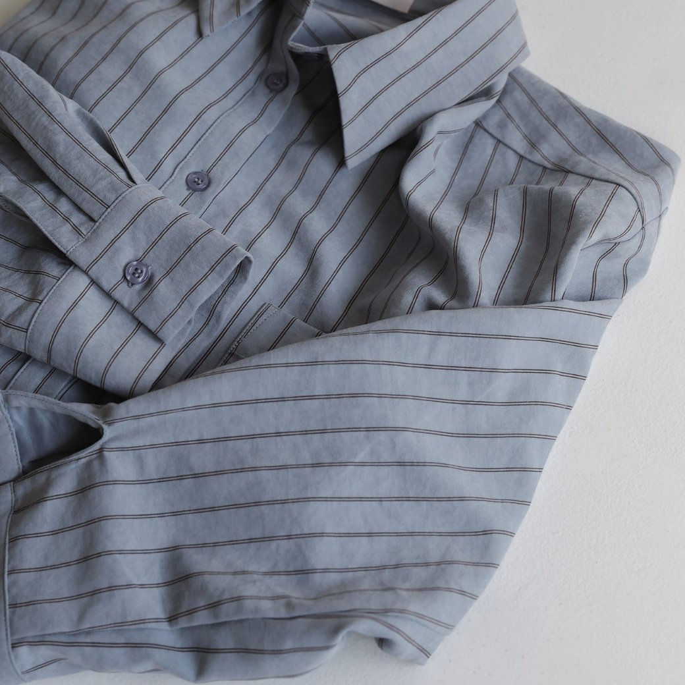 — 출처 <https://brandavenue.r10s.jp/img/news/01/402921/pc_n.png>

**페이지 메타 정보**

| page | title | description |
|---|---|---|
| [`men`](https://brandavenue.rakuten.co.jp/men/) | MEN | ファッション通販 Rakuten Fashion(楽天ファッション／旧楽天ブランドアベニュー) | Rakuten Fashion(楽天ファッション)は人気ブランドを取り扱うファッション通販サイトです。新作アイテム続々入荷！セール商品やクーポン対象商品も豊富。／税込3,980円以上購入で送料無料／楽天ポイントが使えて貯まる！ |

**실패 페이지**

- `women` — http_status_404

#### [Uniqlo Japan](https://www.uniqlo.com/jp/)

- URL: <https://www.uniqlo.com/jp/>
- 페이지: **OK 1 · FAIL 0**

**페이지 메타 정보**

| page | title | description |
|---|---|---|
| [`new_arrivals`](https://www.uniqlo.com/jp/ja/contents/feature/new-arrivals/) | 404 Not Found |  |

#### [WEAR](https://wear.jp/)

- URL: <https://wear.jp/>
- 페이지: **OK 1 · FAIL 0**

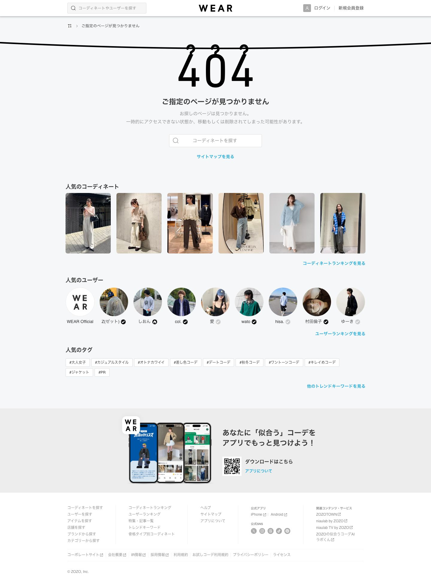

**대표 상품 이미지** (상위 6장, 출처 URL 포함)

-  — 출처 <https://wear.jp/public/_next/static/media/notfound_bg.1ywd-k_shp-hy.png>
-  — 출처 <https://wear.jp/public/_next/static/media/notfound_4.1ho27atf54bbv.png>
-  — 출처 <https://wear.jp/public/_next/static/media/notfound_0.438l9b9xjj6tm.png>
- 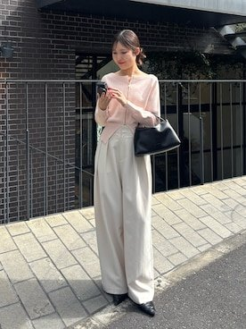 — 출처 <https://images.wear2.jp/coordinate/gGizzoQv/6CslcVwY/1792080704_276.jpg>
- 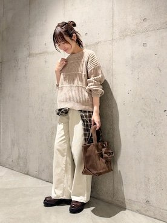 — 출처 <https://images.wear2.jp/coordinate/MniLXRJR/Je2AZFuW/1792056678_276.jpg>
- 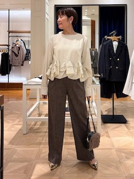 — 출처 <https://images.wear2.jp/coordinate/d2idL7ap/jwyLkQ3O/1792099073_276.jpg>

**페이지 메타 정보**

| page | title | description |
|---|---|---|
| [`ranking`](https://wear.jp/ranking/coordinate/) | ご指定のページが見つかりません - WEAR | お探しのページは見つかりません。一時的にアクセスできない状態か、移動もしくは削除されてしまった可能性があります。 |

#### [ZOZOTOWN](https://zozo.jp/)

- URL: <https://zozo.jp/>
- 페이지: **OK 0 · FAIL 2**

**실패 페이지**

- `new` — playwright_error: TimeoutError: Page.goto: Timeout 30000ms exceeded.
Call log:
  - navigating to "https://zozo.jp/category/new/", waiting until "domcontentloaded"

- `ranking` — playwright_error: TimeoutError: Page.goto: Timeout 30000ms exceeded.
Call log:
  - navigating to "https://zozo.jp/ranking/", waiting until "domcontentloaded"

### 4.3 한국 _( South Korea )_

- 한국 수출규모 순위: **#30** · region: `asia` · tier `1` · currency `KRW`
- 수집 사이트: **4개** (성공 3)
- 메모: 비교 기준 (자국). 국내 사업동향 센싱
#### [29CM](https://www.29cm.co.kr/)

- URL: <https://www.29cm.co.kr/>
- 페이지: **OK 1 · FAIL 0**

**최근 유행 상품** (44건 · 상품명 클릭 시 해당 사이트로 이동)

| # | 상품명 | 브랜드 | 가격 | 페이지 |
|---:|---|---|---:|---|
| 1 | [Pigment Noon Hoodie Zip-Up (2 Colors)](https://product.29cm.co.kr/catalog/3696833) | 시눈 | 91,200 KRW | `home` |
| 2 | [Rugby Long Sleeve (2 Colors)](https://product.29cm.co.kr/catalog/3696816) | 시눈 | 62,700 KRW | `home` |
| 3 | [Multi Stripe Long Sleeve (5 Colors)](https://product.29cm.co.kr/catalog/3696813) | 시눈 | 46,320 KRW | `home` |
| 4 | [헤어리 퍼 숄더백 아이보리 MDBG013IVORY](https://product.29cm.co.kr/catalog/4270950) | 몽돌 | 84,380 KRW | `home` |
| 5 | [헤어리 퍼 미니 크로스백 아이보리 MDBG014IVORY](https://product.29cm.co.kr/catalog/4270941) | 몽돌 | 56,260 KRW | `home` |
| 6 | [[SET] 스트라이프 믹스 가디건 & 팬츠 셋업 네이비 MDPJ006NAVY](https://product.29cm.co.kr/catalog/4270931) | 몽돌 | 89,780 KRW | `home` |
| 7 | [AUTHENTIC TRENCH SUEDE JACKET (BROWN)](https://product.29cm.co.kr/catalog/4137105) | 아수라 | 147,830 KRW | `home` |
| 8 | [AUTHENTIC TRENCH LEATHER JACKET (BLACK)](https://product.29cm.co.kr/catalog/4137104) | 아수라 | 147,830 KRW | `home` |
| 9 | [AUTHENTIC TRENCH JACKET (CHARCOAL)](https://product.29cm.co.kr/catalog/3797198) | 아수라 | 133,650 KRW | `home` |
| 10 | [Dusty Raglan Hoodie_Dusty Blue](https://product.29cm.co.kr/catalog/4218734) | 108파운드 | 83,700 KRW | `home` |
| 11 | [Dusty Raglan Hoodie_Melange Gray](https://product.29cm.co.kr/catalog/4218733) | 108파운드 | 83,700 KRW | `home` |
| 12 | [Dusty Raglan Hoodie_Light Melange](https://product.29cm.co.kr/catalog/4218732) | 108파운드 | 83,700 KRW | `home` |
| 13 | [[선물추천] SEINE PARIS 크리스탈 글라스 커피잔2P+플레이트 2P SET](https://product.29cm.co.kr/catalog/4261953) | 센느파리 | 64,440 KRW | `home` |
| 14 | [[센느파리] SEINE PARIS 크리스탈 글라스 플레이트 16CM 2P SET](https://product.29cm.co.kr/catalog/4261955) | 센느파리 | 47,840 KRW | `home` |
| 15 | [[선물추천] SEINE PARIS 크리스탈 글라스 디저트볼 1P](https://product.29cm.co.kr/catalog/4261956) | 센느파리 | 39,840 KRW | `home` |
| 16 | [에피큐리언 항균 우드 압축도마 엣지그립 도마, 내츄럴 4P 세트](https://product.29cm.co.kr/catalog/3621857) | 에피큐리언 | 310,000 KRW | `home` |
| 17 | [에피큐리언 항균 우드 압축도마 브라운 실리콘 그립 도마, 내츄럴 중형(29.2 x 22.8cm)](https://product.29cm.co.kr/catalog/3276052) | 에피큐리언 | 86,700 KRW | `home` |
| 18 | [에피큐리언 항균 우드 압축도마 브라운 실리콘 그립 도마, 내츄럴 대형(36.7 x 28.5)](https://product.29cm.co.kr/catalog/3276050) | 에피큐리언 | 106,250 KRW | `home` |
| 19 | [Scottish Tartan Check Lean Back Chair Green](https://product.29cm.co.kr/catalog/3387908) | 스튜디오 딥스 | 306,990 KRW | `home` |
| 20 | [Rami Ivory Fabric Sofa](https://product.29cm.co.kr/catalog/3906820) | 스튜디오 딥스 | 639,090 KRW | `home` |

**대표 상품 이미지** (상위 6장, 출처 URL 포함)

- 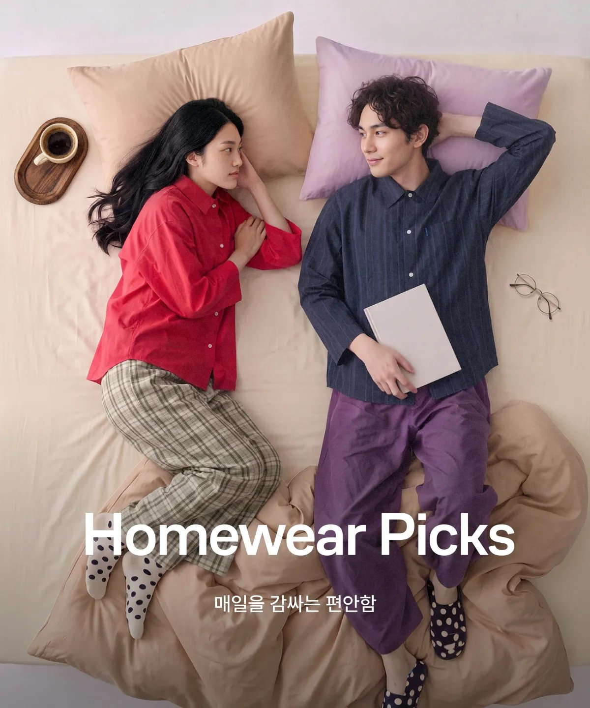 — 출처 <https://img.29cm.co.kr/cms/202610/11f1c78b11c041dab120173ea585d450.png?width=3840&format=webp>
- 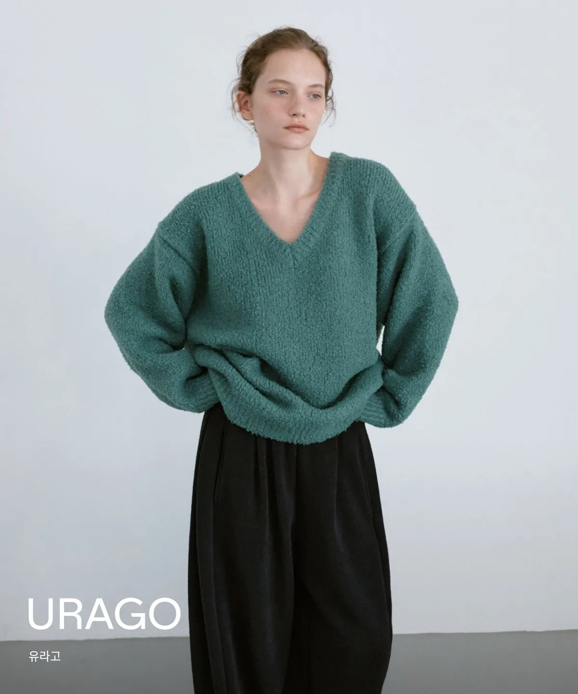 — 출처 <https://img.29cm.co.kr/cms/202610/11f1c78b05e39b7083fe0798448d7c3b.jpg?width=3840&format=webp>
-  — 출처 <https://img.29cm.co.kr/cms/202610/11f1c78aec68046ab120bdd87c29e20b.jpg?width=3840&format=webp>
- 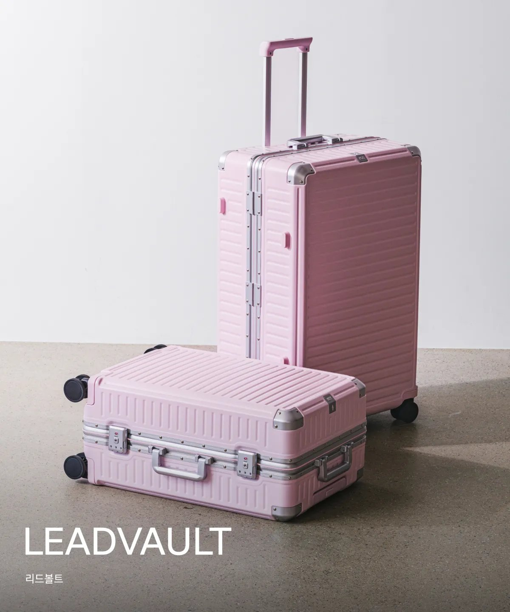 — 출처 <https://img.29cm.co.kr/cms/202610/11f1c78add30c07683fe8722a3f7a18f.jpg?width=3840&format=webp>
- 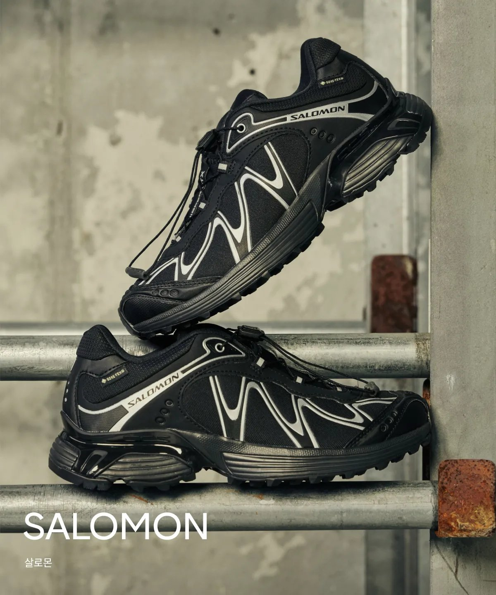 — 출처 <https://img.29cm.co.kr/cms/202610/11f1c78ad238d43c83fe895546801a43.jpg?width=3840&format=webp>
- 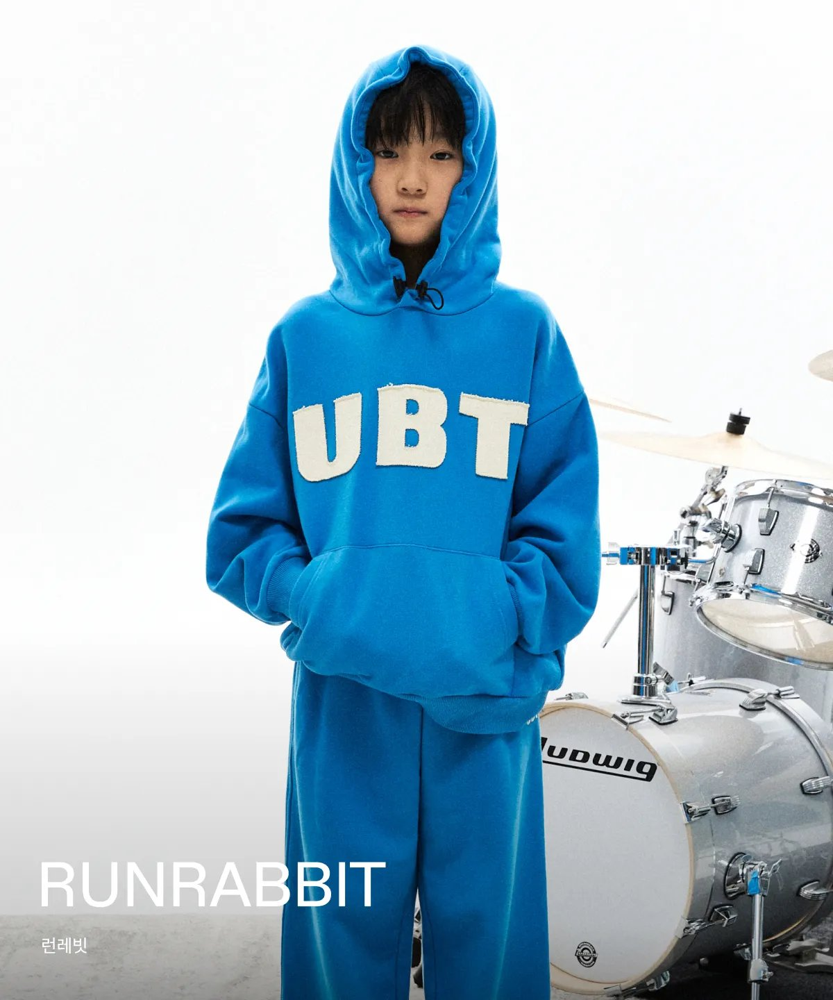 — 출처 <https://img.29cm.co.kr/cms/202610/11f1c78ac7feba3ab120ffae03c31b07.jpg?width=3840&format=webp>

**페이지 메타 정보**

| page | title | description |
|---|---|---|
| [`home`](https://www.29cm.co.kr/) | 모든 취향 곁에, 29CM | 패션, 라이프스타일, 컬처까지 29CM만의 감도 깊은 셀렉션을 만나보세요. |

#### [Musinsa](https://www.musinsa.com/)

- URL: <https://www.musinsa.com/>
- 페이지: **OK 0 · FAIL 1**

**실패 페이지**

- `home` — robots_disallowed

#### [W Concept](https://www.wconcept.co.kr/)

- URL: <https://www.wconcept.co.kr/>
- 페이지: **OK 1 · FAIL 0**

**최근 유행 상품** (30건 · 상품명 클릭 시 해당 사이트로 이동)

| # | 상품명 | 브랜드 | 가격 | 페이지 |
|---:|---|---|---:|---|
| 1 | [[6차 리오더]키라 플리츠 스커트 / KYRA PLEATS SKIRT_2colors](https://m.wconcept.co.kr/Product/301840914) | 룩캐스트 | 62,483 KRW | `home` |
| 2 | [[6차 리오더]리앤 울 핸드메이드 하프 코트 / LEANNE WOOL HANDMADE HALF COAT_4colors](https://m.wconcept.co.kr/Product/306028904) | 룩캐스트 | 177,334 KRW | `home` |
| 3 | [101 에센셜 스트레이트 데님 팬츠 / 101 ESSENTIAL STRAIGHT DENIM PANTS_2colors](https://m.wconcept.co.kr/Product/308892185) | 룩캐스트 | 59,937 KRW | `home` |
| 4 | [[3차 리오더] 소이 울 싱글 자켓_차콜 헤링본 / SOY WOOL SINGLE JACKET_CHARCOAL HERRINGBONE](https://m.wconcept.co.kr/Product/307357897) | 룩캐스트 | 121,098 KRW | `home` |
| 5 | [[단독]캐시미어 딥 브이넥 니트 / CASHMERE DEEP V-NECK KNIT_5colors](https://m.wconcept.co.kr/Product/308892198) | 룩캐스트 | 98,089 KRW | `home` |
| 6 | [오웬 랩 스커트 팬츠 / OWEN WRAP SKIRT PANTS_2colors](https://m.wconcept.co.kr/Product/307518081) | 룩캐스트 | 71,410 KRW | `home` |
| 7 | [[9차 리오더][W단독]릴리 에이치라인 미디 스커트 / LILY H-LINE MIDI SKIRT_3colors](https://m.wconcept.co.kr/Product/306149241) | 룩캐스트 | 88,072 KRW | `home` |
| 8 | [하이 넥 코튼 하프 자켓_베이지 / HIGH NECK COTTON HALF JACKET_BEIGE](https://m.wconcept.co.kr/Product/308892245) | 룩캐스트 | 121,198 KRW | `home` |
| 9 | [[4차 리오더] 키튼 비건 레더 자켓_블랙 / KITTEN VEGAN LEATHER JACKET_BLACK](https://m.wconcept.co.kr/Product/307357713) | 룩캐스트 | 139,447 KRW | `home` |
| 10 | [[W단독] 아이비 베이직 싱글 자켓 / IVY BASIC SINGLE JACKET_3colors](https://m.wconcept.co.kr/Product/308145570) | 룩캐스트 | 114,751 KRW | `home` |
| 11 | [스카프 카울 넥 블라우스_아이보리 / SCARF COWL NECK BLOUSE_IVORY](https://m.wconcept.co.kr/Product/309024739) | 룩캐스트 | 88,965 KRW | `home` |
| 12 | [울 블렌드 롱 슬리브 니트 탑 / WOOL BLEND LONG-SLEEVE KNIT TOP_4colors](https://m.wconcept.co.kr/Product/309024721) | 룩캐스트 | 69,625 KRW | `home` |
| 13 | [리사 캐시미어 하프 탑 / LISA CASHMERE HALF TOP_4colors](https://m.wconcept.co.kr/Product/306028887) | 룩캐스트 | 29,010 KRW | `home` |
| 14 | [305 모션 부츠컷 데님 팬츠 / 305 MOTION BOOTS CUT DENIM PANTS_2colors](https://m.wconcept.co.kr/Product/308892180) | 룩캐스트 | 63,178 KRW | `home` |
| 15 | [[3차 리오더][단독] 메이슨 울 트위드 오버핏 자켓_차콜 / MAISON WOOL TWEED OVERFIT JACKET_CHARCOAL](https://m.wconcept.co.kr/Product/307368673) | 룩캐스트 | 135,678 KRW | `home` |
| 16 | [[5차 리오더] 베이비 알파카 트위드 자켓 / BABY ALPACA TWEED JACKET_2colors](https://m.wconcept.co.kr/Product/303353236) | 룩캐스트 | 163,911 KRW | `home` |
| 17 | [레더 하이넥 점퍼 / LEATHER HIGH NECK JUMPER_2colors](https://m.wconcept.co.kr/Product/308892237) | 룩캐스트 | 150,754 KRW | `home` |
| 18 | [101 에센셜 컬러 스트레이트 데님 팬츠_베이지 / 101 ESSENTIAL COLOR STRAIGHT DENIM PANTS_BEIGE](https://m.wconcept.co.kr/Product/309022279) | 룩캐스트 | 63,178 KRW | `home` |
| 19 | [[3차 리오더] 제인 타이 블라우스_그레이 / JANE TIE BLOUSE_GREY](https://m.wconcept.co.kr/Product/308145526) | 룩캐스트 | 84,634 KRW | `home` |
| 20 | [408 세미 와이드 레그 데님 팬츠 / 408 SEMI WIDE LEG DENIM PANTS_2colors](https://m.wconcept.co.kr/Product/308892182) | 룩캐스트 | 58,318 KRW | `home` |

**페이지 메타 정보**

| page | title | description |
|---|---|---|
| [`home`](https://www.wconcept.co.kr/) | _(empty)_ |  |

#### [Zigzag](https://zigzag.kr/)

- URL: <https://zigzag.kr/>
- 페이지: **OK 1 · FAIL 0**

**최근 유행 상품** (36건 · 상품명 클릭 시 해당 사이트로 이동)

| # | 상품명 | 브랜드 | 가격 | 페이지 |
|---:|---|---|---:|---|
| 1 | [[가을바지🍁/50만장돌파/made] 허쉬 코튼 와이드팬츠 (숏/기본/롱)](https://store.zigzag.kr/app/catalog/products/143224732?browsing_type=NATIVE_BROWSER) | 리얼코코 | 19,920 KRW | `home` |
| 2 | [[울70] 핸드메이드 하이넥 숏코트_MIWJHGV31B](https://store.zigzag.kr/app/catalog/products/171946196?browsing_type=NATIVE_BROWSER) | 미쏘 | 143,200 KRW | `home` |
| 3 | [[가을가디건🍁/made] 맬리 팬던트 니트 가디건 (8color)](https://store.zigzag.kr/app/catalog/products/151404778?browsing_type=NATIVE_BROWSER) | 리얼코코 | 14,800 KRW | `home` |
| 4 | [[🍂2SET / 글레이즈 히든 증정🍂] 플러피 파우더 블러쉬 듀오](https://store.zigzag.kr/app/catalog/products/125962438?browsing_type=NATIVE_BROWSER) | 네이밍 | 18,900 KRW | `home` |
| 5 | [[🍁가을/MNQ] 리들리 하이넥 워싱 야상 자켓 (기본/누빔)](https://store.zigzag.kr/app/catalog/products/171277723?browsing_type=NATIVE_BROWSER) | 매니크 | 50,570 KRW | `home` |
| 6 | [[🍁가을/3기장선택!] made. 모먼트 투커버 올데이슬랙스 (+숏/베이직/롱ver) - 4 size](https://store.zigzag.kr/app/catalog/products/136095576?browsing_type=NATIVE_BROWSER) | 슬로우앤드 | 31,840 KRW | `home` |
| 7 | [[✨매일입어요] made. 솔트 클린 긴팔티셔츠 (스탠다드핏/루즈핏) - 6 color](https://store.zigzag.kr/app/catalog/products/148608703?browsing_type=NATIVE_BROWSER) | 슬로우앤드 | 17,820 KRW | `home` |
| 8 | [[15만장돌파🏆/+반팔/made] 코튼 스판 베이직 긴팔티셔츠 (라운드넥/유넥)](https://store.zigzag.kr/app/catalog/products/109044865?browsing_type=NATIVE_BROWSER) | 리얼코코 | 18,270 KRW | `home` |
| 9 | [[백지헌PICK/V넥단독💖][소프트얀] 여성 라운드넥 카디건_SPCKG49W01,SPCKG49W03](https://store.zigzag.kr/app/catalog/products/171262525?browsing_type=NATIVE_BROWSER) | 스파오 | 32,310 KRW | `home` |
| 10 | [[🏆역대급100만장/3기장선택!] made. 마켓 와이드 트레이닝슬랙스 (+숏/베이직/롱ver) - 4 size](https://store.zigzag.kr/app/catalog/products/141360158?browsing_type=NATIVE_BROWSER) | 슬로우앤드 | 26,320 KRW | `home` |
| 11 | [[여리핏][쫀쫀/S-M][4만장🏆][MADE]프렌즈 반버튼 레이어드 헨리넥 티셔츠 (긴팔/반팔ver)(S/M사이즈ver)(10color)](https://store.zigzag.kr/app/catalog/products/151290539?browsing_type=NATIVE_BROWSER) | 프렌치오브 | 19,420 KRW | `home` |
| 12 | [[🎉안국감사제/무료배송] made. 로젤 리얼도톰 맨즈핏 가디건 - 2 size  (예약주문: 11월 초 이후 순차출고예정)](https://store.zigzag.kr/app/catalog/products/172473868?browsing_type=NATIVE_BROWSER) | 슬로우앤드 | 55,840 KRW | `home` |
| 13 | [[🎉안국감사제/란제리코어] only. 보니 캡내장 레이스 슬리브리스 - 3 color (무료배송)](https://store.zigzag.kr/app/catalog/products/168688154?browsing_type=NATIVE_BROWSER) | 슬로우앤드 | 15,660 KRW | `home` |
| 14 | [[가을하객룩✨][MADE]드넬 하이넥 타이 블라우스[3color]](https://store.zigzag.kr/app/catalog/products/167182302?browsing_type=NATIVE_BROWSER) | 슬로우리스트 | 35,760 KRW | `home` |
| 15 | [헨리넥 새들 니트 (그레이)](https://store.zigzag.kr/app/catalog/products/172484000?browsing_type=NATIVE_BROWSER) | 히어썸웨어 | 46,000 KRW | `home` |
| 16 | [[🏆팬츠1위🏆누적5만장][❣️가을ver/S~L/2기장] 밸런스 데일리 팬츠 / 부츠컷추리닝 / 부츠컷트레이닝팬츠 / 와이드팬츠 / 로우라이즈 / 세미부츠컷](https://store.zigzag.kr/app/catalog/products/168688249?browsing_type=NATIVE_BROWSER) | 코코블랑 | 25,560 KRW | `home` |
| 17 | [[1만장돌파/무료배송] 팬톤 루즈핏 브이울니트 - 6 color](https://store.zigzag.kr/app/catalog/products/115497461?browsing_type=NATIVE_BROWSER) | 슬로우앤드 | 29,600 KRW | `home` |
| 18 | [[레이어드]매그 라운드 라벨 긴팔 니트](https://store.zigzag.kr/app/catalog/products/172482465?browsing_type=NATIVE_BROWSER) | 그레이스뮤즈 | 24,120 KRW | `home` |
| 19 | [[🍁가을/MNQ] 페트리 안티필링 워셔블 오버핏 딥브이넥 니트](https://store.zigzag.kr/app/catalog/products/171226174?browsing_type=NATIVE_BROWSER) | 매니크 | 30,960 KRW | `home` |
| 20 | [[🎉안국감사제/무료배송] made. 멜티드 소프트 컬러니트 - 5 color](https://store.zigzag.kr/app/catalog/products/172473483?browsing_type=NATIVE_BROWSER) | 슬로우앤드 | 33,600 KRW | `home` |

**페이지 메타 정보**

| page | title | description |
|---|---|---|
| [`home`](https://zigzag.kr/) | _(empty)_ |  |

### 4.4 대만 _( Taiwan )_

- 한국 수출규모 순위: **#7** · region: `asia` · tier `1` · currency `TWD`
- 수집 사이트: **5개** (성공 4)
- 메모: K-패션 친화도 높음
#### [momo](https://www.momoshop.com.tw/)

- URL: <https://www.momoshop.com.tw/>
- 페이지: **OK 1 · FAIL 0**

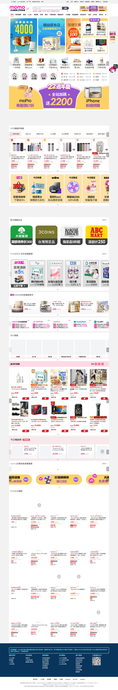

**대표 상품 이미지** (상위 6장, 출처 URL 포함)

-  — 출처 <https://img3.momoshop.com.tw/ecm/img/online/10/998/00/000/bt_0_271_01/bt_0_271_01_e2.jpg?t=1785743060613>
-  — 출처 <https://img3.momoshop.com.tw/ecm/img/online/10/998/00/000/bt_0_245_01/bt_0_245_01_P1_1_e2.png?t=1792080007318>
- 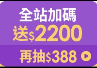 — 출처 <https://img3.momoshop.com.tw/ecm/img/online/10/998/00/000/bt_0_245_01/bt_0_245_01_P1_2_e2.png?t=1792080007318>
-  — 출처 <https://img1.momoshop.com.tw/ecm/img/online/10/998/00/000/bt_0_245_01/bt_0_245_01_P1_3_e2.png?t=1791820809345>
- 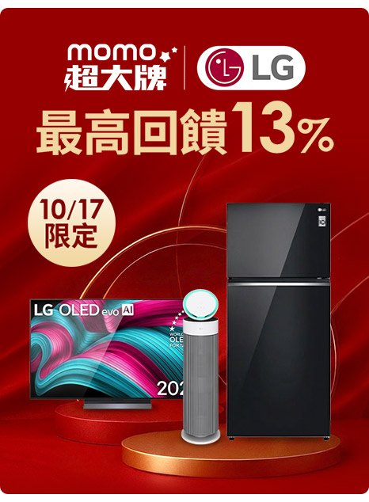 — 출처 <https://img1.momoshop.com.tw/ecm/img/online/81/998/00/000/mobile/bt_7_701_01/bt_7_701_01_e171.jpg?t=1792049877546>

**페이지 메타 정보**

| page | title | description |
|---|---|---|
| [`home`](https://www.momoshop.com.tw/main/Main.jsp) | momo購物網 - 好評推薦 - 2026年10月 | momo購物網提供美妝保養、流行服飾、時尚精品、3C、數位家電、生活用品、美食旅遊票券…等數百萬件商品。快速到貨、超商取貨讓您購物最便利。mo店+商品抵用券天天搶、免運吃到飽，電視/直播商品限時下殺，每日讓您享超低價，並享有十天猶豫期；momo購物網為富邦及台灣大哥大關係企業 |

#### [OB Design](https://www.obdesign.com.tw/)

- URL: <https://www.obdesign.com.tw/>
- 페이지: **OK 1 · FAIL 0**

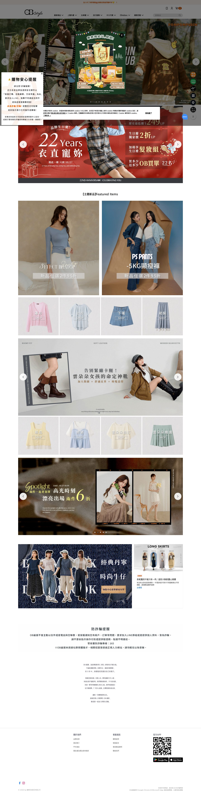

**대표 상품 이미지** (상위 6장, 출처 URL 포함)

-  — 출처 <https://cms-static.cdn.91app.com/images/original/41602/92f19e4d-89b7-4330-9570-02cf1dff9742-1791957884-wtfzxkcvms_d_1920x820_1280x547_1124x480_800x342_600x256_400x171.jpg>
- 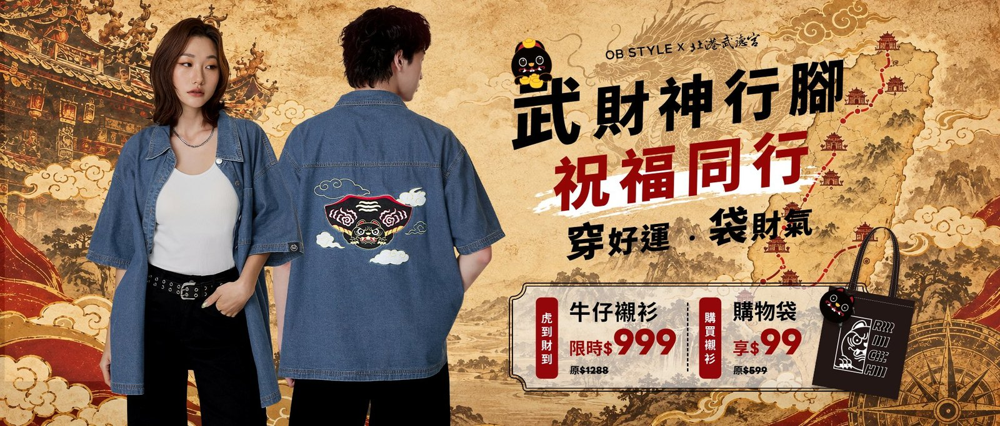 — 출처 <https://cms-static.cdn.91app.com/images/original/41602/92f19e4d-89b7-4330-9570-02cf1dff9742-1791957990-kgvwjo7qw7_d_1920x820_1280x547_1124x480_800x342_600x256_400x171.jpg>
- 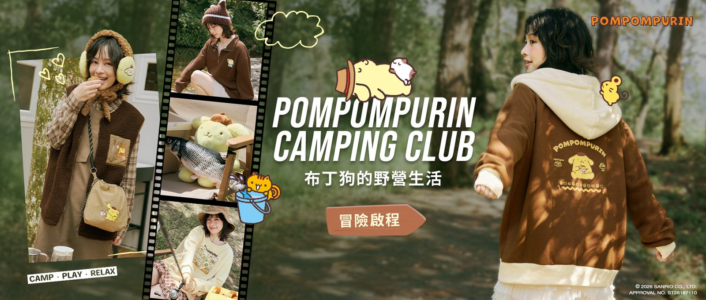 — 출처 <https://cms-static.cdn.91app.com/images/original/41602/92f19e4d-89b7-4330-9570-02cf1dff9742-1791858204-wz3vkxolfi_d_1920x820_1280x547_1124x480_800x342_600x256_400x171.jpg>
- 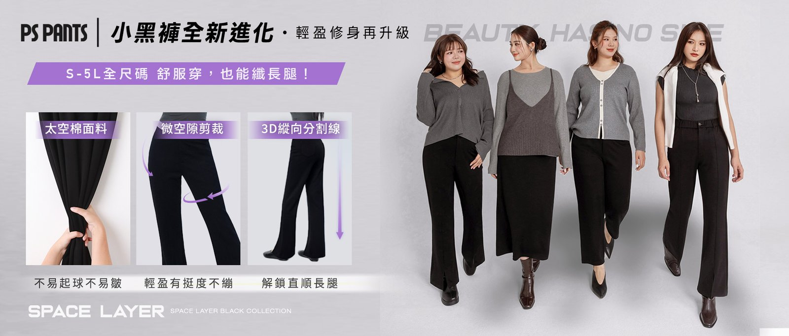 — 출처 <https://cms-static.cdn.91app.com/images/original/41602/92f19e4d-89b7-4330-9570-02cf1dff9742-1791948142-a0d3jhklbp_d_1920x820_1280x547_1124x480_800x342_600x256_400x171.jpg>
- 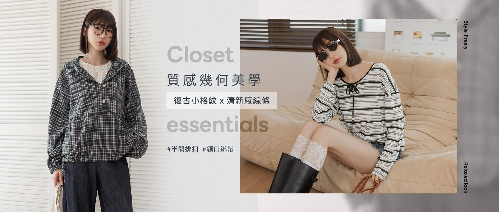 — 출처 <https://cms-static.cdn.91app.com/images/original/41602/92f19e4d-89b7-4330-9570-02cf1dff9742-1792029563-w0s0fz0ca4_d_1920x820_1280x547_1124x480_800x342_600x256_400x171.jpg>
- 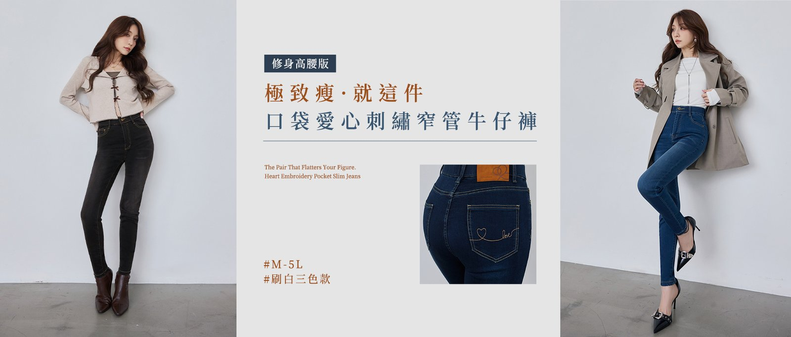 — 출처 <https://cms-static.cdn.91app.com/images/original/41602/92f19e4d-89b7-4330-9570-02cf1dff9742-1791773065-p7ileh8xvh_d_1920x820_1280x547_1124x480_800x342_600x256_400x171.jpg>

**페이지 메타 정보**

| page | title | description |
|---|---|---|
| [`home`](https://www.obdesign.com.tw/) | OB嚴選｜高CP值人氣熱銷服飾，流行服飾品牌 | 你的日常穿搭好夥伴，快上OB嚴選找，OB嚴選提供女裝、孕童、運動、男裝各項流行服飾，秉持優質服務給你高CP值的購物體驗。各種風格都能滿足熱愛穿搭的你，天天上新品，快速出貨，一起加入OB style！網路人氣服飾品牌OB嚴選 |

#### [PChome](https://24h.pchome.com.tw/)

- URL: <https://24h.pchome.com.tw/>
- 페이지: **OK 0 · FAIL 1**

**실패 페이지**

- `home` — http_status_429

#### [Pinkoi Taiwan](https://www.pinkoi.com/)

- URL: <https://www.pinkoi.com/>
- 페이지: **OK 2 · FAIL 0**

**대표 상품 이미지** (상위 6장, 출처 URL 포함)

-  — 출처 <https://cdn04.pinkoi.com/pinkoi.site/logo/og_image.png>

**페이지 메타 정보**

| page | title | description |
|---|---|---|
| [`accessories`](https://en.pinkoi.com/) | Pinkoi | Asia’s cross-border design marketplace | Design the way you are | Shop for original design products from Asia's independent designers. Pinkoi lives and breathes great design, great quality, great service, a |
| [`bags`](https://en.pinkoi.com/) | Pinkoi | Asia’s cross-border design marketplace | Design the way you are | Shop for original design products from Asia's independent designers. Pinkoi lives and breathes great design, great quality, great service, a |

#### [Yahoo Taiwan Shopping](https://tw.buy.yahoo.com/)

- URL: <https://tw.buy.yahoo.com/>
- 페이지: **OK 1 · FAIL 0**

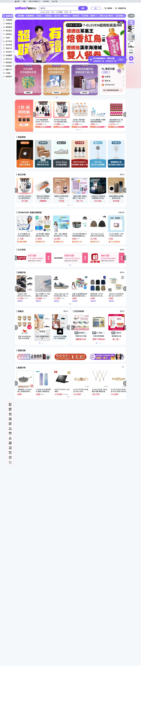

**대표 상품 이미지** (상위 6장, 출처 URL 포함)

- 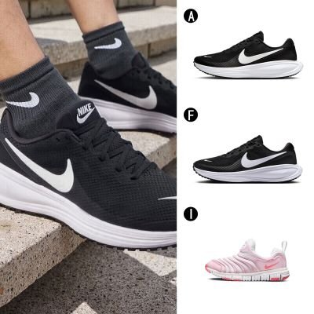 — 출처 <https://img.yec.tw/zp/MerchandiseImages/210fc31caf-Gd-11944832.jpg>
- 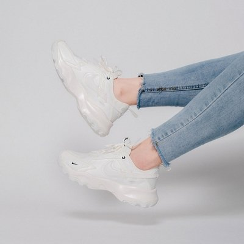 — 출처 <https://img.yec.tw/zp/MerchandiseImages/f7efbe6670-Gd-9378112.jpg>
- 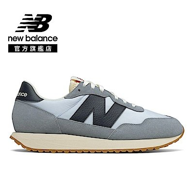 — 출처 <https://img.yec.tw/zp/MerchandiseImages/B151B0FA3C-Gd-11695522.jpg>

**페이지 메타 정보**

| page | title | description |
|---|---|---|
| [`home`](https://tw.buy.yahoo.com/) | Yahoo購物中心 - 最懂生活的人 | 數百萬件商品，貼心客服為您服務，15天鑑賞期購物保障！ |

### 4.5 태국 _( Thailand )_

- 한국 수출규모 순위: **#8** · region: `asia` · tier `1` · currency `THB`
- 수집 사이트: **5개** (성공 4)
- 메모: 동남아 K-패션 핵심 시장
#### [Central Online](https://www.central.co.th/)

- URL: <https://www.central.co.th/>
- 페이지: **OK 1 · FAIL 0**

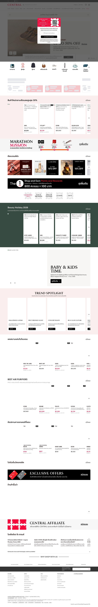

**대표 상품 이미지** (상위 6장, 출처 URL 포함)

-  — 출처 <https://www.central.co.th/_next/image?url=https%3A%2F%2Fassets.central.co.th%2Ffile-assets%2Fassets%2FCMS%2Fcampaign%2F2026%2F10oct%2F20261006_ANV2026_Homepage_herobanner.jpg&w=3840&q=75>
- 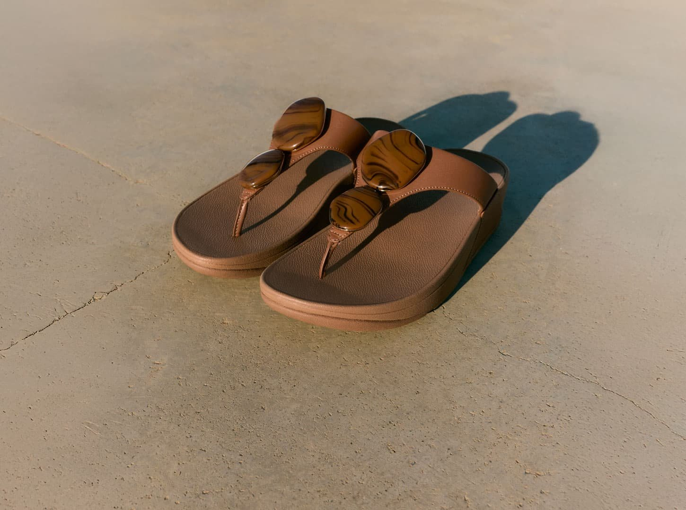 — 출처 <https://www.central.co.th/_next/image?url=https%3A%2F%2Fassets.central.co.th%2Ffile-assets%2Fassets%2FCMS%2Fcampaign%2F2026%2F10oct%2F20261015_FITFLOP_heroweb_d.jpg&w=3840&q=75>
-  — 출처 <https://www.central.co.th/_next/image?url=https%3A%2F%2Fassets.central.co.th%2Ffile-assets%2Fassets%2FCMS%2Fcampaign%2F2026%2F10oct%2F20261015_dior_heroweb_d.jpg&w=3840&q=75>
-  — 출처 <https://www.central.co.th/_next/image?url=%2Fimages%2Ffallback-image.webp&w=3840&q=75>
- 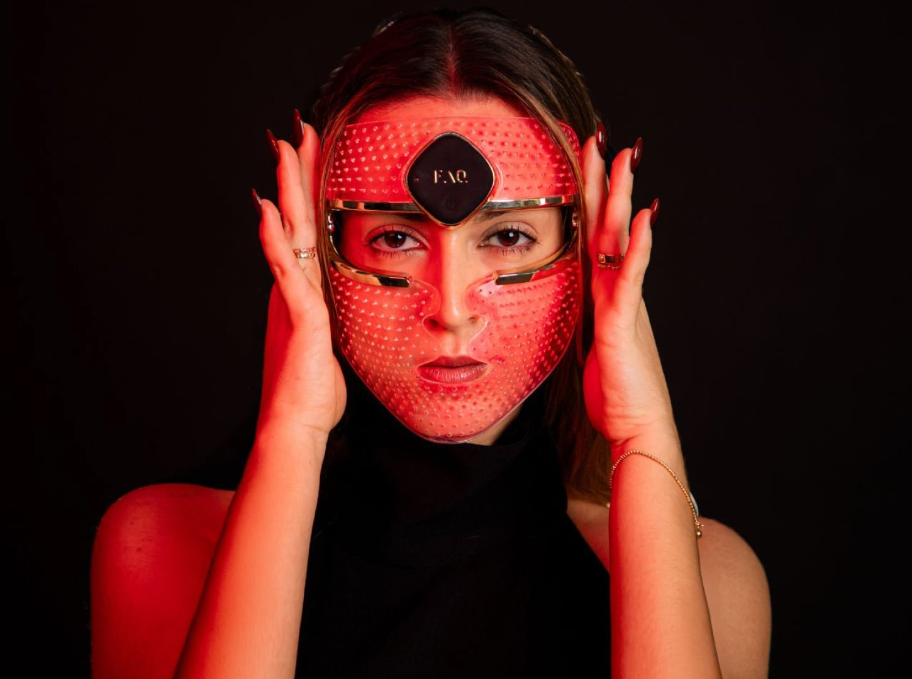 — 출처 <https://assets.central.co.th/file-assets/assets/CMS/campaign/2026/10oct/20261012_foreo_heroweb_d.jpg>
- 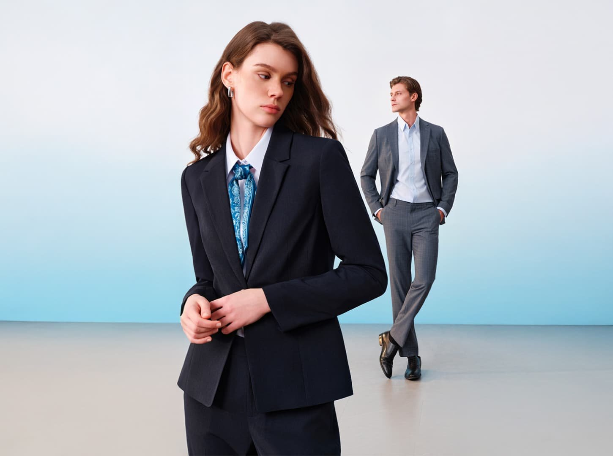 — 출처 <https://www.central.co.th/_next/image?url=https%3A%2F%2Fassets.central.co.th%2Ffile-assets%2Fassets%2FCMS%2Fcampaign%2F2026%2F10oct%2F20261015_G2000_heroweb_d.jpg&w=3840&q=75>

**페이지 메타 정보**

| page | title | description |
|---|---|---|
| [`home`](https://www.central.co.th/th) | Central Online | ลดสูงสุด 30% + คูปองลดเพิ่ม 12% | Central 79th Anniversary โปรโมชั่นสุดยิ่งใหญ่ของปี 2026 เริ่มต้นขึ้นแล้ว! พบกับสินค้าจากหลากหลายแบรนด์ดังที่เราคัดสรรมาลดราคาสูงสุดถึง 30% พ |

#### [Lazada Thailand Fashion](https://www.lazada.co.th/)

- URL: <https://www.lazada.co.th/>
- 페이지: **OK 1 · FAIL 0**

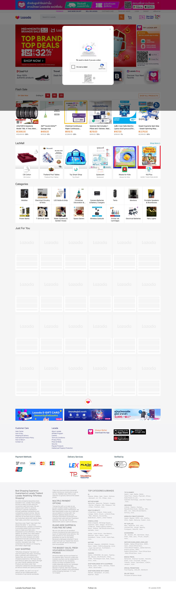

**대표 상품 이미지** (상위 6장, 출처 URL 포함)

-  — 출처 <https://img.lazcdn.com/us/domino/40845120240f19d13f738fa9a7978edd.png>
-  — 출처 <https://img.lazcdn.com/g/tps/images/ims-web/TB1KB2laMFY.1VjSZFnXXcFHXXa.png>
- 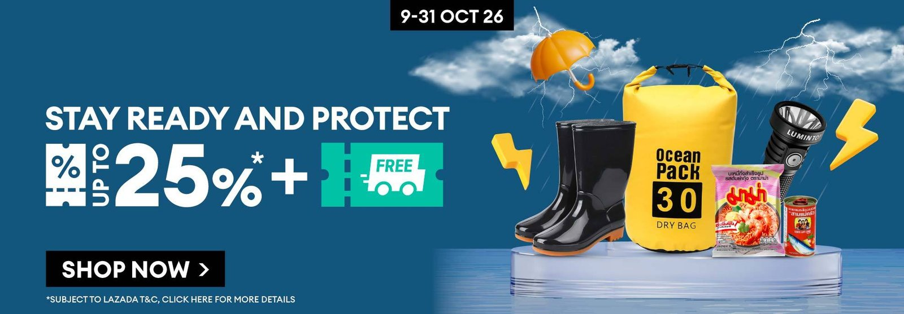 — 출처 <https://img.lazcdn.com/us/domino/56a2598c-45f9-405b-ab6d-2a3002637c54_TH-1976-688.jpg_2200x2200q80.jpg>
- 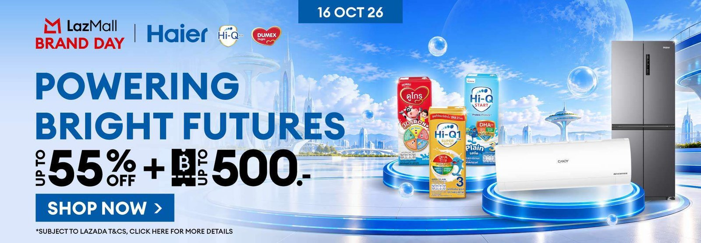 — 출처 <https://img.lazcdn.com/us/domino/8cb2694b-d4ae-4e3f-b8fe-fd2cb6447016_TH-1976-688.jpg_2200x2200q80.jpg>
-  — 출처 <https://img.lazcdn.com/us/domino/8469db2b-158e-43e6-890e-8adf3b22f1ac_TH-1976-688.jpg_2200x2200q80.jpg>
-  — 출처 <https://img.lazcdn.com/us/domino/c2213926-0d6a-4dd7-b5db-dae228116f7e_TH-1976-688.jpg_2200x2200q80.jpg>

**페이지 메타 정보**

| page | title | description |
|---|---|---|
| [`home`](https://www.lazada.co.th/#?) | Lazada Thailand | ช้อปออนไลน์ สินค้าดี พร้อมดีลพิเศษทุกวัน | พบกับ Lazada แพลตฟอร์มช้อปปิ้งชั้นนำในอาเซียน พร้อมบริการเก็บเงินปลายทาง LazMall LazFlash และดีลเด็ดจากแบรนด์ดังทุกวัน |

#### [Pomelo](https://www.pomelofashion.com/)

- URL: <https://www.pomelofashion.com/>
- 페이지: **OK 0 · FAIL 2**

**실패 페이지**

- `new` — robots_disallowed
- `best` — robots_disallowed

#### [Shopee Thailand Fashion](https://shopee.co.th/)

- URL: <https://shopee.co.th/>
- 페이지: **OK 1 · FAIL 0**

**대표 상품 이미지** (상위 6장, 출처 URL 포함)

-  — 출처 <https://deo.shopeemobile.com/shopee/shopee-pcmall-live-sg/assets/1c8bdaaf45e1fd48.png>

**페이지 메타 정보**

| page | title | description |
|---|---|---|
| [`home`](https://shopee.co.th/verify/captcha?anti_bot_tracking_id=gqRjZGVrxHSFomtptTE0MjUxOnRyYWNraW5nX2lkX2tleaJrdtEAAqRhbGdv0gAAAGSjZGVrwKJjdMRAAAAADLyQlHjbhu_tIJoVd59UO0aGI3u8EPZbMRUCgbeCPd4w23IClM5T1bD7-qxvztQnbHA8L7r5z24rbHP-k6pjaXBoZXJ0ZXh0xQOXAAAADIabvisaRwz7KZBzIDRoQ7IvURdwlNzyB0005W--DF_WGVim2xSI4botbtGyvagkguLngmMNL6uSamYrzHpp--4jS-uquGwjAV2a_2b1dd-BrXcu-2K12sQObuIeoYuyNXcW9JsbeC52qlhcs48QSeqJwPj8RF-abhedx4gkMUGqeTTh4Pm4n6nxsLHeifU9GgRJ1ST4_8lb8NUZNDI6m1nG6DWVaZc2Cyc4y54xmOQlR-huYaNqfemPFK9CkGNqfNYf1_5G-lEhKnMa7ochyCc2dMnuGdULUwvkCiad2o7U-tzeeoOS9kFTtsiYKawi7HE0edBPItUhg0T--oKT4ehX_pbXV90pFgK7BVPhrAJBzJ6QnjCKgX5NI7YErfKci5l3rxxuRP9Zb3-h1hX3bHB4SdDgnRcGXNys5pORuYZEMBUH-YpO5mgmuvAfMYmRTZSLc3it2OgXFzMCnF8pnfNne3MuH26OlOR04vVE0YmH_F4ulsZ8wzZSCKRmaYTBkeCj03NjW7CGvZVk-7JZ_kCZrFuHw2wOsSGxTaII0UJ2t-YlzsUUZruERJ1t8rk4y-OsSHb2fUr4BdJu4GNSviewCYSwFCitYWayy8voqtPZMAw2stKcrWInWpBF-fxSyowg1DhR-vkXkdOtvwdi5tDgB47-sXJLAfbTKMztDXa_59WFmG5CzvAIARKo3FHfPr1rSgW0nAQVoGNOgBWN3_5kcyL2GOkUl-CE1HZOeN0DYj4tiANGzprdWn82BwSj_eFfGMYV7njBHZ911lxXQdBv0QkzoKWdu852SBAvPbdAjR6wpMqjmfN2fWSGEN6TDykUawndH-PFzn4dMBlLY6rX_gom69nizyJz6f9dj01ngjpGlZM3x2qLa4ErrjJj9vyYvMUtGvQicpP_gOxoeQFSGR07BtZebT3ngm5YipwDo5763mg2wF8cSJwWd9hPvG0fEqaE2e237Lwbk9E8U8uav45IApvDZEuCOxb-RlIRTHIIJTsFId4wS5ZwDjYdnxMO9MemCTlMEy49F5hxFHKtdv-LFcCuXqv4Fzse3jARG5SqU7mq7HAqZ_CyWVbMAyZ915ekCTsRyDFdK37sjFq1OBgRzjHh_LJFIZuS20cNWwLcPz7sBI0WvVho5rMG1fXx6-Bw7fkRZmKGsJ6QluyU_fu6tuLyhYUNJ7mS3Bte9fRsMxH75BlE15KQ4PSghcOXzg&app_key=Recommendation.PC&client_id=1&next=https%3A%2F%2Fshopee.co.th%2Fverify%2Ftraffic%3F%3Fclient_id%3D%26next%3Dhttps%253A%252F%252Fshopee.co.th%252F%26redirect_type%3D2%26should_replace_history%3Dtrue&redirect_type=2&scene=crawler_item&should_replace_history=true) | Shopee Thailand | ช้อปปิ้งออนไลน์ ผ่านมือถือและเว็บไซต์ | ซื้อทุกอย่างที่ Shopee! ช้อปปิ้งออนไลน์จบในที่เดียว ซื้อหรือขายก็ง่ายสุดๆ มีโปรและส่วนลดเพียบ การันตีโดย Shopee | ส่งฟรีทั่วไทย | เก็บเงินปล |

#### [Zalora Thailand](https://www.zalora.co.th/)

- URL: <https://www.zalora.co.th/>
- 페이지: **OK 1 · FAIL 0**

**대표 상품 이미지** (상위 6장, 출처 URL 포함)

-  — 출처 <https://www.zalora.co.th/images/landingpage/525x500.gif>

**페이지 메타 정보**

| page | title | description |
|---|---|---|
| [`home`](https://www.zalora.co.th/) | ZALORA - ASIA'S LEADING ONLINE FASHION DESTINATION |  |

### 4.6 미국 _( United States )_

- 한국 수출규모 순위: **#1** · region: `north_america` · tier `1` · currency `USD`
- 수집 사이트: **5개** (성공 4)
- 메모: 한국 의류 최대 수출국. 대형 이커머스와 브랜드 커머스 중심
#### [Etsy](https://www.etsy.com/)

- URL: <https://www.etsy.com/>
- 페이지: **OK 2 · FAIL 0**

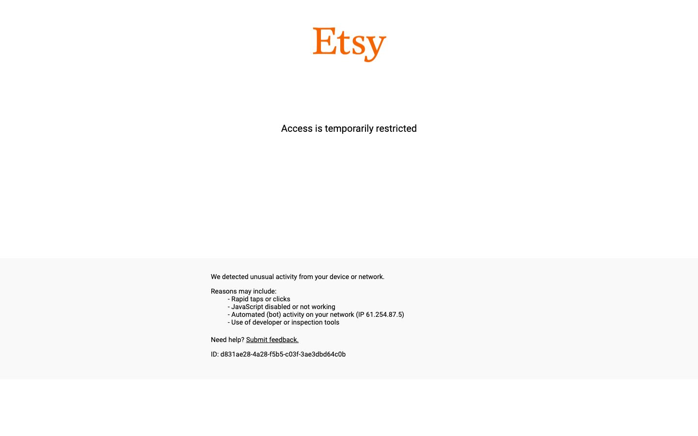

**페이지 메타 정보**

| page | title | description |
|---|---|---|
| [`trending_jewelry`](https://www.etsy.com/c/jewelry) | etsy.com |  |
| [`trending_accessories`](https://www.etsy.com/c/accessories) | etsy.com |  |

#### [Macy's](https://www.macys.com/)

- URL: <https://www.macys.com/>
- 페이지: **OK 1 · FAIL 0**

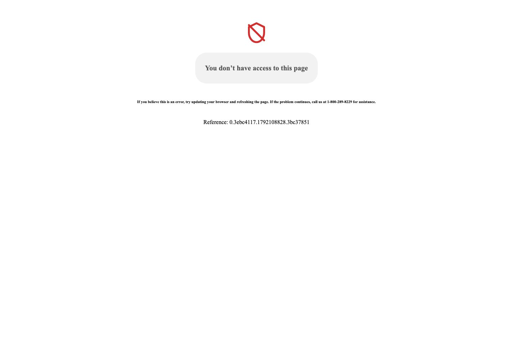

**페이지 메타 정보**

| page | title | description |
|---|---|---|
| [`new`](https://www.macys.com/shop/whats-new?id=14834) | Access Denied - Macy's | Access denied 403 |

#### [Nordstrom](https://www.nordstrom.com/)

- URL: <https://www.nordstrom.com/>
- 페이지: **OK 2 · FAIL 0**

**대표 상품 이미지** (상위 6장, 출처 URL 포함)

-  — 출처 <https://n.nordstrommedia.com/it/7f51c20a-b069-4154-9cfb-1e6d13a7c608.gif>
-  — 출처 <https://n.nordstrommedia.com/is/image/nordstrom/MENS_OUT02F_1026_V2_0030.jpeg?width=240&dpr=2&crop=4829.76%3A6037.2%2Coffset-x68.314%2Coffset-y50&trim=0.05%2C0%2C0.073%2C0>
- 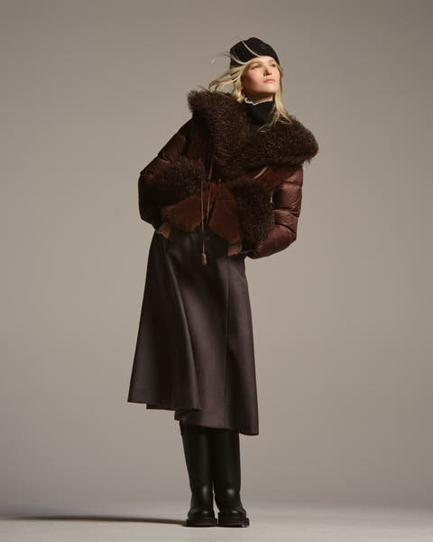 — 출처 <https://n.nordstrommedia.com/is/image/nordstrom/DESW_APP15F_0926_0409_altBgd_ext.jpeg?width=240&dpr=2&crop=3855.488%3A4819.36%2Coffset-x47.781%2Coffset-y50&trim=0.173%2C0%2C0%2C0>
-  — 출처 <https://n.nordstrommedia.com/is/image/nordstrom/KIDS_LB01F_1026_v2_0021.jpeg?width=240&dpr=2&crop=5504%3A6880%2Coffset-x83.75%2Coffset-y50>
-  — 출처 <https://n.nordstrommedia.com/is/image/nordstrom/BEA_MKUP04P_1026.jpeg?width=240&dpr=2&crop=6425.6%3A8032%2Coffset-x50%2Coffset-y50>
- 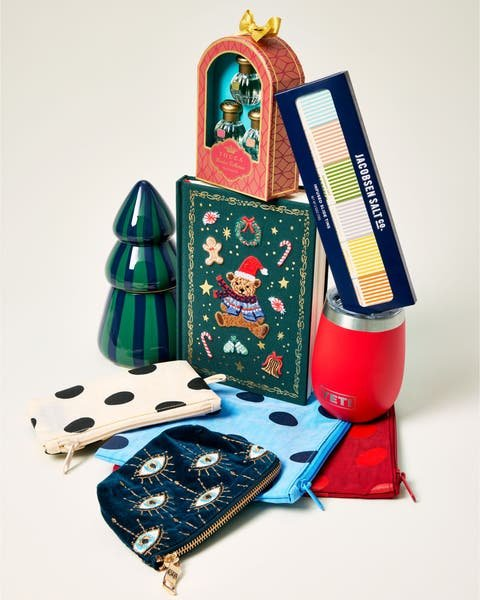 — 출처 <https://n.nordstrommedia.com/is/image/nordstrom/ACC_HDBG03P_1026_V1.jpeg?width=240&dpr=2&crop=5356%3A6695%2Coffset-x50%2Coffset-y43.974>

**페이지 메타 정보**

| page | title | description |
|---|---|---|
| [`new`](https://www.nordstrom.com/browse/new) | New & Now | Nordstrom | Shop a great selection of New Arrivals at Nordstrom.com. Top brands. New trends. |
| [`women`](https://www.nordstrom.com/browse/women) | Women's Clothing, Shoes, & Accessories | Nordstrom | Find a great selection of Women's Clothing, Shoes, & Accessories at Nordstrom.com. Shop popular brands and top designers. |

#### [Revolve](https://www.revolve.com/)

- URL: <https://www.revolve.com/>
- 페이지: **OK 0 · FAIL 2**

**실패 페이지**

- `new` — playwright_error: Error: Page.goto: net::ERR_HTTP2_PROTOCOL_ERROR at https://www.revolve.com/new/br/c79f88/
Call log:
  - navigating to "https://www.revolve.com/new/br/c79f88/", waiting until "domcontentloaded"

- `trending` — playwright_error: Error: Page.goto: net::ERR_HTTP2_PROTOCOL_ERROR at https://www.revolve.com/most-loved/br/4a9ca5/
Call log:
  - navigating to "https://www.revolve.com/most-loved/br/4a9ca5/", waiting until "domcontentloaded"

#### [Urban Outfitters](https://www.urbanoutfitters.com/)

- URL: <https://www.urbanoutfitters.com/>
- 페이지: **OK 1 · FAIL 0**

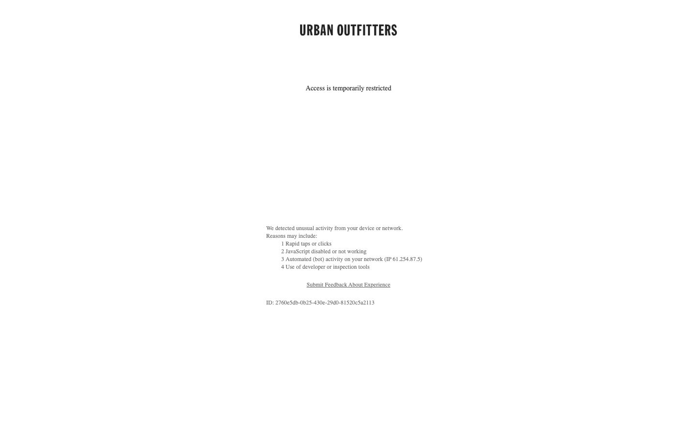

**페이지 메타 정보**

| page | title | description |
|---|---|---|
| [`new_women`](https://www.urbanoutfitters.com/womens-new-arrivals) | urbanoutfitters.com |  |

### 4.7 베트남 _( Vietnam )_

- 한국 수출규모 순위: **#4** · region: `asia` · tier `1` · currency `VND`
- 수집 사이트: **5개** (성공 5)
- 메모: 의류 생산기지/원단 수출 비중 큼. 빠르게 성장하는 이커머스
#### [Canifa](https://canifa.com/)

- URL: <https://canifa.com/>
- 페이지: **OK 1 · FAIL 0**

**대표 상품 이미지** (상위 6장, 출처 URL 포함)

-  — 출처 <https://2885371169.e.cdneverest.net/Simiconnector/BannerSlider/m/o/modelkid_topbanner_desktop-091026.webp>
-  — 출처 <https://2885371169.e.cdneverest.net/Simiconnector/BannerSlider/c/n/cnfcamon_topbanner_desktop-141026.webp>
- 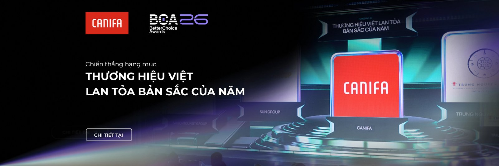 — 출처 <https://2885371169.e.cdneverest.net/Simiconnector/BannerSlider/b/c/bca_topbanner_desktop-091026.webp>
- 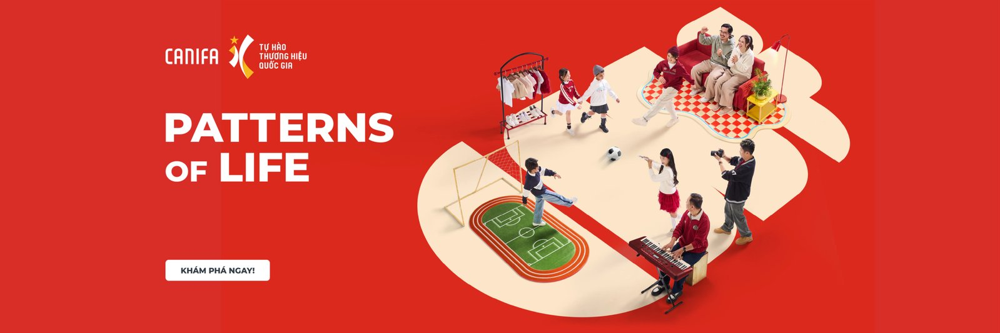 — 출처 <https://2885371169.e.cdneverest.net/Simiconnector/BannerSlider/p/a/pattern-of-life_topbanner_desk-051026.webp>
- 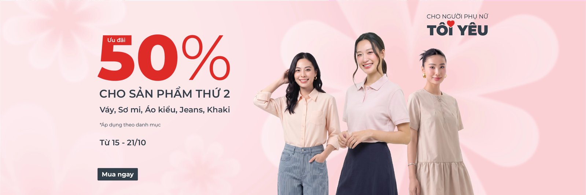 — 출처 <https://2885371169.e.cdneverest.net/Simiconnector/BannerSlider/h/a/happyweek_topbanner_desktop-141026.webp>
-  — 출처 <https://canifa.com/_nuxt/img/chatbot-icon.c84d6ec.webp>

**페이지 메타 정보**

| page | title | description |
|---|---|---|
| [`home`](https://canifa.com/) | CANIFA | Fashion For All | CANIFA - thương hiệu thời trang hàng đầu Việt Nam. Hàng ngàn mẫu quần áo phụ kiện nam, nữ, trẻ em cao cấp, chất lượng, an toàn liên tục được |

#### [IVY moda](https://ivymoda.com/)

- URL: <https://ivymoda.com/>
- 페이지: **OK 1 · FAIL 0**

**대표 상품 이미지** (상위 6장, 출처 URL 포함)

-  — 출처 <https://cotton4u.vn/files/news/2026/10/14/0587fa6e43eed3d6a596f3df4cb007bf.webp>
-  — 출처 <https://cotton4u.vn/files/news/2026/10/14/839870b6bb9a68439a2e1c689b67defe.webp>
-  — 출처 <https://cotton4u.vn/files/news/2026/09/26/470fbfc7cf5488f4162c15acfbb4b6ee.webp>
-  — 출처 <https://cotton4u.vn/files/news/2026/10/05/9f75481224001830953edc5297b8bced.webp>
-  — 출처 <https://cotton4u.vn/files/product/thumab/400/2026/10/10/38f06d98332f6a08ed0ced48e18734a0.webp>
-  — 출처 <https://cotton4u.vn/files/product/thumab/400/2026/10/10/51b08549d87263e096c827bcf7b1c7bb.webp>

**페이지 메타 정보**

| page | title | description |
|---|---|---|
| [`home`](https://ivymoda.com/) | IVY moda - Thời Trang Công Sở Hiện Đại | IVY moda |  |

#### [Lazada Vietnam](https://www.lazada.vn/)

- URL: <https://www.lazada.vn/>
- 페이지: **OK 1 · FAIL 0**

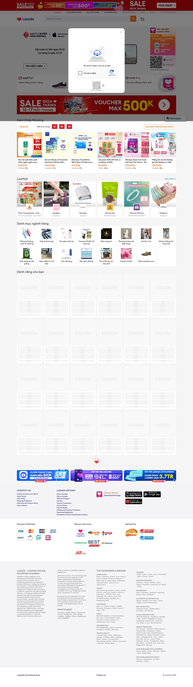

**대표 상품 이미지** (상위 6장, 출처 URL 포함)

-  — 출처 <https://img.lazcdn.com/us/domino/2ad4f22ce5a43dc145f221d13feed352.png>
-  — 출처 <https://img.lazcdn.com/g/tps/images/ims-web/TB1T7K2d8Cw3KVjSZFuXXcAOpXa.png>
- 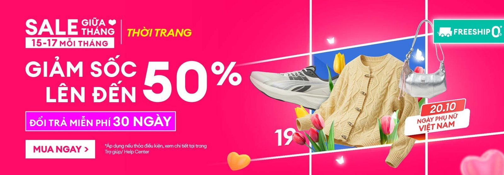 — 출처 <https://img.lazcdn.com/us/domino/86869393-6c79-47fc-83db-c60b12dc7650_VN-1976-688.jpg_2200x2200q80.jpg>
- 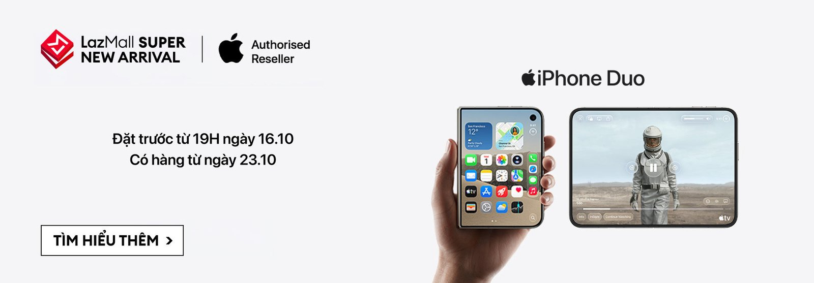 — 출처 <https://img.lazcdn.com/us/domino/fc8d228b-1bc4-4b22-ab8c-ef2a4d015944_VN-1976-688.jpg_2200x2200q80.jpg>
- 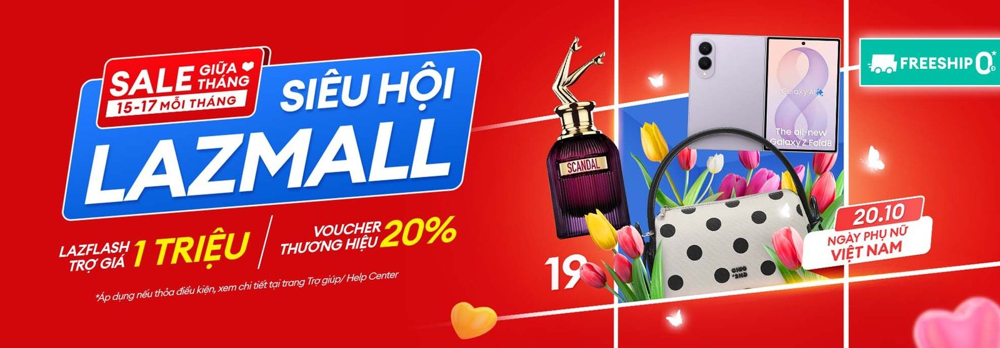 — 출처 <https://img.lazcdn.com/us/domino/23b05cb2-545f-48a1-9890-9ee92942e46c_VN-1976-688.jpg_2200x2200q80.jpg>
- 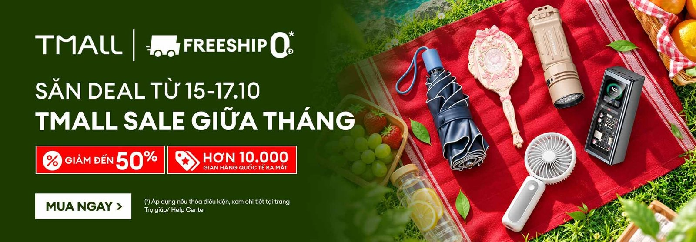 — 출처 <https://img.lazcdn.com/us/domino/5c809db2-f2e4-41e9-9ffa-a158034a4c6f_VN-1976-688.jpg_2200x2200q80.jpg>

**페이지 메타 정보**

| page | title | description |
|---|---|---|
| [`home`](https://www.lazada.vn/#?) | Lazada Việt Nam | Mua Sắm Online, Giá Tốt Nhất Mỗi Ngày | Mua sắm đồ điện tử, thời trang, làm đẹp và đồ chơi giá cả phải chăng. Đảm bảo sản phẩm chính hãng và trải nghiệm mua sắm tiện lợi – mua ngay |

#### [Shopee Vietnam](https://shopee.vn/)

- URL: <https://shopee.vn/>
- 페이지: **OK 1 · FAIL 0**

**페이지 메타 정보**

| page | title | description |
|---|---|---|
| [`home`](https://shopee.vn/verify/captcha?anti_bot_tracking_id=gqRjZGVrxHSFomtptTE0MjUxOnRyYWNraW5nX2lkX2tleaJrdtEAAqRhbGdv0gAAAGSjZGVrwKJjdMRAAAAADLyQlHjbhu_tIJoVd59UO0aGI3u8EPZbMRUCgbeCPd4w23IClM5T1bD7-qxvztQnbHA8L7r5z24rbHP-k6pjaXBoZXJ0ZXh0xQODAAAADAiOc2FUhxHFd4uZmETYYhsu4L8GI2pRSfopnc3RbUuMDEzstvag-c8XCcv9xUIUUbBSpgxiXinNuueOthw7DCs9Qqrj4XZ9axL5hH6nGFlslx4oRTeOBW56luDSNG7t7MC4YL2USfYNNMiXBwDbAzH97B-qn8oSz3hk5an-0eFI2himOy3O4Xm8fZey5M2KtqEOQfPokSZW1ug1l0stjG3JJTfnS3jx1W5JIzL-ZhISOeasbduvXdMf3mAEjo3tj_gu7pZ3rEvUfDFwYDdq6Yj1HUG3VGpm7SeTe0D3N-OrWuI2Hwm0pEny6e5AyVSNLROszph38taoF_EVMmCNR0_oq01kQs0kBsdsNy2FM7JPK7jRM7krQjLIz6U2-ulcciLBiwCzTgi56qI1zqdy6Jsa0XtdiA2c3-SiOctt2czL6fX1Pfg6_V0ExtYp5TLx_s6wnO-cbY6aRk_r1SVEWCwFs5HR1zqxu35NFatz4zwcsySVODMoT8KNJz9H-AQwM2euqCM8A_fVrs6MKxHppRQS86aNpDI4q9BdLcdDnS-Kw10LFd06fOWVLOEdH-Or56Iq2eqX4KyRqErPUWDHCfW2d5MdvHlpmB9ceyzT3bNpFJHV6O-kMuflf7bLGd2WuPr30IJHkrvfBy50NWF8GfgYmserAAmFIcfiZVaJMf2JbKU1r4lClNoFuorhNHY8A9tlVdrIpSgoAoJ83DirroHWHSINAtUk-avoIub7TbBymXiZgwig_twN1mpT6UnUP15S-iP123iAZafxCtO5KTX0t5jvWfUU3mDD087qjifYPXHU8B15tujUEagJalywKZDqnB9Vn9vslDKNtQJlqnC9erDp6oQTIpRLaVmUt1NCGPOCJRMS_YkJyaEoypRc-pFCeRKQdw4K0krELkSAcfnrAMq5P7i3RBFmdoFpPuR6DOt7Edf3kNJU7ElaV_9J4jxXIkW_bMLy3-jsFT2P29EjXnBqrSFpwAo2v_7LthjoCXEtH-olTcNw97oWcig6UgyOOjTtpijm3KjiwcJXlh2Re1wZxpUZCOYu8LUmDSFcm7zf7QzLZCuyhKkVWeGXXds3Dln_hQeR2ES-wqlf_DdqAM91s4XL5pa_hKJqvhg6piXP0feQVqYe8udkkgjrNgF2gBCEIiZzKjhIP3Zbd2PoLHSSw3853PJdJIxG3-k&app_key=FlashSale.PC&client_id=1&next=https%3A%2F%2Fshopee.vn%2Fverify%2Ftraffic%3F%3Fclient_id%3D%26next%3Dhttps%253A%252F%252Fshopee.vn%252F%26redirect_type%3D2%26should_replace_history%3Dfalse&redirect_type=2&scene=crawler_item&should_replace_history=false) | Shopee Việt Nam | Mua Sắm Online | Mua sắm trực tuyến hàng triệu sản phẩm ở tất cả ngành hàng. Giá tốt & Miễn phí vận chuyển. Mua và bán online trong 30 giây. Voucher Xtra | F |

#### [Tiki](https://tiki.vn/)

- URL: <https://tiki.vn/>
- 페이지: **OK 1 · FAIL 0**

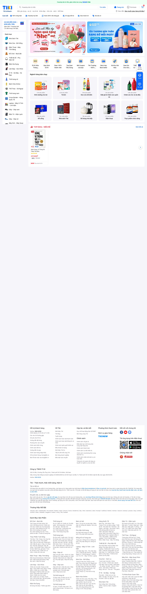

**대표 상품 이미지** (상위 6장, 출처 URL 포함)

- 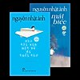 — 출처 <https://salt.tikicdn.com/cache/100x100/ts/category/ed/20/60/afa9b3b474bf7ad70f10dd6443211d5f.png>
-  — 출처 <https://salt.tikicdn.com/cache/100x100/ts/category/f6/22/46/7e2185d2cf1bca72d5aeac385a865b2b.png>
-  — 출처 <https://salt.tikicdn.com/cache/100x100/ts/category/54/c0/ff/fe98a4afa2d3e5142dc8096addc4e40b.png>
-  — 출처 <https://salt.tikicdn.com/cache/100x100/ts/category/13/64/43/226301adcc7660ffcf44a61bb6df99b7.png>
-  — 출처 <https://salt.tikicdn.com/cache/100x100/ts/category/75/34/29/78e428fdd90408587181005f5cc3de32.png>
-  — 출처 <https://salt.tikicdn.com/cache/100x100/ts/category/61/d4/ea/e6ea3ffc1fcde3b6224d2bb691ea16a2.png>

**페이지 메타 정보**

| page | title | description |
|---|---|---|
| [`home`](https://tiki.vn/) | Tiki - Mua hàng online giá tốt, hàng chuẩn, ship nhanh | Tiện lợi mua sắm hàng triệu mặt hàng, dịch vụ. Vô vàn ưu đãi freeship, mã giảm giá. Hoàn tiền 15% tối đa 600k/tháng với thẻ tín dụng TikiCAR |

## 5. 의류 카테고리별 글로벌 트렌드

| # | 카테고리 | 건수 | 대표 상품명 |
|---:|---|---:|---|
| 1 | `니트` | 15 | [단독]캐시미어 딥 브이넥 니트 / CASHMERE DEEP V-NECK KNIT_5colors · 울 블렌드 롱 슬리브 니트 탑 / WOOL BLEND LONG-SLEEVE KNIT TOP_4colors · [단독]캐시미어 에센셜 브이넥 니트 / CASHMERE ESSENTIAL V-NECK KNIT_6colors |
| 2 | `자켓` | 12 | [핏더사이즈 콜라보] 플라이트 자켓 카키 · [핏더사이즈 콜라보] 플라이트 자켓 네이비 · [3차 리오더] 소이 울 싱글 자켓_차콜 헤링본 / SOY WOOL SINGLE JACKET_CHARCOAL HERRINGBONE |
| 3 | `팬츠` | 11 | [SET] 스트라이프 믹스 가디건 & 팬츠 셋업 네이비 MDPJ006NAVY · [핏더사이즈 콜라보] USAFA 퍼티그 팬츠 올리브 그린 · 101 에센셜 스트레이트 데님 팬츠 / 101 ESSENTIAL STRAIGHT DENIM PANTS_2colors |
| 4 | `블라우스` | 5 | 스카프 카울 넥 블라우스_아이보리 / SCARF COWL NECK BLOUSE_IVORY · [3차 리오더] 제인 타이 블라우스_그레이 / JANE TIE BLOUSE_GREY · 오픈 넥 스트라이프 블라우스_화이트 / OPEN NECK STRIPE BLOUSE_WHITE |
| 5 | `셔츠` | 5 | 울 더블 레이어드 롱 슬리브 티셔츠_라이트 그레이 / WOOL DOUBLE-LAYERED LONG SLEEVE T-SHIRT_LIGHT GREY · [✨매일입어요] made. 솔트 클린 긴팔티셔츠 (스탠다드핏/루즈핏) - 6 color · [15만장돌파🏆/+반팔/made] 코튼 스판 베이직 긴팔티셔츠 (라운드넥/유넥) |
| 6 | `hoodie` | 4 | Pigment Noon Hoodie Zip-Up (2 Colors) · Dusty Raglan Hoodie_Dusty Blue · Dusty Raglan Hoodie_Melange Gray |
| 7 | `스커트` | 4 | [6차 리오더]키라 플리츠 스커트 / KYRA PLEATS SKIRT_2colors · 오웬 랩 스커트 팬츠 / OWEN WRAP SKIRT PANTS_2colors · [9차 리오더][W단독]릴리 에이치라인 미디 스커트 / LILY H-LINE MIDI SKIRT_3colors |
| 8 | `코트` | 4 | [6차 리오더]리앤 울 핸드메이드 하프 코트 / LEANNE WOOL HANDMADE HALF COAT_4colors · 울 핸드메이드 드레이프 하이넥 하프 코트 / WOOL HANDMADE DRAPE HIGH NECK HALF COAT_3colors · [울70] 핸드메이드 하이넥 숏코트_MIWJHGV31B |
| 9 | `jacket` | 3 | AUTHENTIC TRENCH SUEDE JACKET (BROWN) · AUTHENTIC TRENCH LEATHER JACKET (BLACK) · AUTHENTIC TRENCH JACKET (CHARCOAL) |
| 10 | `슬랙스` | 3 | [🍁가을/3기장선택!] made. 모먼트 투커버 올데이슬랙스 (+숏/베이직/롱ver) - 4 size · [🏆역대급100만장/3기장선택!] made. 마켓 와이드 트레이닝슬랙스 (+숏/베이직/롱ver) - 4 size · [누적65만장] WONT 어텀 핀턱 슬랙스 (미니,숏,롱,맥시ver) |

**국가별 의류 TOP**

- **korea**: `니트`(15), `자켓`(12), `팬츠`(11), `블라우스`(5), `셔츠`(5)
## 6. 악세사리 카테고리별 글로벌 트렌드

| # | 카테고리 | 건수 | 대표 상품명 |
|---:|---|---:|---|
| 1 | `크로스백` | 1 | 헤어리 퍼 미니 크로스백 아이보리 MDBG014IVORY |
| 2 | `부츠` | 1 | [5차 리오더] 알렉스 롱부츠_블랙 / ALEX LONG BOOTS_BLACK |

**국가별 악세사리 TOP**

- **korea**: `크로스백`(1), `부츠`(1)
## 7. 국가별 가격대 비교

| 국가 | 통화 | 표본 | min | p25 | median | p75 | max | median (USD) |
|---|---|---:|---:|---:|---:|---:|---:|---:|
| korea | KRW | 110 | 12640 | 29138 | 61100 | 102125 | 639090 | 45.6 |

> p25/p75 는 IQR 기준 분위수. USD 환산은 `config/exchange_rates.yaml` 기준 (운영자가 정기 갱신).

## 8. 국내 의류·악세사리 사업동향

### KITA K-stat

- 한국무역통계의 국가 수출입 통계 총괄 페이지입니다.
- 사이트: <https://stat.kita.net/stat/kts/ctr/CtrTotalImpExpList.screen>

| # | topic | title | url |
|---:|---|---|---|
| 1 | `trade` | KITA.NET | <https://www.kita.net/> |
| 2 | `trade` | K-stat 란? | <https://www.kita.net/pdf/statGuide/index.html#p=1> |
| 3 | `무역통계` | 무역통계 분류 | <https://stat.kita.net/stat/guide/guide_18_01.screen> |
| 4 | `trade` | 한국품목코드 | <https://stat.kita.net/stat/kts/statCode/ItemHierCodeList.screen> |
| 5 | `trade` | 해외품목코드 | <https://stat.kita.net/stat/istat/common/IstatHSCode.screen> |
| 6 | `trade` | 대륙/경제코드 | <https://stat.kita.net/stat/kts/statCode/ConEcoCodeList.screen> |
| 7 | `trade` | 수출입 총괄 | <https://stat.kita.net/stat/kts/sum/SumImpExpTotalList.screen> |
| 8 | `trade` | 가공단계 수출입 | <https://stat.kita.net/stat/kts/use/BecList.screen> |
| 9 | `trade` | 품목 수출입 | <https://stat.kita.net/stat/kts/pum/ItemImpExpList.screen> |
| 10 | `trade` | 국가 수출입 | <https://stat.kita.net/stat/kts/ctr/CtrTotalImpExpList.screen> |
| 11 | `trade` | 대륙/경제권 수출입 | <https://stat.kita.net/stat/kts/rel/RelColligationList.screen> |
| 12 | `trade` | 지자체 수출입 | <https://stat.kita.net/stat/kts/prod/ProdWholeList.screen> |
| 13 | `trade` | 항구/공항 수출입 | <https://stat.kita.net/stat/kts/port/PortImpExpList.screen> |
| 14 | `trade` | FTA체결국 수출입 | <https://stat.kita.net/stat/kts/fta/FtaCtrImpExpList.screen> |
| 15 | `trade` | 간접수출 현황 | <https://stat.kita.net/stat/ind/KtsIndMain.screen> |

### Korea Customs Service

- 수출입 현황, 물류통계 등 관세청 무역통계정보를 종합적으로 제공
- 사이트: <https://tradedata.go.kr/cts/index_eng.do>

| # | topic | title | url |
|---:|---|---|---|
| 1 | `trade` | Korea Customs Service | <http://customs.go.kr/english/main.do> |

### KOSIS

- 코시스, 국가데이터처가 제공하는 원스톱 통계 서비스, 국가승인통계, 국제통계, 북한통계, e-지방지표, 통계시각화콘텐츠, 온라인간행물 등 제공
- 사이트: <https://kosis.kr/statisticsList/statisticsListIndex.do?parmTabId=M_01_01&vwcd=MT_ZTITLE&menuId=M_01_01&outLink=Y&entrType=>

| # | topic | title | url |
|---:|---|---|---|
| 1 | `statistics` | 쉽게 보는 통계 | <http://kosis.kr/easyViewStatis/customStatisIndex.do?vwcd=MT_TM1_TITLE&menuId=M_03_01> |
| 2 | `statistics` | 이슈별 접근 | <http://kosis.kr/easyViewStatis/customStatisIndex.do?vwcd=MT_TM2_TITLE&menuId=M_03_02> |
| 3 | `statistics` | 통계시각화콘텐츠 | <http://kosis.kr/easyViewStatis/visualizationIndex.do> |
| 4 | `statistics` | 온라인간행물 | <http://kosis.kr/publication/publicationThema.do> |
| 5 | `statistics` | 기획간행물 | <http://kosis.kr/publication/publicationStat.do> |
| 6 | `statistics` | KOSIS 길라잡이 | <http://kosis.kr/civilComplaint/kosisGuideIndex.do> |
| 7 | `statistics` | 홈페이지 개선의견 | <http://kosis.kr/civilComplaint/siteRequestList.do> |
| 8 | `statistics` | 찾아가는 KOSIS | <http://kosis.kr/civilComplaint/kosisEduIndex.do> |
| 9 | `statistics` | 서비스 소개 | <http://kosis.kr/serviceInfo/kosisIntroduce.do> |
| 10 | `statistics` | 국가통계현황 | <http://kosis.kr/serviceInfo/statisInstitution.do> |
| 11 | `statistics` | 국가통계 공표일정 | <http://kosis.kr/serviceInfo/statisPublicationList.do> |
| 12 | `statistics` | 팩트체크 서비스 | <http://kosis.kr/serviceInfo/factCheckList.do> |
| 13 | `statistics` | 서비스정책 | <http://kosis.kr/serviceInfo/useGuide.do> |
| 14 | `statistics` | 공유서비스 (OpenAPI) | <http://kosis.kr/serviceInfo/openAPIGuide.do> |
| 15 | `statistics` | English | <https://kosis.kr/eng> |

### KOTRA

- 트라이빅(TriBig)은 코트라(KOTRA)가 제공하는 무역투자 빅데이터 플랫폼으로 무역투자통계, 국가별 시장정보, 품목별 유망시장, 기업별 맞춤정보, 해외바이어 정보의 서비스를 제공합니다.
- 사이트: <https://www.kotra.or.kr/bigdata/visualization/korea#search/ALL/ALL/2024>

| # | topic | title | url |
|---:|---|---|---|
| 1 | `trade` | kotra 무역투자24 | <https://www.kotra.or.kr/bigdata/kotraSsoRedirect?targetURL=https://www.kotra.or.kr> |
| 2 | `trade` | 해외비즈니스 정보 포털 | <https://www.kotra.or.kr/bigdata/kotraSsoRedirect?targetURL=https://dream.kotra.or.kr/dream> |
| 3 | `trade` | 글로벌 전시포털 | <https://www.kotra.or.kr/bigdata/kotraSsoRedirect?targetURL=https://www.gep.or.kr/> |
| 4 | `trade` | KOTRA 해외인재유치센터 | <https://www.kotra.or.kr/gtc_kor> |
| 5 | `trade` | 투자유치정보제공 | <https://www.kotra.or.kr/bigdata/kotraSsoRedirect?targetURL=https://www.investkorea.org/> |
| 6 | `수출지원` | 수출지원 온라인 플랫폼 | <https://www.kotra.or.kr/bigdata/kotraSsoRedirect?targetURL=https://www.buykorea.or.kr/> |
| 7 | `trade` | 빅데이터 서비스 | <https://www.kotra.or.kr/bigdata/> |
| 8 | `trade` | 경제외교 활용포털 | <https://www.kotra.or.kr/bigdata/kotraSsoRedirect?targetURL=https://president.globalwindow.org> |
| 9 | `trade` | 방산물자교역지원센터 | <https://www.kotra.or.kr/bigdata/kotraSsoRedirect?targetURL=https://www.kotra.or.kr/kodits> |
| 10 | `trade` | 외투기업고충처리 | <https://www.kotra.or.kr/bigdata/kotraSsoRedirect?targetURL=https://ombudsman.kotra.or.kr/ob-kr> |
| 11 | `trade` | 수출바우처 · 지사화 | <https://www.exportvoucher.com> |
| 12 | `trade` | 무역투자통계 | <https://www.kotra.or.kr/bigdata/visualization/korea> |
| 13 | `trade` | 국가별 시장정보 | <https://www.kotra.or.kr/bigdata/marketAnalysis> |
| 14 | `trade` | 품목별 유망시장 | <https://www.kotra.or.kr/bigdata/bhrcMarket> |
| 15 | `trade` | 해외바이어 정보 | <https://www.kotra.or.kr/bigdata/partner/search> |

### Statistics Korea Online Shopping

- 국가데이터처,List | 전체 | 보도자료 | 새소식
- 사이트: <https://mods.go.kr/board.es?mid=a10301010000&bid=11789>

| # | topic | title | url |
|---:|---|---|---|
| 1 | `statistics` | 정보공개제도 | <https://mods.go.kr/menu.es?mid=a10101010100> |
| 2 | `statistics` | 정보공개청구 | <https://www.open.go.kr/com/main/mainView.do> |
| 3 | `statistics` | 비공개대상정보세부기준 | <https://mods.go.kr/menu.es?mid=a10101030000> |
| 4 | `statistics` | 고객수요분석 | <https://mods.go.kr/menu.es?mid=a10101040000> |
| 5 | `statistics` | 사전정보공표 | <https://mods.go.kr/menu.es?mid=a10103010000> |
| 6 | `statistics` | 사전정보공표목록 | <https://mods.go.kr/menu.es?mid=a10103010100> |
| 7 | `statistics` | 핵심단어목록 | <https://mods.go.kr/menu.es?mid=a10103020100> |
| 8 | `statistics` | 인기정보TOP10 | <https://mods.go.kr/menu.es?mid=a10103030100> |
| 9 | `statistics` | 행정자료실 | <https://mods.go.kr/menu.es?mid=a10104010000> |
| 10 | `statistics` | 업무추진비 | <https://mods.go.kr/menu.es?mid=a10104010100> |
| 11 | `statistics` | 국회관련정보 | <https://mods.go.kr/menu.es?mid=a10104040000> |
| 12 | `statistics` | 정책실명제 | <https://mods.go.kr/menu.es?mid=a10105010000> |
| 13 | `statistics` | 연도별대상사업현황 | <https://mods.go.kr/menu.es?mid=a10105020000> |
| 14 | `statistics` | 중점관리대상사업 | <https://mods.go.kr/menu.es?mid=a10105030600> |
| 15 | `statistics` | 국민신청실명제 | <https://mods.go.kr/menu.es?mid=a10105040000> |

### 기업마당

- 기업마당>정책정보>지원사업 공고
- 사이트: <https://www.bizinfo.go.kr/sii/siia/selectSIIA200View.do?null>

| # | topic | title | url |
|---:|---|---|---|
| 1 | `policy` | 지원사업 공고 | <https://www.bizinfo.go.kr/sii/siia/selectSIIA200View.do> |
| 2 | `policy` | 품목별 법정의무 인증제도 | <https://www.bizinfo.go.kr/biz/biza/selectBIZA100View.do> |
| 3 | `policy` | 입법·행정예고/고시 | <https://www.bizinfo.go.kr/biz/biza/selectBIZA300View.do> |
| 4 | `policy` | 월간 중기누리 | <https://www.bizinfo.go.kr/biz/biza/selectBIZA400View.do> |
| 5 | `policy` | 기업업무용 서식 | <https://www.bizinfo.go.kr/biz/bizb/selectBIZB100View.do> |
| 6 | `policy` | 입주기업 모집공고 | <https://www.bizinfo.go.kr/biz/bizb/selectBIZB200View.do> |
| 7 | `policy` | 온라인화상회의실 | <https://www.k-startup.go.kr/web/contents/webOLNIVIDEOMTRM.do> |
| 8 | `policy` | 정책정보 개방 | <https://www.bizinfo.go.kr/apiList.do> |
| 9 | `policy` | 속보성 대시보드 | <https://www.bizinfo.go.kr/dashboard.do> |
| 10 | `policy` | 고객의 소리 | <https://www.bizinfo.go.kr/biz/bizc/selectBIZC200Regist.do> |
| 11 | `policy` | 자주하는질문 | <https://www.bizinfo.go.kr/biz/bizc/selectBIZC300View.do> |
| 12 | `policy` | 이메일주소 무단 수집 거부안내 | <https://www.bizinfo.go.kr/biz/bizd/selectBIZD110View.do> |
| 13 | `policy` | 저작권 정책 | <https://www.bizinfo.go.kr/biz/bizd/selectBIZD120View.do> |
| 14 | `policy` | 웹접근성 정책 | <https://www.bizinfo.go.kr/biz/bizd/selectBIZD130View.do> |
| 15 | `policy` | 전체메뉴보기 | <https://www.bizinfo.go.kr/sitemap/intro.do> |

### 서울경제진흥원

- 서울경제진흥원 에러페이지
- 사이트: <https://www.sba.seoul.kr/Pages/error_404.html?aspxerrorpath=/Pages/NSub06_01.aspx>

### 소상공인24

- 소상공인24는 소상공인시장진흥공단이 운영하는 소상공인 지원사업 통합 플랫폼입니다. 소진공·지방정부·유관기관 지원사업 공고 조회와 신청, 대출상품 조회, 증명서 발급, 소상공인 통계를 한 곳에서 이용할 수 있습니다.
- 사이트: <https://www.sbiz24.kr/#/pbanc>

| # | topic | title | url |
|---:|---|---|---|
| 1 | `policy` | 지원사업 소개 | <https://www.sbiz24.kr/#/cmmn/gnrl/Conts/7> |
| 2 | `policy` | 소진공 지원사업 공고조회 및 신청 | <https://www.sbiz24.kr/#/pbanc> |
| 3 | `policy` | 지방정부 지원사업 공고조회 및 신청 | <https://www.sbiz24.kr/#/lcgPbanc> |
| 4 | `policy` | 유관기관 지원사업 공고조회 | <https://www.sbiz24.kr/#/extldPbanc> |
| 5 | `policy` | 대출상품 조회 | <https://www.sbiz24.kr/#/loanProduct> |
| 6 | `policy` | 지원사업 상담 | <https://www.sbiz24.kr/#/qna> |

### 중소벤처기업부

- 중소기업중앙회 등 기관 중소기업 조사, 통계 DB화 검색, 내려받기 등 제공.
- 사이트: <https://www.mss.go.kr/site/smba/ex/bbs/List.do?cbIdx=86>

| # | topic | title | url |
|---:|---|---|---|
| 1 | `policy` | 어린이 누리집 | <https://www.mss.go.kr/site/kids/main.do> |
| 2 | `policy` | English | <https://www.mss.go.kr/site/eng/main.do> |
| 3 | `policy` | 누리집 안내지도 | <https://www.mss.go.kr/site/smba/ex/siteMap/siteMap.do> |
| 4 | `policy` | 훈령/예규/고시/공고 | <https://www.mss.go.kr/site/smba/ex/bbs/List.do?cbIdx=125&ext6=Y> |
| 5 | `policy` | 입법/행정예고 | <https://www.mss.go.kr/site/smba/ex/bbs/List.do?cbIdx=126&searchRltnYn=Y> |
| 6 | `policy` | 인사·채용 | <https://www.mss.go.kr/site/smba/ex/bbs/List.do?cbIdx=82> |
| 7 | `policy` | 보도설명자료 | <https://www.mss.go.kr/site/smba/ex/bbs/List.do?cbIdx=87> |
| 8 | `policy` | 현장속으로 | <https://www.mss.go.kr/site/smba/brdcststnVod/brdcststnVodList.do?ctgr_code=C01> |
| 9 | `policy` | 중기부소식지 | <https://www.mss.go.kr/site/smba/ex/bbs/List.do?cbIdx=95> |
| 10 | `policy` | 통계발표자료 | <https://www.mss.go.kr/site/smba/foffice/ex/statDB/ptScheduleList.do> |
| 11 | `policy` | 주제별 통계 | <https://www.mss.go.kr/site/smba/foffice/ex/statDB/temaList.do?tabCd=0001> |
| 12 | `policy` | 조사별 통계 | <https://www.mss.go.kr/site/smba/foffice/ex/statDB/surveyList.do?tabCd=0001> |
| 13 | `policy` | 조사보고서 | <https://www.mss.go.kr/site/smba/foffice/ex/statDB/stReportRoList.do?gb=1&nodeId=&roCode=> |
| 14 | `policy` | 주제별 조회 | <https://www.mss.go.kr/site/smba/foffice/ex/statDB/stReportRcList.do?gb=2&nodeId=&rcCode=> |
| 15 | `policy` | 중소기업위상 | <https://www.mss.go.kr/site/smba/foffice/ex/statDB/MainSubStat.do?scd=0001> |

## 9. 한국 사업자 관점 기회 국가 TOP 10

| # | 국가 | tier | region | 점수 | 근거 |
|---:|---|---:|---|---:|---|
| 1 | 태국 _( Thailand )_ | 1 | `asia` | **143.5** | tier1 기본점(90); 아시아 권역(+20); ASEAN 시장(+10); K-패션/콘텐츠 친화 시장(+20); 트렌드 신호 밀도 4 |
| 2 | 대만 _( Taiwan )_ | 1 | `asia` | **136.5** | tier1 기본점(90); 아시아 권역(+20); K-패션/콘텐츠 친화 시장(+20); 트렌드 신호 밀도 6 |
| 3 | 일본 _( Japan )_ | 1 | `asia` | **130.0** | tier1 기본점(90); 아시아 권역(+20); K-패션/콘텐츠 친화 시장(+20) |
| 4 | 인도네시아 _( Indonesia )_ | 1 | `asia` | **129.0** | tier1 기본점(90); 아시아 권역(+20); ASEAN 시장(+10); 트렌드 신호 밀도 9 |
| 5 | 베트남 _( Vietnam )_ | 1 | `asia` | **126.0** | tier1 기본점(90); 아시아 권역(+20); ASEAN 시장(+10); 트렌드 신호 밀도 6 |
| 6 | 미국 _( United States )_ | 1 | `north_america` | **112.0** | tier1 기본점(90); 트렌드 신호 밀도 22 |
| 7 | 필리핀 _( Philippines )_ | 2 | `asia` | **110.0** | tier2 기본점(60); 아시아 권역(+20); ASEAN 시장(+10); K-패션/콘텐츠 친화 시장(+20) |
| 8 | 말레이시아 _( Malaysia )_ | 2 | `asia` | **90.0** | tier2 기본점(60); 아시아 권역(+20); ASEAN 시장(+10) |
| 9 | 싱가포르 _( Singapore )_ | 2 | `asia` | **90.0** | tier2 기본점(60); 아시아 권역(+20); ASEAN 시장(+10) |
| 10 | 홍콩 _( Hong Kong )_ | 2 | `asia` | **80.0** | tier2 기본점(60); 아시아 권역(+20) |

## 10. 실행 제안

### **1위 태국** (점수 144, tier1 · asia)

- 현지 스타일 TOP: `wide` — 시즌 컬렉션 기획 시 우선 반영.
- 현지 컬러 TOP: `red` — 시즌 컬렉션 기획 시 우선 반영.
- 현지 카테고리 TOP: `tee`, `bag`, `accessories` — 시즌 컬렉션 기획 시 우선 반영.
- K-패션 친화도가 명시된 시장이므로 K-브랜드 아이덴티티 및 한류 셀럽 협업을 강조.
- ASEAN 권역 시장 — 물류/관세(FTA) 활용 + 동남아 통합 마케팅 검토 권장.
- tier1 핵심 시장 — 현지 마켓플레이스(예: 해당 국가의 대표 패션 플랫폼) 공식 입점 + 셀러 운영 채널 확보 우선.
- 연계 가능한 국내 수출/지원 사업이 식별되지 않음 — `domestic_sources.yaml` 의 `landing_url` 을 KOTRA 사업 공고/기업마당 수출바우처로 직접 지정 권장.

### **2위 대만** (점수 136, tier1 · asia)

- 현지 컬러 TOP: `pink`, `red` — 시즌 컬렉션 기획 시 우선 반영.
- 현지 소재 TOP: `lace` — 시즌 컬렉션 기획 시 우선 반영.
- K-패션 친화도가 명시된 시장이므로 K-브랜드 아이덴티티 및 한류 셀럽 협업을 강조.
- 아시아 권역 시장 — 시차/언어 친화 + 한국 본사 직배송 모델 검토.
- tier1 핵심 시장 — 현지 마켓플레이스(예: 해당 국가의 대표 패션 플랫폼) 공식 입점 + 셀러 운영 채널 확보 우선.
- 연계 가능한 국내 수출/지원 사업이 식별되지 않음 — `domestic_sources.yaml` 의 `landing_url` 을 KOTRA 사업 공고/기업마당 수출바우처로 직접 지정 권장.

### **3위 일본** (점수 130, tier1 · asia)

- K-패션 친화도가 명시된 시장이므로 K-브랜드 아이덴티티 및 한류 셀럽 협업을 강조.
- 아시아 권역 시장 — 시차/언어 친화 + 한국 본사 직배송 모델 검토.
- tier1 핵심 시장 — 현지 마켓플레이스(예: 해당 국가의 대표 패션 플랫폼) 공식 입점 + 셀러 운영 채널 확보 우선.
- 연계 가능한 국내 수출/지원 사업이 식별되지 않음 — `domestic_sources.yaml` 의 `landing_url` 을 KOTRA 사업 공고/기업마당 수출바우처로 직접 지정 권장.

### 운영 점검 노트

- **한국 어휘사전 매칭 0건**: 메인페이지만 수집되어 색/소재/스타일 신호가 0. 한국 사이트(29CM/W Concept/Musinsa)에 `page_targets` 추가 필요.
- **ASEAN 다중 진출 기회**: TOP10 중 ASEAN 국가가 3개 이상. Shopee/Lazada/Zalora 통합 운영을 통한 동남아 멀티마켓 전략을 검토 권장.

## 11. 수집 실패/주의 사이트

| 국가 | 사이트 | 페이지 | 상태 | 사유 |
|---|---|---|---|---|
| usa | Revolve | new | failed | playwright_error: Error: Page.goto: net::ERR_HTTP2_PROTOCOL_ERROR at https://www.revolve.com/new/br/c79f88/
Call log:
  - navigating to "https://www.revolve.com/new/br/c79f88/", waiting until "domcontentloaded"
 |
| usa | Revolve | trending | failed | playwright_error: Error: Page.goto: net::ERR_HTTP2_PROTOCOL_ERROR at https://www.revolve.com/most-loved/br/4a9ca5/
Call log:
  - navigating to "https://www.revolve.com/most-loved/br/4a9ca5/", waiting until "domcontentloaded"
 |
| japan | ZOZOTOWN | new | failed | playwright_error: TimeoutError: Page.goto: Timeout 30000ms exceeded.
Call log:
  - navigating to "https://zozo.jp/category/new/", waiting until "domcontentloaded"
 |
| japan | ZOZOTOWN | ranking | failed | playwright_error: TimeoutError: Page.goto: Timeout 30000ms exceeded.
Call log:
  - navigating to "https://zozo.jp/ranking/", waiting until "domcontentloaded"
 |
| japan | Rakuten Fashion | women | failed | http_status_404 |
| indonesia | Tokopedia | home | failed | playwright_error: Error: Page.goto: net::ERR_HTTP2_PROTOCOL_ERROR at https://www.tokopedia.com/
Call log:
  - navigating to "https://www.tokopedia.com/", waiting until "domcontentloaded"
 |
| taiwan | PChome | home | failed | http_status_429 |
| thailand | Pomelo | new | failed | robots_disallowed |
| thailand | Pomelo | best | failed | robots_disallowed |
| korea | Musinsa | home | failed | robots_disallowed |

## 12. 원문 출처 및 이미지 출처

### 인도네시아

- **Berrybenka** — <https://www.berrybenka.com/>
  - 이미지 출처: <https://berrybenka.com/cdn/shop/files/logo.jpg?height=288&v=1791288203>
  - 이미지 출처: <https://berrybenka.com/cdn/shop/files/Shopee1.png?v=1791286518&width=3840>
  - 이미지 출처: <https://berrybenka.com/cdn/shop/files/Shopee2.png?v=1791282529&width=3840>
  - 이미지 출처: <https://berrybenka.com/cdn/shop/files/Banner-3-1.jpg?v=1791283147&width=3840>
  - 이미지 출처: <https://berrybenka.com/cdn/shop/files/Banner-3-2.jpg?v=1791283866&width=3840>
  - 이미지 출처: <https://berrybenka.com/cdn/shop/files/Banner-3-3.jpg?v=1791283948&width=3840>
  - 이미지 출처: <https://berrybenka.com/cdn/shop/files/Banner-3-4.jpg?v=1791284027&width=3840>
  - 이미지 출처: <https://berrybenka.com/cdn/shop/files/Banner-3-5.jpg?v=1791284112&width=3840>
  - 이미지 출처: <https://berrybenka.com/cdn/shop/files/Shopee4.jpg?v=1791285843&width=3840>
  - 이미지 출처: <https://berrybenka.com/cdn/shop/files/shopee6-1.jpg?v=1791286001&width=3840>
  - 이미지 출처: <https://berrybenka.com/cdn/shop/files/shopee6-2.jpg?v=1791286073&width=3840>
  - 이미지 출처: <https://berrybenka.com/cdn/shop/files/shopee6-3.jpg?v=1791286117&width=3840>
  - 이미지 출처: <https://berrybenka.com/cdn/shop/files/shopee6-4.jpg?v=1791286156&width=3840>
  - 이미지 출처: <https://berrybenka.com/cdn/shop/files/shopee6-5.jpg?v=1791286367&width=3840>
  - 이미지 출처: <https://berrybenka.com/cdn/shop/files/th-11134207-81zto-mr01nsim06pz1d.jpg?v=1788923925&width=3840>
  - 이미지 출처: <https://berrybenka.com/cdn/shop/files/th-11134207-81ztm-mr01nsai9iis83.jpg?v=1788923925&width=3840>
  - 이미지 출처: <https://berrybenka.com/cdn/shop/files/th-11134207-81zti-mr01ns6xfbb69c.jpg?v=1788923925&width=3840>
  - 이미지 출처: <https://berrybenka.com/cdn/shop/files/th-11134207-81ztl-mr01ns6yd0y418.jpg?v=1788923925&width=3840>
  - 이미지 출처: <https://berrybenka.com/cdn/shop/files/th-11134207-81ztl-mr01mnofturra9.jpg?v=1788923924&width=3840>
- **Hijup** — <https://www.hijup.com/>
- **Shopee Indonesia** — <https://shopee.co.id/>
  - 이미지 출처: <https://deo.shopeemobile.com/shopee/shopee-pcmall-live-sg/assets/1c8bdaaf45e1fd48.png>
  - 이미지 출처: <https://deo.shopeemobile.com/shopee/shopee-pcmall-live-sg/homepagefe/42ba6075c82a85ab.png>
- **Tokopedia** — <https://www.tokopedia.com/>
- **Zalora Indonesia** — <https://www.zalora.co.id/>
  - 이미지 출처: <https://static-id.zacdn.com/next-assets/static-assets/images/logo/icon_mastercard.png>
  - 이미지 출처: <https://static-id.zacdn.com/next-assets/static-assets/images/logo/icon_visa.png>
  - 이미지 출처: <https://static-id.zacdn.com/next-assets/static-assets/images/logo/icon_ovo.png>

### 일본

- **GU Japan** — <https://www.gu-global.com/jp/>
  - 이미지 출처: <https://image.uniqlo.com/GU/ST3/jp/imagesother/Navigation/Category-icon_V2/2026/0724/Categoy_Limited-offers.jpg>
  - 이미지 출처: <https://image.uniqlo.com/GU/ST3/jp/imagesother/Navigation/Category-icon_V2/2026/0724/Categoy_SALE.jpg>
  - 이미지 출처: <https://image.uniqlo.com/GU/ST3/jp/imagesother/Navigation/collaboration_Category/26FW/rokh_category_icon.png>
  - 이미지 출처: <https://image.uniqlo.com/GU/ST3/jp/imagesother/Navigation/WOMEN_Category/2026/260901/Category_w_Outer_361430.png>
  - 이미지 출처: <https://image.uniqlo.com/GU/ST3/jp/imagesother/Navigation/WOMEN_Category/2026/261008/category_w_knit-and-cardigan_360549.png>
  - 이미지 출처: <https://image.uniqlo.com/GU/ST3/jp/imagesother/Navigation/WOMEN_Category/2026/261008/category_w_tops_361505.png>
  - 이미지 출처: <https://image.uniqlo.com/GU/ST3/jp/imagesother/Navigation/WOMEN_Category/2026/260911/Category_w_sweat_361784.png>
  - 이미지 출처: <https://image.uniqlo.com/GU/ST3/jp/imagesother/Navigation/WOMEN_Category/2026/261016/category_w_sheer-T_358176_30.png>
  - 이미지 출처: <https://image.uniqlo.com/GU/ST3/jp/imagesother/Navigation/WOMEN_Category/2026/261016/category_w_fleece_361372.png>
  - 이미지 출처: <https://image.uniqlo.com/GU/ST3/jp/imagesother/Navigation/WOMEN_Category/2026/260807/Category_w_shirt_361657.png>
  - 이미지 출처: <https://image.uniqlo.com/GU/ST3/jp/imagesother/Navigation/WOMEN_Category/2026/260724/Category_w_Pants.jpg>
  - 이미지 출처: <https://image.uniqlo.com/GU/ST3/jp/imagesother/Navigation/WOMEN_Category/2026/260820/Category_w_skirt_361518.png>
  - 이미지 출처: <https://image.uniqlo.com/GU/ST3/jp/imagesother/Navigation/WOMEN_Category/2026/260820/Category_w_onepeace_361516.png>
  - 이미지 출처: <https://image.uniqlo.com/GU/ST3/jp/imagesother/Navigation/WOMEN_Category/2026/261008/category_m_roomwear_361883.png>
- **Rakuten Fashion** — <https://brandavenue.rakuten.co.jp/>
  - 이미지 출처: <https://brandavenue.r10s.jp/img/library/index/sbn_flagshipstore_20231003.png>
  - 이미지 출처: <https://brandavenue.r10s.jp/img/news/01/402657/pc_n.jpg>
  - 이미지 출처: <https://brandavenue.r10s.jp/img/news/01/403297/pc_n.jpg>
  - 이미지 출처: <https://brandavenue.r10s.jp/img/news/01/403448/pc_n.jpg>
  - 이미지 출처: <https://brandavenue.r10s.jp/img/news/01/402086/pc_n.jpg>
  - 이미지 출처: <https://brandavenue.r10s.jp/img/news/01/402921/pc_n.png>
  - 이미지 출처: <https://brandavenue.r10s.jp/img/news/01/402963/pc_n.jpg>
  - 이미지 출처: <https://brandavenue.r10s.jp/img/news/01/403553/pc_n.jpg>
  - 이미지 출처: <https://brandavenue.r10s.jp/img/news/01/403379/pc_n.jpg>
  - 이미지 출처: <https://brandavenue.r10s.jp/img/news/01/403376/pc_n.jpg>
  - 이미지 출처: <https://brandavenue.r10s.jp/img/news/01/403450/pc_n.jpg>
  - 이미지 출처: <https://brandavenue.r10s.jp/img/news/01/403172/pc_n.jpg>
  - 이미지 출처: <https://brandavenue.r10s.jp/img/news/01/402690/pc_n.jpg>
  - 이미지 출처: <https://brandavenue.r10s.jp/img/news/01/403402/pc_n.jpg>
  - 이미지 출처: <https://brandavenue.r10s.jp/img/news/01/403214/pc_n.jpg>
  - 이미지 출처: <https://brandavenue.r10s.jp/img/news/01/402939/pc_n.jpg>
  - 이미지 출처: <https://brandavenue.r10s.jp/img/news/01/402722/pc_n.jpg>
  - 이미지 출처: <https://brandavenue.r10s.jp/img/news/01/403240/pc_n.jpg>
  - 이미지 출처: <https://brandavenue.r10s.jp/img/news/01/403198/pc_n.jpg>
- **Uniqlo Japan** — <https://www.uniqlo.com/jp/>
- **WEAR** — <https://wear.jp/>
  - 이미지 출처: <https://wear.jp/public/_next/static/media/notfound_bg.1ywd-k_shp-hy.png>
  - 이미지 출처: <https://wear.jp/public/_next/static/media/notfound_4.1ho27atf54bbv.png>
  - 이미지 출처: <https://wear.jp/public/_next/static/media/notfound_0.438l9b9xjj6tm.png>
  - 이미지 출처: <https://images.wear2.jp/coordinate/gGizzoQv/6CslcVwY/1792080704_276.jpg>
  - 이미지 출처: <https://images.wear2.jp/coordinate/MniLXRJR/Je2AZFuW/1792056678_276.jpg>
  - 이미지 출처: <https://images.wear2.jp/coordinate/d2idL7ap/jwyLkQ3O/1792099073_276.jpg>
  - 이미지 출처: <https://images.wear2.jp/coordinate/DZiZG4Vy/8jyCnKYV/1791978969_276.jpg>
  - 이미지 출처: <https://images.wear2.jp/coordinate/bBilZqYv/hW8PVGt8/1792057472_276.jpg>
  - 이미지 출처: <https://images.wear2.jp/coordinate/8BiXxLpx/4ttLja5n/1791933996_276.jpg>
  - 이미지 출처: <https://images.wear2.jp/profile/6gio2xl5/hpSX0raH/1715229637_120.jpg>
  - 이미지 출처: <https://images.wear2.jp/profile/gGizwWeY/5gAgffQD/1768217889_120.jpg>
  - 이미지 출처: <https://images.wear2.jp/profile/Z8iaZlkD/FcuxbiuY/1730267967_120.jpg>
  - 이미지 출처: <https://images.wear2.jp/profile/Gri66bAY/5oSjAnxh/1701856953_120.jpg>
  - 이미지 출처: <https://images.wear2.jp/profile/p3i5Z6nn/tCoRTk32/1778832843_120.jpg>
  - 이미지 출처: <https://images.wear2.jp/profile/rlivRRy4/1gPsHNiL/1703226190_120.jpg>
  - 이미지 출처: <https://images.wear2.jp/profile/d2i3q5yv/yac9Kpem/1782659925_120.jpg>
  - 이미지 출처: <https://images.wear2.jp/profile/QWivkOy/qGdIIzNX/1727457625_120.jpg>
  - 이미지 출처: <https://images.wear2.jp/profile/nZiLPVym/ttsEOqIZ/1791613821_120.jpg>
  - 이미지 출처: <https://wear.jp/public/_next/static/media/mock.1rl8d86z-j78c.webp>
  - 이미지 출처: <https://wear.jp/public/_next/static/media/newgrad-selection-2028-sp.0mdy3xo7pw33z.webp>
- **ZOZOTOWN** — <https://zozo.jp/>

### 한국

- **29CM** — <https://www.29cm.co.kr/>
  - 이미지 출처: <https://img.29cm.co.kr/cms/202610/11f1c78b11c041dab120173ea585d450.png?width=3840&format=webp>
  - 이미지 출처: <https://img.29cm.co.kr/cms/202610/11f1c78b05e39b7083fe0798448d7c3b.jpg?width=3840&format=webp>
  - 이미지 출처: <https://img.29cm.co.kr/cms/202610/11f1c78aec68046ab120bdd87c29e20b.jpg?width=3840&format=webp>
  - 이미지 출처: <https://img.29cm.co.kr/cms/202610/11f1c78add30c07683fe8722a3f7a18f.jpg?width=3840&format=webp>
  - 이미지 출처: <https://img.29cm.co.kr/cms/202610/11f1c78ad238d43c83fe895546801a43.jpg?width=3840&format=webp>
  - 이미지 출처: <https://img.29cm.co.kr/cms/202610/11f1c78ac7feba3ab120ffae03c31b07.jpg?width=3840&format=webp>
  - 이미지 출처: <https://img.29cm.co.kr/cms/202610/11f1c78abb72c05cb120fbcedae235b9.jpg?width=3840&format=webp>
  - 이미지 출처: <https://img.29cm.co.kr/cms/202610/11f1c6c022f63fef8aae11ec6d6380f0.png?width=3840&format=webp>
  - 이미지 출처: <https://img.29cm.co.kr/cms/202610/11f1c6c00e3fd1e18aae83d11ce32979.jpg?width=3840&format=webp>
  - 이미지 출처: <https://img.29cm.co.kr/cms/202610/11f1c6bfeb2639b290edb763b1ce1674.jpg?width=3840&format=webp>
  - 이미지 출처: <https://img.29cm.co.kr/cms/202610/11f1c6bfe1e5736490ed3183f685c350.jpg?width=3840&format=webp>
  - 이미지 출처: <https://img.29cm.co.kr/cms/202610/11f1c6bfd787cbd38aaef32c31b63dd5.jpg?width=3840&format=webp>
  - 이미지 출처: <https://img.29cm.co.kr/cms/202610/11f1c6bfca7515f18aae99f7f9d6f1d5.jpg?width=3840&format=webp>
  - 이미지 출처: <https://img.29cm.co.kr/cms/202610/11f1c5f2b3ed32308aae9dea8150a9bb.jpg?width=3840&format=webp>
  - 이미지 출처: <https://img.29cm.co.kr/cms/202610/11f1c5f2aaf7f45990ed0b703416c586.jpg?width=3840&format=webp>
  - 이미지 출처: <https://img.29cm.co.kr/cms/202610/11f1c5f2a216b2aa8aae5104f4a6d2d3.jpg?width=3840&format=webp>
  - 이미지 출처: <https://img.29cm.co.kr/cms/202610/11f1c5f29946b02190ede102b204772e.jpg?width=3840&format=webp>
  - 이미지 출처: <https://img.29cm.co.kr/cms/202610/11f1c5f290c73d7e8aae37df45f7db3f.jpg?width=3840&format=webp>
- **Musinsa** — <https://www.musinsa.com/>
- **W Concept** — <https://www.wconcept.co.kr/>
- **Zigzag** — <https://zigzag.kr/>

### 대만

- **momo** — <https://www.momoshop.com.tw/>
  - 이미지 출처: <https://img3.momoshop.com.tw/ecm/img/online/10/998/00/000/bt_0_271_01/bt_0_271_01_e2.jpg?t=1785743060613>
  - 이미지 출처: <https://img3.momoshop.com.tw/ecm/img/online/10/998/00/000/bt_0_245_01/bt_0_245_01_P1_1_e2.png?t=1792080007318>
  - 이미지 출처: <https://img3.momoshop.com.tw/ecm/img/online/10/998/00/000/bt_0_245_01/bt_0_245_01_P1_2_e2.png?t=1792080007318>
  - 이미지 출처: <https://img1.momoshop.com.tw/ecm/img/online/10/998/00/000/bt_0_245_01/bt_0_245_01_P1_3_e2.png?t=1791820809345>
  - 이미지 출처: <https://img1.momoshop.com.tw/ecm/img/online/81/998/00/000/mobile/bt_7_701_01/bt_7_701_01_e171.jpg?t=1792049877546>
- **OB Design** — <https://www.obdesign.com.tw/>
  - 이미지 출처: <https://cms-static.cdn.91app.com/images/original/41602/92f19e4d-89b7-4330-9570-02cf1dff9742-1791957884-wtfzxkcvms_d_1920x820_1280x547_1124x480_800x342_600x256_400x171.jpg>
  - 이미지 출처: <https://cms-static.cdn.91app.com/images/original/41602/92f19e4d-89b7-4330-9570-02cf1dff9742-1791957990-kgvwjo7qw7_d_1920x820_1280x547_1124x480_800x342_600x256_400x171.jpg>
  - 이미지 출처: <https://cms-static.cdn.91app.com/images/original/41602/92f19e4d-89b7-4330-9570-02cf1dff9742-1791858204-wz3vkxolfi_d_1920x820_1280x547_1124x480_800x342_600x256_400x171.jpg>
  - 이미지 출처: <https://cms-static.cdn.91app.com/images/original/41602/92f19e4d-89b7-4330-9570-02cf1dff9742-1791948142-a0d3jhklbp_d_1920x820_1280x547_1124x480_800x342_600x256_400x171.jpg>
  - 이미지 출처: <https://cms-static.cdn.91app.com/images/original/41602/92f19e4d-89b7-4330-9570-02cf1dff9742-1792029563-w0s0fz0ca4_d_1920x820_1280x547_1124x480_800x342_600x256_400x171.jpg>
  - 이미지 출처: <https://cms-static.cdn.91app.com/images/original/41602/92f19e4d-89b7-4330-9570-02cf1dff9742-1791773065-p7ileh8xvh_d_1920x820_1280x547_1124x480_800x342_600x256_400x171.jpg>
  - 이미지 출처: <https://cms-static.cdn.91app.com/images/original/41602/92f19e4d-89b7-4330-9570-02cf1dff9742-1792029462-3sy0baovmv_d_1920x820_1280x547_1124x480_800x342_600x256_400x171.jpg>
  - 이미지 출처: <https://cms-static.cdn.91app.com/images/compress/41602/92f19e4d-89b7-4330-9570-02cf1dff9742-1792029462-3sy0baovmv_d_400x171.webp>
  - 이미지 출처: <https://cms-static.cdn.91app.com/images/original/41602/92f19e4d-89b7-4330-9570-02cf1dff9742-1791254336-r939wwxl10_d_1920x820_1280x547_1124x480_800x342_600x256_400x171.jpg>
  - 이미지 출처: <https://cms-static.cdn.91app.com/images/original/41602/20e150ef-f3b9-41e5-a7d1-3e246e070a59-1766996640-zaqbt3m2o6_m.png>
  - 이미지 출처: <https://cms-static.cdn.91app.com/images/original/41602/20e150ef-f3b9-41e5-a7d1-3e246e070a59-1767328066-hpr7vgg5h2_m.png>
  - 이미지 출처: <https://cms-static.cdn.91app.com/images/original/41602/20e150ef-f3b9-41e5-a7d1-3e246e070a59-1767067052-avl82sdmyk_m.gif>
  - 이미지 출처: <https://cms-static.cdn.91app.com/images/original/41602/20e150ef-f3b9-41e5-a7d1-3e246e070a59-1772016038-bahn8sg6xa_m.png>
  - 이미지 출처: <https://cms-static.cdn.91app.com/images/original/41602/92f19e4d-89b7-4330-9570-02cf1dff9742-1791958118-zf2l00pim9_m_1280x600_1124x527_800x375_600x281_400x188.jpg>
  - 이미지 출처: <https://cms-static.cdn.91app.com/images/compress/41602/92f19e4d-89b7-4330-9570-02cf1dff9742-1791958118-zf2l00pim9_m_400x188.webp>
  - 이미지 출처: <https://cms-static.cdn.91app.com/images/original/41602/92f19e4d-89b7-4330-9570-02cf1dff9742-1791429790-o6vplsex9d_m_1280x600_1124x527_800x375_600x281_400x188.jpg>
- **PChome** — <https://24h.pchome.com.tw/>
- **Pinkoi Taiwan** — <https://www.pinkoi.com/>
  - 이미지 출처: <https://cdn04.pinkoi.com/pinkoi.site/logo/og_image.png>
- **Yahoo Taiwan Shopping** — <https://tw.buy.yahoo.com/>
  - 이미지 출처: <https://img.yec.tw/zp/MerchandiseImages/210fc31caf-Gd-11944832.jpg>
  - 이미지 출처: <https://img.yec.tw/zp/MerchandiseImages/f7efbe6670-Gd-9378112.jpg>
  - 이미지 출처: <https://img.yec.tw/zp/MerchandiseImages/B151B0FA3C-Gd-11695522.jpg>

### 태국

- **Central Online** — <https://www.central.co.th/>
  - 이미지 출처: <https://www.central.co.th/_next/image?url=https%3A%2F%2Fassets.central.co.th%2Ffile-assets%2Fassets%2FCMS%2Fcampaign%2F2026%2F10oct%2F20261006_ANV2026_Homepage_herobanner.jpg&w=3840&q=75>
  - 이미지 출처: <https://www.central.co.th/_next/image?url=https%3A%2F%2Fassets.central.co.th%2Ffile-assets%2Fassets%2FCMS%2Fcampaign%2F2026%2F10oct%2F20261015_FITFLOP_heroweb_d.jpg&w=3840&q=75>
  - 이미지 출처: <https://www.central.co.th/_next/image?url=https%3A%2F%2Fassets.central.co.th%2Ffile-assets%2Fassets%2FCMS%2Fcampaign%2F2026%2F10oct%2F20261015_dior_heroweb_d.jpg&w=3840&q=75>
  - 이미지 출처: <https://www.central.co.th/_next/image?url=%2Fimages%2Ffallback-image.webp&w=3840&q=75>
  - 이미지 출처: <https://assets.central.co.th/file-assets/assets/CMS/campaign/2026/10oct/20261012_foreo_heroweb_d.jpg>
  - 이미지 출처: <https://www.central.co.th/_next/image?url=https%3A%2F%2Fassets.central.co.th%2Ffile-assets%2Fassets%2FCMS%2Fcampaign%2F2026%2F10oct%2F20261015_G2000_heroweb_d.jpg&w=3840&q=75>
  - 이미지 출처: <https://www.central.co.th/_next/image?url=https%3A%2F%2Fassets.central.co.th%2Ffile-assets%2Fassets%2FCMS%2Fcampaign%2F2026%2F10oct%2F20261012_electrolux_heroweb_d.jpg&w=3840&q=75>
  - 이미지 출처: <https://www.central.co.th/_next/image?url=https%3A%2F%2Fassets.central.co.th%2Ffile-assets%2Fassets%2FCMS%2Fcampaign%2F2026%2F10oct%2F20261012_amila-veroniqa-mikiko_heroweb_d.jpg&w=3840&q=75>
  - 이미지 출처: <https://www.central.co.th/_next/image?url=https%3A%2F%2Fassets.central.co.th%2Ffile-assets%2Fassets%2FCMS%2Fcampaign%2F2026%2F10oct%2F20261015_tommyhilfiger_heroweb_d.jpg&w=3840&q=75>
  - 이미지 출처: <https://www.central.co.th/_next/image?url=https%3A%2F%2Fassets.central.co.th%2Ffile-assets%2Fassets%2FCMS%2Fcampaign%2F2026%2F10oct%2F20261001_PACIFIC-POINT_heroweb_d.jpg&w=3840&q=75>
  - 이미지 출처: <https://www.central.co.th/_next/image?url=https%3A%2F%2Fassets.central.co.th%2Ffile-assets%2Fassets%2FCMS%2Fcampaign%2F2026%2F10oct%2F20261012_DYSON_heroweb_d.jpg&w=3840&q=75>
  - 이미지 출처: <https://www.central.co.th/_next/image?url=https%3A%2F%2Fassets.central.co.th%2Ffile-assets%2Fassets%2FCMS%2Fcampaign%2F2026%2F10oct%2F20261015_premiumwatch_heroweb_d.jpg&w=3840&q=75>
  - 이미지 출처: <https://www.central.co.th/_next/image?url=https%3A%2F%2Fassets.central.co.th%2Ffile-assets%2Fassets%2FCMS%2Fcampaign%2F2026%2F10oct%2F20261012_MARDI-MERCREDI-ACTIF_heroweb_d.jpg&w=3840&q=75>
  - 이미지 출처: <https://www.central.co.th/_next/image?url=https%3A%2F%2Fassets.central.co.th%2Ffile-assets%2Fassets%2FCMS%2Fevm%2Fcategory-navigation%2FCategory-carousel%2FBeauty%2FTH_beauty.png&w=3840&q=75>
  - 이미지 출처: <https://www.central.co.th/_next/image?url=https%3A%2F%2Fassets.central.co.th%2Ffile-assets%2Fassets%2FCMS%2Fevm%2Fcategory-navigation%2FCategory-carousel%2FWomen%2FTH_women.png&w=3840&q=75>
  - 이미지 출처: <https://www.central.co.th/_next/image?url=https%3A%2F%2Fassets.central.co.th%2Ffile-assets%2Fassets%2FCMS%2Fevm%2Fcategory-navigation%2FCategory-carousel%2FMen%2FTH_men.png&w=3840&q=75>
  - 이미지 출처: <https://www.central.co.th/_next/image?url=https%3A%2F%2Fassets.central.co.th%2Ffile-assets%2Fassets%2FCMS%2Fevm%2Fcategory-navigation%2FCategory-carousel%2FFashion-accessories%2FTH_fashion-accessories.png&w=3840&q=75>
- **Lazada Thailand Fashion** — <https://www.lazada.co.th/>
  - 이미지 출처: <https://img.lazcdn.com/us/domino/40845120240f19d13f738fa9a7978edd.png>
  - 이미지 출처: <https://img.lazcdn.com/g/tps/images/ims-web/TB1KB2laMFY.1VjSZFnXXcFHXXa.png>
  - 이미지 출처: <https://img.lazcdn.com/us/domino/56a2598c-45f9-405b-ab6d-2a3002637c54_TH-1976-688.jpg_2200x2200q80.jpg>
  - 이미지 출처: <https://img.lazcdn.com/us/domino/8cb2694b-d4ae-4e3f-b8fe-fd2cb6447016_TH-1976-688.jpg_2200x2200q80.jpg>
  - 이미지 출처: <https://img.lazcdn.com/us/domino/8469db2b-158e-43e6-890e-8adf3b22f1ac_TH-1976-688.jpg_2200x2200q80.jpg>
  - 이미지 출처: <https://img.lazcdn.com/us/domino/c2213926-0d6a-4dd7-b5db-dae228116f7e_TH-1976-688.jpg_2200x2200q80.jpg>
  - 이미지 출처: <https://img.lazcdn.com/us/domino/9d40fc38-8a6d-4b6b-93a5-fc5cb0fe9dd7_TH-1976-688.jpg_2200x2200q80.jpg>
  - 이미지 출처: <https://img.lazcdn.com/us/domino/51d7622c-8059-4e64-a655-fd670862d3a8_TH-1976-688.jpg_2200x2200q80.jpg>
  - 이미지 출처: <https://img.lazcdn.com/us/domino/fd2969ce-613b-4cea-892d-37796182d8aa_TH-1976-688.jpg_2200x2200q80.jpg>
  - 이미지 출처: <https://img.lazcdn.com/us/domino/041cac3b-fe6b-4dc9-b6e9-63b5daf568cc_TH-1976-688.jpg_2200x2200q80.jpg>
  - 이미지 출처: <https://img.lazcdn.com/us/domino/ae0097cdb1eceff6a1c6c8e67b5c09f7.png_360x360q80.png>
  - 이미지 출처: <https://img.lazcdn.com/us/domino/2982506b-639f-44f6-8482-d49a42106fe6_TH-276-260.png_300x300q80.png>
- **Pomelo** — <https://www.pomelofashion.com/>
- **Shopee Thailand Fashion** — <https://shopee.co.th/>
  - 이미지 출처: <https://deo.shopeemobile.com/shopee/shopee-pcmall-live-sg/assets/1c8bdaaf45e1fd48.png>
- **Zalora Thailand** — <https://www.zalora.co.th/>
  - 이미지 출처: <https://www.zalora.co.th/images/landingpage/525x500.gif>

### 미국

- **Etsy** — <https://www.etsy.com/>
- **Macy's** — <https://www.macys.com/>
- **Nordstrom** — <https://www.nordstrom.com/>
  - 이미지 출처: <https://n.nordstrommedia.com/it/7f51c20a-b069-4154-9cfb-1e6d13a7c608.gif>
  - 이미지 출처: <https://n.nordstrommedia.com/is/image/nordstrom/MENS_OUT02F_1026_V2_0030.jpeg?width=240&dpr=2&crop=4829.76%3A6037.2%2Coffset-x68.314%2Coffset-y50&trim=0.05%2C0%2C0.073%2C0>
  - 이미지 출처: <https://n.nordstrommedia.com/is/image/nordstrom/DESW_APP15F_0926_0409_altBgd_ext.jpeg?width=240&dpr=2&crop=3855.488%3A4819.36%2Coffset-x47.781%2Coffset-y50&trim=0.173%2C0%2C0%2C0>
  - 이미지 출처: <https://n.nordstrommedia.com/is/image/nordstrom/KIDS_LB01F_1026_v2_0021.jpeg?width=240&dpr=2&crop=5504%3A6880%2Coffset-x83.75%2Coffset-y50>
  - 이미지 출처: <https://n.nordstrommedia.com/is/image/nordstrom/BEA_MKUP04P_1026.jpeg?width=240&dpr=2&crop=6425.6%3A8032%2Coffset-x50%2Coffset-y50>
  - 이미지 출처: <https://n.nordstrommedia.com/is/image/nordstrom/ACC_HDBG03P_1026_V1.jpeg?width=240&dpr=2&crop=5356%3A6695%2Coffset-x50%2Coffset-y43.974>
  - 이미지 출처: <https://n.nordstrommedia.com/it/6ef57583-06de-49c7-9e03-a42d99ff8004.jpeg?q=45&dpr=2&h=353&w=230>
  - 이미지 출처: <https://n.nordstrommedia.com/it/6998dfb9-aa9b-422b-a7dc-51ef2d3e54d1.jpeg?q=45&dpr=2&h=353&w=230>
  - 이미지 출처: <https://n.nordstrommedia.com/it/e64f5a62-f6df-43cd-b48e-912a3273119b.jpeg?q=45&dpr=2&h=353&w=230>
  - 이미지 출처: <https://n.nordstrommedia.com/it/8edb3c72-2d5b-4329-ad35-011738185def.jpeg?q=45&dpr=2&h=353&w=230>
  - 이미지 출처: <https://n.nordstrommedia.com/it/8c8eda73-e912-4195-a6f5-b395406f4908.jpeg?q=45&dpr=2&h=353&w=230>
  - 이미지 출처: <https://n.nordstrommedia.com/it/e2f9e83d-c41e-4fcd-8c76-e52989e411a2.jpeg?q=45&dpr=2&h=353&w=230>
  - 이미지 출처: <https://n.nordstrommedia.com/it/4bf3286c-910c-4df7-b6c9-846b07e90186.jpeg?q=45&dpr=2&h=353&w=230>
  - 이미지 출처: <https://n.nordstrommedia.com/it/46d504ce-85de-4757-9ee4-0f78e48e0e52.jpeg?q=45&dpr=2&h=353&w=230>
  - 이미지 출처: <https://n.nordstrommedia.com/it/241383ae-87bd-4eb6-89c6-89d69766235e.jpeg?q=45&dpr=2&h=353&w=230>
  - 이미지 출처: <https://n.nordstrommedia.com/it/48bad981-db10-46e7-8107-8ea6521b2a87.jpeg?q=45&dpr=2&h=353&w=230>
  - 이미지 출처: <https://n.nordstrommedia.com/it/9e972ff9-bf3d-43fb-9509-a364ab978967.jpeg?q=45&dpr=2&h=353&w=230>
  - 이미지 출처: <https://n.nordstrommedia.com/it/8a814abc-726b-4cdd-8f7d-283d74aa5373.jpeg?q=45&dpr=2&h=353&w=230>
  - 이미지 출처: <https://n.nordstrommedia.com/is/image/nordstrom/01_Womens-Sale_Tile_1-1_12364522-1.png?width=240&dpr=2&crop=1280%3A1600%2Coffset-x50%2Coffset-y50>
  - 이미지 출처: <https://n.nordstrommedia.com/is/image/nordstrom/WMNS_OPC01F_0926_062_altBgd_ext_1-1.jpeg?width=240&dpr=2&crop=2312.576%3A2890.72%2Coffset-x59.295%2Coffset-y50&trim=0.047%2C0.071%2C0.36%2C0>
- **Revolve** — <https://www.revolve.com/>
- **Urban Outfitters** — <https://www.urbanoutfitters.com/>

### 베트남

- **Canifa** — <https://canifa.com/>
  - 이미지 출처: <https://2885371169.e.cdneverest.net/Simiconnector/BannerSlider/m/o/modelkid_topbanner_desktop-091026.webp>
  - 이미지 출처: <https://2885371169.e.cdneverest.net/Simiconnector/BannerSlider/c/n/cnfcamon_topbanner_desktop-141026.webp>
  - 이미지 출처: <https://2885371169.e.cdneverest.net/Simiconnector/BannerSlider/b/c/bca_topbanner_desktop-091026.webp>
  - 이미지 출처: <https://2885371169.e.cdneverest.net/Simiconnector/BannerSlider/p/a/pattern-of-life_topbanner_desk-051026.webp>
  - 이미지 출처: <https://2885371169.e.cdneverest.net/Simiconnector/BannerSlider/h/a/happyweek_topbanner_desktop-141026.webp>
  - 이미지 출처: <https://canifa.com/_nuxt/img/chatbot-icon.c84d6ec.webp>
  - 이미지 출처: <https://canifa.com/_nuxt/img/chat-zalo.ab5351f.webp>
- **IVY moda** — <https://ivymoda.com/>
  - 이미지 출처: <https://cotton4u.vn/files/news/2026/10/14/0587fa6e43eed3d6a596f3df4cb007bf.webp>
  - 이미지 출처: <https://cotton4u.vn/files/news/2026/10/14/839870b6bb9a68439a2e1c689b67defe.webp>
  - 이미지 출처: <https://cotton4u.vn/files/news/2026/09/26/470fbfc7cf5488f4162c15acfbb4b6ee.webp>
  - 이미지 출처: <https://cotton4u.vn/files/news/2026/10/05/9f75481224001830953edc5297b8bced.webp>
  - 이미지 출처: <https://cotton4u.vn/files/product/thumab/400/2026/10/10/38f06d98332f6a08ed0ced48e18734a0.webp>
  - 이미지 출처: <https://cotton4u.vn/files/product/thumab/400/2026/10/10/51b08549d87263e096c827bcf7b1c7bb.webp>
  - 이미지 출처: <https://cotton4u.vn/files/product/thumab/400/2026/10/10/08c23ecb7ec6c715f9e1c8e2a1368e4d.webp>
  - 이미지 출처: <https://cotton4u.vn/files/product/thumab/400/2026/10/10/ef4e0723556aa3cbecfdaafe17eff783.webp>
  - 이미지 출처: <https://cotton4u.vn/files/product/thumab/400/2026/10/10/16aac81d8063f6e4a40abdcccdbb04cf.webp>
  - 이미지 출처: <https://cotton4u.vn/files/product/thumab/400/2026/10/10/d667dced7ffc4a288749cf2b632a2db7.webp>
  - 이미지 출처: <https://cotton4u.vn/files/product/thumab/400/2026/10/13/0b04f393e646c3b160d6e94460eddd64.webp>
  - 이미지 출처: <https://cotton4u.vn/files/product/thumab/400/2026/10/10/1a15690a49fc6018bf95defbe49e4e1b.webp>
  - 이미지 출처: <https://cotton4u.vn/files/product/thumab/400/2026/10/13/d8b52c2ec70a30e56eded15803bb0fc1.webp>
- **Lazada Vietnam** — <https://www.lazada.vn/>
  - 이미지 출처: <https://img.lazcdn.com/us/domino/2ad4f22ce5a43dc145f221d13feed352.png>
  - 이미지 출처: <https://img.lazcdn.com/g/tps/images/ims-web/TB1T7K2d8Cw3KVjSZFuXXcAOpXa.png>
  - 이미지 출처: <https://img.lazcdn.com/us/domino/86869393-6c79-47fc-83db-c60b12dc7650_VN-1976-688.jpg_2200x2200q80.jpg>
  - 이미지 출처: <https://img.lazcdn.com/us/domino/fc8d228b-1bc4-4b22-ab8c-ef2a4d015944_VN-1976-688.jpg_2200x2200q80.jpg>
  - 이미지 출처: <https://img.lazcdn.com/us/domino/23b05cb2-545f-48a1-9890-9ee92942e46c_VN-1976-688.jpg_2200x2200q80.jpg>
  - 이미지 출처: <https://img.lazcdn.com/us/domino/5c809db2-f2e4-41e9-9ffa-a158034a4c6f_VN-1976-688.jpg_2200x2200q80.jpg>
  - 이미지 출처: <https://img.lazcdn.com/us/domino/e4870840-67d0-412d-a09f-f1d4de0f7c8d_VN-1976-688.jpg_2200x2200q80.jpg>
  - 이미지 출처: <https://img.lazcdn.com/us/domino/d2f97005-3e04-44f1-b736-e8575ec329bf_VN-1976-688.jpg_2200x2200q80.jpg>
  - 이미지 출처: <https://img.lazcdn.com/us/domino/c2c470a7-3f24-4733-9868-06b044638d60_VN-1976-688.jpg_2200x2200q80.jpg>
  - 이미지 출처: <https://img.lazcdn.com/us/domino/60595cbf-b692-4f8f-821c-6328b37fa9ac_VN-1976-688.jpg_2200x2200q80.jpg>
  - 이미지 출처: <https://img.lazcdn.com/us/domino/68c7c886-1079-4fab-883f-765f485e7acf_VN-1976-688.jpg_2200x2200q80.jpg>
  - 이미지 출처: <https://img.lazcdn.com/us/domino/8b81dbf2-3420-4dfa-8b44-4bdea0893920_VN-1976-688.jpg_2200x2200q80.jpg>
  - 이미지 출처: <https://img.lazcdn.com/us/domino/53c6d708-cc5c-4b0b-8331-e47c563b632f_VN-1976-688.jpg_2200x2200q80.jpg>
  - 이미지 출처: <https://img.lazcdn.com/us/domino/a96c58a6a88070c43bc63444f6774f51.png_120x120q80.png>
  - 이미지 출처: <https://img.lazcdn.com/us/domino/c7412e89f2d826219b7a37ed5f7d6d50.png_360x360q80.png>
- **Shopee Vietnam** — <https://shopee.vn/>
- **Tiki** — <https://tiki.vn/>
  - 이미지 출처: <https://salt.tikicdn.com/cache/100x100/ts/category/ed/20/60/afa9b3b474bf7ad70f10dd6443211d5f.png>
  - 이미지 출처: <https://salt.tikicdn.com/cache/100x100/ts/category/f6/22/46/7e2185d2cf1bca72d5aeac385a865b2b.png>
  - 이미지 출처: <https://salt.tikicdn.com/cache/100x100/ts/category/54/c0/ff/fe98a4afa2d3e5142dc8096addc4e40b.png>
  - 이미지 출처: <https://salt.tikicdn.com/cache/100x100/ts/category/13/64/43/226301adcc7660ffcf44a61bb6df99b7.png>
  - 이미지 출처: <https://salt.tikicdn.com/cache/100x100/ts/category/75/34/29/78e428fdd90408587181005f5cc3de32.png>
  - 이미지 출처: <https://salt.tikicdn.com/cache/100x100/ts/category/61/d4/ea/e6ea3ffc1fcde3b6224d2bb691ea16a2.png>

---

_본 보고서는 fashion-sensing-agent 가 자동 생성한 운영용 리포트입니다. 이미지/스크린샷의 저작권은 원 출처에 있으며, 외부 공개 시 출처 표기 또는 링크 전환을 권장합니다._
