# 글로벌 패션·악세사리 트렌드 리포트

- **날짜**: 2026-10-27
- **생성**: 2026-10-27 09:10 KST
- **센싱 국가**: 7개
- **센싱 사이트**: 34개 (성공 28)
- **수집 페이지**: OK 31 / FAIL 10
- **다운로드 이미지**: 206장

---

## 1. Executive Summary

오늘 7개국 34개 사이트에서 31개 페이지를 수집하고, 206장의 대표 이미지를 정규화/저장했습니다.

## 2. 글로벌 트렌드 TOP 10

### 키워드

| # | keyword | count | 출처 사이트 수 |
|---:|---|---:|---:|
| 1 | `online` | 17 | 7 |
| 2 | `design` | 12 | 1 |
| 3 | `mua` | 12 | 4 |
| 4 | `lazada` | 10 | 2 |
| 5 | `nordstrom` | 9 | 1 |
| 6 | `shopee` | 8 | 2 |
| 7 | `pinkoi` | 8 | 1 |
| 8 | `great` | 8 | 1 |
| 9 | `sneaker` | 8 | 1 |
| 10 | `sweater` | 8 | 1 |

### 컬러

| # | keyword | count | 출처 사이트 수 |
|---:|---|---:|---:|
| 1 | `pink` | 8 | 1 |
| 2 | `red` | 2 | 2 |
| 3 | `black` | 1 | 1 |
| 4 | `blue` | 1 | 1 |
| 5 | `gold` | 1 | 1 |

### 소재

| # | keyword | count | 출처 사이트 수 |
|---:|---|---:|---:|
| 1 | `cashmere` | 7 | 1 |
| 2 | `lace` | 5 | 2 |
| 3 | `tweed` | 4 | 2 |
| 4 | `cotton` | 3 | 2 |
| 5 | `leather` | 2 | 1 |
| 6 | `corduroy` | 1 | 1 |
| 7 | `wool` | 1 | 1 |
| 8 | `knit` | 1 | 1 |

### 스타일

| # | keyword | count | 출처 사이트 수 |
|---:|---|---:|---:|
| 1 | `wide` | 9 | 3 |
| 2 | `classic` | 2 | 1 |

### 카테고리

| # | keyword | count | 출처 사이트 수 |
|---:|---|---:|---:|
| 1 | `sweater` | 8 | 1 |
| 2 | `jeans` | 5 | 1 |
| 3 | `accessories` | 4 | 2 |
| 4 | `dress` | 3 | 2 |
| 5 | `shoes` | 3 | 1 |
| 6 | `hat` | 3 | 2 |
| 7 | `scarf` | 2 | 1 |
| 8 | `pants` | 2 | 1 |
| 9 | `coat` | 2 | 1 |
| 10 | `blouse` | 1 | 1 |

## 3. 국가별 핵심 트렌드 요약

### 인도네시아

- **키워드** (10): `online`(5), `shopee`(4), `indonesia`(3), `belanja`(3), `latest`(2)- **카테고리** (3): `dress`(2), `scarf`(2), `blouse`(1)
### 일본

- **키워드** (10): `ファッション`(7), `楽天`(6), `cookie`(5), `rakuten`(5), `fashion`(5)
### 한국

- **키워드** (10): `취향`(2), `곁에`(2), `패션`(1), `라이프스타일`(1), `컬처까지`(1)
### 대만

- **키워드** (10): `design`(12), `pinkoi`(8), `great`(8), `momo`(5), `asia`(4)- **컬러** (2): `pink`(8), `red`(1)- **소재** (1): `lace`(4)
### 태국

- **키워드** (10): `central`(6), `lazada`(6), `online`(4), `thailand`(4), `shopee`(4)- **컬러** (1): `red`(1)- **스타일** (1): `wide`(3)- **카테고리** (3): `tee`(1), `bag`(1), `accessories`(1)
### 미국

- **키워드** (10): `nordstrom`(9), `sneaker`(8), `sweater`(8), `cashmere`(7), `new`(6)- **컬러** (1): `black`(1)- **소재** (7): `cashmere`(7), `leather`(2), `cotton`(1), `lace`(1), `corduroy`(1)- **스타일** (2): `wide`(4), `classic`(2)- **카테고리** (10): `sweater`(8), `jeans`(5), `accessories`(3), `shoes`(3), `pants`(2)
### 베트남

- **키워드** (10): `mua`(12), `online`(8), `trang`(7), `nam`(7), `canifa`(5)- **컬러** (2): `blue`(1), `gold`(1)- **소재** (3): `tweed`(3), `cotton`(2), `knit`(1)- **스타일** (1): `wide`(2)- **카테고리** (2): `knit`(1), `hat`(1)

## 4. 국가별 상세 센싱 결과

### 4.1 인도네시아 _( Indonesia )_

- 한국 수출규모 순위: **#5** · region: `asia` · tier `1` · currency `IDR`
- 수집 사이트: **5개** (성공 3)
- 메모: 동남아 최대 인구, modest fashion 비중 큼
#### [Berrybenka](https://www.berrybenka.com/)

- URL: <https://www.berrybenka.com/>
- 페이지: **OK 0 · FAIL 1**

**실패 페이지**

- `home` — http_status_429

#### [Hijup](https://www.hijup.com/)

- URL: <https://www.hijup.com/>
- 페이지: **OK 1 · FAIL 0**

**페이지 메타 정보**

| page | title | description |
|---|---|---|
| [`home`](https://www.hijup.com/) | Latest Scarf, Tunic, Long Dress Collection | HIJUP | Trusted Muslim Women's Clothing Online Shopping Site. Buy latest collection of Abaya, Blouse, Dress, Tunic, Printed Scarf. International shi |

#### [Shopee Indonesia](https://shopee.co.id/)

- URL: <https://shopee.co.id/>
- 페이지: **OK 1 · FAIL 0**

**대표 상품 이미지** (상위 6장, 출처 URL 포함)

-  — 출처 <https://deo.shopeemobile.com/shopee/shopee-pcmall-live-sg/assets/1c8bdaaf45e1fd48.png>

**페이지 메타 정보**

| page | title | description |
|---|---|---|
| [`home`](https://shopee.co.id/verify/captcha?anti_bot_tracking_id=gqRjZGVrxHSFomtptTE0MjUxOnRyYWNraW5nX2lkX2tleaJrdtEAAqRhbGdv0gAAAGSjZGVrwKJjdMRAAAAADLyQlHjbhu_tIJoVd59UO0aGI3u8EPZbMRUCgbeCPd4w23IClM5T1bD7-qxvztQnbHA8L7r5z24rbHP-k6pjaXBoZXJ0ZXh0xQOGAAAADGUVMguRQQjwwN1S9J18RL8fbJXDjQXfyTd10yQlRAujEEhx7tSm2rJRaW_2n3hpq5N1J0AW9sLFTUCY9UhsJMH-KiUgg4lxnDRf62eCWWQf4ezWSURkkQVriWpcqUYBY2aHDF9OYUVRDFSi_zzV6vxjaIx7IGdghaCByQP5lt5lJBzIaEeN25JllQGpqqFzdZNX1LnADwsDai1kWuvy5f8G4X8ipN6T7CjkNnKRwmv5gi6OjS4Dtb_9a2CfwhpHhG7mlAgEfgn9EWTHzKn9KzW28W04D5FDOGNWojRnWuDOAP8RDvHRPji2EcIjcer8Raxl8VJCS_CrCcv0PAcO1CBePkPfbKQ5ZO_sCaOIKJYR-R6NvEQFDKTDfq7RcipkFGlI1zsGXmLGyVrrQWkTWNDfQz-FWQmKTjGmuIfucx6DT_5i1Y-ZsTI44VSYL6RP4_GBUf8Jubsgtxq7qGk-OtRZI9tM12zDCZRqRfof_S0uGVxJ738pMMcLXDQCLzs4Rxl0G6EQPLWPUOa_2de16S7qiAu9lD2P4_8YBHgFacurbTArEIxIynjhKjmEAey8tpBC12jq8tvxqHJgmItjbH5F0Aj0-LFqGWcTTElnZ2HW6mzl195mlIGK2iB2qXPLMqK8s0qRBYRpasXSpLgLU1-QKuP-s4kahQterJ_7rHyXB6vWEEFjBchvRRoDnfT0AfnTMK6FH5Y_StZIchzmnJa9NBl3kG_DLdoEUruD1B04hEIRavF3NeGq0JIZIH7-FsRAvCCWeFWyoHOmZRB7Ica127QgZJsCTQHTgrUgb3NJYZrBsbFZoZDS44Ej0Ld1g419mcvR8mxxgtCov4ZnnLlCgv6ckc8EiPYBB4gU7B1uTCxGVmwV1gp4vTfTKwJqYzEdrL-3yA8Yqa2qjPwHGmevawxbol90gAkYxS4b9vnBNcR7upgy-TxkYqDbR_6XcOKJOnu4MbnRAZ6Xn-tKG82PZyqW2T59CLS_MIxWI8ym52PdI2aODZMRa-m0sNH_E_Thq65HLMRn0hpB2HEan89nq-NtKi1ZOlTfreZX-2Z2hPb74MOettlfy2pXQo43tAULO0J2JFXJVrcLfi-85-LLgL3qarmDBgp1WuqWgtboGKr2kBpYQMfINiJA-iSR-Es8gser-aNBCcBr3YfctnUBF2b9hIvcdM7WetwnLjzjBmg&app_key=FlashSale.PC&client_id=1&next=https%3A%2F%2Fshopee.co.id%2Fverify%2Ftraffic%3F%3Fclient_id%3D%26next%3Dhttps%253A%252F%252Fshopee.co.id%252F%26redirect_type%3D2%26should_replace_history%3Dfalse&redirect_type=2&scene=crawler_item&should_replace_history=false) | Shopee Indonesia | Belanja Online Terlengkap & Terpercaya | Belanja Online di Shopee Indonesia!  Nikmati Keuntungan Jual Beli Online Mudah dengan Shopee COD (Bayar di Tempat), Gratis Ongkir, & Pengiri |

#### [Tokopedia](https://www.tokopedia.com/)

- URL: <https://www.tokopedia.com/>
- 페이지: **OK 0 · FAIL 1**

**실패 페이지**

- `home` — playwright_error: Error: Page.goto: net::ERR_HTTP2_PROTOCOL_ERROR at https://www.tokopedia.com/
Call log:
  - navigating to "https://www.tokopedia.com/", waiting until "domcontentloaded"

#### [Zalora Indonesia](https://www.zalora.co.id/)

- URL: <https://www.zalora.co.id/>
- 페이지: **OK 1 · FAIL 0**

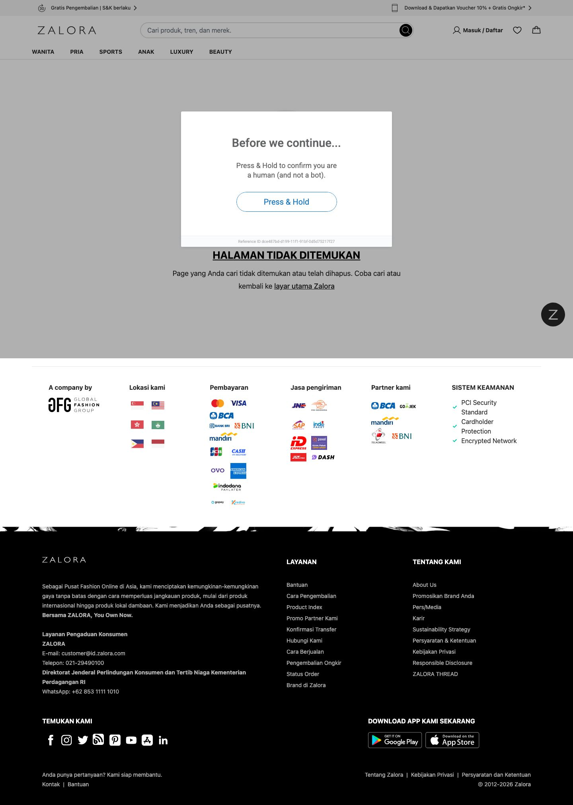

**대표 상품 이미지** (상위 6장, 출처 URL 포함)

-  — 출처 <https://static-id.zacdn.com/next-assets/static-assets/images/logo/icon_mastercard.png>
-  — 출처 <https://static-id.zacdn.com/next-assets/static-assets/images/logo/icon_visa.png>
-  — 출처 <https://static-id.zacdn.com/next-assets/static-assets/images/logo/icon_ovo.png>
-  — 출처 <https://static-id.zacdn.com/next-assets/static-assets/images/logo/icon_indodana.png>

**페이지 메타 정보**

| page | title | description |
|---|---|---|
| [`new_women`](https://www.zalora.co.id/wanita/new-arrivals) | Halaman tidak ditemukan | ZALORA |  |

### 4.2 일본 _( Japan )_

- 한국 수출규모 순위: **#2** · region: `asia` · tier `1` · currency `JPY`
- 수집 사이트: **5개** (성공 4)
- 메모: K-패션 선호도 높고 온라인 패션몰 발달
#### [GU Japan](https://www.gu-global.com/jp/)

- URL: <https://www.gu-global.com/jp/>
- 페이지: **OK 1 · FAIL 0**

**대표 상품 이미지** (상위 6장, 출처 URL 포함)

-  — 출처 <https://image.uniqlo.com/GU/ST3/jp/imagesother/Navigation/WOMEN_Category/2026/261023/261023_category-icon_autumn-winter-sale.png>
-  — 출처 <https://image.uniqlo.com/GU/ST3/jp/imagesother/Navigation/Category-icon_V2/2026/0724/Categoy_Limited-offers.jpg>
-  — 출처 <https://image.uniqlo.com/GU/ST3/jp/imagesother/Navigation/Category-icon_V2/2026/0724/Categoy_SALE.jpg>
-  — 출처 <https://image.uniqlo.com/GU/ST3/jp/imagesother/Navigation/collaboration_Category/26FW/rokh_category_icon.png>
-  — 출처 <https://image.uniqlo.com/GU/ST3/jp/imagesother/Navigation/collaboration_Category/26FW/261023_category_icon_POKEMON.png>
-  — 출처 <https://image.uniqlo.com/GU/ST3/jp/imagesother/Navigation/WOMEN_Category/2026/260901/Category_w_Outer_361430.png>

**페이지 메타 정보**

| page | title | description |
|---|---|---|
| [`new_arrivals`](https://www.gu-global.com/jp/ja/not-found) | 申し訳ありません、お客様がアクセスしようとしたページが見つかりませんでした。恐れ入りますが、正しくアドレスが入力されているか、もう一度ご確認ください。 | ジーユー | 申し訳ありません、お客様がアクセスしようとしたページが見つかりませんでした。恐れ入りますが、正しくアドレスが入力されているか、もう一度ご確認ください。 |

#### [Rakuten Fashion](https://brandavenue.rakuten.co.jp/)

- URL: <https://brandavenue.rakuten.co.jp/>
- 페이지: **OK 1 · FAIL 1**

**대표 상품 이미지** (상위 6장, 출처 URL 포함)

-  — 출처 <https://brandavenue.r10s.jp/img/library/index/sbn_flagshipstore_20231003.png>
- 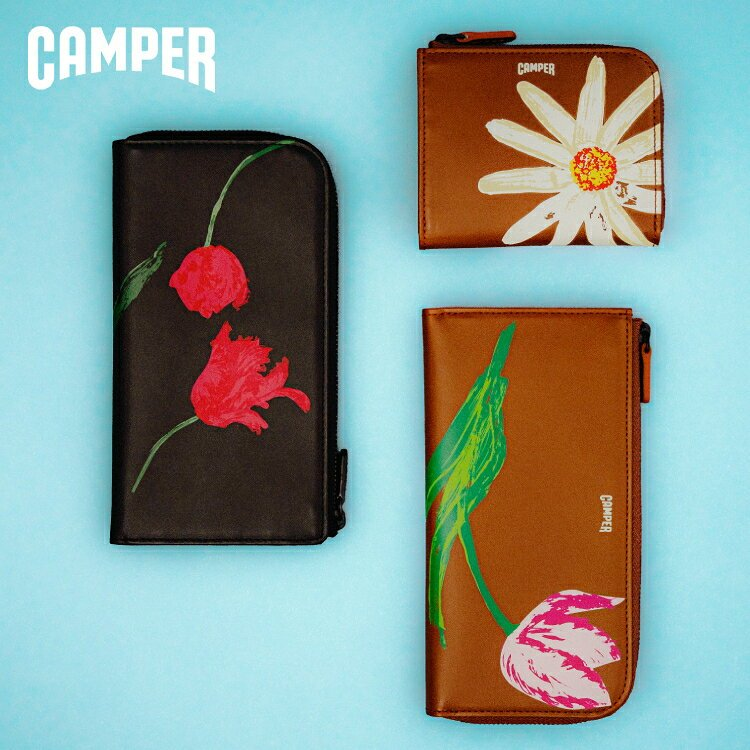 — 출처 <https://brandavenue.r10s.jp/img/news/01/404975/pc_n.jpg>
- 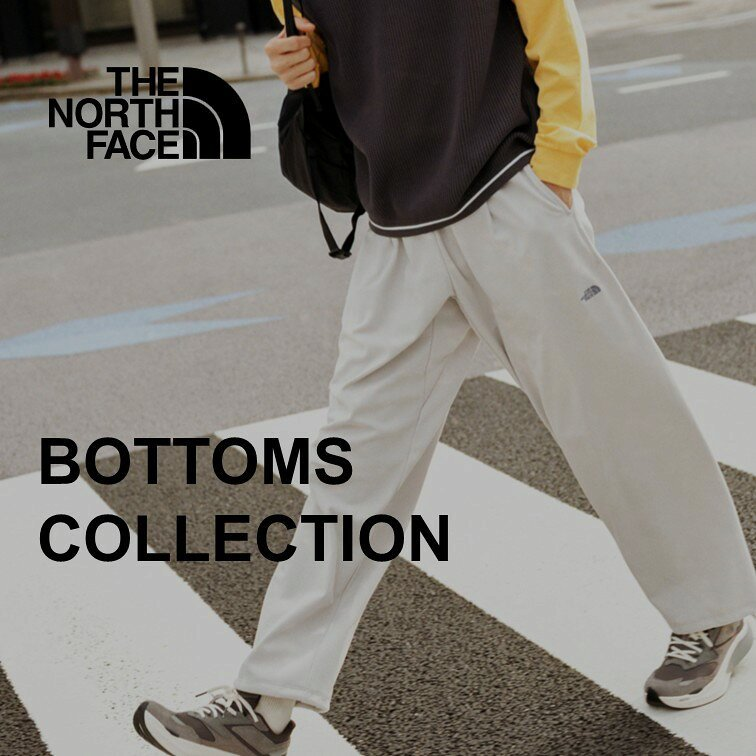 — 출처 <https://brandavenue.r10s.jp/img/news/01/405529/pc_n.jpg>
- 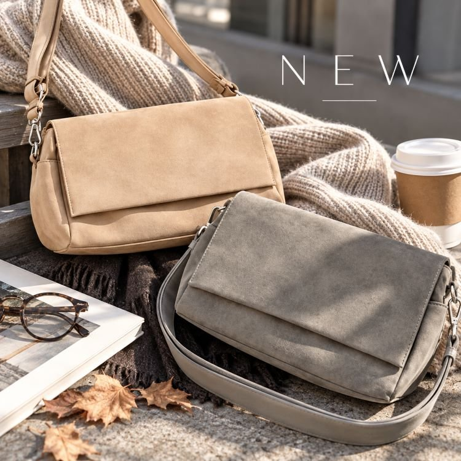 — 출처 <https://brandavenue.r10s.jp/img/news/01/405569/pc_n.jpg>
- 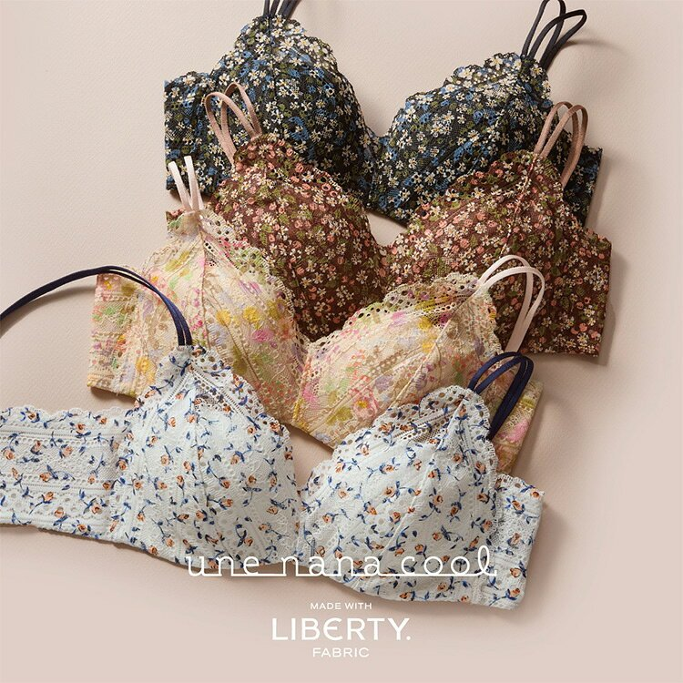 — 출처 <https://brandavenue.r10s.jp/img/news/01/404400/pc_n.jpg>
- 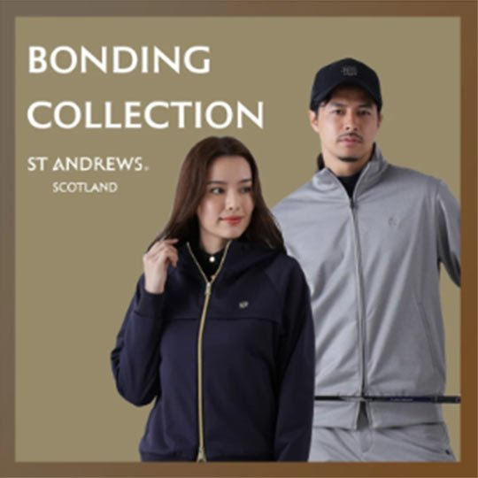 — 출처 <https://brandavenue.r10s.jp/img/news/01/404816/pc_n.jpg>

**페이지 메타 정보**

| page | title | description |
|---|---|---|
| [`men`](https://brandavenue.rakuten.co.jp/men/) | MEN | ファッション通販 Rakuten Fashion(楽天ファッション／旧楽天ブランドアベニュー) | Rakuten Fashion(楽天ファッション)は人気ブランドを取り扱うファッション通販サイトです。新作アイテム続々入荷！セール商品やクーポン対象商品も豊富。／税込3,980円以上購入で送料無料／楽天ポイントが使えて貯まる！ |

**실패 페이지**

- `women` — http_status_404

#### [Uniqlo Japan](https://www.uniqlo.com/jp/)

- URL: <https://www.uniqlo.com/jp/>
- 페이지: **OK 1 · FAIL 0**

**페이지 메타 정보**

| page | title | description |
|---|---|---|
| [`new_arrivals`](https://www.uniqlo.com/jp/ja/contents/feature/new-arrivals/) | 404 Not Found |  |

#### [WEAR](https://wear.jp/)

- URL: <https://wear.jp/>
- 페이지: **OK 1 · FAIL 0**

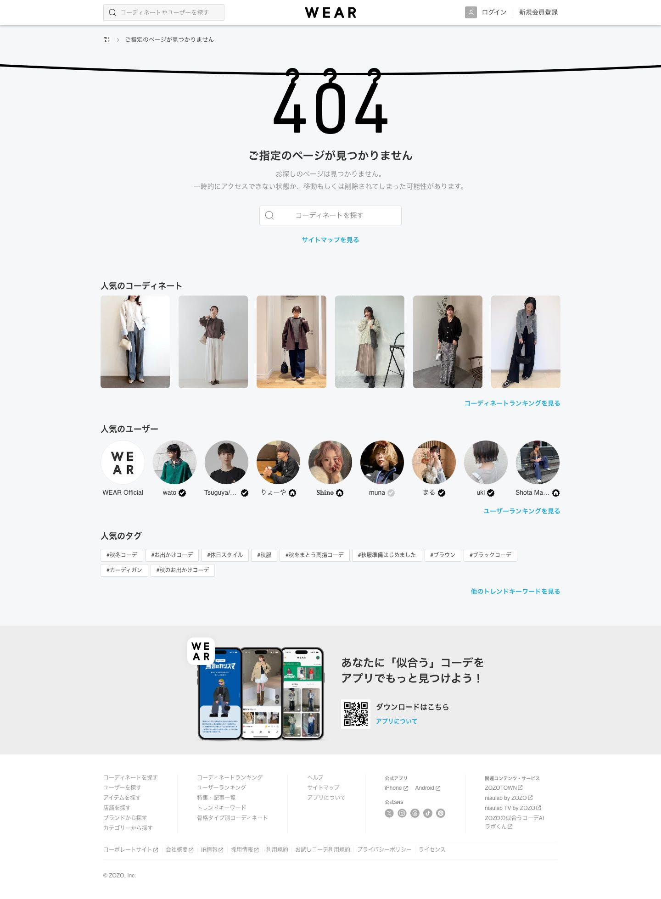

**대표 상품 이미지** (상위 6장, 출처 URL 포함)

-  — 출처 <https://wear.jp/public/_next/static/media/notfound_bg.1ywd-k_shp-hy.png>
-  — 출처 <https://wear.jp/public/_next/static/media/notfound_4.1ho27atf54bbv.png>
-  — 출처 <https://wear.jp/public/_next/static/media/notfound_0.438l9b9xjj6tm.png>
- 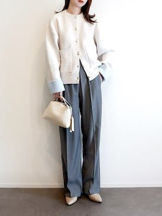 — 출처 <https://images.wear2.jp/coordinate/kAiO3P8/BGywH5db/1793040584_276.jpg>
- 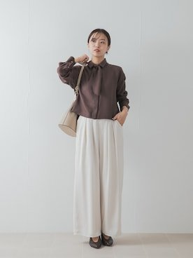 — 출처 <https://images.wear2.jp/coordinate/jmi8pOzw/HujGOacd/1793019737_276.jpg>
- 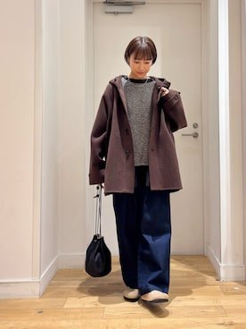 — 출처 <https://images.wear2.jp/coordinate/Owid7r4/uNgtfAHq/1793013425_276.jpg>

**페이지 메타 정보**

| page | title | description |
|---|---|---|
| [`ranking`](https://wear.jp/ranking/coordinate/) | ご指定のページが見つかりません - WEAR | お探しのページは見つかりません。一時的にアクセスできない状態か、移動もしくは削除されてしまった可能性があります。 |

#### [ZOZOTOWN](https://zozo.jp/)

- URL: <https://zozo.jp/>
- 페이지: **OK 0 · FAIL 2**

**실패 페이지**

- `new` — playwright_error: TimeoutError: Page.goto: Timeout 30000ms exceeded.
Call log:
  - navigating to "https://zozo.jp/category/new/", waiting until "domcontentloaded"

- `ranking` — playwright_error: TimeoutError: Page.goto: Timeout 30000ms exceeded.
Call log:
  - navigating to "https://zozo.jp/ranking/", waiting until "domcontentloaded"

### 4.3 한국 _( South Korea )_

- 한국 수출규모 순위: **#30** · region: `asia` · tier `1` · currency `KRW`
- 수집 사이트: **4개** (성공 3)
- 메모: 비교 기준 (자국). 국내 사업동향 센싱
#### [29CM](https://www.29cm.co.kr/)

- URL: <https://www.29cm.co.kr/>
- 페이지: **OK 1 · FAIL 0**

**최근 유행 상품** (50건 · 상품명 클릭 시 해당 사이트로 이동)

| # | 상품명 | 브랜드 | 가격 | 페이지 |
|---:|---|---|---:|---|
| 1 | [SHEARLING BUTTON VEST, CREAM](https://product.29cm.co.kr/catalog/4288422) | 아유서울 | 167,330 KRW | `home` |
| 2 | [SHEARLING BUTTON VEST, BROWN](https://product.29cm.co.kr/catalog/4288423) | 아유서울 | 167,330 KRW | `home` |
| 3 | [HIGH-NECK FAUX HALF FUR COAT, MOCHA GREY](https://product.29cm.co.kr/catalog/4288426) | 아유서울 | 250,600 KRW | `home` |
| 4 | [Eames Hang-It-All (Black)](https://product.29cm.co.kr/catalog/3786814) | 허먼밀러 | 336,000 KRW | `home` |
| 5 | [Eames Wire Base Low Table (White/Chrome)](https://product.29cm.co.kr/catalog/3791212) | 허먼밀러 | 424,000 KRW | `home` |
| 6 | [Eames Wire Base Low Table (Walnut/Black)](https://product.29cm.co.kr/catalog/3792929) | 허먼밀러 | 640,000 KRW | `home` |
| 7 | [젠 리빙다이닝 소파 식탁 단품/세트 (펫프렌들리)](https://product.29cm.co.kr/catalog/3327360) | 오투가구 | 375,300 KRW | `home` |
| 8 | [[예약판매] 세토 3단 와이드 수납장](https://product.29cm.co.kr/catalog/1278451) | 오투가구 | 622,800 KRW | `home` |
| 9 | [무온 4칸 격자 수납장](https://product.29cm.co.kr/catalog/4076763) | 오투가구 | 778,500 KRW | `home` |
| 10 | [쓰임 에센셜 도자식판 나눔 플레이트3구 세트(식판+머그)](https://product.29cm.co.kr/catalog/4286471) | 쓰임 | 25,430 KRW | `home` |
| 11 | [[29cm단독] 에센셜 식판 5구 세트(핑크) + 머쉬룸 커트러리 세트 (크림화이트)](https://product.29cm.co.kr/catalog/3005541) | 쓰임 | 22,430 KRW | `home` |
| 12 | [[29cm단독] 에센셜 식판 5구(화이트) + 머쉬룸 커트러리 세트 (크림화이트)](https://product.29cm.co.kr/catalog/2890988) | 쓰임 | 24,680 KRW | `home` |
| 13 | [JC902 SOFA](https://product.29cm.co.kr/catalog/4107562) | 카레클린트 | 2,975,000 KRW | `home` |
| 14 | [JC901 SOFA CHROME PIPE](https://product.29cm.co.kr/catalog/1643694) | 카레클린트 | 7,650,000 KRW | `home` |
| 15 | [JC902 TABLE WHITE OAK, SUS HAIRLINE](https://product.29cm.co.kr/catalog/1912270) | 카레클린트 | 1,105,000 KRW | `home` |
| 16 | [Flat Jazz shoes (black)](https://product.29cm.co.kr/catalog/4241739) | 페몬트 | 178,200 KRW | `home` |
| 17 | [[29CM Only] square (leather)](https://product.29cm.co.kr/catalog/2973673) | 페몬트 | 198,000 KRW | `home` |
| 18 | [[29CM Only] square (leather brown)](https://product.29cm.co.kr/catalog/3849457) | 페몬트 | 198,000 KRW | `home` |
| 19 | [[장미맨숀] 리브 원목 4단 서랍장 01 (브라운)](https://product.29cm.co.kr/catalog/889232) | 장미맨숀 | 394,010 KRW | `home` |
| 20 | [[장미맨숀] 리브 서랍장 02 와이드 (브라운)](https://product.29cm.co.kr/catalog/2323381) | 장미맨숀 | 438,180 KRW | `home` |

**대표 상품 이미지** (상위 6장, 출처 URL 포함)

-  — 출처 <https://img.29cm.co.kr/cms/202610/11f1ce9db46e49e2838179fabf53e6f3.jpg?width=3840&format=webp>
- 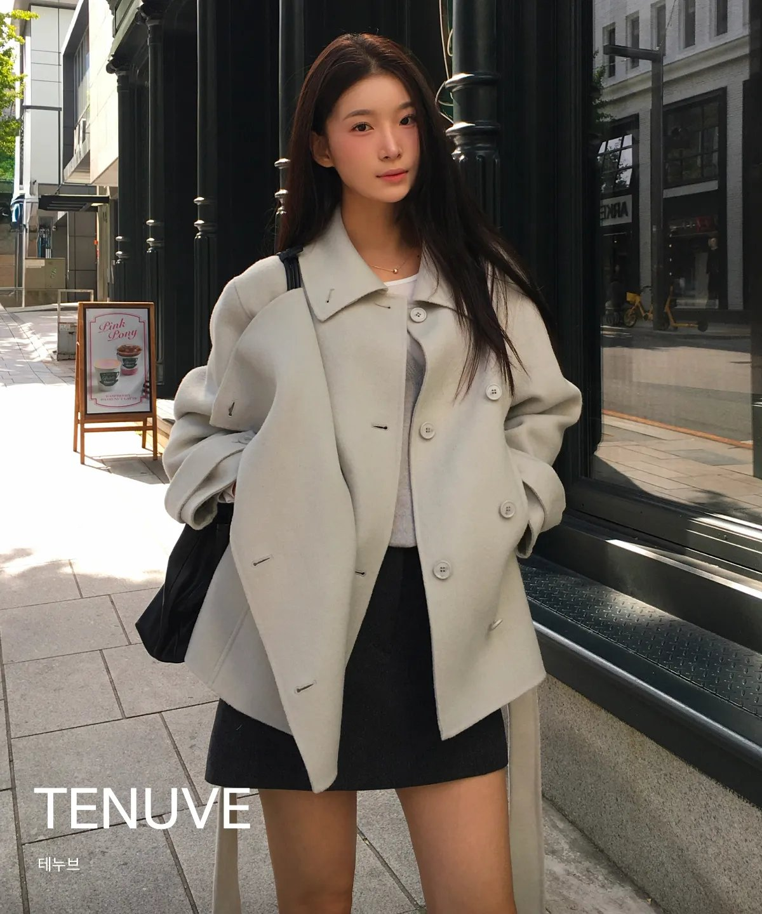 — 출처 <https://img.29cm.co.kr/cms/202610/11f1ce9da88a01f4a087e71ec3ba7d9c.jpg?width=3840&format=webp>
- 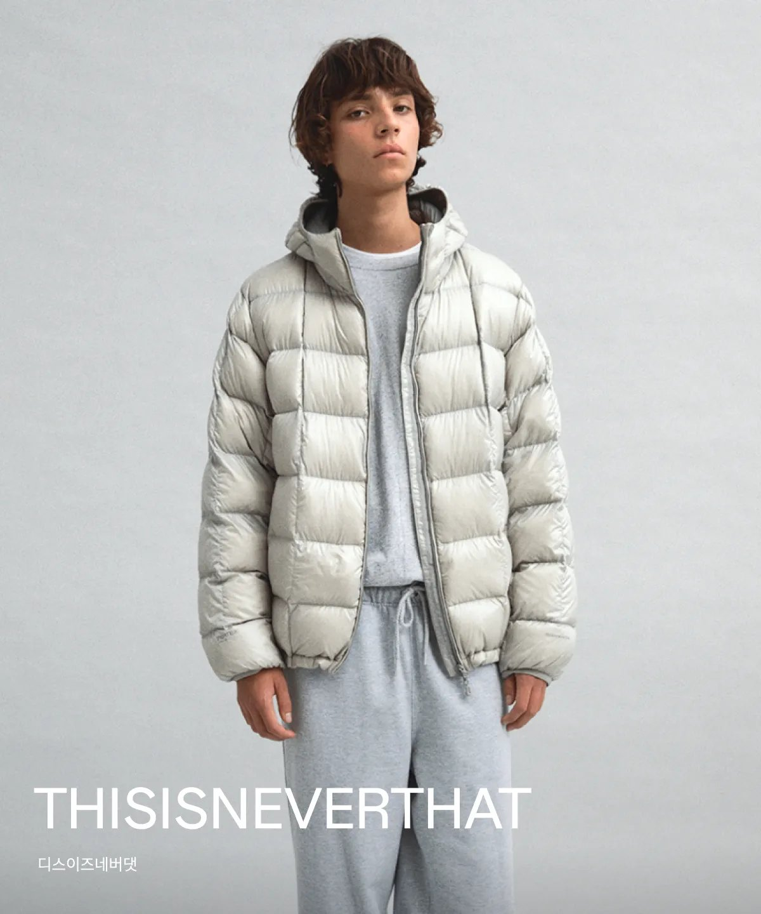 — 출처 <https://img.29cm.co.kr/cms/202610/11f1ce9da0811f408381394a48409a1f.jpg?width=3840&format=webp>
- 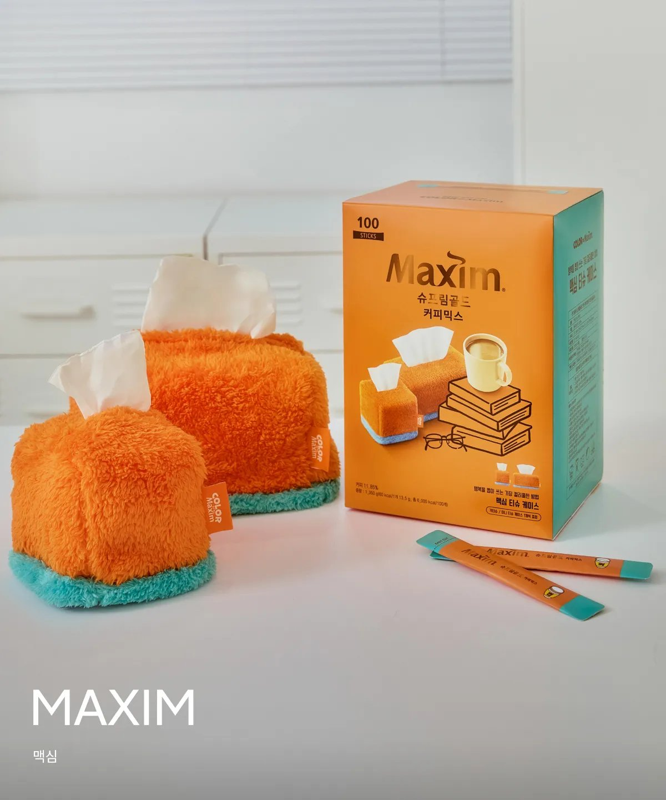 — 출처 <https://img.29cm.co.kr/cms/202610/11f1ce9d93fa7d888381ade1653512f3.jpg?width=3840&format=webp>
- 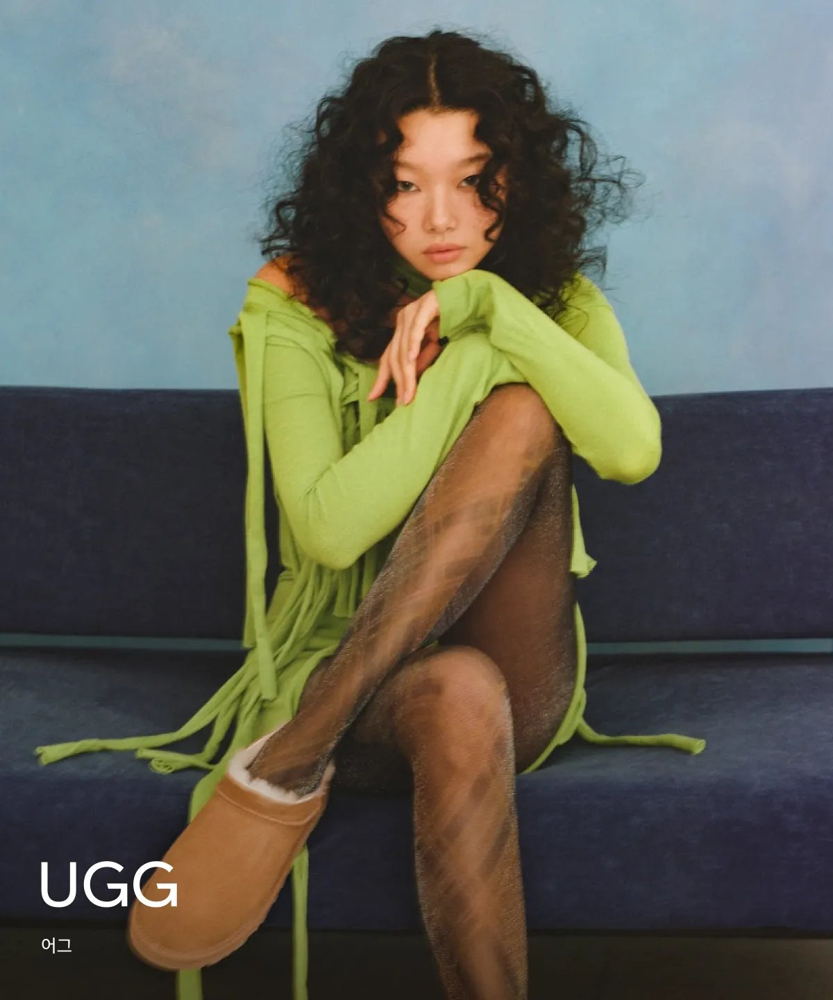 — 출처 <https://img.29cm.co.kr/cms/202610/11f1ce9d8799646083819789cabe048f.jpg?width=3840&format=webp>
- 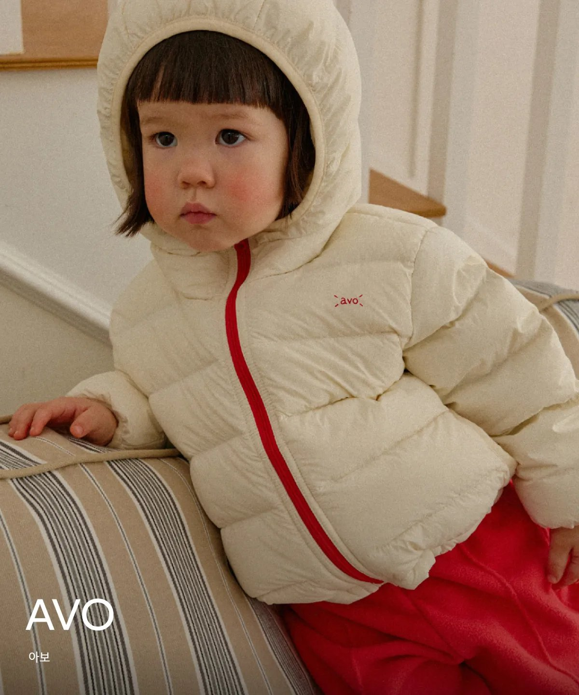 — 출처 <https://img.29cm.co.kr/cms/202610/11f1ce9d7e3f97d083817b9cdcb9de30.jpg?width=3840&format=webp>

**페이지 메타 정보**

| page | title | description |
|---|---|---|
| [`home`](https://www.29cm.co.kr/) | 모든 취향 곁에, 29CM | 패션, 라이프스타일, 컬처까지 29CM만의 감도 깊은 셀렉션을 만나보세요. |

#### [Musinsa](https://www.musinsa.com/)

- URL: <https://www.musinsa.com/>
- 페이지: **OK 0 · FAIL 1**

**실패 페이지**

- `home` — robots_disallowed

#### [W Concept](https://www.wconcept.co.kr/)

- URL: <https://www.wconcept.co.kr/>
- 페이지: **OK 1 · FAIL 0**

**최근 유행 상품** (30건 · 상품명 클릭 시 해당 사이트로 이동)

| # | 상품명 | 브랜드 | 가격 | 페이지 |
|---:|---|---|---:|---|
| 1 | [신세틱 스웨이드 하프 자켓 [다크브라운]](https://m.wconcept.co.kr/Product/307496244) | 레프트서울 | 88,725 KRW | `home` |
| 2 | [램스킨 우먼즈 포켓 자켓 [블랙]](https://m.wconcept.co.kr/Product/306052032) | 레프트서울 | 97,510 KRW | `home` |
| 3 | [캐시미어 블렌드 헤어리 라운드넥 니트 [브라운]](https://m.wconcept.co.kr/Product/309087269) | 레프트서울 | 59,850 KRW | `home` |
| 4 | [신세틱 스웨이드 싱글 자켓 [핑크]](https://m.wconcept.co.kr/Product/308211446) | 레프트서울 | 63,210 KRW | `home` |
| 5 | [베이직 울100 라운드 니트 [10COL]](https://m.wconcept.co.kr/Product/307496233) | 레프트서울 | 33,040 KRW | `home` |
| 6 | [캐시미어 블렌드 헤리티지 아가일 가디건 [차콜]](https://m.wconcept.co.kr/Product/308895409) | 레프트서울 | 55,440 KRW | `home` |
| 7 | [코듀로이 세미 부츠컷 팬츠 [다크브라운]](https://m.wconcept.co.kr/Product/309028048) | 레프트서울 | 52,955 KRW | `home` |
| 8 | [리얼 양털 데일리 자켓 [그레이]](https://m.wconcept.co.kr/Product/301884917) | 레프트서울 | 83,580 KRW | `home` |
| 9 | [오버사이즈 하프 무스탕 코트 [블랙]](https://m.wconcept.co.kr/Product/306263401) | 레프트서울 | 66,780 KRW | `home` |
| 10 | [램스킨 베이직 자켓 [브라운]](https://m.wconcept.co.kr/Product/305603406) | 레프트서울 | 112,980 KRW | `home` |
| 11 | [신세틱 그레인 크랙 레더 자켓 [브라운]](https://m.wconcept.co.kr/Product/308895439) | 레프트서울 | 105,840 KRW | `home` |
| 12 | [램스킨 베지터블 오버핏 자켓 [브라운]](https://m.wconcept.co.kr/Product/302301723) | 레프트서울 | 167,440 KRW | `home` |
| 13 | [테디베어 오버핏 더블 롱 울 코트 [브라운]](https://m.wconcept.co.kr/Product/307663703) | 레프트서울 | 60,690 KRW | `home` |
| 14 | [이지 웜 후디드 덕 다운 점퍼 [블랙]](https://m.wconcept.co.kr/Product/307663686) | 레프트서울 | 156,975 KRW | `home` |
| 15 | [[단독] 소프트 퍼 자켓 [베이지]](https://m.wconcept.co.kr/Product/309028144) | 레프트서울 | 97,510 KRW | `home` |
| 16 | [코듀로이 콤비 신세틱 레더 자켓 [빈티지]](https://m.wconcept.co.kr/Product/306628532) | 레프트서울 | 31,290 KRW | `home` |
| 17 | [신세틱 레더 하이넥 블루종 [블랙]](https://m.wconcept.co.kr/Product/308361092) | 레프트서울 | 63,210 KRW | `home` |
| 18 | [클래식 램스킨 자켓 [다크브라운]](https://m.wconcept.co.kr/Product/303287913) | 레프트서울 | 125,580 KRW | `home` |
| 19 | [소프트 울 텐셀 터틀넥 [5COL]](https://m.wconcept.co.kr/Product/309028054) | 레프트서울 | 29,155 KRW | `home` |
| 20 | [리얼 스웨이드 봄버 자켓 [다크브라운]](https://m.wconcept.co.kr/Product/308895521) | 레프트서울 | 161,840 KRW | `home` |

**페이지 메타 정보**

| page | title | description |
|---|---|---|
| [`home`](https://www.wconcept.co.kr/) | _(empty)_ |  |

#### [Zigzag](https://zigzag.kr/)

- URL: <https://zigzag.kr/>
- 페이지: **OK 1 · FAIL 0**

**최근 유행 상품** (36건 · 상품명 클릭 시 해당 사이트로 이동)

| # | 상품명 | 브랜드 | 가격 | 페이지 |
|---:|---|---|---:|---|
| 1 | [[백지헌PICK/V넥단독💖][소프트얀] 여성 라운드넥 카디건_SPCKG49W01,SPCKG49W03](https://store.zigzag.kr/app/catalog/products/171262525?browsing_type=NATIVE_BROWSER) | 스파오 | 32,310 KRW | `home` |
| 2 | [[울70] 핸드메이드 하이넥 숏코트_MIWJHGV31B](https://store.zigzag.kr/app/catalog/products/171946196?browsing_type=NATIVE_BROWSER) | 미쏘 | 152,150 KRW | `home` |
| 3 | [[가을&겨울❄/50만장돌파/자체제작] 시오 니트 (라운드넥/브이넥)](https://store.zigzag.kr/app/catalog/products/147921597?browsing_type=NATIVE_BROWSER) | 리얼코코 | 11,840 KRW | `home` |
| 4 | [[우와PICK] [6만3천장돌파/S-XL/기장옵션/MADE] 유로즈 레이어드 슬릿 롱 스커트 - 3 타입 (당일배송/가을/사계절/초겨울/겨울/스웨이드/머메이드/맥시/시스루/하객룩)](https://store.zigzag.kr/app/catalog/products/165586743?browsing_type=NATIVE_BROWSER) | 커먼유니크 | 30,650 KRW | `home` |
| 5 | [[기모🔥+골반패드탈부착/부츠컷원조1등🏆누적80만장💙마법보정핏+미친편안함/재구매율끝판왕/가을팬츠/부츠컷/니썸][made]세인트부츠컷데님 - 9color](https://store.zigzag.kr/app/catalog/products/111046579?browsing_type=NATIVE_BROWSER) | 니썸 | 27,520 KRW | `home` |
| 6 | [[🍁가을/3기장선택!] made. 모먼트 투커버 올데이슬랙스 (+숏/베이직/롱ver) - 4 size](https://store.zigzag.kr/app/catalog/products/136095576?browsing_type=NATIVE_BROWSER) | 슬로우앤드 | 31,840 KRW | `home` |
| 7 | [[🏆인생부츠컷/3기장선택!] made. 세미부츠컷 찰랑슬랙스 (+숏/베이직/롱ver) - 4 size](https://store.zigzag.kr/app/catalog/products/142355088?browsing_type=NATIVE_BROWSER) | 슬로우앤드 | 25,520 KRW | `home` |
| 8 | [[made]모먼트울쇼츠](https://store.zigzag.kr/app/catalog/products/167600416?browsing_type=NATIVE_BROWSER) | 어텀 | 23,400 KRW | `home` |
| 9 | [[✨한겹레이어드/가을이너!] made. 오브 울텐셀 레이어드 티셔츠 - 3 color](https://store.zigzag.kr/app/catalog/products/171352715?browsing_type=NATIVE_BROWSER) | 슬로우앤드 | 26,400 KRW | `home` |
| 10 | [[기모추가🔥/50만장돌파/자체제작] 허쉬 코튼 와이드팬츠 (숏/기본/롱)](https://store.zigzag.kr/app/catalog/products/143224732?browsing_type=NATIVE_BROWSER) | 리얼코코 | 16,960 KRW | `home` |
| 11 | [[🤎기장선택/편한바지!] made. 마켓 울라이크 핀턱 트레이닝 슬랙스 (숏/베이직/롱)](https://store.zigzag.kr/app/catalog/products/172227674?browsing_type=NATIVE_BROWSER) | 슬로우앤드 | 29,520 KRW | `home` |
| 12 | [[하객룩🕊️/자체제작] 라베아 타이 블라우스 (4color)](https://store.zigzag.kr/app/catalog/products/171315892?browsing_type=NATIVE_BROWSER) | 리얼코코 | 30,880 KRW | `home` |
| 13 | [[🏆역대급100만장/3기장선택!] made. 마켓 와이드 트레이닝슬랙스 (+숏/베이직/롱ver) - 4 size](https://store.zigzag.kr/app/catalog/products/141360158?browsing_type=NATIVE_BROWSER) | 슬로우앤드 | 26,320 KRW | `home` |
| 14 | [[MADE/뉴컬러]슈이드 딥브이넥 니트 (S-M/가을니트/오버핏/레이어드/딥브이니트/출근룩/데이트룩/데일리룩/무지니트)](https://store.zigzag.kr/app/catalog/products/171954385?browsing_type=NATIVE_BROWSER) | 케이클럽 | 28,800 KRW | `home` |
| 15 | [SR 메리 브이넥 니트 (3col) 데일리 캐주얼 떠유니](https://store.zigzag.kr/app/catalog/products/172794865?browsing_type=NATIVE_BROWSER) | 떠유니 | 73,000 KRW | `home` |
| 16 | [[가을하객룩✨][MADE]드넬 하이넥 타이 블라우스[3color]](https://store.zigzag.kr/app/catalog/products/167182302?browsing_type=NATIVE_BROWSER) | 슬로우리스트 | 35,920 KRW | `home` |
| 17 | [[미엔느] 사이드 타이 하프넥 티 (2col)](https://store.zigzag.kr/app/catalog/products/172795833?browsing_type=NATIVE_BROWSER) | 미엔느 | 31,800 KRW | `home` |
| 18 | [르버터 도빌 누벅 롱 스커트 (2col) 스웨이드 H라인 치마 떠유니](https://store.zigzag.kr/app/catalog/products/172796039?browsing_type=NATIVE_BROWSER) | 떠유니 | 66,960 KRW | `home` |
| 19 | [[울80/알파카10][패딩내피][키작녀][MADE]모빈스 헤링본 핸드메이드 코트 자켓[3color]](https://store.zigzag.kr/app/catalog/products/171485653?browsing_type=NATIVE_BROWSER) | 슬로우리스트 | 174,000 KRW | `home` |
| 20 | [Molly Pocket Cardigan 몰리 포켓 가디건](https://store.zigzag.kr/app/catalog/products/171894009?browsing_type=NATIVE_BROWSER) | 안젤로비안코 | 36,450 KRW | `home` |

**페이지 메타 정보**

| page | title | description |
|---|---|---|
| [`home`](https://zigzag.kr/) | _(empty)_ |  |

### 4.4 대만 _( Taiwan )_

- 한국 수출규모 순위: **#7** · region: `asia` · tier `1` · currency `TWD`
- 수집 사이트: **5개** (성공 5)
- 메모: K-패션 친화도 높음
#### [momo](https://www.momoshop.com.tw/)

- URL: <https://www.momoshop.com.tw/>
- 페이지: **OK 1 · FAIL 0**

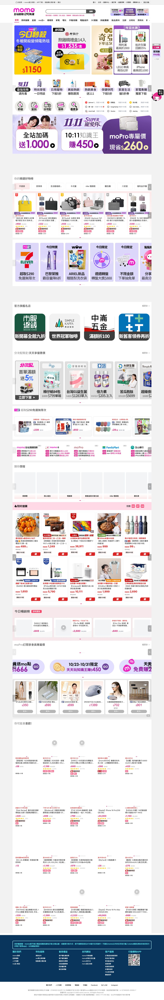

**대표 상품 이미지** (상위 6장, 출처 URL 포함)

-  — 출처 <https://img3.momoshop.com.tw/ecm/img/online/10/998/00/000/bt_0_271_01/bt_0_271_01_e2.jpg?t=1785743060613>
-  — 출처 <https://img1.momoshop.com.tw/ecm/img/online/10/998/00/000/bt_0_245_01/bt_0_245_01_P1_1_e2.png?t=1793030407033>
-  — 출처 <https://img1.momoshop.com.tw/ecm/img/online/10/998/00/000/bt_0_245_01/bt_0_245_01_P1_2_e2.png?t=1793030407033>
-  — 출처 <https://img1.momoshop.com.tw/ecm/img/online/10/998/00/000/bt_0_245_01/bt_0_245_01_P1_3_e2.png?t=1793030407033>
- 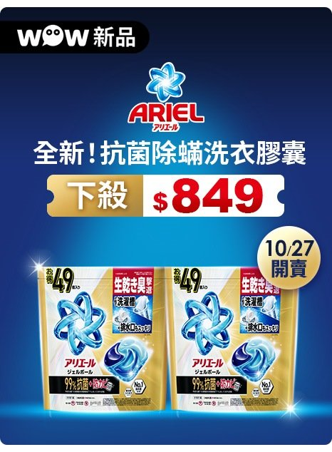 — 출처 <https://img3.momoshop.com.tw/ecm/img/online/81/998/00/000/mobile/bt_7_701_01/bt_7_701_01_e131.jpg?t=1792727905224>
-  — 출처 <https://img3.momoshop.com.tw/ecm/img/online/81/998/00/000/mobile/bt_7_701_01/bt_7_701_01_e101.jpg?t=1792727905214>

**페이지 메타 정보**

| page | title | description |
|---|---|---|
| [`home`](https://www.momoshop.com.tw/main/Main.jsp) | momo購物網 - 好評推薦 - 2026年10月 | momo購物網提供美妝保養、流行服飾、時尚精品、3C、數位家電、生活用品、美食旅遊票券…等數百萬件商品。快速到貨、超商取貨讓您購物最便利。mo店+商品抵用券天天搶、免運吃到飽，電視/直播商品限時下殺，每日讓您享超低價，並享有十天猶豫期；momo購物網為富邦及台灣大哥大關係企業 |

#### [OB Design](https://www.obdesign.com.tw/)

- URL: <https://www.obdesign.com.tw/>
- 페이지: **OK 1 · FAIL 0**

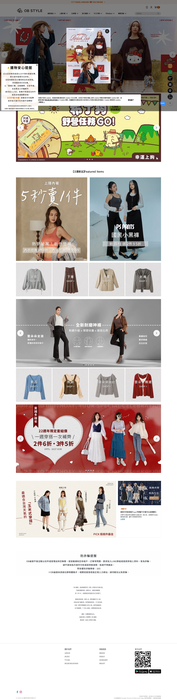

**대표 상품 이미지** (상위 6장, 출처 URL 포함)

- 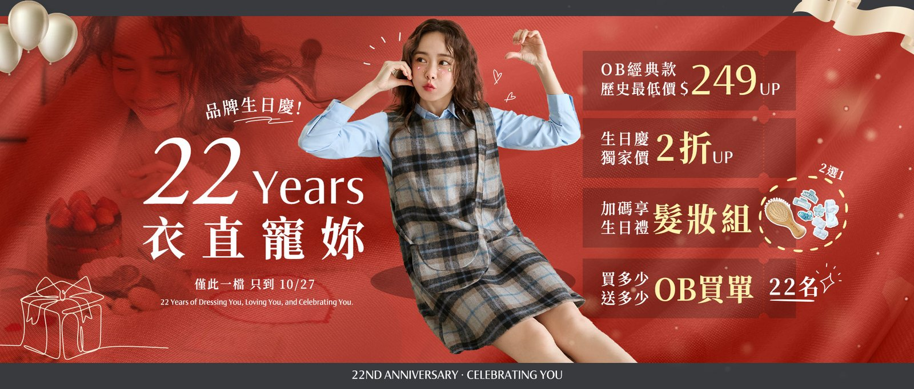 — 출처 <https://cms-static.cdn.91app.com/images/original/41602/92f19e4d-89b7-4330-9570-02cf1dff9742-1792557973-6drun5zyc4_d_1920x820_1280x547_1124x480_800x342_600x256_400x171.jpg>
- 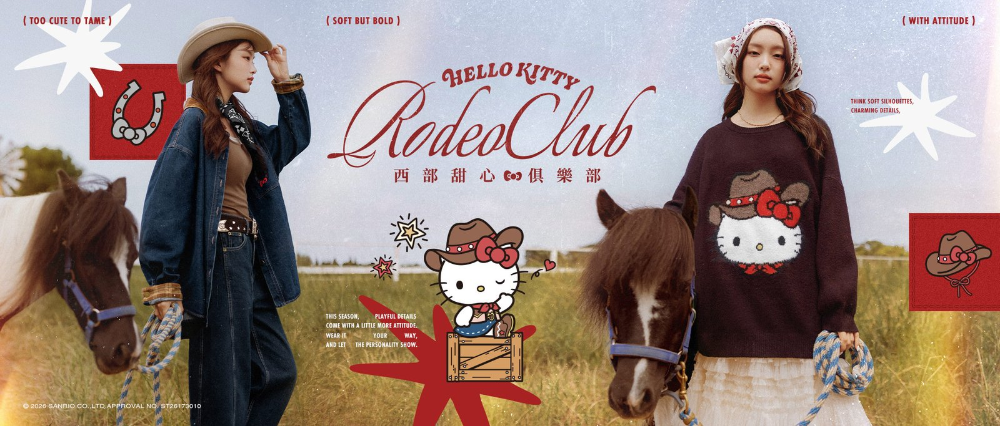 — 출처 <https://cms-static.cdn.91app.com/images/original/41602/92f19e4d-89b7-4330-9570-02cf1dff9742-1792651691-cbu6lcg4qm_d_1920x820_1280x547_1124x480_800x342_600x256_400x171.jpg>
- 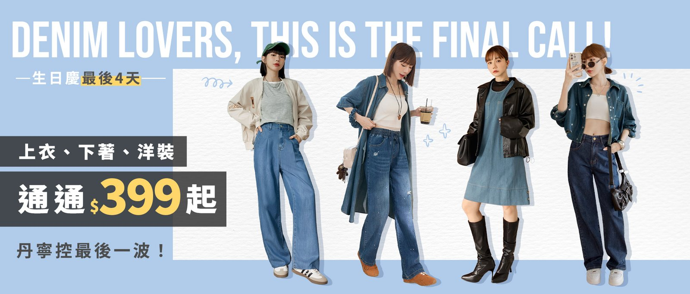 — 출처 <https://cms-static.cdn.91app.com/images/original/41602/92f19e4d-89b7-4330-9570-02cf1dff9742-1792634852-4qi55pzdbb_d_1920x820_1280x547_1124x480_800x342_600x256_400x171.jpg>
- 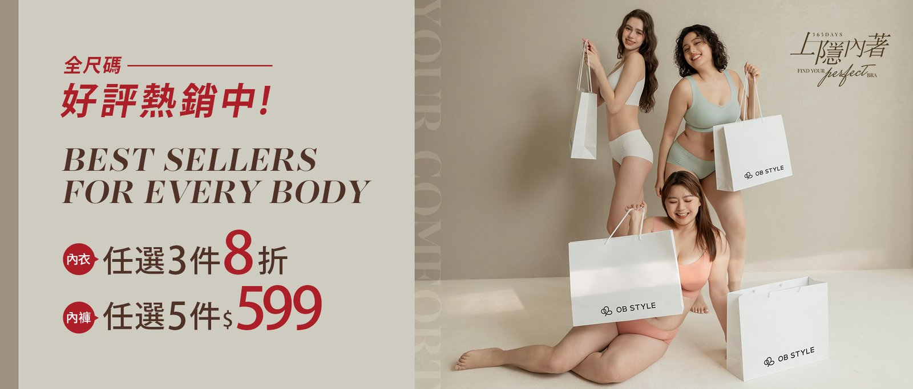 — 출처 <https://cms-static.cdn.91app.com/images/original/41602/92f19e4d-89b7-4330-9570-02cf1dff9742-1792737612-dn1wmx9ffo_d_1920x820_1280x547_1124x480_800x342_600x256_400x171.jpg>
-  — 출처 <https://cms-static.cdn.91app.com/images/compress/41602/92f19e4d-89b7-4330-9570-02cf1dff9742-1792737612-dn1wmx9ffo_d_400x171.webp>
- 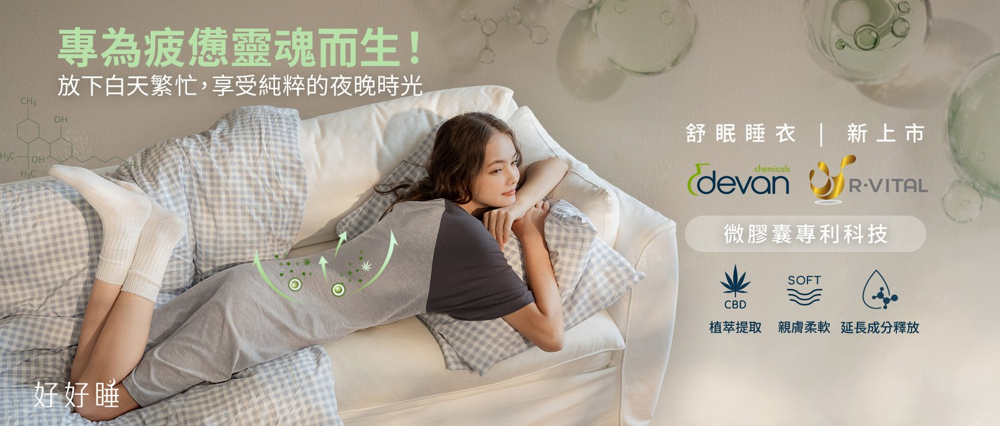 — 출처 <https://cms-static.cdn.91app.com/images/original/41602/92f19e4d-89b7-4330-9570-02cf1dff9742-1792634722-w0s0fz0ca4_d_1920x820_1280x547_1124x480_800x342_600x256_400x171.jpg>

**페이지 메타 정보**

| page | title | description |
|---|---|---|
| [`home`](https://www.obdesign.com.tw/) | OB嚴選｜高CP值人氣熱銷服飾，流行服飾品牌 | 你的日常穿搭好夥伴，快上OB嚴選找，OB嚴選提供女裝、孕童、運動、男裝各項流行服飾，秉持優質服務給你高CP值的購物體驗。各種風格都能滿足熱愛穿搭的你，天天上新品，快速出貨，一起加入OB style！網路人氣服飾品牌OB嚴選 |

#### [PChome](https://24h.pchome.com.tw/)

- URL: <https://24h.pchome.com.tw/>
- 페이지: **OK 1 · FAIL 0**

**페이지 메타 정보**

| page | title | description |
|---|---|---|
| [`home`](https://24h.pchome.com.tw/) | PChome 24h購物 |  |

#### [Pinkoi Taiwan](https://www.pinkoi.com/)

- URL: <https://www.pinkoi.com/>
- 페이지: **OK 2 · FAIL 0**

**대표 상품 이미지** (상위 6장, 출처 URL 포함)

-  — 출처 <https://cdn04.pinkoi.com/pinkoi.site/logo/og_image.png>

**페이지 메타 정보**

| page | title | description |
|---|---|---|
| [`accessories`](https://en.pinkoi.com/) | Pinkoi | Asia’s cross-border design marketplace | Design the way you are | Shop for original design products from Asia's independent designers. Pinkoi lives and breathes great design, great quality, great service, a |
| [`bags`](https://en.pinkoi.com/) | Pinkoi | Asia’s cross-border design marketplace | Design the way you are | Shop for original design products from Asia's independent designers. Pinkoi lives and breathes great design, great quality, great service, a |

#### [Yahoo Taiwan Shopping](https://tw.buy.yahoo.com/)

- URL: <https://tw.buy.yahoo.com/>
- 페이지: **OK 1 · FAIL 0**

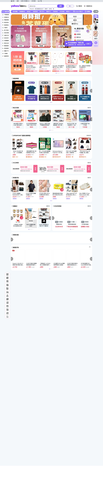

**대표 상품 이미지** (상위 6장, 출처 URL 포함)

- 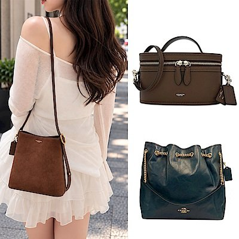 — 출처 <https://img.yec.tw/zp/MerchandiseImages/F7B8DEAD00-Gd-12256441.jpg>
- 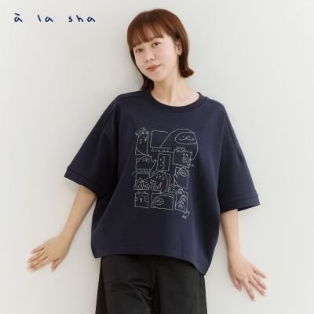 — 출처 <https://img.yec.tw/zp/MerchandiseImages/ac2a63749a-Gd-12306088.jpg>
- 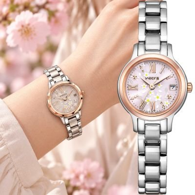 — 출처 <https://img.yec.tw/zp/MerchandiseImages/d696228672-Gd-11092952.jpg>

**페이지 메타 정보**

| page | title | description |
|---|---|---|
| [`home`](https://tw.buy.yahoo.com/) | Yahoo購物中心 - 最懂生活的人 | 數百萬件商品，貼心客服為您服務，15天鑑賞期購物保障！ |

### 4.5 태국 _( Thailand )_

- 한국 수출규모 순위: **#8** · region: `asia` · tier `1` · currency `THB`
- 수집 사이트: **5개** (성공 4)
- 메모: 동남아 K-패션 핵심 시장
#### [Central Online](https://www.central.co.th/)

- URL: <https://www.central.co.th/>
- 페이지: **OK 1 · FAIL 0**

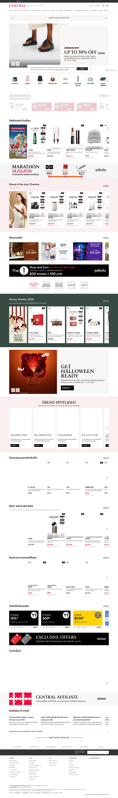

**대표 상품 이미지** (상위 6장, 출처 URL 포함)

-  — 출처 <https://www.central.co.th/_next/image?url=https%3A%2F%2Fassets.central.co.th%2Ffile-assets%2Fassets%2FCMS%2Fcampaign%2F2026%2F10oct%2F20261006_ANV2026_Homepage_herobanner.jpg&w=3840&q=75>
- 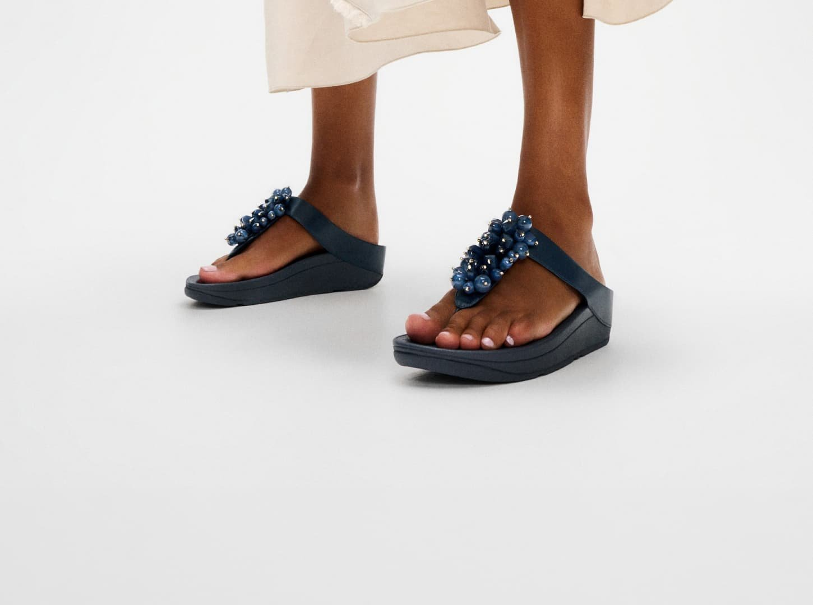 — 출처 <https://www.central.co.th/_next/image?url=https%3A%2F%2Fassets.central.co.th%2Ffile-assets%2Fassets%2FCMS%2Fcampaign%2F2026%2F10oct%2F20261025_FITFLOP_heroweb_d.jpg&w=3840&q=75>
-  — 출처 <https://www.central.co.th/_next/image?url=%2Fimages%2Fposter-desktop.webp&w=1920&q=75>
-  — 출처 <https://www.central.co.th/_next/image?url=https%3A%2F%2Fassets.central.co.th%2Ffile-assets%2Fassets%2FCMS%2Fcampaign%2F2026%2F10oct%2F202601023_lamer_heroweb_d.jpg&w=3840&q=75>
- 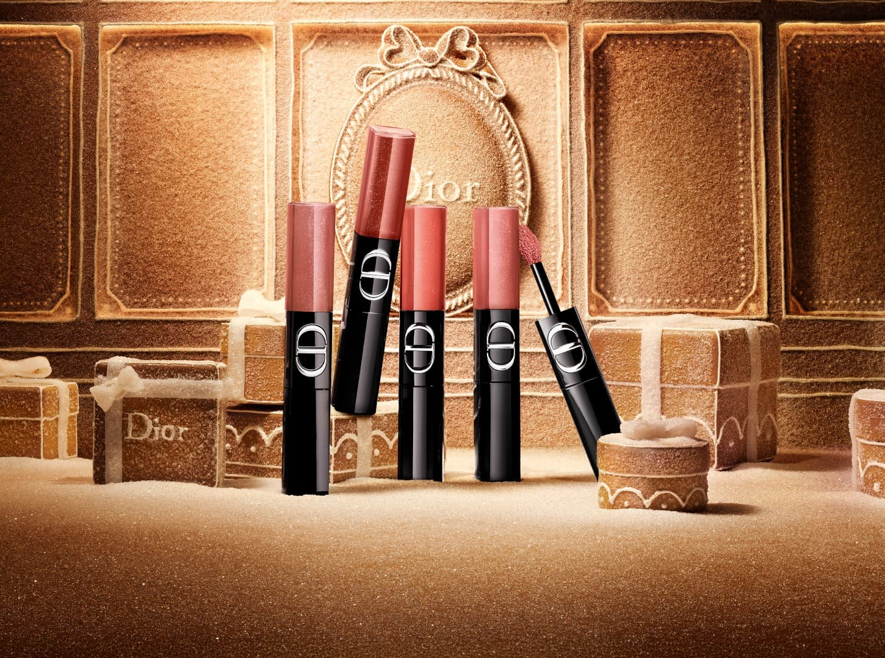 — 출처 <https://www.central.co.th/_next/image?url=https%3A%2F%2Fassets.central.co.th%2Ffile-assets%2Fassets%2FCMS%2Fcampaign%2F2026%2F10oct%2F20261027_dior_heroweb_d.jpg&w=3840&q=75>
-  — 출처 <https://www.central.co.th/_next/image?url=https%3A%2F%2Fassets.central.co.th%2Ffile-assets%2Fassets%2FCMS%2Fcampaign%2F2026%2F10oct%2F20261023_esteelauder_heroweb_d.jpg&w=3840&q=75>

**페이지 메타 정보**

| page | title | description |
|---|---|---|
| [`home`](https://www.central.co.th/th) | Central Online | ลดสูงสุด 30% + คูปองลดเพิ่ม 12% | Central 79th Anniversary โปรโมชั่นสุดยิ่งใหญ่ของปี 2026 เริ่มต้นขึ้นแล้ว! พบกับสินค้าจากหลากหลายแบรนด์ดังที่เราคัดสรรมาลดราคาสูงสุดถึง 30% พ |

#### [Lazada Thailand Fashion](https://www.lazada.co.th/)

- URL: <https://www.lazada.co.th/>
- 페이지: **OK 1 · FAIL 0**

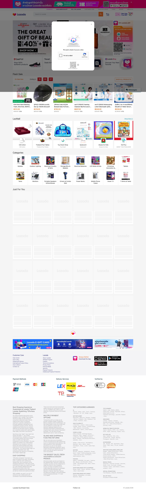

**대표 상품 이미지** (상위 6장, 출처 URL 포함)

-  — 출처 <https://img.lazcdn.com/us/domino/40845120240f19d13f738fa9a7978edd.png>
-  — 출처 <https://img.lazcdn.com/g/tps/images/ims-web/TB1KB2laMFY.1VjSZFnXXcFHXXa.png>
-  — 출처 <https://img.lazcdn.com/us/domino/9de93127-9819-4f69-89e3-25af8e8bd1da_TH-1976-688.jpg_2200x2200q80.jpg>
-  — 출처 <https://img.lazcdn.com/us/domino/699517bf-89f6-4b22-b8d3-5c4fa986c286_TH-1976-688.jpg_2200x2200q80.jpg>
-  — 출처 <https://img.lazcdn.com/us/domino/ff807222-c1b0-45dd-8d12-ef32cf622397_TH-1976-688.jpg_2200x2200q80.jpg>
-  — 출처 <https://img.lazcdn.com/us/domino/9bfb6365-b03d-42b8-8476-dc0fae5ac5bf_TH-1976-688.jpg_2200x2200q80.jpg>

**페이지 메타 정보**

| page | title | description |
|---|---|---|
| [`home`](https://www.lazada.co.th/#?) | Lazada Thailand | ช้อปออนไลน์ สินค้าดี พร้อมดีลพิเศษทุกวัน | พบกับ Lazada แพลตฟอร์มช้อปปิ้งชั้นนำในอาเซียน พร้อมบริการเก็บเงินปลายทาง LazMall LazFlash และดีลเด็ดจากแบรนด์ดังทุกวัน |

#### [Pomelo](https://www.pomelofashion.com/)

- URL: <https://www.pomelofashion.com/>
- 페이지: **OK 0 · FAIL 2**

**실패 페이지**

- `new` — robots_disallowed
- `best` — robots_disallowed

#### [Shopee Thailand Fashion](https://shopee.co.th/)

- URL: <https://shopee.co.th/>
- 페이지: **OK 1 · FAIL 0**

**대표 상품 이미지** (상위 6장, 출처 URL 포함)

-  — 출처 <https://deo.shopeemobile.com/shopee/shopee-pcmall-live-sg/assets/1c8bdaaf45e1fd48.png>
-  — 출처 <https://deo.shopeemobile.com/shopee/shopee-pcmall-live-sg/homepagefe/42ba6075c82a85ab.png>

**페이지 메타 정보**

| page | title | description |
|---|---|---|
| [`home`](https://shopee.co.th/verify/captcha?anti_bot_tracking_id=gqRjZGVrxHSFomtptTE0MjUxOnRyYWNraW5nX2lkX2tleaJrdtEAAqRhbGdv0gAAAGSjZGVrwKJjdMRAAAAADLyQlHjbhu_tIJoVd59UO0aGI3u8EPZbMRUCgbeCPd4w23IClM5T1bD7-qxvztQnbHA8L7r5z24rbHP-k6pjaXBoZXJ0ZXh0xQOGAAAADFIM1RKgJ_vkKRWjijwhmEXwOzjrzU4HKu93KK2kyqnTVMgfmXbteBdj6Pidf5FrzSFoaShhppPBsqAl7o5jJvbu1HdWrFZhdm72N_zCtdGrv4T2Q9YTM7G4WlwQTitdAIR6id-m2HsvNM58JjPfpWlmqSi4NB30GlUprm6qywHreIw4q0Io5EOXfasmX1euXIJ4mqPtDvj2gVAS-qZc-yWkoMG6dXD3yU_8eG5PsXnadzuz7101AXrwFFXqv86_VX5xCZiMpOCGo1TfkZcWQzw79rLyGkUejgy8uoOhc-IcoQ5Vv_5LtVxAafDk1wEAo-iMzsu8yLWArLHsWL1Tv5FskH3OS2fKYDJxsmNtjGuHnDyTpEDDNBEzCKKlF_4ust_a48P3nmA5W24LOrVpnL8OjXp8P_DU_qoSCslzwCgdEF5x-qTDaSJZ52BJJbDpAOAKsIesByoSqh6_uIfl2Qc_EKuTUbl3nsFU-akOTkDLPkdn96xj52APgShwNe6mN00bV1NgUNZufN2_xzrdbrHXmjRJL-ahWX3qrd9m5wdRbElk401VcdgGio_OY3EukhA9wWDr-oNQFJa4nX7xClT17rCNGAl1iuf_TPocp5nQyX-qvzxsjb0woZyHIg-X6QHxWsdvmbCfVMhMi6hIbdML91RKiX1x62rernKgu0vrCLlu203LXP_y_nWbRAl6pz6AfT0i5-1Ddd4c3eU-WN7lbjIRmIhu1djjgEaJn-RT6yG3SABCk94sCHNlzxh7q9WpaU49BUGlLNttaVhz7DMQOehoo7qSPYuLwz9xB-UHeRSAL9ysEIovkf7LFkxZsTWddHmiBP6mO_fu9NA8cifwOolgcjuhSc3PfLXH-z-7siyBCQjFKPY9IauQ1sXJebfuEGJxiUkiiFZUv_A6rIEKuLqJF2BzTNLOS6UH7uULqAXYDyd6lPEtGbfI5qJ1U6_yb66L_7vtEWX5sHWOJPVUzHxGW8f_713SOnuAsWxmBj2nOY9Ws9ijXdti3p_TS3FBVXVeJJyp8w3vUjKXCnMNodUAVabYlgxDsPh7R1Ng_jo5zSXridM4LIJ2jTJ9pG74oK3C6DIMTUfX7Pmbw0E8jX8MDfDBxy4TeXdo5YkMQNEY2H5CkS7NT0Pl0xjTHI-IN-JEnvwWmnYXaRaGrLbA735aHMXRWVFY_DSm3TydKbk&app_key=FlashSale.PC&client_id=1&next=https%3A%2F%2Fshopee.co.th%2Fverify%2Ftraffic%3F%3Fclient_id%3D%26next%3Dhttps%253A%252F%252Fshopee.co.th%252F%26redirect_type%3D2%26should_replace_history%3Dfalse&redirect_type=2&scene=crawler_item&should_replace_history=false) | Shopee Thailand | ช้อปปิ้งออนไลน์ ผ่านมือถือและเว็บไซต์ | ซื้อทุกอย่างที่ Shopee! ช้อปปิ้งออนไลน์จบในที่เดียว ซื้อหรือขายก็ง่ายสุดๆ มีโปรและส่วนลดเพียบ การันตีโดย Shopee | ส่งฟรีทั่วไทย | เก็บเงินปล |

#### [Zalora Thailand](https://www.zalora.co.th/)

- URL: <https://www.zalora.co.th/>
- 페이지: **OK 1 · FAIL 0**

**대표 상품 이미지** (상위 6장, 출처 URL 포함)

-  — 출처 <https://www.zalora.co.th/images/landingpage/525x500.gif>

**페이지 메타 정보**

| page | title | description |
|---|---|---|
| [`home`](https://www.zalora.co.th/) | ZALORA - ASIA'S LEADING ONLINE FASHION DESTINATION |  |

### 4.6 미국 _( United States )_

- 한국 수출규모 순위: **#1** · region: `north_america` · tier `1` · currency `USD`
- 수집 사이트: **5개** (성공 4)
- 메모: 한국 의류 최대 수출국. 대형 이커머스와 브랜드 커머스 중심
#### [Etsy](https://www.etsy.com/)

- URL: <https://www.etsy.com/>
- 페이지: **OK 2 · FAIL 0**

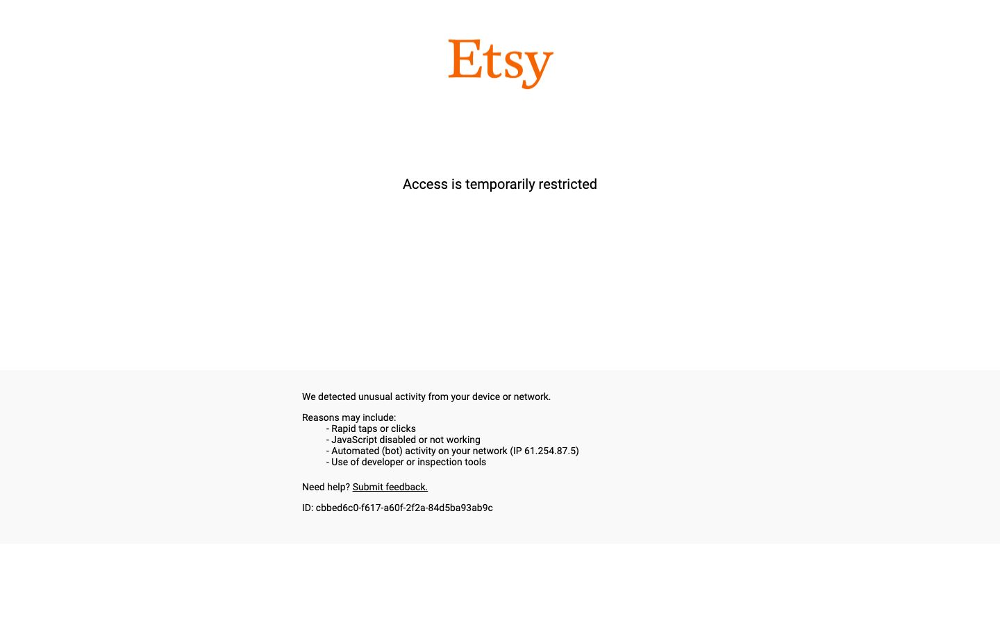

**페이지 메타 정보**

| page | title | description |
|---|---|---|
| [`trending_jewelry`](https://www.etsy.com/c/jewelry) | etsy.com |  |
| [`trending_accessories`](https://www.etsy.com/c/accessories) | etsy.com |  |

#### [Macy's](https://www.macys.com/)

- URL: <https://www.macys.com/>
- 페이지: **OK 1 · FAIL 0**

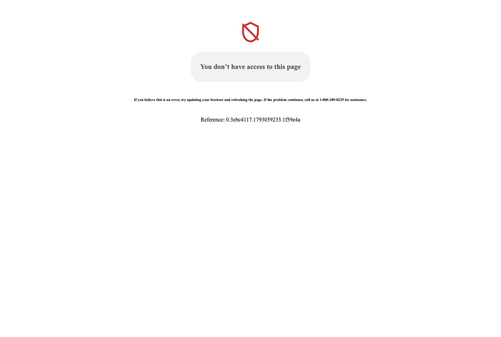

**페이지 메타 정보**

| page | title | description |
|---|---|---|
| [`new`](https://www.macys.com/shop/whats-new?id=14834) | Access Denied - Macy's | Access denied 403 |

#### [Nordstrom](https://www.nordstrom.com/)

- URL: <https://www.nordstrom.com/>
- 페이지: **OK 2 · FAIL 0**

**대표 상품 이미지** (상위 6장, 출처 URL 포함)

-  — 출처 <https://n.nordstrommedia.com/it/7f51c20a-b069-4154-9cfb-1e6d13a7c608.gif>
- 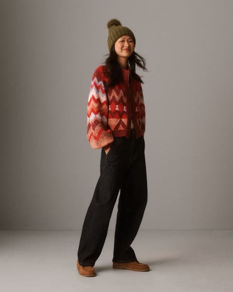 — 출처 <https://n.nordstrommedia.com/is/image/nordstrom/WMNS_TRD03F_1026_0039.jpeg?width=240&dpr=2&crop=4857.28%3A6071.6%2Coffset-x50%2Coffset-y50&trim=0.083%2C0%2C0.035%2C0>
-  — 출처 <https://n.nordstrommedia.com/is/image/nordstrom/MENS_OUT02F_1026_V2_0030.jpeg?width=240&dpr=2&crop=4829.76%3A6037.2%2Coffset-x68.314%2Coffset-y50&trim=0.05%2C0%2C0.073%2C0>
-  — 출처 <https://n.nordstrommedia.com/is/image/nordstrom/DESW_APP15F_0926_0409_altBgd_ext.jpeg?width=240&dpr=2&crop=3855.488%3A4819.36%2Coffset-x47.781%2Coffset-y50&trim=0.173%2C0%2C0%2C0>
- 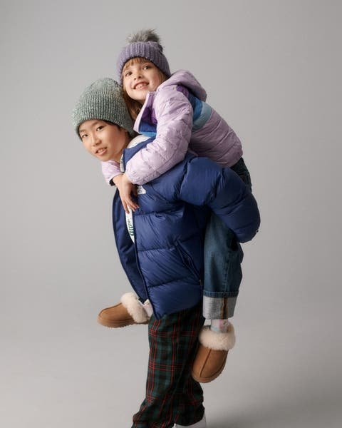 — 출처 <https://n.nordstrommedia.com/is/image/nordstrom/KIDS_LB01F_1026_v2_0021.jpeg?width=240&dpr=2&crop=5504%3A6880%2Coffset-x83.75%2Coffset-y50>
- 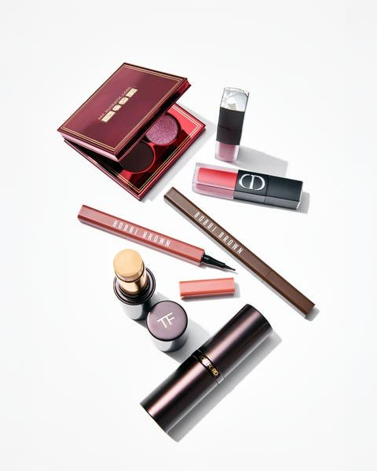 — 출처 <https://n.nordstrommedia.com/is/image/nordstrom/BEA_MKUP04P_1026.jpeg?width=240&dpr=2&crop=6425.6%3A8032%2Coffset-x50%2Coffset-y50>

**페이지 메타 정보**

| page | title | description |
|---|---|---|
| [`new`](https://www.nordstrom.com/browse/new) | New & Now | Nordstrom | Shop a great selection of New Arrivals at Nordstrom.com. Top brands. New trends. |
| [`women`](https://www.nordstrom.com/browse/women) | Women's Clothing, Shoes, & Accessories | Nordstrom | Find a great selection of Women's Clothing, Shoes, & Accessories at Nordstrom.com. Shop popular brands and top designers. |

#### [Revolve](https://www.revolve.com/)

- URL: <https://www.revolve.com/>
- 페이지: **OK 0 · FAIL 2**

**실패 페이지**

- `new` — playwright_error: Error: Page.goto: net::ERR_HTTP2_PROTOCOL_ERROR at https://www.revolve.com/new/br/c79f88/
Call log:
  - navigating to "https://www.revolve.com/new/br/c79f88/", waiting until "domcontentloaded"

- `trending` — playwright_error: Error: Page.goto: net::ERR_HTTP2_PROTOCOL_ERROR at https://www.revolve.com/most-loved/br/4a9ca5/
Call log:
  - navigating to "https://www.revolve.com/most-loved/br/4a9ca5/", waiting until "domcontentloaded"

#### [Urban Outfitters](https://www.urbanoutfitters.com/)

- URL: <https://www.urbanoutfitters.com/>
- 페이지: **OK 1 · FAIL 0**

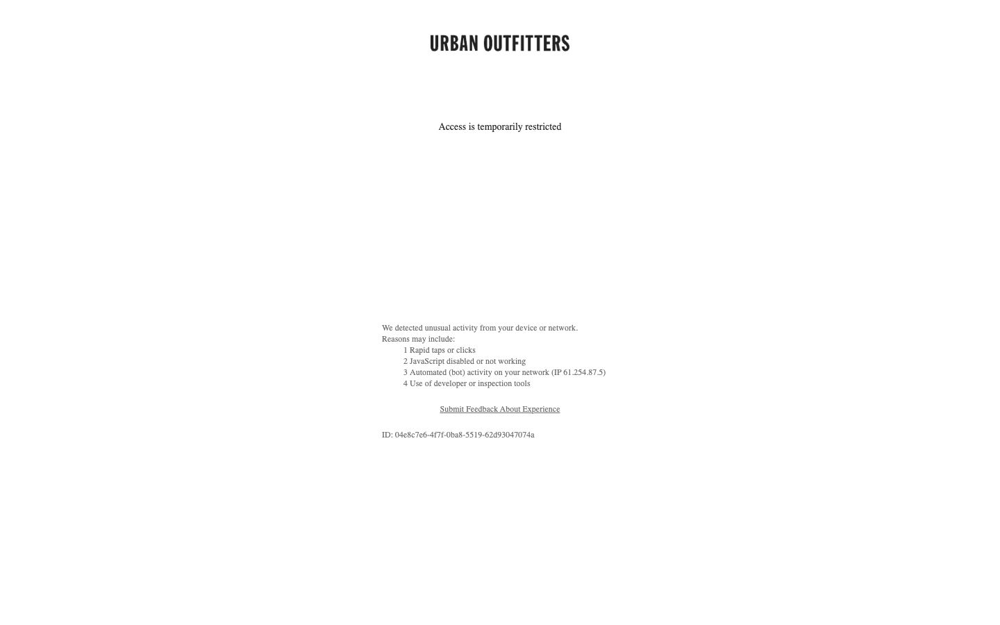

**페이지 메타 정보**

| page | title | description |
|---|---|---|
| [`new_women`](https://www.urbanoutfitters.com/womens-new-arrivals) | urbanoutfitters.com |  |

### 4.7 베트남 _( Vietnam )_

- 한국 수출규모 순위: **#4** · region: `asia` · tier `1` · currency `VND`
- 수집 사이트: **5개** (성공 5)
- 메모: 의류 생산기지/원단 수출 비중 큼. 빠르게 성장하는 이커머스
#### [Canifa](https://canifa.com/)

- URL: <https://canifa.com/>
- 페이지: **OK 1 · FAIL 0**

**대표 상품 이미지** (상위 6장, 출처 URL 포함)

- 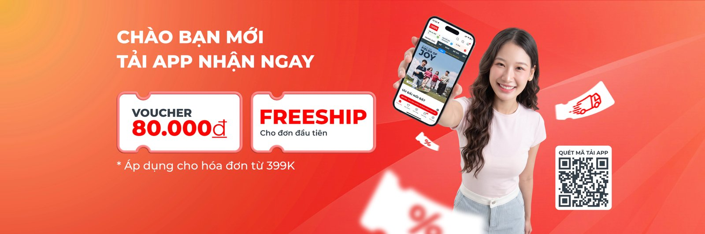 — 출처 <https://2885371169.e.cdneverest.net/Simiconnector/BannerSlider/c/h/chaobanmoi_topbanner_desktop-261026.webp>
-  — 출처 <https://2885371169.e.cdneverest.net/Simiconnector/BannerSlider/t/c/tce_topbanner_desktop-261026.webp>
-  — 출처 <https://2885371169.e.cdneverest.net/Simiconnector/BannerSlider/t/h/thqg_topbanner_desktop-161026.webp>
-  — 출처 <https://2885371169.e.cdneverest.net/Simiconnector/BannerSlider/p/a/pattern-of-life_topbanner_desk-051026.webp>
-  — 출처 <https://canifa.com/_nuxt/img/chatbot-icon.c84d6ec.webp>
-  — 출처 <https://canifa.com/_nuxt/img/chat-zalo.ab5351f.webp>

**페이지 메타 정보**

| page | title | description |
|---|---|---|
| [`home`](https://canifa.com/) | CANIFA | Patterns of Life | CANIFA - thương hiệu thời trang hàng đầu Việt Nam. Hàng ngàn mẫu quần áo phụ kiện nam, nữ, trẻ em cao cấp, chất lượng, an toàn liên tục được |

#### [IVY moda](https://ivymoda.com/)

- URL: <https://ivymoda.com/>
- 페이지: **OK 1 · FAIL 0**

**대표 상품 이미지** (상위 6장, 출처 URL 포함)

-  — 출처 <https://cotton4u.vn/files/news/2026/10/14/839870b6bb9a68439a2e1c689b67defe.webp>
-  — 출처 <https://cotton4u.vn/files/news/2026/10/23/89e8eb777a0d21e8986a7f73c2ad29ac.webp>
-  — 출처 <https://cotton4u.vn/files/product/thumab/400/2026/10/10/38f06d98332f6a08ed0ced48e18734a0.webp>
-  — 출처 <https://cotton4u.vn/files/product/thumab/400/2026/10/10/51b08549d87263e096c827bcf7b1c7bb.webp>
- 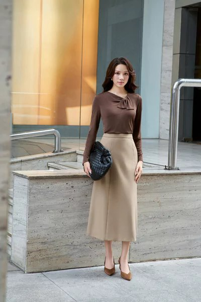 — 출처 <https://cotton4u.vn/files/product/thumab/400/2026/10/10/08c23ecb7ec6c715f9e1c8e2a1368e4d.webp>
-  — 출처 <https://cotton4u.vn/files/product/thumab/400/2026/10/10/ef4e0723556aa3cbecfdaafe17eff783.webp>

**페이지 메타 정보**

| page | title | description |
|---|---|---|
| [`home`](https://ivymoda.com/) | IVY moda - Thời Trang Công Sở Hiện Đại | IVY moda |  |

#### [Lazada Vietnam](https://www.lazada.vn/)

- URL: <https://www.lazada.vn/>
- 페이지: **OK 1 · FAIL 0**

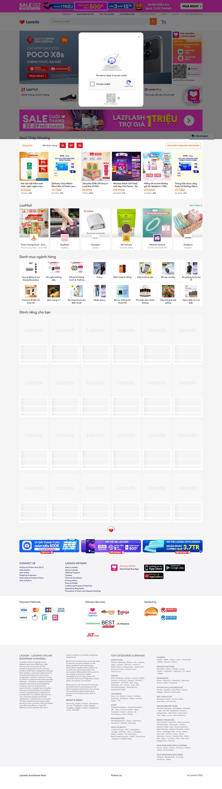

**대표 상품 이미지** (상위 6장, 출처 URL 포함)

-  — 출처 <https://img.lazcdn.com/us/domino/2ad4f22ce5a43dc145f221d13feed352.png>
-  — 출처 <https://img.lazcdn.com/g/tps/images/ims-web/TB1T7K2d8Cw3KVjSZFuXXcAOpXa.png>
- 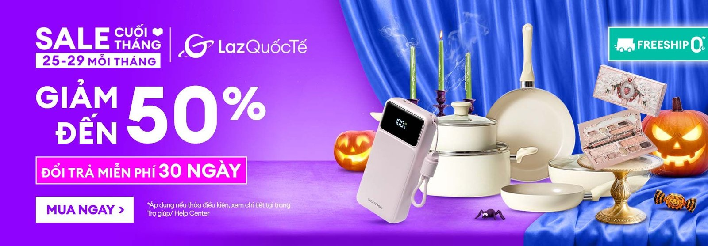 — 출처 <https://img.lazcdn.com/us/domino/964fa5ae-8dea-4d98-a3f4-ba2895ca7468_VN-1976-688.jpg_2200x2200q80.jpg>
- 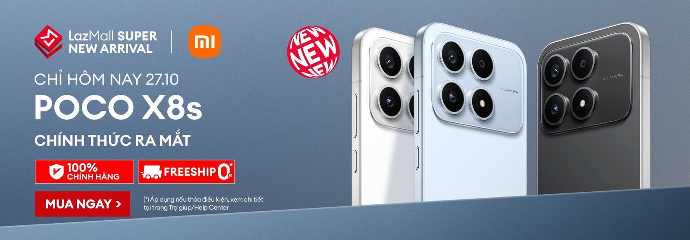 — 출처 <https://img.lazcdn.com/us/domino/06b2292a-98f6-428d-8d6c-15b1afbec880_VN-1976-688.jpg_2200x2200q80.jpg>
-  — 출처 <https://img.lazcdn.com/us/domino/ea9a93ff-8c42-4da2-87fb-3c06dda841a5_VN-1976-688.jpg_2200x2200q80.jpg>
-  — 출처 <https://img.lazcdn.com/us/domino/178575b6-2af9-435f-aed0-6f9cea6c95a4_VN-1976-688.jpg_2200x2200q80.jpg>

**페이지 메타 정보**

| page | title | description |
|---|---|---|
| [`home`](https://www.lazada.vn/#?) | Lazada Việt Nam | Mua Sắm Online, Giá Tốt Nhất Mỗi Ngày | Mua sắm đồ điện tử, thời trang, làm đẹp và đồ chơi giá cả phải chăng. Đảm bảo sản phẩm chính hãng và trải nghiệm mua sắm tiện lợi – mua ngay |

#### [Shopee Vietnam](https://shopee.vn/)

- URL: <https://shopee.vn/>
- 페이지: **OK 1 · FAIL 0**

**페이지 메타 정보**

| page | title | description |
|---|---|---|
| [`home`](https://shopee.vn/verify/captcha?anti_bot_tracking_id=gqRjZGVrxHSFomtptTE0MjUxOnRyYWNraW5nX2lkX2tleaJrdtEAAqRhbGdv0gAAAGSjZGVrwKJjdMRAAAAADLyQlHjbhu_tIJoVd59UO0aGI3u8EPZbMRUCgbeCPd4w23IClM5T1bD7-qxvztQnbHA8L7r5z24rbHP-k6pjaXBoZXJ0ZXh0xQODAAAADKhtiS0pPpl4NmdU3Mvne5gA1rpBDJTRnd-wxtLTabWJBNLhO6HrqFW40qLuqjANSMqea9t9Ji6zqzfWU07tDjVshrrEhUSa3LVXgGv8QjC7a-M-PXhRKaknr7tpbkZw_ZundFmIOH-BOeqX_CVVbB0gLD8o6Yq9nfkmHc4ZSvE82eQuqBb-9risaWZ_fvliCx7SlELO3jQE84Nlfj_RzIM8CV39-st0D-cxXbI-3LrUc3Dt3gaiqsBC7bEA8rwCb-_chjJEKdx74zSEVVO7My7gdA2RvNUjjezGtFw_tBqshmVA_A06qZMHExYSftye4Nv9aLhtyh7qAzjnR8hKmmoxwukxDT8UhVuxAqIbwV15po3QCycPnuB4PjV1GjWpgpL5F6pcVAivCrf1fbEj6Pu9t7w4_yQRldtK1zMwlQUVZn37TZwC8Dob0T_iVxo-V-0zbTe3zPgVsgbm0ob8O8Y6oTpoCOI6ClkinZ_tNMej1Bay2jakz8onHRbeizpuawLT1lfgZ1demX9j3WoHwbf-yy4TRwF5vUFqtub8ckNSpjhEdL6YjuZlMFafvbxuLqTcPtN5NUNg9vZ0jRAxk9rvs55pKY_9KNt3rqxImBIpawFSPPJAgc8K-zro-7wIltySqZ_K9GyqsPUVwIeEYGRvr-x0GByKZKyCIjH087DbLjK4AR3JIMG2NKAbSmeMrw6WBU9aLeCZ8Ht1z32h4v9AseDej33foxdKq6Re9cWPi7mgjMqYPGXGJEV-xCSyo9lXTJyaSTn-TL_ORmTBee0BOjHfsAFszxn_7a_hzALVrTseBInsogd8Tzya7toFXRlxsY99wwh13P4VRE9k5Ds3LsNobihxUpjwPzVLusBLbrJviFH_Ra6QAwBotzaO7b7_sP67ls2m6BjVcgHbtCwHftPSXnhhfPhOBltUKh-Q1qUc1CeUg5mEzM3jvDV2T9UF6KgHK3-nDAa4tEFFygTny7RygzuDeRIs_HWgreBE3lPnW7AdvHHOsGwivyqtkReantFXO_m6oz_MCzWAxtjhddCbWc0ick9vejl1GhE_1a_71Yj3Cr2jvY6AY3v8QFqq-jsjHewVH84FQ5lKnAnH2xLk9VVFyggzvDUu9tOMBmhZo9EN1QonmDrtQbs47rronsjY4DQWW0SeSx8jZ6RxkayEoJID5JMTj8CLGh8&app_key=FlashSale.PC&client_id=1&next=https%3A%2F%2Fshopee.vn%2Fverify%2Ftraffic%3F%3Fclient_id%3D%26next%3Dhttps%253A%252F%252Fshopee.vn%252F%26redirect_type%3D2%26should_replace_history%3Dfalse&redirect_type=2&scene=crawler_item&should_replace_history=false) | Shopee Việt Nam | Mua Sắm Online | Mua sắm trực tuyến hàng triệu sản phẩm ở tất cả ngành hàng. Giá tốt & Miễn phí vận chuyển. Mua và bán online trong 30 giây. Voucher Xtra | F |

#### [Tiki](https://tiki.vn/)

- URL: <https://tiki.vn/>
- 페이지: **OK 1 · FAIL 0**

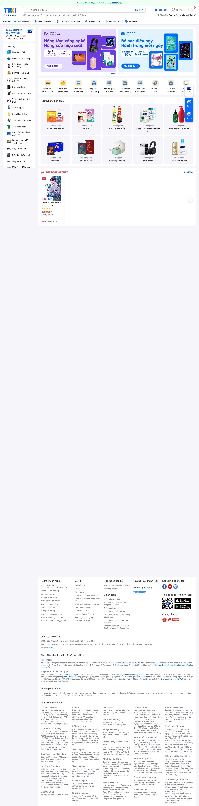

**대표 상품 이미지** (상위 6장, 출처 URL 포함)

-  — 출처 <https://salt.tikicdn.com/cache/100x100/ts/category/ed/20/60/afa9b3b474bf7ad70f10dd6443211d5f.png>
- 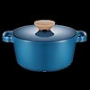 — 출처 <https://salt.tikicdn.com/cache/100x100/ts/category/f6/22/46/7e2185d2cf1bca72d5aeac385a865b2b.png>
-  — 출처 <https://salt.tikicdn.com/cache/100x100/ts/category/54/c0/ff/fe98a4afa2d3e5142dc8096addc4e40b.png>
-  — 출처 <https://salt.tikicdn.com/cache/100x100/ts/category/13/64/43/226301adcc7660ffcf44a61bb6df99b7.png>
-  — 출처 <https://salt.tikicdn.com/cache/100x100/ts/category/75/34/29/78e428fdd90408587181005f5cc3de32.png>
-  — 출처 <https://salt.tikicdn.com/cache/100x100/ts/category/61/d4/ea/e6ea3ffc1fcde3b6224d2bb691ea16a2.png>

**페이지 메타 정보**

| page | title | description |
|---|---|---|
| [`home`](https://tiki.vn/) | Tiki - Mua hàng online giá tốt, hàng chuẩn, ship nhanh | Tiện lợi mua sắm hàng triệu mặt hàng, dịch vụ. Vô vàn ưu đãi freeship, mã giảm giá. Hoàn tiền 15% tối đa 600k/tháng với thẻ tín dụng TikiCAR |

## 5. 의류 카테고리별 글로벌 트렌드

| # | 카테고리 | 건수 | 대표 상품명 |
|---:|---|---:|---|
| 1 | `자켓` | 21 | 신세틱 스웨이드 하프 자켓 [다크브라운] · 램스킨 우먼즈 포켓 자켓 [블랙] · 신세틱 스웨이드 싱글 자켓 [핑크] |
| 2 | `코트` | 7 | 니코트 피넛브라운 1인 그릇세트 4P MADE IN JAPAN · 니코트 피넛브라운 2인 신혼그릇 홈세트 9P MADE IN JAPAN · 니코트 피넛브라운 파스타 접시, 볼 2인 세트 4P MADE IN JAPAN |
| 3 | `팬츠` | 7 | 코듀로이 세미 부츠컷 팬츠 [다크브라운] · [기모🔥+골반패드탈부착/부츠컷원조1등🏆누적80만장💙마법보정핏+미친편안함/재구매율끝판왕/가을팬츠/부츠컷/니썸][made]세인트부츠컷데님 - 9color · [기모추가🔥/50만장돌파/자체제작] 허쉬 코튼 와이드팬츠 (숏/기본/롱) |
| 4 | `스커트` | 7 | [우와PICK] [6만3천장돌파/S-XL/기장옵션/MADE] 유로즈 레이어드 슬릿 롱 스커트 - 3 타입 (당일배송/가을/사계절/초겨울/겨울/스웨이드/머메이드/맥시/시스루/하객룩) · 르버터 도빌 누벅 롱 스커트 (2col) 스웨이드 H라인 치마 떠유니 · 캐시 맥시 스커트 (3color) |
| 5 | `니트` | 6 | 캐시미어 블렌드 헤어리 라운드넥 니트 [브라운] · 베이직 울100 라운드 니트 [10COL] · [가을&겨울❄/50만장돌파/자체제작] 시오 니트 (라운드넥/브이넥) |
| 6 | `슬랙스` | 5 | [🍁가을/3기장선택!] made. 모먼트 투커버 올데이슬랙스 (+숏/베이직/롱ver) - 4 size · [🏆인생부츠컷/3기장선택!] made. 세미부츠컷 찰랑슬랙스 (+숏/베이직/롱ver) - 4 size · [🏆역대급100만장/3기장선택!] made. 마켓 와이드 트레이닝슬랙스 (+숏/베이직/롱ver) - 4 size |
| 7 | `coat` | 4 | HIGH-NECK FAUX HALF FUR COAT, MOCHA GREY · Sailor Duffle Coat [Brown] · Sailor Duffle Coat [Gray] |
| 8 | `셔츠` | 3 | [✨한겹레이어드/가을이너!] made. 오브 울텐셀 레이어드 티셔츠 - 3 color · [🥇레이어드룩1위] made. 세이 셔츠앤 레이어링 니트 (워셔블니트) - 5 color · [여리핏][쫀쫀/S-M][4만장🏆][MADE]프렌즈 반버튼 레이어드 헨리넥 티셔츠 (긴팔/반팔ver)(S/M사이즈ver)(10color) |
| 9 | `가디건` | 2 | 캐시미어 블렌드 헤리티지 아가일 가디건 [차콜] · Molly Pocket Cardigan 몰리 포켓 가디건 |
| 10 | `블라우스` | 2 | [하객룩🕊️/자체제작] 라베아 타이 블라우스 (4color) · [가을하객룩✨][MADE]드넬 하이넥 타이 블라우스[3color] |

**국가별 의류 TOP**

- **korea**: `자켓`(21), `코트`(7), `팬츠`(7), `스커트`(7), `니트`(6)
## 6. 악세사리 카테고리별 글로벌 트렌드

| # | 카테고리 | 건수 | 대표 상품명 |
|---:|---|---:|---|
| 1 | `scarf` | 2 | Textured Scarf (Charcoal) · Textured Scarf (Ivory) |
| 2 | `shoes` | 1 | Flat Jazz shoes (black) |
| 3 | `bag` | 1 | Kevin Shopper Bag_Shearling Fur |

**국가별 악세사리 TOP**

- **korea**: `scarf`(2), `shoes`(1), `bag`(1)
## 7. 국가별 가격대 비교

| 국가 | 통화 | 표본 | min | p25 | median | p75 | max | median (USD) |
|---|---|---:|---:|---:|---:|---:|---:|---:|
| korea | KRW | 116 | 2980 | 32588 | 81000 | 163212 | 7650000 | 61.18 |

> p25/p75 는 IQR 기준 분위수. USD 환산은 `config/exchange_rates.yaml` 기준 (운영자가 정기 갱신).

## 8. 국내 의류·악세사리 사업동향

### KITA K-stat

- 한국무역통계의 국가 수출입 통계 총괄 페이지입니다.
- 사이트: <https://stat.kita.net/stat/kts/ctr/CtrTotalImpExpList.screen>

| # | topic | title | url |
|---:|---|---|---|
| 1 | `trade` | KITA.NET | <https://www.kita.net/> |
| 2 | `trade` | K-stat 란? | <https://www.kita.net/pdf/statGuide/index.html#p=1> |
| 3 | `무역통계` | 무역통계 분류 | <https://stat.kita.net/stat/guide/guide_18_01.screen> |
| 4 | `trade` | 한국품목코드 | <https://stat.kita.net/stat/kts/statCode/ItemHierCodeList.screen> |
| 5 | `trade` | 해외품목코드 | <https://stat.kita.net/stat/istat/common/IstatHSCode.screen> |
| 6 | `trade` | 대륙/경제코드 | <https://stat.kita.net/stat/kts/statCode/ConEcoCodeList.screen> |
| 7 | `trade` | 수출입 총괄 | <https://stat.kita.net/stat/kts/sum/SumImpExpTotalList.screen> |
| 8 | `trade` | 가공단계 수출입 | <https://stat.kita.net/stat/kts/use/BecList.screen> |
| 9 | `trade` | 품목 수출입 | <https://stat.kita.net/stat/kts/pum/ItemImpExpList.screen> |
| 10 | `trade` | 국가 수출입 | <https://stat.kita.net/stat/kts/ctr/CtrTotalImpExpList.screen> |
| 11 | `trade` | 대륙/경제권 수출입 | <https://stat.kita.net/stat/kts/rel/RelColligationList.screen> |
| 12 | `trade` | 지자체 수출입 | <https://stat.kita.net/stat/kts/prod/ProdWholeList.screen> |
| 13 | `trade` | 항구/공항 수출입 | <https://stat.kita.net/stat/kts/port/PortImpExpList.screen> |
| 14 | `trade` | FTA체결국 수출입 | <https://stat.kita.net/stat/kts/fta/FtaCtrImpExpList.screen> |
| 15 | `trade` | 간접수출 현황 | <https://stat.kita.net/stat/ind/KtsIndMain.screen> |

### Korea Customs Service

- 수출입 현황, 물류통계 등 관세청 무역통계정보를 종합적으로 제공
- 사이트: <https://tradedata.go.kr/cts/index_eng.do>

| # | topic | title | url |
|---:|---|---|---|
| 1 | `trade` | Korea Customs Service | <http://customs.go.kr/english/main.do> |

### KOSIS

- 코시스, 국가데이터처가 제공하는 원스톱 통계 서비스, 국가승인통계, 국제통계, 북한통계, e-지방지표, 통계시각화콘텐츠, 온라인간행물 등 제공
- 사이트: <https://kosis.kr/statisticsList/statisticsListIndex.do?parmTabId=M_01_01&vwcd=MT_ZTITLE&menuId=M_01_01&outLink=Y&entrType=>

| # | topic | title | url |
|---:|---|---|---|
| 1 | `statistics` | 쉽게 보는 통계 | <http://kosis.kr/easyViewStatis/customStatisIndex.do?vwcd=MT_TM1_TITLE&menuId=M_03_01> |
| 2 | `statistics` | 이슈별 접근 | <http://kosis.kr/easyViewStatis/customStatisIndex.do?vwcd=MT_TM2_TITLE&menuId=M_03_02> |
| 3 | `statistics` | 통계시각화콘텐츠 | <http://kosis.kr/easyViewStatis/visualizationIndex.do> |
| 4 | `statistics` | 온라인간행물 | <http://kosis.kr/publication/publicationThema.do> |
| 5 | `statistics` | 기획간행물 | <http://kosis.kr/publication/publicationStat.do> |
| 6 | `statistics` | KOSIS 길라잡이 | <http://kosis.kr/civilComplaint/kosisGuideIndex.do> |
| 7 | `statistics` | 홈페이지 개선의견 | <http://kosis.kr/civilComplaint/siteRequestList.do> |
| 8 | `statistics` | 찾아가는 KOSIS | <http://kosis.kr/civilComplaint/kosisEduIndex.do> |
| 9 | `statistics` | 서비스 소개 | <http://kosis.kr/serviceInfo/kosisIntroduce.do> |
| 10 | `statistics` | 국가통계현황 | <http://kosis.kr/serviceInfo/statisInstitution.do> |
| 11 | `statistics` | 국가통계 공표일정 | <http://kosis.kr/serviceInfo/statisPublicationList.do> |
| 12 | `statistics` | 팩트체크 서비스 | <http://kosis.kr/serviceInfo/factCheckList.do> |
| 13 | `statistics` | 서비스정책 | <http://kosis.kr/serviceInfo/useGuide.do> |
| 14 | `statistics` | 공유서비스 (OpenAPI) | <http://kosis.kr/serviceInfo/openAPIGuide.do> |
| 15 | `statistics` | English | <https://kosis.kr/eng> |

### KOTRA

- 트라이빅(TriBig)은 코트라(KOTRA)가 제공하는 무역투자 빅데이터 플랫폼으로 무역투자통계, 국가별 시장정보, 품목별 유망시장, 기업별 맞춤정보, 해외바이어 정보의 서비스를 제공합니다.
- 사이트: <https://www.kotra.or.kr/bigdata/visualization/korea#search/ALL/ALL/2024>

| # | topic | title | url |
|---:|---|---|---|
| 1 | `trade` | kotra 무역투자24 | <https://www.kotra.or.kr/bigdata/kotraSsoRedirect?targetURL=https://www.kotra.or.kr> |
| 2 | `trade` | 해외비즈니스 정보 포털 | <https://www.kotra.or.kr/bigdata/kotraSsoRedirect?targetURL=https://dream.kotra.or.kr/dream> |
| 3 | `trade` | 글로벌 전시포털 | <https://www.kotra.or.kr/bigdata/kotraSsoRedirect?targetURL=https://www.gep.or.kr/> |
| 4 | `trade` | KOTRA 해외인재유치센터 | <https://www.kotra.or.kr/gtc_kor> |
| 5 | `trade` | 투자유치정보제공 | <https://www.kotra.or.kr/bigdata/kotraSsoRedirect?targetURL=https://www.investkorea.org/> |
| 6 | `수출지원` | 수출지원 온라인 플랫폼 | <https://www.kotra.or.kr/bigdata/kotraSsoRedirect?targetURL=https://www.buykorea.or.kr/> |
| 7 | `trade` | 빅데이터 서비스 | <https://www.kotra.or.kr/bigdata/> |
| 8 | `trade` | 경제외교 활용포털 | <https://www.kotra.or.kr/bigdata/kotraSsoRedirect?targetURL=https://president.globalwindow.org> |
| 9 | `trade` | 방산물자교역지원센터 | <https://www.kotra.or.kr/bigdata/kotraSsoRedirect?targetURL=https://www.kotra.or.kr/kodits> |
| 10 | `trade` | 외투기업고충처리 | <https://www.kotra.or.kr/bigdata/kotraSsoRedirect?targetURL=https://ombudsman.kotra.or.kr/ob-kr> |
| 11 | `trade` | 수출바우처 · 지사화 | <https://www.exportvoucher.com> |
| 12 | `trade` | 무역투자통계 | <https://www.kotra.or.kr/bigdata/visualization/korea> |
| 13 | `trade` | 국가별 시장정보 | <https://www.kotra.or.kr/bigdata/marketAnalysis> |
| 14 | `trade` | 품목별 유망시장 | <https://www.kotra.or.kr/bigdata/bhrcMarket> |
| 15 | `trade` | 해외바이어 정보 | <https://www.kotra.or.kr/bigdata/partner/search> |

### Statistics Korea Online Shopping

- 국가데이터처,List | 전체 | 보도자료 | 새소식
- 사이트: <https://mods.go.kr/board.es?mid=a10301010000&bid=11789>

| # | topic | title | url |
|---:|---|---|---|
| 1 | `statistics` | 정보공개제도 | <https://mods.go.kr/menu.es?mid=a10101010100> |
| 2 | `statistics` | 정보공개청구 | <https://www.open.go.kr/com/main/mainView.do> |
| 3 | `statistics` | 비공개대상정보세부기준 | <https://mods.go.kr/menu.es?mid=a10101030000> |
| 4 | `statistics` | 고객수요분석 | <https://mods.go.kr/menu.es?mid=a10101040000> |
| 5 | `statistics` | 사전정보공표 | <https://mods.go.kr/menu.es?mid=a10103010000> |
| 6 | `statistics` | 사전정보공표목록 | <https://mods.go.kr/menu.es?mid=a10103010100> |
| 7 | `statistics` | 핵심단어목록 | <https://mods.go.kr/menu.es?mid=a10103020100> |
| 8 | `statistics` | 인기정보TOP10 | <https://mods.go.kr/menu.es?mid=a10103030100> |
| 9 | `statistics` | 행정자료실 | <https://mods.go.kr/menu.es?mid=a10104010000> |
| 10 | `statistics` | 업무추진비 | <https://mods.go.kr/menu.es?mid=a10104010100> |
| 11 | `statistics` | 국회관련정보 | <https://mods.go.kr/menu.es?mid=a10104040000> |
| 12 | `statistics` | 정책실명제 | <https://mods.go.kr/menu.es?mid=a10105010000> |
| 13 | `statistics` | 연도별대상사업현황 | <https://mods.go.kr/menu.es?mid=a10105020000> |
| 14 | `statistics` | 중점관리대상사업 | <https://mods.go.kr/menu.es?mid=a10105030600> |
| 15 | `statistics` | 국민신청실명제 | <https://mods.go.kr/menu.es?mid=a10105040000> |

### 기업마당

- 기업마당>정책정보>지원사업 공고
- 사이트: <https://www.bizinfo.go.kr/sii/siia/selectSIIA200View.do?null>

| # | topic | title | url |
|---:|---|---|---|
| 1 | `policy` | 지원사업 공고 | <https://www.bizinfo.go.kr/sii/siia/selectSIIA200View.do> |
| 2 | `policy` | 품목별 법정의무 인증제도 | <https://www.bizinfo.go.kr/biz/biza/selectBIZA100View.do> |
| 3 | `policy` | 입법·행정예고/고시 | <https://www.bizinfo.go.kr/biz/biza/selectBIZA300View.do> |
| 4 | `policy` | 월간 중기누리 | <https://www.bizinfo.go.kr/biz/biza/selectBIZA400View.do> |
| 5 | `policy` | 기업업무용 서식 | <https://www.bizinfo.go.kr/biz/bizb/selectBIZB100View.do> |
| 6 | `policy` | 입주기업 모집공고 | <https://www.bizinfo.go.kr/biz/bizb/selectBIZB200View.do> |
| 7 | `policy` | 온라인화상회의실 | <https://www.k-startup.go.kr/web/contents/webOLNIVIDEOMTRM.do> |
| 8 | `policy` | 정책정보 개방 | <https://www.bizinfo.go.kr/apiList.do> |
| 9 | `policy` | 속보성 대시보드 | <https://www.bizinfo.go.kr/dashboard.do> |
| 10 | `policy` | 고객의 소리 | <https://www.bizinfo.go.kr/biz/bizc/selectBIZC200Regist.do> |
| 11 | `policy` | 자주하는질문 | <https://www.bizinfo.go.kr/biz/bizc/selectBIZC300View.do> |
| 12 | `policy` | 이메일주소 무단 수집 거부안내 | <https://www.bizinfo.go.kr/biz/bizd/selectBIZD110View.do> |
| 13 | `policy` | 저작권 정책 | <https://www.bizinfo.go.kr/biz/bizd/selectBIZD120View.do> |
| 14 | `policy` | 웹접근성 정책 | <https://www.bizinfo.go.kr/biz/bizd/selectBIZD130View.do> |
| 15 | `policy` | 전체메뉴보기 | <https://www.bizinfo.go.kr/sitemap/intro.do> |

### 서울경제진흥원

- 서울경제진흥원 에러페이지
- 사이트: <https://www.sba.seoul.kr/Pages/error_404.html?aspxerrorpath=/Pages/NSub06_01.aspx>

### 소상공인24

- 소상공인24는 소상공인시장진흥공단이 운영하는 소상공인 지원사업 통합 플랫폼입니다. 소진공·지방정부·유관기관 지원사업 공고 조회와 신청, 대출상품 조회, 증명서 발급, 소상공인 통계를 한 곳에서 이용할 수 있습니다.
- 사이트: <https://www.sbiz24.kr/#/pbanc>

| # | topic | title | url |
|---:|---|---|---|
| 1 | `policy` | 지원사업 소개 | <https://www.sbiz24.kr/#/cmmn/gnrl/Conts/7> |
| 2 | `policy` | 소진공 지원사업 공고조회 및 신청 | <https://www.sbiz24.kr/#/pbanc> |
| 3 | `policy` | 지방정부 지원사업 공고조회 및 신청 | <https://www.sbiz24.kr/#/lcgPbanc> |
| 4 | `policy` | 유관기관 지원사업 공고조회 | <https://www.sbiz24.kr/#/extldPbanc> |
| 5 | `policy` | 대출상품 조회 | <https://www.sbiz24.kr/#/loanProduct> |
| 6 | `policy` | 지원사업 상담 | <https://www.sbiz24.kr/#/qna> |

### 중소벤처기업부

- 중소기업중앙회 등 기관 중소기업 조사, 통계 DB화 검색, 내려받기 등 제공.
- 사이트: <https://www.mss.go.kr/site/smba/ex/bbs/List.do?cbIdx=86>

| # | topic | title | url |
|---:|---|---|---|
| 1 | `policy` | 어린이 누리집 | <https://www.mss.go.kr/site/kids/main.do> |
| 2 | `policy` | English | <https://www.mss.go.kr/site/eng/main.do> |
| 3 | `policy` | 누리집 안내지도 | <https://www.mss.go.kr/site/smba/ex/siteMap/siteMap.do> |
| 4 | `policy` | 훈령/예규/고시/공고 | <https://www.mss.go.kr/site/smba/ex/bbs/List.do?cbIdx=125&ext6=Y> |
| 5 | `policy` | 입법/행정예고 | <https://www.mss.go.kr/site/smba/ex/bbs/List.do?cbIdx=126&searchRltnYn=Y> |
| 6 | `policy` | 인사·채용 | <https://www.mss.go.kr/site/smba/ex/bbs/List.do?cbIdx=82> |
| 7 | `policy` | 보도설명자료 | <https://www.mss.go.kr/site/smba/ex/bbs/List.do?cbIdx=87> |
| 8 | `policy` | 현장속으로 | <https://www.mss.go.kr/site/smba/brdcststnVod/brdcststnVodList.do?ctgr_code=C01> |
| 9 | `policy` | 중기부소식지 | <https://www.mss.go.kr/site/smba/ex/bbs/List.do?cbIdx=95> |
| 10 | `policy` | 통계설명자료 | <https://www.mss.go.kr/site/smba/foffice/ex/statDB/ptScheduleList.do> |
| 11 | `policy` | 주제별 통계 | <https://www.mss.go.kr/site/smba/foffice/ex/statDB/temaList.do?tabCd=0001> |
| 12 | `policy` | 조사별 통계 | <https://www.mss.go.kr/site/smba/foffice/ex/statDB/surveyList.do?tabCd=0001> |
| 13 | `policy` | 조사보고서 | <https://www.mss.go.kr/site/smba/foffice/ex/statDB/stReportRoList.do?gb=1&nodeId=&roCode=> |
| 14 | `policy` | 주제별 조회 | <https://www.mss.go.kr/site/smba/foffice/ex/statDB/stReportRcList.do?gb=2&nodeId=&rcCode=> |
| 15 | `policy` | 중소기업위상 | <https://www.mss.go.kr/site/smba/foffice/ex/statDB/MainSubStat.do?scd=0001> |

## 9. 한국 사업자 관점 기회 국가 TOP 10

| # | 국가 | tier | region | 점수 | 근거 |
|---:|---|---:|---|---:|---|
| 1 | 태국 _( Thailand )_ | 1 | `asia` | **143.5** | tier1 기본점(90); 아시아 권역(+20); ASEAN 시장(+10); K-패션/콘텐츠 친화 시장(+20); 트렌드 신호 밀도 4 |
| 2 | 대만 _( Taiwan )_ | 1 | `asia` | **136.5** | tier1 기본점(90); 아시아 권역(+20); K-패션/콘텐츠 친화 시장(+20); 트렌드 신호 밀도 6 |
| 3 | 일본 _( Japan )_ | 1 | `asia` | **130.0** | tier1 기본점(90); 아시아 권역(+20); K-패션/콘텐츠 친화 시장(+20) |
| 4 | 베트남 _( Vietnam )_ | 1 | `asia` | **126.0** | tier1 기본점(90); 아시아 권역(+20); ASEAN 시장(+10); 트렌드 신호 밀도 6 |
| 5 | 인도네시아 _( Indonesia )_ | 1 | `asia` | **122.5** | tier1 기본점(90); 아시아 권역(+20); ASEAN 시장(+10); 트렌드 신호 밀도 2 |
| 6 | 미국 _( United States )_ | 1 | `north_america` | **114.5** | tier1 기본점(90); 트렌드 신호 밀도 24 |
| 7 | 필리핀 _( Philippines )_ | 2 | `asia` | **110.0** | tier2 기본점(60); 아시아 권역(+20); ASEAN 시장(+10); K-패션/콘텐츠 친화 시장(+20) |
| 8 | 말레이시아 _( Malaysia )_ | 2 | `asia` | **90.0** | tier2 기본점(60); 아시아 권역(+20); ASEAN 시장(+10) |
| 9 | 싱가포르 _( Singapore )_ | 2 | `asia` | **90.0** | tier2 기본점(60); 아시아 권역(+20); ASEAN 시장(+10) |
| 10 | 홍콩 _( Hong Kong )_ | 2 | `asia` | **80.0** | tier2 기본점(60); 아시아 권역(+20) |

## 10. 실행 제안

### **1위 태국** (점수 144, tier1 · asia)

- 현지 스타일 TOP: `wide` — 시즌 컬렉션 기획 시 우선 반영.
- 현지 컬러 TOP: `red` — 시즌 컬렉션 기획 시 우선 반영.
- 현지 카테고리 TOP: `tee`, `bag`, `accessories` — 시즌 컬렉션 기획 시 우선 반영.
- K-패션 친화도가 명시된 시장이므로 K-브랜드 아이덴티티 및 한류 셀럽 협업을 강조.
- ASEAN 권역 시장 — 물류/관세(FTA) 활용 + 동남아 통합 마케팅 검토 권장.
- tier1 핵심 시장 — 현지 마켓플레이스(예: 해당 국가의 대표 패션 플랫폼) 공식 입점 + 셀러 운영 채널 확보 우선.
- 연계 가능한 국내 수출/지원 사업이 식별되지 않음 — `domestic_sources.yaml` 의 `landing_url` 을 KOTRA 사업 공고/기업마당 수출바우처로 직접 지정 권장.

### **2위 대만** (점수 136, tier1 · asia)

- 현지 컬러 TOP: `pink`, `red` — 시즌 컬렉션 기획 시 우선 반영.
- 현지 소재 TOP: `lace` — 시즌 컬렉션 기획 시 우선 반영.
- K-패션 친화도가 명시된 시장이므로 K-브랜드 아이덴티티 및 한류 셀럽 협업을 강조.
- 아시아 권역 시장 — 시차/언어 친화 + 한국 본사 직배송 모델 검토.
- tier1 핵심 시장 — 현지 마켓플레이스(예: 해당 국가의 대표 패션 플랫폼) 공식 입점 + 셀러 운영 채널 확보 우선.
- 연계 가능한 국내 수출/지원 사업이 식별되지 않음 — `domestic_sources.yaml` 의 `landing_url` 을 KOTRA 사업 공고/기업마당 수출바우처로 직접 지정 권장.

### **3위 일본** (점수 130, tier1 · asia)

- K-패션 친화도가 명시된 시장이므로 K-브랜드 아이덴티티 및 한류 셀럽 협업을 강조.
- 아시아 권역 시장 — 시차/언어 친화 + 한국 본사 직배송 모델 검토.
- tier1 핵심 시장 — 현지 마켓플레이스(예: 해당 국가의 대표 패션 플랫폼) 공식 입점 + 셀러 운영 채널 확보 우선.
- 연계 가능한 국내 수출/지원 사업이 식별되지 않음 — `domestic_sources.yaml` 의 `landing_url` 을 KOTRA 사업 공고/기업마당 수출바우처로 직접 지정 권장.

### 운영 점검 노트

- **한국 어휘사전 매칭 0건**: 메인페이지만 수집되어 색/소재/스타일 신호가 0. 한국 사이트(29CM/W Concept/Musinsa)에 `page_targets` 추가 필요.
- **ASEAN 다중 진출 기회**: TOP10 중 ASEAN 국가가 3개 이상. Shopee/Lazada/Zalora 통합 운영을 통한 동남아 멀티마켓 전략을 검토 권장.

## 11. 수집 실패/주의 사이트

| 국가 | 사이트 | 페이지 | 상태 | 사유 |
|---|---|---|---|---|
| usa | Revolve | new | failed | playwright_error: Error: Page.goto: net::ERR_HTTP2_PROTOCOL_ERROR at https://www.revolve.com/new/br/c79f88/
Call log:
  - navigating to "https://www.revolve.com/new/br/c79f88/", waiting until "domcontentloaded"
 |
| usa | Revolve | trending | failed | playwright_error: Error: Page.goto: net::ERR_HTTP2_PROTOCOL_ERROR at https://www.revolve.com/most-loved/br/4a9ca5/
Call log:
  - navigating to "https://www.revolve.com/most-loved/br/4a9ca5/", waiting until "domcontentloaded"
 |
| japan | ZOZOTOWN | new | failed | playwright_error: TimeoutError: Page.goto: Timeout 30000ms exceeded.
Call log:
  - navigating to "https://zozo.jp/category/new/", waiting until "domcontentloaded"
 |
| japan | ZOZOTOWN | ranking | failed | playwright_error: TimeoutError: Page.goto: Timeout 30000ms exceeded.
Call log:
  - navigating to "https://zozo.jp/ranking/", waiting until "domcontentloaded"
 |
| japan | Rakuten Fashion | women | failed | http_status_404 |
| indonesia | Tokopedia | home | failed | playwright_error: Error: Page.goto: net::ERR_HTTP2_PROTOCOL_ERROR at https://www.tokopedia.com/
Call log:
  - navigating to "https://www.tokopedia.com/", waiting until "domcontentloaded"
 |
| indonesia | Berrybenka | home | failed | http_status_429 |
| thailand | Pomelo | new | failed | robots_disallowed |
| thailand | Pomelo | best | failed | robots_disallowed |
| korea | Musinsa | home | failed | robots_disallowed |

## 12. 원문 출처 및 이미지 출처

### 인도네시아

- **Berrybenka** — <https://www.berrybenka.com/>
- **Hijup** — <https://www.hijup.com/>
- **Shopee Indonesia** — <https://shopee.co.id/>
  - 이미지 출처: <https://deo.shopeemobile.com/shopee/shopee-pcmall-live-sg/assets/1c8bdaaf45e1fd48.png>
- **Tokopedia** — <https://www.tokopedia.com/>
- **Zalora Indonesia** — <https://www.zalora.co.id/>
  - 이미지 출처: <https://static-id.zacdn.com/next-assets/static-assets/images/logo/icon_mastercard.png>
  - 이미지 출처: <https://static-id.zacdn.com/next-assets/static-assets/images/logo/icon_visa.png>
  - 이미지 출처: <https://static-id.zacdn.com/next-assets/static-assets/images/logo/icon_ovo.png>
  - 이미지 출처: <https://static-id.zacdn.com/next-assets/static-assets/images/logo/icon_indodana.png>

### 일본

- **GU Japan** — <https://www.gu-global.com/jp/>
  - 이미지 출처: <https://image.uniqlo.com/GU/ST3/jp/imagesother/Navigation/WOMEN_Category/2026/261023/261023_category-icon_autumn-winter-sale.png>
  - 이미지 출처: <https://image.uniqlo.com/GU/ST3/jp/imagesother/Navigation/Category-icon_V2/2026/0724/Categoy_Limited-offers.jpg>
  - 이미지 출처: <https://image.uniqlo.com/GU/ST3/jp/imagesother/Navigation/Category-icon_V2/2026/0724/Categoy_SALE.jpg>
  - 이미지 출처: <https://image.uniqlo.com/GU/ST3/jp/imagesother/Navigation/collaboration_Category/26FW/rokh_category_icon.png>
  - 이미지 출처: <https://image.uniqlo.com/GU/ST3/jp/imagesother/Navigation/collaboration_Category/26FW/261023_category_icon_POKEMON.png>
  - 이미지 출처: <https://image.uniqlo.com/GU/ST3/jp/imagesother/Navigation/WOMEN_Category/2026/260901/Category_w_Outer_361430.png>
  - 이미지 출처: <https://image.uniqlo.com/GU/ST3/jp/imagesother/Navigation/WOMEN_Category/2026/261008/category_w_knit-and-cardigan_360549.png>
  - 이미지 출처: <https://image.uniqlo.com/GU/ST3/jp/imagesother/Navigation/WOMEN_Category/2026/261008/category_w_tops_361505.png>
  - 이미지 출처: <https://image.uniqlo.com/GU/ST3/jp/imagesother/Navigation/WOMEN_Category/2026/260911/Category_w_sweat_361784.png>
  - 이미지 출처: <https://image.uniqlo.com/GU/ST3/jp/imagesother/Navigation/WOMEN_Category/2026/261016/category_w_sheer-T_358176_30.png>
  - 이미지 출처: <https://image.uniqlo.com/GU/ST3/jp/imagesother/Navigation/WOMEN_Category/2026/261016/category_w_fleece_361372.png>
  - 이미지 출처: <https://image.uniqlo.com/GU/ST3/jp/imagesother/Navigation/WOMEN_Category/2026/260807/Category_w_shirt_361657.png>
  - 이미지 출처: <https://image.uniqlo.com/GU/ST3/jp/imagesother/Navigation/WOMEN_Category/2026/260724/Category_w_Pants.jpg>
  - 이미지 출처: <https://image.uniqlo.com/GU/ST3/jp/imagesother/Navigation/WOMEN_Category/2026/260820/Category_w_skirt_361518.png>
- **Rakuten Fashion** — <https://brandavenue.rakuten.co.jp/>
  - 이미지 출처: <https://brandavenue.r10s.jp/img/library/index/sbn_flagshipstore_20231003.png>
  - 이미지 출처: <https://brandavenue.r10s.jp/img/news/01/404975/pc_n.jpg>
  - 이미지 출처: <https://brandavenue.r10s.jp/img/news/01/405529/pc_n.jpg>
  - 이미지 출처: <https://brandavenue.r10s.jp/img/news/01/405569/pc_n.jpg>
  - 이미지 출처: <https://brandavenue.r10s.jp/img/news/01/404400/pc_n.jpg>
  - 이미지 출처: <https://brandavenue.r10s.jp/img/news/01/404816/pc_n.jpg>
  - 이미지 출처: <https://brandavenue.r10s.jp/img/news/01/405523/pc_n.jpg>
  - 이미지 출처: <https://brandavenue.r10s.jp/img/news/01/405400/pc_n.jpg>
  - 이미지 출처: <https://brandavenue.r10s.jp/img/news/01/405571/pc_n.jpg>
  - 이미지 출처: <https://brandavenue.r10s.jp/img/news/01/404900/pc_n.jpg>
  - 이미지 출처: <https://brandavenue.r10s.jp/img/news/01/403277/pc_n.jpg>
  - 이미지 출처: <https://brandavenue.r10s.jp/img/news/01/405458/pc_n.jpg>
  - 이미지 출처: <https://brandavenue.r10s.jp/img/news/01/405509/pc_n.png>
  - 이미지 출처: <https://brandavenue.r10s.jp/img/news/01/405072/pc_n.jpg>
  - 이미지 출처: <https://brandavenue.r10s.jp/img/news/01/405538/pc_n.jpg>
  - 이미지 출처: <https://brandavenue.r10s.jp/img/news/01/395230/pc_n.jpg>
  - 이미지 출처: <https://brandavenue.r10s.jp/img/news/01/405044/pc_n.jpg>
  - 이미지 출처: <https://brandavenue.r10s.jp/img/news/01/405438/pc_n.jpg>
  - 이미지 출처: <https://brandavenue.r10s.jp/img/news/01/405398/pc_n.jpg>
- **Uniqlo Japan** — <https://www.uniqlo.com/jp/>
- **WEAR** — <https://wear.jp/>
  - 이미지 출처: <https://wear.jp/public/_next/static/media/notfound_bg.1ywd-k_shp-hy.png>
  - 이미지 출처: <https://wear.jp/public/_next/static/media/notfound_4.1ho27atf54bbv.png>
  - 이미지 출처: <https://wear.jp/public/_next/static/media/notfound_0.438l9b9xjj6tm.png>
  - 이미지 출처: <https://images.wear2.jp/coordinate/kAiO3P8/BGywH5db/1793040584_276.jpg>
  - 이미지 출처: <https://images.wear2.jp/coordinate/jmi8pOzw/HujGOacd/1793019737_276.jpg>
  - 이미지 출처: <https://images.wear2.jp/coordinate/Owid7r4/uNgtfAHq/1793013425_276.jpg>
  - 이미지 출처: <https://images.wear2.jp/coordinate/DZioQ5Z0/oWluiBD1/1793027140_276.jpg>
  - 이미지 출처: <https://images.wear2.jp/coordinate/kAizpQOb/4K2EJqH2/1792730069_276.jpg>
  - 이미지 출처: <https://images.wear2.jp/coordinate/kAizvA4D/MzakY70W/1793001894_276.jpg>
  - 이미지 출처: <https://images.wear2.jp/profile/6gio2xl5/hpSX0raH/1715229637_120.jpg>
  - 이미지 출처: <https://images.wear2.jp/profile/rlivRRy4/1gPsHNiL/1703226190_120.jpg>
  - 이미지 출처: <https://images.wear2.jp/profile/Mniv4bE/A8v7HSsc/1726841922_120.jpg>
  - 이미지 출처: <https://images.wear2.jp/profile/wni2A5oM/QvFHtX1b/1707265256_120.jpg>
  - 이미지 출처: <https://images.wear2.jp/profile/wnipYnRD/X8dWuLfA/1706628765_120.jpg>
  - 이미지 출처: <https://images.wear2.jp/profile/MniRzZAQ/UyzGti6g/1778248980_120.jpg>
  - 이미지 출처: <https://images.wear2.jp/profile/3oiqVaom/URuKOaZE/1787153862_120.jpg>
  - 이미지 출처: <https://cdn.wimg.jp/profile/e5gvvs/20210422190902624_120.jpg>
  - 이미지 출처: <https://images.wear2.jp/profile/YMiQA7V5/3AKQ654r/1744794165_120.jpg>
  - 이미지 출처: <https://wear.jp/public/_next/static/media/mock.1rl8d86z-j78c.webp>
  - 이미지 출처: <https://wear.jp/public/_next/static/media/newgrad28-business-entry-sp.400k08y827-wx.webp>
- **ZOZOTOWN** — <https://zozo.jp/>

### 한국

- **29CM** — <https://www.29cm.co.kr/>
  - 이미지 출처: <https://img.29cm.co.kr/cms/202610/11f1ce9db46e49e2838179fabf53e6f3.jpg?width=3840&format=webp>
  - 이미지 출처: <https://img.29cm.co.kr/cms/202610/11f1ce9da88a01f4a087e71ec3ba7d9c.jpg?width=3840&format=webp>
  - 이미지 출처: <https://img.29cm.co.kr/cms/202610/11f1ce9da0811f408381394a48409a1f.jpg?width=3840&format=webp>
  - 이미지 출처: <https://img.29cm.co.kr/cms/202610/11f1ce9d93fa7d888381ade1653512f3.jpg?width=3840&format=webp>
  - 이미지 출처: <https://img.29cm.co.kr/cms/202610/11f1ce9d8799646083819789cabe048f.jpg?width=3840&format=webp>
  - 이미지 출처: <https://img.29cm.co.kr/cms/202610/11f1ce9d7e3f97d083817b9cdcb9de30.jpg?width=3840&format=webp>
  - 이미지 출처: <https://img.29cm.co.kr/cms/202610/11f1ce9d720a97908381935fe73e136c.jpg?width=3840&format=webp>
  - 이미지 출처: <https://img.29cm.co.kr/cms/202610/11f1ce9d6947db30a08737025a8f1e8a.jpg?width=3840&format=webp>
  - 이미지 출처: <https://img.29cm.co.kr/cms/202610/11f1cdda56f5cd5899aefd6f393c2f5c.jpg?width=3840&format=webp>
  - 이미지 출처: <https://img.29cm.co.kr/cms/202610/11f1cdda2fbcc1aeb3932b514d6ed7b1.jpg?width=3840&format=webp>
  - 이미지 출처: <https://img.29cm.co.kr/cms/202610/11f1cd2711ba3398b39383bb106f960e.jpg?width=3840&format=webp>
  - 이미지 출처: <https://img.29cm.co.kr/cms/202610/11f1cc4698532a4b99aeb9c9ae096bfb.jpg?width=3840&format=webp>
  - 이미지 출처: <https://img.29cm.co.kr/cms/202610/11f1cb7d36374c4eb3931f49e27b0f68.jpg?width=3840&format=webp>
  - 이미지 출처: <https://img.29cm.co.kr/cms/202610/11f1cb7d308f6420b39361bedef99265.jpg?width=3840&format=webp>
  - 이미지 출처: <https://img.29cm.co.kr/cms/202610/11f1c92c528a386099ae0964f551ae5b.jpg?width=3840&format=webp>
  - 이미지 출처: <https://img.29cm.co.kr/cms/202610/11f1c92c397d8fe9b3930fab522e24cd.jpg?width=3840&format=webp>
  - 이미지 출처: <https://img.29cm.co.kr/cms/202610/11f1c92c306b2c93b3936f550f2dc2c8.jpg?width=3840&format=webp>
  - 이미지 출처: <https://img.29cm.co.kr/cms/202610/11f1c86197c949dc880109aa0c29b9ac.jpg?width=3840&format=webp>
- **Musinsa** — <https://www.musinsa.com/>
- **W Concept** — <https://www.wconcept.co.kr/>
- **Zigzag** — <https://zigzag.kr/>

### 대만

- **momo** — <https://www.momoshop.com.tw/>
  - 이미지 출처: <https://img3.momoshop.com.tw/ecm/img/online/10/998/00/000/bt_0_271_01/bt_0_271_01_e2.jpg?t=1785743060613>
  - 이미지 출처: <https://img1.momoshop.com.tw/ecm/img/online/10/998/00/000/bt_0_245_01/bt_0_245_01_P1_1_e2.png?t=1793030407033>
  - 이미지 출처: <https://img1.momoshop.com.tw/ecm/img/online/10/998/00/000/bt_0_245_01/bt_0_245_01_P1_2_e2.png?t=1793030407033>
  - 이미지 출처: <https://img1.momoshop.com.tw/ecm/img/online/10/998/00/000/bt_0_245_01/bt_0_245_01_P1_3_e2.png?t=1793030407033>
  - 이미지 출처: <https://img3.momoshop.com.tw/ecm/img/online/81/998/00/000/mobile/bt_7_701_01/bt_7_701_01_e131.jpg?t=1792727905224>
  - 이미지 출처: <https://img3.momoshop.com.tw/ecm/img/online/81/998/00/000/mobile/bt_7_701_01/bt_7_701_01_e101.jpg?t=1792727905214>
  - 이미지 출처: <https://img3.momoshop.com.tw/ecm/img/online/81/998/00/000/mobile/bt_7_701_01/bt_7_701_01_e61.jpg?t=1792727905199>
  - 이미지 출처: <https://img3.momoshop.com.tw/ecm/img/online/81/998/00/000/mobile/bt_7_701_01/bt_7_701_01_e31.jpg?t=1792727905186>
  - 이미지 출처: <https://img3.momoshop.com.tw/ecm/img/online/81/998/00/000/mobile/bt_7_701_01/bt_7_701_01_e111.jpg?t=1792727905217>
  - 이미지 출처: <https://img3.momoshop.com.tw/ecm/img/online/81/998/00/000/mobile/bt_7_701_01/bt_7_701_01_e161.jpg?t=1792727905235>
  - 이미지 출처: <https://img3.momoshop.com.tw/ecm/img/online/81/998/00/000/mobile/bt_7_701_01/bt_7_701_01_e81.jpg?t=1792727905205>
  - 이미지 출처: <https://img3.momoshop.com.tw/ecm/img/online/81/998/00/000/mobile/bt_7_701_01/bt_7_701_01_e41.jpg?t=1792727905191>
  - 이미지 출처: <https://img3.momoshop.com.tw/ecm/img/online/81/998/00/000/mobile/bt_7_701_01/bt_7_701_01_e121.png?t=1792727905220>
  - 이미지 출처: <https://img3.momoshop.com.tw/ecm/img/online/81/998/00/000/mobile/bt_7_701_01/bt_7_701_01_e91.jpg?t=1792727905209>
  - 이미지 출처: <https://img3.momoshop.com.tw/ecm/img/online/81/998/00/000/mobile/bt_7_701_01/bt_7_701_01_e71.jpg?t=1792727905202>
  - 이미지 출처: <https://img3.momoshop.com.tw/ecm/img/online/81/998/00/000/mobile/bt_7_701_01/bt_7_701_01_e21.jpg?t=1792727905183>
  - 이미지 출처: <https://img3.momoshop.com.tw/ecm/img/online/81/998/00/000/mobile/bt_7_701_01/bt_7_701_01_e151.jpg?t=1792727905231>
  - 이미지 출처: <https://img3.momoshop.com.tw/ecm/img/online/81/998/00/000/mobile/bt_7_701_01/bt_7_701_01_e51.jpg?t=1792727905195>
  - 이미지 출처: <https://img3.momoshop.com.tw/ecm/img/online/81/998/00/000/mobile/bt_7_701_01/bt_7_701_01_e141.jpg?t=1792727905228>
- **OB Design** — <https://www.obdesign.com.tw/>
  - 이미지 출처: <https://cms-static.cdn.91app.com/images/original/41602/92f19e4d-89b7-4330-9570-02cf1dff9742-1792557973-6drun5zyc4_d_1920x820_1280x547_1124x480_800x342_600x256_400x171.jpg>
  - 이미지 출처: <https://cms-static.cdn.91app.com/images/original/41602/92f19e4d-89b7-4330-9570-02cf1dff9742-1792651691-cbu6lcg4qm_d_1920x820_1280x547_1124x480_800x342_600x256_400x171.jpg>
  - 이미지 출처: <https://cms-static.cdn.91app.com/images/original/41602/92f19e4d-89b7-4330-9570-02cf1dff9742-1792634852-4qi55pzdbb_d_1920x820_1280x547_1124x480_800x342_600x256_400x171.jpg>
  - 이미지 출처: <https://cms-static.cdn.91app.com/images/original/41602/92f19e4d-89b7-4330-9570-02cf1dff9742-1792737612-dn1wmx9ffo_d_1920x820_1280x547_1124x480_800x342_600x256_400x171.jpg>
  - 이미지 출처: <https://cms-static.cdn.91app.com/images/compress/41602/92f19e4d-89b7-4330-9570-02cf1dff9742-1792737612-dn1wmx9ffo_d_400x171.webp>
  - 이미지 출처: <https://cms-static.cdn.91app.com/images/original/41602/92f19e4d-89b7-4330-9570-02cf1dff9742-1792634722-w0s0fz0ca4_d_1920x820_1280x547_1124x480_800x342_600x256_400x171.jpg>
  - 이미지 출처: <https://cms-static.cdn.91app.com/images/original/41602/92f19e4d-89b7-4330-9570-02cf1dff9742-1792556280-p7ileh8xvh_d_1920x820_1280x547_1124x480_800x342_600x256_400x171.jpg>
  - 이미지 출처: <https://cms-static.cdn.91app.com/images/original/41602/92f19e4d-89b7-4330-9570-02cf1dff9742-1792377622-a0d3jhklbp_d_1920x820_1280x547_1124x480_800x342_600x256_400x171.jpg>
  - 이미지 출처: <https://cms-static.cdn.91app.com/images/original/41602/92f19e4d-89b7-4330-9570-02cf1dff9742-1791957884-wtfzxkcvms_d_1920x820_1280x547_1124x480_800x342_600x256_400x171.jpg>
  - 이미지 출처: <https://cms-static.cdn.91app.com/images/original/41602/20e150ef-f3b9-41e5-a7d1-3e246e070a59-1766996640-zaqbt3m2o6_m.png>
  - 이미지 출처: <https://cms-static.cdn.91app.com/images/original/41602/20e150ef-f3b9-41e5-a7d1-3e246e070a59-1767328066-hpr7vgg5h2_m.png>
  - 이미지 출처: <https://cms-static.cdn.91app.com/images/original/41602/20e150ef-f3b9-41e5-a7d1-3e246e070a59-1767067052-avl82sdmyk_m.gif>
  - 이미지 출처: <https://cms-static.cdn.91app.com/images/original/41602/20e150ef-f3b9-41e5-a7d1-3e246e070a59-1772016038-bahn8sg6xa_m.png>
  - 이미지 출처: <https://cms-static.cdn.91app.com/images/original/41602/92f19e4d-89b7-4330-9570-02cf1dff9742-1791791085-tiauxgne1q_m_1280x600_1124x527_800x375_600x281_400x188.jpg>
  - 이미지 출처: <https://cms-static.cdn.91app.com/images/compress/41602/92f19e4d-89b7-4330-9570-02cf1dff9742-1791791085-tiauxgne1q_m_400x188.webp>
  - 이미지 출처: <https://cms-static.cdn.91app.com/images/original/41602/92f19e4d-89b7-4330-9570-02cf1dff9742-1792396568-ypzzc7rp4d_m_1280x600_1124x527_800x375_600x281_400x188.jpg>
- **PChome** — <https://24h.pchome.com.tw/>
- **Pinkoi Taiwan** — <https://www.pinkoi.com/>
  - 이미지 출처: <https://cdn04.pinkoi.com/pinkoi.site/logo/og_image.png>
- **Yahoo Taiwan Shopping** — <https://tw.buy.yahoo.com/>
  - 이미지 출처: <https://img.yec.tw/zp/MerchandiseImages/F7B8DEAD00-Gd-12256441.jpg>
  - 이미지 출처: <https://img.yec.tw/zp/MerchandiseImages/ac2a63749a-Gd-12306088.jpg>
  - 이미지 출처: <https://img.yec.tw/zp/MerchandiseImages/d696228672-Gd-11092952.jpg>

### 태국

- **Central Online** — <https://www.central.co.th/>
  - 이미지 출처: <https://www.central.co.th/_next/image?url=https%3A%2F%2Fassets.central.co.th%2Ffile-assets%2Fassets%2FCMS%2Fcampaign%2F2026%2F10oct%2F20261006_ANV2026_Homepage_herobanner.jpg&w=3840&q=75>
  - 이미지 출처: <https://www.central.co.th/_next/image?url=https%3A%2F%2Fassets.central.co.th%2Ffile-assets%2Fassets%2FCMS%2Fcampaign%2F2026%2F10oct%2F20261025_FITFLOP_heroweb_d.jpg&w=3840&q=75>
  - 이미지 출처: <https://www.central.co.th/_next/image?url=%2Fimages%2Fposter-desktop.webp&w=1920&q=75>
  - 이미지 출처: <https://www.central.co.th/_next/image?url=https%3A%2F%2Fassets.central.co.th%2Ffile-assets%2Fassets%2FCMS%2Fcampaign%2F2026%2F10oct%2F202601023_lamer_heroweb_d.jpg&w=3840&q=75>
  - 이미지 출처: <https://www.central.co.th/_next/image?url=https%3A%2F%2Fassets.central.co.th%2Ffile-assets%2Fassets%2FCMS%2Fcampaign%2F2026%2F10oct%2F20261027_dior_heroweb_d.jpg&w=3840&q=75>
  - 이미지 출처: <https://www.central.co.th/_next/image?url=https%3A%2F%2Fassets.central.co.th%2Ffile-assets%2Fassets%2FCMS%2Fcampaign%2F2026%2F10oct%2F20261023_esteelauder_heroweb_d.jpg&w=3840&q=75>
  - 이미지 출처: <https://www.central.co.th/_next/image?url=https%3A%2F%2Fassets.central.co.th%2Ffile-assets%2Fassets%2FCMS%2Fcampaign%2F2026%2F10oct%2F20261025_lancome_heroweb_d.jpg&w=3840&q=75>
  - 이미지 출처: <https://www.central.co.th/_next/image?url=https%3A%2F%2Fassets.central.co.th%2Ffile-assets%2Fassets%2FCMS%2Fcampaign%2F2026%2F10oct%2F20261025_CALVIN-KLEIN_heroweb_d.jpg&w=3840&q=75>
  - 이미지 출처: <https://www.central.co.th/_next/image?url=https%3A%2F%2Fassets.central.co.th%2Ffile-assets%2Fassets%2FCMS%2Fcampaign%2F2026%2F10oct%2F20261025_crocs_heroweb_d.jpg&w=3840&q=75>
  - 이미지 출처: <https://www.central.co.th/_next/image?url=https%3A%2F%2Fassets.central.co.th%2Ffile-assets%2Fassets%2FCMS%2Fcampaign%2F2026%2F10oct%2F20261016_lego_heroweb_d.jpg&w=3840&q=75>
  - 이미지 출처: <https://www.central.co.th/_next/image?url=https%3A%2F%2Fassets.central.co.th%2Ffile-assets%2Fassets%2FCMS%2Fcampaign%2F2026%2F10oct%2F20261016_SANRIO_heroweb_d.jpg&w=3840&q=75>
  - 이미지 출처: <https://www.central.co.th/_next/image?url=https%3A%2F%2Fassets.central.co.th%2Ffile-assets%2Fassets%2FCMS%2Fevm%2Fcategory-navigation%2FCategory-carousel%2FBeauty%2FTH_beauty.png&w=3840&q=75>
  - 이미지 출처: <https://www.central.co.th/_next/image?url=https%3A%2F%2Fassets.central.co.th%2Ffile-assets%2Fassets%2FCMS%2Fevm%2Fcategory-navigation%2FCategory-carousel%2FWomen%2FTH_women.png&w=3840&q=75>
  - 이미지 출처: <https://www.central.co.th/_next/image?url=https%3A%2F%2Fassets.central.co.th%2Ffile-assets%2Fassets%2FCMS%2Fevm%2Fcategory-navigation%2FCategory-carousel%2FMen%2FTH_men.png&w=3840&q=75>
  - 이미지 출처: <https://www.central.co.th/_next/image?url=https%3A%2F%2Fassets.central.co.th%2Ffile-assets%2Fassets%2FCMS%2Fevm%2Fcategory-navigation%2FCategory-carousel%2FFashion-accessories%2FTH_fashion-accessories.png&w=3840&q=75>
  - 이미지 출처: <https://www.central.co.th/_next/image?url=https%3A%2F%2Fassets.central.co.th%2Ffile-assets%2Fassets%2FCMS%2Fcampaign%2F2025%2F09sep%2Fshoesth.png&w=3840&q=75>
  - 이미지 출처: <https://www.central.co.th/_next/image?url=https%3A%2F%2Fassets.central.co.th%2Ffile-assets%2Fassets%2FCMS%2Fevm%2Fcategory-navigation%2FCategory-carousel%2FWatches-jewelry%2FTH_watches-jewelry.png&w=3840&q=75>
- **Lazada Thailand Fashion** — <https://www.lazada.co.th/>
  - 이미지 출처: <https://img.lazcdn.com/us/domino/40845120240f19d13f738fa9a7978edd.png>
  - 이미지 출처: <https://img.lazcdn.com/g/tps/images/ims-web/TB1KB2laMFY.1VjSZFnXXcFHXXa.png>
  - 이미지 출처: <https://img.lazcdn.com/us/domino/9de93127-9819-4f69-89e3-25af8e8bd1da_TH-1976-688.jpg_2200x2200q80.jpg>
  - 이미지 출처: <https://img.lazcdn.com/us/domino/699517bf-89f6-4b22-b8d3-5c4fa986c286_TH-1976-688.jpg_2200x2200q80.jpg>
  - 이미지 출처: <https://img.lazcdn.com/us/domino/ff807222-c1b0-45dd-8d12-ef32cf622397_TH-1976-688.jpg_2200x2200q80.jpg>
  - 이미지 출처: <https://img.lazcdn.com/us/domino/9bfb6365-b03d-42b8-8476-dc0fae5ac5bf_TH-1976-688.jpg_2200x2200q80.jpg>
  - 이미지 출처: <https://img.lazcdn.com/us/domino/1e83c1cd-f970-4174-9f04-fbd286407fb1_TH-1976-688.jpg_2200x2200q80.jpg>
  - 이미지 출처: <https://img.lazcdn.com/us/domino/08cbfebe-403c-46ef-b8ad-f22260ba29ef_TH-1976-688.jpg_2200x2200q80.jpg>
  - 이미지 출처: <https://img.lazcdn.com/us/domino/3f66d6f9-a3dd-4a62-afac-c5cabad99530_TH-1976-688.jpg_2200x2200q80.jpg>
  - 이미지 출처: <https://img.lazcdn.com/us/domino/7566d83b-49e3-4c4a-888e-8e036610c818_TH-1976-688.jpg_2200x2200q80.jpg>
  - 이미지 출처: <https://img.lazcdn.com/us/domino/ae0097cdb1eceff6a1c6c8e67b5c09f7.png_360x360q80.png>
  - 이미지 출처: <https://img.lazcdn.com/us/domino/2982506b-639f-44f6-8482-d49a42106fe6_TH-276-260.png_300x300q80.png>
- **Pomelo** — <https://www.pomelofashion.com/>
- **Shopee Thailand Fashion** — <https://shopee.co.th/>
  - 이미지 출처: <https://deo.shopeemobile.com/shopee/shopee-pcmall-live-sg/assets/1c8bdaaf45e1fd48.png>
  - 이미지 출처: <https://deo.shopeemobile.com/shopee/shopee-pcmall-live-sg/homepagefe/42ba6075c82a85ab.png>
- **Zalora Thailand** — <https://www.zalora.co.th/>
  - 이미지 출처: <https://www.zalora.co.th/images/landingpage/525x500.gif>

### 미국

- **Etsy** — <https://www.etsy.com/>
- **Macy's** — <https://www.macys.com/>
- **Nordstrom** — <https://www.nordstrom.com/>
  - 이미지 출처: <https://n.nordstrommedia.com/it/7f51c20a-b069-4154-9cfb-1e6d13a7c608.gif>
  - 이미지 출처: <https://n.nordstrommedia.com/is/image/nordstrom/WMNS_TRD03F_1026_0039.jpeg?width=240&dpr=2&crop=4857.28%3A6071.6%2Coffset-x50%2Coffset-y50&trim=0.083%2C0%2C0.035%2C0>
  - 이미지 출처: <https://n.nordstrommedia.com/is/image/nordstrom/MENS_OUT02F_1026_V2_0030.jpeg?width=240&dpr=2&crop=4829.76%3A6037.2%2Coffset-x68.314%2Coffset-y50&trim=0.05%2C0%2C0.073%2C0>
  - 이미지 출처: <https://n.nordstrommedia.com/is/image/nordstrom/DESW_APP15F_0926_0409_altBgd_ext.jpeg?width=240&dpr=2&crop=3855.488%3A4819.36%2Coffset-x47.781%2Coffset-y50&trim=0.173%2C0%2C0%2C0>
  - 이미지 출처: <https://n.nordstrommedia.com/is/image/nordstrom/KIDS_LB01F_1026_v2_0021.jpeg?width=240&dpr=2&crop=5504%3A6880%2Coffset-x83.75%2Coffset-y50>
  - 이미지 출처: <https://n.nordstrommedia.com/is/image/nordstrom/BEA_MKUP04P_1026.jpeg?width=240&dpr=2&crop=6425.6%3A8032%2Coffset-x50%2Coffset-y50>
  - 이미지 출처: <https://n.nordstrommedia.com/is/image/nordstrom/ACC_HDBG03P_1026_V1.jpeg?width=240&dpr=2&crop=5356%3A6695%2Coffset-x50%2Coffset-y43.974>
  - 이미지 출처: <https://n.nordstrommedia.com/it/8c8eda73-e912-4195-a6f5-b395406f4908.jpeg?q=45&dpr=2&h=353&w=230>
  - 이미지 출처: <https://n.nordstrommedia.com/it/d4f6a7e1-d32e-4ffd-ba24-3401ff1ba8bf.jpeg?q=45&dpr=2&h=353&w=230>
  - 이미지 출처: <https://n.nordstrommedia.com/it/e64f5a62-f6df-43cd-b48e-912a3273119b.jpeg?q=45&dpr=2&h=353&w=230>
  - 이미지 출처: <https://n.nordstrommedia.com/it/4bf3286c-910c-4df7-b6c9-846b07e90186.jpeg?q=45&dpr=2&h=353&w=230>
  - 이미지 출처: <https://n.nordstrommedia.com/it/65e2a55b-9a42-4971-9c57-5799c95509e7.jpeg?q=45&dpr=2&h=353&w=230>
  - 이미지 출처: <https://n.nordstrommedia.com/it/60b5e8a4-0c07-4f58-85da-0e1f9fc5e9c4.jpeg?q=45&dpr=2&h=353&w=230>
  - 이미지 출처: <https://n.nordstrommedia.com/it/8a814abc-726b-4cdd-8f7d-283d74aa5373.jpeg?q=45&dpr=2&h=353&w=230>
  - 이미지 출처: <https://n.nordstrommedia.com/it/02800c66-27f3-47aa-9666-d6c8beb04460.jpeg?q=45&dpr=2&h=353&w=230>
  - 이미지 출처: <https://n.nordstrommedia.com/it/8893beec-098e-4371-a5a5-a5a7a48da8fd.jpeg?q=45&dpr=2&h=353&w=230>
  - 이미지 출처: <https://n.nordstrommedia.com/it/98006ec5-593d-4f72-b2bc-1d99ef9911e2.jpeg?q=45&dpr=2&h=353&w=230>
  - 이미지 출처: <https://n.nordstrommedia.com/it/6998dfb9-aa9b-422b-a7dc-51ef2d3e54d1.jpeg?q=45&dpr=2&h=353&w=230>
  - 이미지 출처: <https://n.nordstrommedia.com/it/e59ecb5c-745b-4e23-a0f2-bde69ef1b8f2.jpeg?q=45&dpr=2&h=353&w=230>
  - 이미지 출처: <https://n.nordstrommedia.com/is/image/nordstrom/01_Womens-Sale_Tile_1-1_12364522-1.png?width=240&dpr=2&crop=1280%3A1600%2Coffset-x50%2Coffset-y50>
- **Revolve** — <https://www.revolve.com/>
- **Urban Outfitters** — <https://www.urbanoutfitters.com/>

### 베트남

- **Canifa** — <https://canifa.com/>
  - 이미지 출처: <https://2885371169.e.cdneverest.net/Simiconnector/BannerSlider/c/h/chaobanmoi_topbanner_desktop-261026.webp>
  - 이미지 출처: <https://2885371169.e.cdneverest.net/Simiconnector/BannerSlider/t/c/tce_topbanner_desktop-261026.webp>
  - 이미지 출처: <https://2885371169.e.cdneverest.net/Simiconnector/BannerSlider/t/h/thqg_topbanner_desktop-161026.webp>
  - 이미지 출처: <https://2885371169.e.cdneverest.net/Simiconnector/BannerSlider/p/a/pattern-of-life_topbanner_desk-051026.webp>
  - 이미지 출처: <https://canifa.com/_nuxt/img/chatbot-icon.c84d6ec.webp>
  - 이미지 출처: <https://canifa.com/_nuxt/img/chat-zalo.ab5351f.webp>
- **IVY moda** — <https://ivymoda.com/>
  - 이미지 출처: <https://cotton4u.vn/files/news/2026/10/14/839870b6bb9a68439a2e1c689b67defe.webp>
  - 이미지 출처: <https://cotton4u.vn/files/news/2026/10/23/89e8eb777a0d21e8986a7f73c2ad29ac.webp>
  - 이미지 출처: <https://cotton4u.vn/files/product/thumab/400/2026/10/10/38f06d98332f6a08ed0ced48e18734a0.webp>
  - 이미지 출처: <https://cotton4u.vn/files/product/thumab/400/2026/10/10/51b08549d87263e096c827bcf7b1c7bb.webp>
  - 이미지 출처: <https://cotton4u.vn/files/product/thumab/400/2026/10/10/08c23ecb7ec6c715f9e1c8e2a1368e4d.webp>
  - 이미지 출처: <https://cotton4u.vn/files/product/thumab/400/2026/10/10/ef4e0723556aa3cbecfdaafe17eff783.webp>
  - 이미지 출처: <https://cotton4u.vn/files/product/thumab/400/2026/10/10/16aac81d8063f6e4a40abdcccdbb04cf.webp>
  - 이미지 출처: <https://cotton4u.vn/files/product/thumab/400/2026/10/10/d667dced7ffc4a288749cf2b632a2db7.webp>
  - 이미지 출처: <https://cotton4u.vn/files/product/thumab/400/2026/10/13/0b04f393e646c3b160d6e94460eddd64.webp>
  - 이미지 출처: <https://cotton4u.vn/files/product/thumab/400/2026/10/10/1a15690a49fc6018bf95defbe49e4e1b.webp>
  - 이미지 출처: <https://cotton4u.vn/files/product/thumab/400/2026/10/13/d8b52c2ec70a30e56eded15803bb0fc1.webp>
  - 이미지 출처: <https://cotton4u.vn/files/product/thumab/400/2026/10/10/39a562e837da83c6f27aef1bdba3440d.webp>
- **Lazada Vietnam** — <https://www.lazada.vn/>
  - 이미지 출처: <https://img.lazcdn.com/us/domino/2ad4f22ce5a43dc145f221d13feed352.png>
  - 이미지 출처: <https://img.lazcdn.com/g/tps/images/ims-web/TB1T7K2d8Cw3KVjSZFuXXcAOpXa.png>
  - 이미지 출처: <https://img.lazcdn.com/us/domino/964fa5ae-8dea-4d98-a3f4-ba2895ca7468_VN-1976-688.jpg_2200x2200q80.jpg>
  - 이미지 출처: <https://img.lazcdn.com/us/domino/06b2292a-98f6-428d-8d6c-15b1afbec880_VN-1976-688.jpg_2200x2200q80.jpg>
  - 이미지 출처: <https://img.lazcdn.com/us/domino/ea9a93ff-8c42-4da2-87fb-3c06dda841a5_VN-1976-688.jpg_2200x2200q80.jpg>
  - 이미지 출처: <https://img.lazcdn.com/us/domino/178575b6-2af9-435f-aed0-6f9cea6c95a4_VN-1976-688.jpg_2200x2200q80.jpg>
  - 이미지 출처: <https://img.lazcdn.com/us/domino/36a57382-a56c-46d2-b260-6d919d036528_VN-1976-688.jpg_2200x2200q80.jpg>
  - 이미지 출처: <https://img.lazcdn.com/us/domino/9cf87642-2ebc-45bf-832c-dbae65afb406_VN-1976-688.jpg_2200x2200q80.jpg>
  - 이미지 출처: <https://img.lazcdn.com/us/domino/ba60ca0c-ce63-409e-9ee7-c9ce9eb54c09_VN-1976-688.jpg_2200x2200q80.jpg>
  - 이미지 출처: <https://img.lazcdn.com/us/domino/04dc6261-c8a3-4c92-9b87-a151984d492c_VN-1976-688.jpg_2200x2200q80.jpg>
  - 이미지 출처: <https://img.lazcdn.com/us/domino/1352e59d-6bd2-4629-bc83-22497a04c5df_VN-1976-688.jpg_2200x2200q80.jpg>
  - 이미지 출처: <https://img.lazcdn.com/us/domino/ca6bd769-d6cd-4d09-b68c-4b03c0b2c59b_VN-1976-688.jpg_2200x2200q80.jpg>
  - 이미지 출처: <https://img.lazcdn.com/us/domino/a09589f1-f0f8-452f-aacd-d59079176dcc_VN-1976-688.jpg_2200x2200q80.jpg>
  - 이미지 출처: <https://img.lazcdn.com/us/domino/a96c58a6a88070c43bc63444f6774f51.png_120x120q80.png>
  - 이미지 출처: <https://img.lazcdn.com/us/domino/c7412e89f2d826219b7a37ed5f7d6d50.png_360x360q80.png>
- **Shopee Vietnam** — <https://shopee.vn/>
- **Tiki** — <https://tiki.vn/>
  - 이미지 출처: <https://salt.tikicdn.com/cache/100x100/ts/category/ed/20/60/afa9b3b474bf7ad70f10dd6443211d5f.png>
  - 이미지 출처: <https://salt.tikicdn.com/cache/100x100/ts/category/f6/22/46/7e2185d2cf1bca72d5aeac385a865b2b.png>
  - 이미지 출처: <https://salt.tikicdn.com/cache/100x100/ts/category/54/c0/ff/fe98a4afa2d3e5142dc8096addc4e40b.png>
  - 이미지 출처: <https://salt.tikicdn.com/cache/100x100/ts/category/13/64/43/226301adcc7660ffcf44a61bb6df99b7.png>
  - 이미지 출처: <https://salt.tikicdn.com/cache/100x100/ts/category/75/34/29/78e428fdd90408587181005f5cc3de32.png>
  - 이미지 출처: <https://salt.tikicdn.com/cache/100x100/ts/category/61/d4/ea/e6ea3ffc1fcde3b6224d2bb691ea16a2.png>

---

_본 보고서는 fashion-sensing-agent 가 자동 생성한 운영용 리포트입니다. 이미지/스크린샷의 저작권은 원 출처에 있으며, 외부 공개 시 출처 표기 또는 링크 전환을 권장합니다._
