# 글로벌 패션·악세사리 트렌드 리포트

- **날짜**: 2026-11-10
- **생성**: 2026-11-10 09:08 KST
- **센싱 국가**: 7개
- **센싱 사이트**: 34개 (성공 29)
- **수집 페이지**: OK 32 / FAIL 9
- **다운로드 이미지**: 154장

---

## 1. Executive Summary

오늘 7개국 34개 사이트에서 32개 페이지를 수집하고, 154장의 대표 이미지를 정규화/저장했습니다.

## 2. 글로벌 트렌드 TOP 10

### 키워드

| # | keyword | count | 출처 사이트 수 |
|---:|---|---:|---:|
| 1 | `online` | 18 | 7 |
| 2 | `design` | 12 | 1 |
| 3 | `mua` | 12 | 4 |
| 4 | `lazada` | 10 | 2 |
| 5 | `shopee` | 8 | 2 |
| 6 | `pinkoi` | 8 | 1 |
| 7 | `great` | 8 | 1 |
| 8 | `ファッション` | 7 | 1 |
| 9 | `fashion` | 7 | 3 |
| 10 | `trang` | 7 | 3 |

### 컬러

| # | keyword | count | 출처 사이트 수 |
|---:|---|---:|---:|
| 1 | `pink` | 8 | 1 |
| 2 | `red` | 2 | 2 |

### 소재

| # | keyword | count | 출처 사이트 수 |
|---:|---|---:|---:|
| 1 | `lace` | 4 | 1 |
| 2 | `cotton` | 2 | 1 |
| 3 | `silk` | 1 | 1 |
| 4 | `tweed` | 1 | 1 |

### 스타일

| # | keyword | count | 출처 사이트 수 |
|---:|---|---:|---:|
| 1 | `wide` | 5 | 2 |
| 2 | `casual` | 1 | 1 |
| 3 | `modern` | 1 | 1 |

### 카테고리

| # | keyword | count | 출처 사이트 수 |
|---:|---|---:|---:|
| 1 | `shoes` | 2 | 1 |
| 2 | `dress` | 2 | 1 |
| 3 | `scarf` | 2 | 1 |
| 4 | `blouse` | 1 | 1 |
| 5 | `tee` | 1 | 1 |
| 6 | `bag` | 1 | 1 |
| 7 | `accessories` | 1 | 1 |
| 8 | `hat` | 1 | 1 |

## 3. 국가별 핵심 트렌드 요약

### 인도네시아

- **키워드** (10): `berrybenka`(5), `online`(5), `shopee`(4), `indonesia`(3), `belanja`(3)- **카테고리** (4): `shoes`(2), `dress`(2), `scarf`(2), `blouse`(1)
### 일본

- **키워드** (10): `ファッション`(7), `楽天`(6), `cookie`(5), `rakuten`(5), `fashion`(5)
### 한국

- **키워드** (10): `취향`(2), `곁에`(2), `패션`(1), `라이프스타일`(1), `컬처까지`(1)
### 대만

- **키워드** (10): `design`(12), `pinkoi`(8), `great`(8), `asia`(4), `cross-border`(4)- **컬러** (2): `pink`(8), `red`(1)- **소재** (1): `lace`(4)
### 태국

- **키워드** (10): `lazada`(6), `online`(5), `central`(4), `thailand`(4), `shopee`(4)- **컬러** (1): `red`(1)- **스타일** (1): `wide`(3)- **카테고리** (3): `tee`(1), `bag`(1), `accessories`(1)
### 미국

- **키워드** (10): `etsy`(2), `access`(2), `denied`(2), `nordstrom`(2), `we've`(2)
### 베트남

- **키워드** (10): `mua`(12), `online`(8), `trang`(7), `nam`(7), `canifa`(5)- **소재** (3): `cotton`(2), `silk`(1), `tweed`(1)- **스타일** (3): `wide`(2), `casual`(1), `modern`(1)- **카테고리** (1): `hat`(1)

## 4. 국가별 상세 센싱 결과

### 4.1 인도네시아 _( Indonesia )_

- 한국 수출규모 순위: **#5** · region: `asia` · tier `1` · currency `IDR`
- 수집 사이트: **5개** (성공 4)
- 메모: 동남아 최대 인구, modest fashion 비중 큼
#### [Berrybenka](https://www.berrybenka.com/)

- URL: <https://www.berrybenka.com/>
- 페이지: **OK 1 · FAIL 0**

**대표 상품 이미지** (상위 6장, 출처 URL 포함)

-  — 출처 <https://berrybenka.com/cdn/shop/files/logo.jpg?v=1791288203&width=3840>
-  — 출처 <http://berrybenka.com/cdn/shop/files/berrybenka_logo.png?v=1788942734>
-  — 출처 <https://berrybenka.com/cdn/shop/files/berrybenka_logo.png?v=1788942734>

**페이지 메타 정보**

| page | title | description |
|---|---|---|
| [`home`](https://berrybenka.com/password) | – Berrybenka | #berrybenka #trendy fashion # berrybenka_Thailand  #Trendy Shoes #Flat shoes |

#### [Hijup](https://www.hijup.com/)

- URL: <https://www.hijup.com/>
- 페이지: **OK 1 · FAIL 0**

**페이지 메타 정보**

| page | title | description |
|---|---|---|
| [`home`](https://www.hijup.com/) | Latest Scarf, Tunic, Long Dress Collection | HIJUP | Trusted Muslim Women's Clothing Online Shopping Site. Buy latest collection of Abaya, Blouse, Dress, Tunic, Printed Scarf. International shi |

#### [Shopee Indonesia](https://shopee.co.id/)

- URL: <https://shopee.co.id/>
- 페이지: **OK 1 · FAIL 0**

**대표 상품 이미지** (상위 6장, 출처 URL 포함)

-  — 출처 <https://deo.shopeemobile.com/shopee/shopee-pcmall-live-sg/assets/1c8bdaaf45e1fd48.png>
-  — 출처 <https://deo.shopeemobile.com/shopee/shopee-pcmall-live-sg/homepagefe/42ba6075c82a85ab.png>

**페이지 메타 정보**

| page | title | description |
|---|---|---|
| [`home`](https://shopee.co.id/verify/captcha?anti_bot_tracking_id=gqRjZGVrxHSFomtptTE0MjUxOnRyYWNraW5nX2lkX2tleaJrdtEAAqRhbGdv0gAAAGSjZGVrwKJjdMRAAAAADIKMyZ1P2O2Qvasq83S5AwzeFIVi130gJEs0rzTO_4iwfIWyFzi6GeoS0al_i_SqWqJfxR5gmm_2D9B-AqpjaXBoZXJ0ZXh0xQOJAAAADMTXNfrax22S-4mEEu3qSQ34qvajo-M-5y6Jhv7rPuMYt8lppyZ8NePFmBnENYzVvQ-xHCbhuBlf2KC31Qlr0BT9J-t57gmPwbnG5K52KmCKVHLbffW9iQEw62lMQqETjM_JqC-z97R72bMHHQIJUA0hwBbfF0pLaZpYyVsCmhgcLLHpIBIWhbtdY3VvHy3tjlJNpR2yjwBocZdAWUpLxYQKFtoGL9iycYYpe2b0R6rWqNLC-htbofJNi2GfaWni7lbccZo8RLMaV1xfa4m-qMeteSIfY7YfQxUnfYgCeoKYMd400gNxqu58k7VJRZfRIO-reFtz63jucNttr61GkE_iUpzQoAdSDs5GZ6LIExMcTybmT_EyXDFk5Srhwrptas8U6cW5-o7smj6_6mio4T8KkGkacDhAgBGIhWXTcS9efOs_a-xSP553i1sst_7hSOb4tgKiMeuaQJfJTModz5JNhxoL3TAuSq36BlHUpYCzkqrqAMgpdLL1JkhkCjtgTV5ZWb4D3cxyFP6eYRmzo-spUAHOnI-h4HsD7n1y_6XFtGK9ruw7zdZm1QDvntF5Tug-xhgG5BinaRKo7pkb4E0G-BmVaeFCAWl80g0rM7Z_nxKhukks63Cr2oafM7w2-2lrOcUPq1fsqOtVBqmJkCoIYk-DnvAT2CF3vjyaY_B211EtCVWD7-Sh352V7vRcp-7cDBzrAVpW5Zp7ar-uhZ_vZyxENcf-x74ZQihrGDdqrqYMPP0gseHcFSRoQ9rz-frGU7rXQ8eZ2uG8uuS5CrcXNkN66QSkZTy6_aqi6zkv6litDlh9I6hRSyIx91Gg6EEQ5X7Al6H2-9eTtHrKW33b1fokzBQYKstlyfze_bj5s5BXvaCkxHNTTpcCjsWl1Myfw-G77rp1UHXNCaEn0ne27tV8yI-0rB519Wf6weWRRS8pue_meqxymF1uebHRbfH-XNfFzteNkhg3NPoZ2kJzOgPISHrscCdpQHqeKxNmZDm_BMnOgOsCINxhi5Io5FIEvnAWajTxzd8LcaFmIFKsnPFKC2kEbbrqD5Kv5qb3uwY4B3ZvKMr4f1lErIjf3cPwdAHKL_JxbTI9J_ZCbkqm44A3PRkhNTkMbQvRU5aFWjT_iwAfN7NXm79B6EBQ6Bhpd49DPnmFgDTrch0CwybxouxgVUs-qNRVqPZetJzuzCxvWGM&app_key=FlashSale.PC&client_id=1&next=https%3A%2F%2Fshopee.co.id%2Fverify%2Ftraffic%3F%3Fclient_id%3D%26next%3Dhttps%253A%252F%252Fshopee.co.id%252F%26redirect_type%3D2%26should_replace_history%3Dfalse&redirect_type=2&scene=crawler_item&should_replace_history=false) | Shopee Indonesia | Belanja Online Terlengkap & Terpercaya | Belanja Online di Shopee Indonesia!  Nikmati Keuntungan Jual Beli Online Mudah dengan Shopee COD (Bayar di Tempat), Gratis Ongkir, & Pengiri |

#### [Tokopedia](https://www.tokopedia.com/)

- URL: <https://www.tokopedia.com/>
- 페이지: **OK 0 · FAIL 1**

**실패 페이지**

- `home` — playwright_error: Error: Page.goto: net::ERR_HTTP2_PROTOCOL_ERROR at https://www.tokopedia.com/
Call log:
  - navigating to "https://www.tokopedia.com/", waiting until "domcontentloaded"

#### [Zalora Indonesia](https://www.zalora.co.id/)

- URL: <https://www.zalora.co.id/>
- 페이지: **OK 1 · FAIL 0**

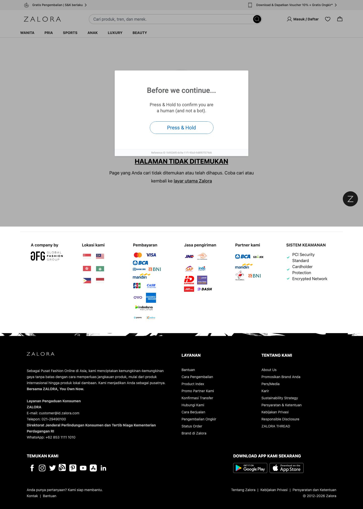

**대표 상품 이미지** (상위 6장, 출처 URL 포함)

-  — 출처 <https://static-id.zacdn.com/next-assets/static-assets/images/logo/icon_mastercard.png>
-  — 출처 <https://static-id.zacdn.com/next-assets/static-assets/images/logo/icon_visa.png>
-  — 출처 <https://static-id.zacdn.com/next-assets/static-assets/images/logo/icon_ovo.png>
-  — 출처 <https://static-id.zacdn.com/next-assets/static-assets/images/logo/icon_indodana.png>

**페이지 메타 정보**

| page | title | description |
|---|---|---|
| [`new_women`](https://www.zalora.co.id/wanita/new-arrivals) | Halaman tidak ditemukan | ZALORA |  |

### 4.2 일본 _( Japan )_

- 한국 수출규모 순위: **#2** · region: `asia` · tier `1` · currency `JPY`
- 수집 사이트: **5개** (성공 4)
- 메모: K-패션 선호도 높고 온라인 패션몰 발달
#### [GU Japan](https://www.gu-global.com/jp/)

- URL: <https://www.gu-global.com/jp/>
- 페이지: **OK 1 · FAIL 0**

**대표 상품 이미지** (상위 6장, 출처 URL 포함)

-  — 출처 <https://image.uniqlo.com/GU/ST3/jp/imagesother/Navigation/WOMEN_Category/2026/261023/261023_category-icon_autumn-winter-sale.png>
-  — 출처 <https://image.uniqlo.com/GU/ST3/jp/imagesother/Navigation/Category-icon_V2/2026/0724/Categoy_Limited-offers.jpg>
-  — 출처 <https://image.uniqlo.com/GU/ST3/jp/imagesother/Navigation/Category-icon_V2/2026/0724/Categoy_SALE.jpg>
-  — 출처 <https://image.uniqlo.com/GU/ST3/jp/imagesother/Navigation/collaboration_Category/26FW/rokh_category_icon.png>
-  — 출처 <https://image.uniqlo.com/GU/ST3/jp/imagesother/Navigation/WOMEN_Category/2026/261106/261106_category_w_outer_360434.png>
-  — 출처 <https://image.uniqlo.com/GU/ST3/jp/imagesother/Navigation/WOMEN_Category/2026/261008/category_w_knit-and-cardigan_360549.png>

**페이지 메타 정보**

| page | title | description |
|---|---|---|
| [`new_arrivals`](https://www.gu-global.com/jp/ja/not-found) | 申し訳ありません、お客様がアクセスしようとしたページが見つかりませんでした。恐れ入りますが、正しくアドレスが入力されているか、もう一度ご確認ください。 | ジーユー | 申し訳ありません、お客様がアクセスしようとしたページが見つかりませんでした。恐れ入りますが、正しくアドレスが入力されているか、もう一度ご確認ください。 |

#### [Rakuten Fashion](https://brandavenue.rakuten.co.jp/)

- URL: <https://brandavenue.rakuten.co.jp/>
- 페이지: **OK 1 · FAIL 1**

**대표 상품 이미지** (상위 6장, 출처 URL 포함)

-  — 출처 <https://brandavenue.r10s.jp/img/library/index/sbn_flagshipstore_20231003.png>
- 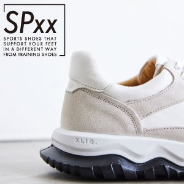 — 출처 <https://brandavenue.r10s.jp/img/news/01/408240/pc_n.jpg>
- 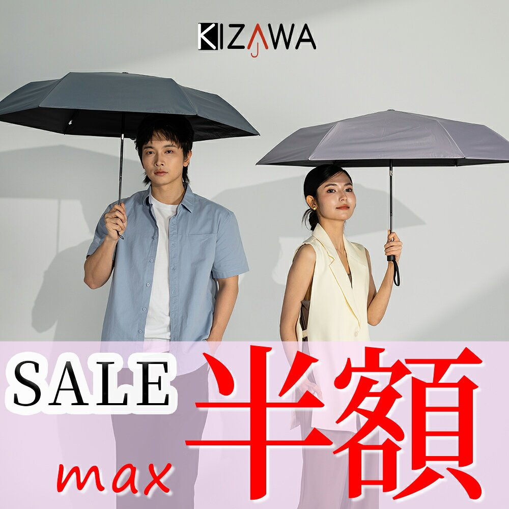 — 출처 <https://brandavenue.r10s.jp/img/news/01/406122/pc_n.jpg>
-  — 출처 <https://brandavenue.r10s.jp/img/news/01/407207/pc_n.jpg>
-  — 출처 <https://brandavenue.r10s.jp/img/news/01/407209/pc_n.jpg>
-  — 출처 <https://brandavenue.r10s.jp/img/news/01/407213/pc_n.jpg>

**페이지 메타 정보**

| page | title | description |
|---|---|---|
| [`men`](https://brandavenue.rakuten.co.jp/men/) | MEN | ファッション通販 Rakuten Fashion(楽天ファッション／旧楽天ブランドアベニュー) | Rakuten Fashion(楽天ファッション)は人気ブランドを取り扱うファッション通販サイトです。新作アイテム続々入荷！セール商品やクーポン対象商品も豊富。／税込3,980円以上購入で送料無料／楽天ポイントが使えて貯まる！ |

**실패 페이지**

- `women` — http_status_404

#### [Uniqlo Japan](https://www.uniqlo.com/jp/)

- URL: <https://www.uniqlo.com/jp/>
- 페이지: **OK 1 · FAIL 0**

**페이지 메타 정보**

| page | title | description |
|---|---|---|
| [`new_arrivals`](https://www.uniqlo.com/jp/ja/contents/feature/new-arrivals/) | 404 Not Found |  |

#### [WEAR](https://wear.jp/)

- URL: <https://wear.jp/>
- 페이지: **OK 1 · FAIL 0**

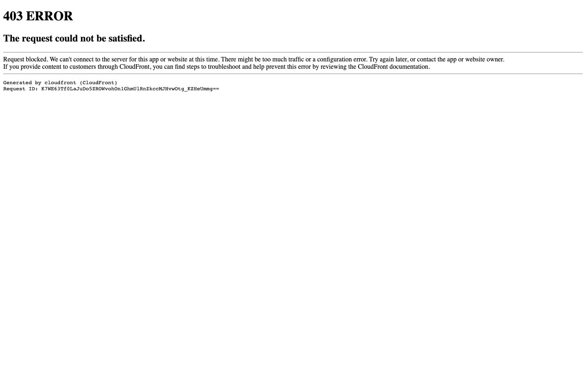

**페이지 메타 정보**

| page | title | description |
|---|---|---|
| [`ranking`](https://wear.jp/ranking/coordinate/) | ERROR: The request could not be satisfied |  |

#### [ZOZOTOWN](https://zozo.jp/)

- URL: <https://zozo.jp/>
- 페이지: **OK 0 · FAIL 2**

**실패 페이지**

- `new` — playwright_error: Error: Page.goto: net::ERR_TIMED_OUT at https://zozo.jp/category/new/
Call log:
  - navigating to "https://zozo.jp/category/new/", waiting until "domcontentloaded"

- `ranking` — playwright_error: TimeoutError: Page.goto: Timeout 30000ms exceeded.
Call log:
  - navigating to "https://zozo.jp/ranking/", waiting until "domcontentloaded"

### 4.3 한국 _( South Korea )_

- 한국 수출규모 순위: **#30** · region: `asia` · tier `1` · currency `KRW`
- 수집 사이트: **4개** (성공 3)
- 메모: 비교 기준 (자국). 국내 사업동향 센싱
#### [29CM](https://www.29cm.co.kr/)

- URL: <https://www.29cm.co.kr/>
- 페이지: **OK 1 · FAIL 0**

**최근 유행 상품** (44건 · 상품명 클릭 시 해당 사이트로 이동)

| # | 상품명 | 브랜드 | 가격 | 페이지 |
|---:|---|---|---:|---|
| 1 | [[해삐 PICK] Morrow Suede Hobo Bag (Brown)](https://product.29cm.co.kr/catalog/4307401) | 토아베 | 76,630 KRW | `home` |
| 2 | [Morrow Suede Hobo Bag (Mulberry)](https://product.29cm.co.kr/catalog/4307389) | 토아베 | 76,630 KRW | `home` |
| 3 | [Wrap Draped Long Skirt (Charcoal)](https://product.29cm.co.kr/catalog/4307361) | 토아베 | 82,800 KRW | `home` |
| 4 | [[사은품][봉주르하우스공구] 떼에마 2인 한식세트 화이트 (15P)](https://product.29cm.co.kr/catalog/3770998) | 이딸라 | 255,000 KRW | `home` |
| 5 | [[사은품][봉주르하우스공구] 떼에마 4인 한식세트 화이트 (28P)](https://product.29cm.co.kr/catalog/3770984) | 이딸라 | 450,000 KRW | `home` |
| 6 | [[봉주르하우스공구] 떼에마 체리 컬렉션 2P 세트 (옵션 선택)](https://product.29cm.co.kr/catalog/4340062) | 이딸라 | 39,000 KRW | `home` |
| 7 | [[이구위크 단독 구성] 후르츠팟 2개 미니 런치팟 1개 세트](https://product.29cm.co.kr/catalog/4352862) | 메팔 | 57,980 KRW | `home` |
| 8 | [[이구위크 단독 구성] 후르츠팟 2개 런치팟 1개 사은품 세트](https://product.29cm.co.kr/catalog/4352848) | 메팔 | 65,720 KRW | `home` |
| 9 | [[단짝꿍 세트] 런치팟 & 미니 런치팟 (5colors)](https://product.29cm.co.kr/catalog/4217207) | 메팔 | 44,120 KRW | `home` |
| 10 | [[원더시리즈] 원더 트레이 라지 1P (5color)](https://product.29cm.co.kr/catalog/3687758) | 시리츠 | 12,900 KRW | `home` |
| 11 | [[라지세트] 원더 트레이 라지 1P+머그 라지1P (5color)](https://product.29cm.co.kr/catalog/3687788) | 시리츠 | 23,370 KRW | `home` |
| 12 | [[스몰세트] 원더 트레이 스몰 1P+머그 스몰1P (5color)](https://product.29cm.co.kr/catalog/3687775) | 시리츠 | 18,140 KRW | `home` |
| 13 | [[령은 착용] MARGARINE WOOL WASHING FUR-COAT_BEIGE](https://product.29cm.co.kr/catalog/4328637) | 오떼뜨 | 221,240 KRW | `home` |
| 14 | [[유하 착용] MOMO HIGH-NECK FUR JK_IVORY](https://product.29cm.co.kr/catalog/4328636) | 오떼뜨 | 180,770 KRW | `home` |
| 15 | [HOOD REVERSIBLE MUSTANG_BROWN](https://product.29cm.co.kr/catalog/4328635) | 오떼뜨 | 231,320 KRW | `home` |
| 16 | [[29cm단독발매] 로맨티크 롱원피스 블랙](https://product.29cm.co.kr/catalog/4146784) | 신스덴 | 121,640 KRW | `home` |
| 17 | [[29CM단독]미엘린 롱스커트](https://product.29cm.co.kr/catalog/4323428) | 신스덴 | 144,590 KRW | `home` |
| 18 | [[29CM단독]미엘린 페플럼 탑](https://product.29cm.co.kr/catalog/4323426) | 신스덴 | 98,640 KRW | `home` |
| 19 | [PERTEX T Down Jacket Black](https://product.29cm.co.kr/catalog/4277176) | 디스이즈네버댓 | 195,300 KRW | `home` |
| 20 | [T-Logo Hoodie Heather Grey](https://product.29cm.co.kr/catalog/3447673) | 디스이즈네버댓 | 76,300 KRW | `home` |

**대표 상품 이미지** (상위 6장, 출처 URL 포함)

-  — 출처 <https://img.29cm.co.kr/cms/202611/11f1d9aac84ca5acb5d9c590eb524720.jpg?width=3840&format=webp>
- 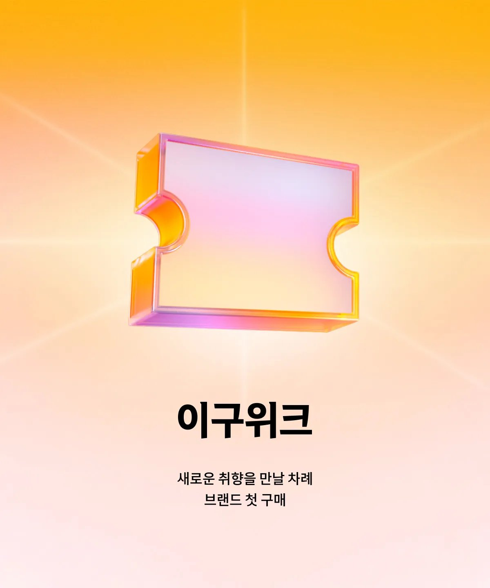 — 출처 <https://img.29cm.co.kr/cms/202611/11f1d9aabf60dd2eb5d94d8bb30d4788.jpg?width=3840&format=webp>
- 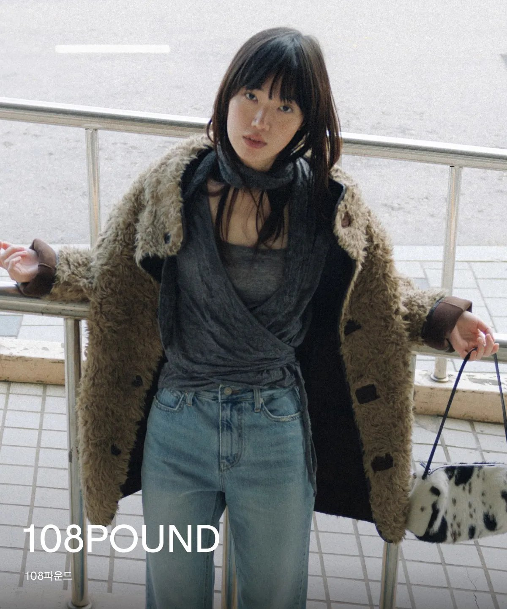 — 출처 <https://img.29cm.co.kr/cms/202611/11f1d9aaa30a12b6aa2de170f071d531.jpg?width=3840&format=webp>
- 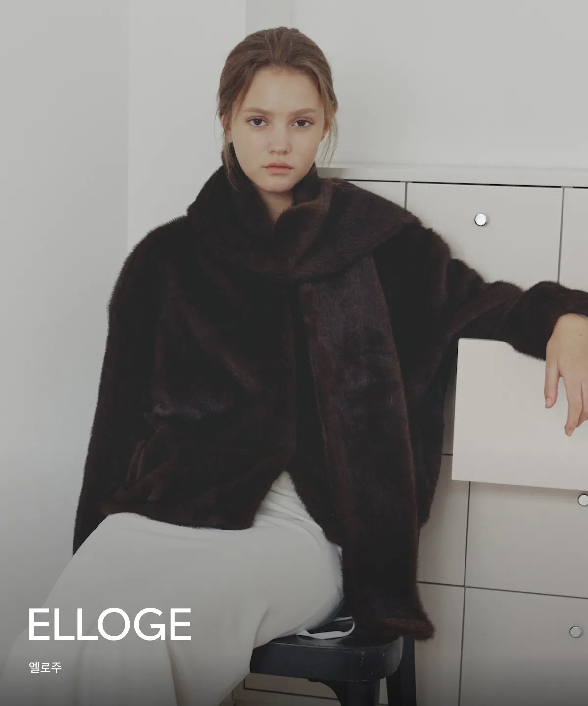 — 출처 <https://img.29cm.co.kr/cms/202611/11f1d9aa99ea68f0aa2d69985b95954e.jpg?width=3840&format=webp>
- 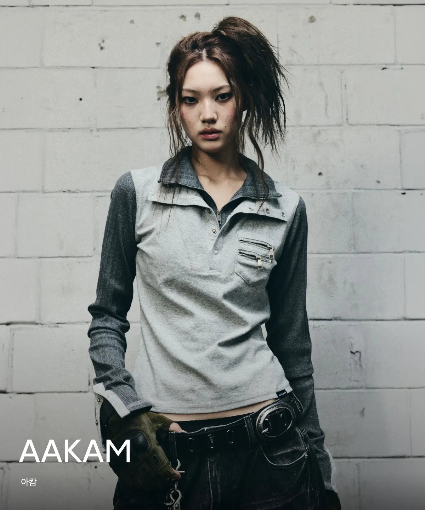 — 출처 <https://img.29cm.co.kr/cms/202611/11f1d9aa8cfe74e4aa2d5be3c7222fef.jpg?width=3840&format=webp>
- 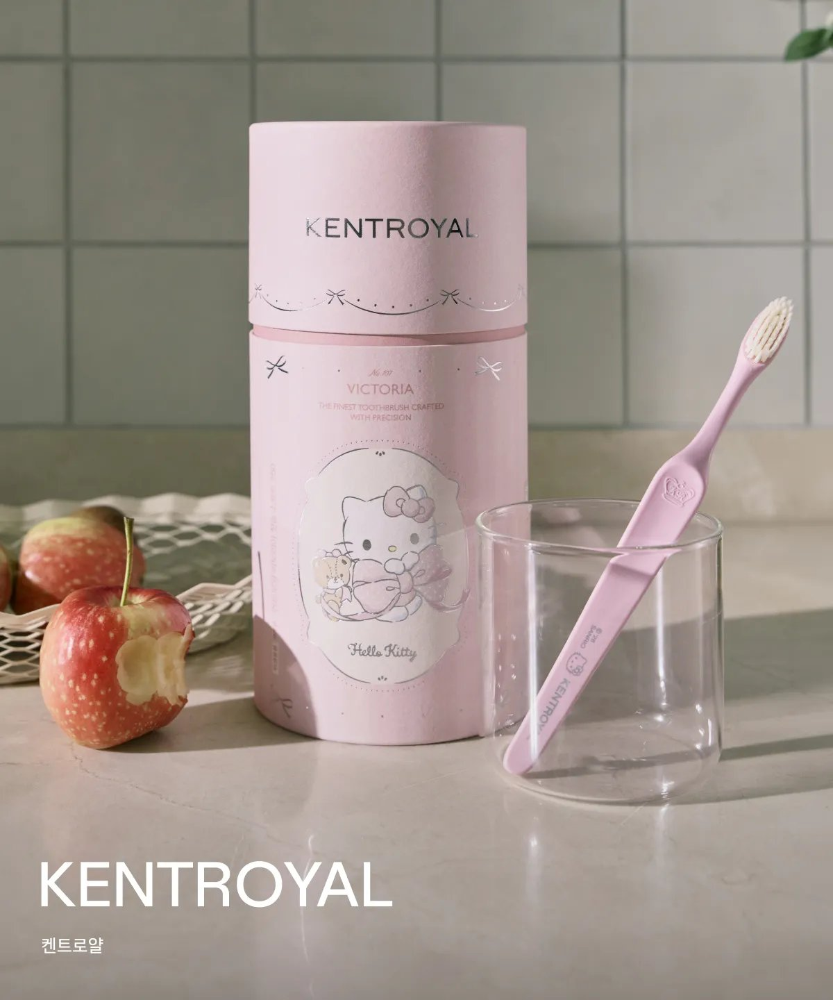 — 출처 <https://img.29cm.co.kr/cms/202611/11f1d9aa84d427aeaa2d85781c33f870.jpg?width=3840&format=webp>

**페이지 메타 정보**

| page | title | description |
|---|---|---|
| [`home`](https://www.29cm.co.kr/) | 모든 취향 곁에, 29CM | 패션, 라이프스타일, 컬처까지 29CM만의 감도 깊은 셀렉션을 만나보세요. |

#### [Musinsa](https://www.musinsa.com/)

- URL: <https://www.musinsa.com/>
- 페이지: **OK 0 · FAIL 1**

**실패 페이지**

- `home` — robots_disallowed

#### [W Concept](https://www.wconcept.co.kr/)

- URL: <https://www.wconcept.co.kr/>
- 페이지: **OK 1 · FAIL 0**

**최근 유행 상품** (30건 · 상품명 클릭 시 해당 사이트로 이동)

| # | 상품명 | 브랜드 | 가격 | 페이지 |
|---:|---|---|---:|---|
| 1 | [MITTO BANDING PANTS_BROWN](https://m.wconcept.co.kr/Product/307579009) | 망고매니플리즈 | 63,756 KRW | `home` |
| 2 | [[단독][NEW컬러 발매] BELLO WOOL COAT_3COLORS](https://m.wconcept.co.kr/Product/307551728) | 망고매니플리즈 | 258,300 KRW | `home` |
| 3 | [[3rd] HARNEY FUR VEST_ASH BEIGE](https://m.wconcept.co.kr/Product/309066817) | 망고매니플리즈 | 188,300 KRW | `home` |
| 4 | [MITTO BANDING PANTS_CREAM](https://m.wconcept.co.kr/Product/307579006) | 망고매니플리즈 | 63,756 KRW | `home` |
| 5 | [ANTIQUE FUR JACKET_GREY](https://m.wconcept.co.kr/Product/307579056) | 망고매니플리즈 | 230,300 KRW | `home` |
| 6 | [NAVAN DUFFLE HALF COAT (2colors)](https://m.wconcept.co.kr/Product/306115511) | 망고매니플리즈 | 247,940 KRW | `home` |
| 7 | [BOWL CABLE KNIT_OAT BEIGE](https://m.wconcept.co.kr/Product/309066812) | 망고매니플리즈 | 118,300 KRW | `home` |
| 8 | [MUMU V WOOL KNIT_GREY](https://m.wconcept.co.kr/Product/309066843) | 망고매니플리즈 | 111,300 KRW | `home` |
| 9 | [[단독][NEW컬러추가]SOL BUTTON CARDIGAN_5COLORS](https://m.wconcept.co.kr/Product/307369776) | 망고매니플리즈 | 93,380 KRW | `home` |
| 10 | [LULU FUR HALF COAT_CREAM](https://m.wconcept.co.kr/Product/309122919) | 망고매니플리즈 | 258,300 KRW | `home` |
| 11 | [LOON CORDUROY PANTS_CHARCOAL](https://m.wconcept.co.kr/Product/309066788) | 망고매니플리즈 | 87,500 KRW | `home` |
| 12 | [DUI FUR HALF COAT_CREAM](https://m.wconcept.co.kr/Product/309066847) | 망고매니플리즈 | 223,300 KRW | `home` |
| 13 | [[ROUTINE] POPORY JOGGER PANTS_GREY](https://m.wconcept.co.kr/Product/309066821) | 망고매니플리즈 | 69,300 KRW | `home` |
| 14 | [FUR SUEDE BUCKET HAT_BROWN](https://m.wconcept.co.kr/Product/309066653) | 망고매니플리즈 | 62,300 KRW | `home` |
| 15 | [[8th] SOI BANDING PANTS_CHARCOAL](https://m.wconcept.co.kr/Product/307360636) | 망고매니플리즈 | 54,740 KRW | `home` |
| 16 | [DOV ONE PIECE_BLACK](https://m.wconcept.co.kr/Product/307553109) | 망고매니플리즈 | 118,300 KRW | `home` |
| 17 | [[단독]HARNEY FUR VEST_CREAM](https://m.wconcept.co.kr/Product/309066818) | 망고매니플리즈 | 188,300 KRW | `home` |
| 18 | [TOE VELVET ONE PIECE_BLACK](https://m.wconcept.co.kr/Product/307631094) | 망고매니플리즈 | 95,956 KRW | `home` |
| 19 | [ANZO TUCK BANDING PANTS_KHAKI BEIGE](https://m.wconcept.co.kr/Product/309122925) | 망고매니플리즈 | 83,300 KRW | `home` |
| 20 | [[7th]UNTIL FIELD JACKET_KHAKI](https://m.wconcept.co.kr/Product/308867985) | 망고매니플리즈 | 221,067 KRW | `home` |

**페이지 메타 정보**

| page | title | description |
|---|---|---|
| [`home`](https://www.wconcept.co.kr/) | _(empty)_ |  |

#### [Zigzag](https://zigzag.kr/)

- URL: <https://zigzag.kr/>
- 페이지: **OK 1 · FAIL 0**

**최근 유행 상품** (36건 · 상품명 클릭 시 해당 사이트로 이동)

| # | 상품명 | 브랜드 | 가격 | 페이지 |
|---:|---|---|---:|---|
| 1 | [[기모추가🔥/50만장돌파/자체제작] 허쉬 코튼 와이드팬츠 (숏/기본/롱)](https://store.zigzag.kr/app/catalog/products/143224732?browsing_type=NATIVE_BROWSER) | 리얼코코 | 13,640 KRW | `home` |
| 2 | [[made]보니덤블스웨트팬츠](https://store.zigzag.kr/app/catalog/products/172866826?browsing_type=NATIVE_BROWSER) | 어텀 | 42,400 KRW | `home` |
| 3 | [[겨울❄️/50만장돌파/자체제작] 시오 니트 (라운드넥/브이넥)](https://store.zigzag.kr/app/catalog/products/147921597?browsing_type=NATIVE_BROWSER) | 리얼코코 | 11,840 KRW | `home` |
| 4 | [[🔥기모][서경PICK][골반뽕탈부착][~2XL][11만장🏆][힙딥커버]렌더 코튼 부츠컷 팬츠 (숏/롱ver)(사계절/기모ver)(7color)](https://store.zigzag.kr/app/catalog/products/162075326?browsing_type=NATIVE_BROWSER) | 프렌치오브 | 29,160 KRW | `home` |
| 5 | [[라로슈포제] 시카플라스트 밤 B5+ 100ml](https://store.zigzag.kr/app/catalog/products/145661347?browsing_type=NATIVE_BROWSER) | 라로슈포제 | 25,600 KRW | `home` |
| 6 | [[🍁가을/3기장선택!] made. 모먼트 투커버 올데이슬랙스 (+숏/베이직/롱ver) - 4 size](https://store.zigzag.kr/app/catalog/products/136095576?browsing_type=NATIVE_BROWSER) | 슬로우앤드 | 31,840 KRW | `home` |
| 7 | [[made]모먼트울쇼츠](https://store.zigzag.kr/app/catalog/products/167600416?browsing_type=NATIVE_BROWSER) | 어텀 | 20,800 KRW | `home` |
| 8 | [[역대급블프🖤/겨울바지] made. 웜모어 도톰라이크 니트팬츠 (숏/베이직/롱) - 4 color (무료배송)](https://store.zigzag.kr/app/catalog/products/173115310?browsing_type=NATIVE_BROWSER) | 슬로우앤드 | 31,840 KRW | `home` |
| 9 | [[made]파우더벌룬니트](https://store.zigzag.kr/app/catalog/products/166494898?browsing_type=NATIVE_BROWSER) | 어텀 | 23,200 KRW | `home` |
| 10 | [캐시홀가먼트V니트](https://store.zigzag.kr/app/catalog/products/172689072?browsing_type=NATIVE_BROWSER) | 어텀 | 31,200 KRW | `home` |
| 11 | [[역대급블프🖤/릴스착장!] made. 얼웨이즈 모크넥 홀가먼트 니트 - 7 color (무료배송)](https://store.zigzag.kr/app/catalog/products/173060019?browsing_type=NATIVE_BROWSER) | 슬로우앤드 | 26,820 KRW | `home` |
| 12 | [[히든포켓✨/자체제작] UTMOST 드로인 알파카 히든 핸드메이드 코트](https://store.zigzag.kr/app/catalog/products/150026968?browsing_type=NATIVE_BROWSER) | 리얼코코 | 157,430 KRW | `home` |
| 13 | [[기모추가🔥/5만장돌파/자체제작] 모티브 핀턱 슬랙스 (숏/기본)](https://store.zigzag.kr/app/catalog/products/141911042?browsing_type=NATIVE_BROWSER) | 리얼코코 | 15,440 KRW | `home` |
| 14 | [[롱코트❄️/자체제작] UTMOST 세일러 울 핸드메이드 코트](https://store.zigzag.kr/app/catalog/products/150027198?browsing_type=NATIVE_BROWSER) | 리얼코코 | 157,430 KRW | `home` |
| 15 | [자체제작 still velvet long skirt (2color) 기모안감! 당일발송](https://store.zigzag.kr/app/catalog/products/173157030?browsing_type=NATIVE_BROWSER) | 어리틀빗 | 35,000 KRW | `home` |
| 16 | [[겨울❄️/브이넥&라운드넥/자체제작] 에트 니트 (6color)](https://store.zigzag.kr/app/catalog/products/129456378?browsing_type=NATIVE_BROWSER) | 리얼코코 | 14,800 KRW | `home` |
| 17 | [아를 울 버튼 나그랑 겨울 레이어드 반팔 니트](https://store.zigzag.kr/app/catalog/products/173150629?browsing_type=NATIVE_BROWSER) | 도에 | 47,800 KRW | `home` |
| 18 | [헤이즐 프릴 목폴라 티셔츠 (4color)](https://store.zigzag.kr/app/catalog/products/173156539?browsing_type=NATIVE_BROWSER) | 베하르 | 27,550 KRW | `home` |
| 19 | [[하객룩🕊️/자체제작] 라베아 타이 블라우스 (4color)](https://store.zigzag.kr/app/catalog/products/171315892?browsing_type=NATIVE_BROWSER) | 리얼코코 | 30,880 KRW | `home` |
| 20 | [[기모추가🔥/15만장돌파🏆/반팔추가/자체제작] 코튼 스판 베이직 긴팔티셔츠 (라운드넥/유넥)](https://store.zigzag.kr/app/catalog/products/109044865?browsing_type=NATIVE_BROWSER) | 리얼코코 | 18,270 KRW | `home` |

**페이지 메타 정보**

| page | title | description |
|---|---|---|
| [`home`](https://zigzag.kr/) | _(empty)_ |  |

### 4.4 대만 _( Taiwan )_

- 한국 수출규모 순위: **#7** · region: `asia` · tier `1` · currency `TWD`
- 수집 사이트: **5개** (성공 5)
- 메모: K-패션 친화도 높음
#### [momo](https://www.momoshop.com.tw/)

- URL: <https://www.momoshop.com.tw/>
- 페이지: **OK 1 · FAIL 0**

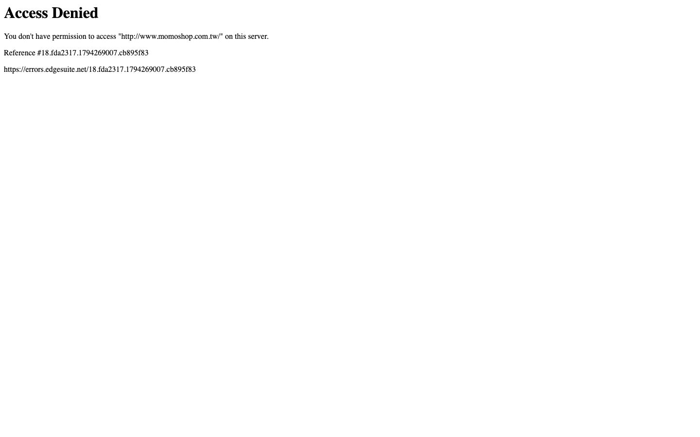

**페이지 메타 정보**

| page | title | description |
|---|---|---|
| [`home`](https://www.momoshop.com.tw/) | Access Denied |  |

#### [OB Design](https://www.obdesign.com.tw/)

- URL: <https://www.obdesign.com.tw/>
- 페이지: **OK 1 · FAIL 0**

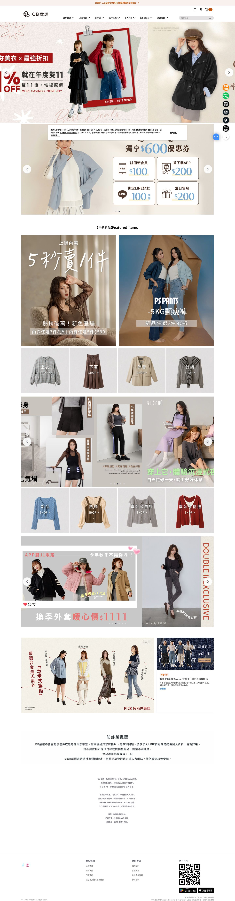

**대표 상품 이미지** (상위 6장, 출처 URL 포함)

- 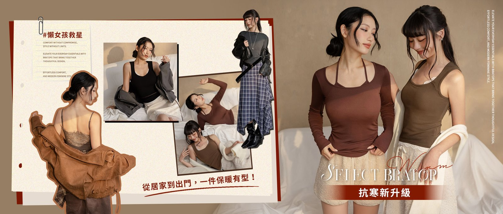 — 출처 <https://cms-static.cdn.91app.com/images/original/41602/92f19e4d-89b7-4330-9570-02cf1dff9742-1793588497-3rum8nrsiv_d_1920x820_1280x547_1124x480_800x342_600x256_400x171.jpg>
-  — 출처 <https://cms-static.cdn.91app.com/images/original/41602/92f19e4d-89b7-4330-9570-02cf1dff9742-1794204068-szm5kt30au_d_1920x820_1280x547_1124x480_800x342_600x256_400x171.jpg>
- 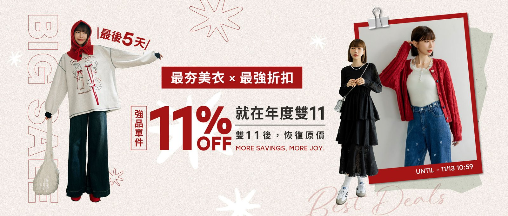 — 출처 <https://cms-static.cdn.91app.com/images/original/41602/92f19e4d-89b7-4330-9570-02cf1dff9742-1794193864-y85juga1zg_d_1920x820_1280x547_1124x480_800x342_600x256_400x171.jpg>
- 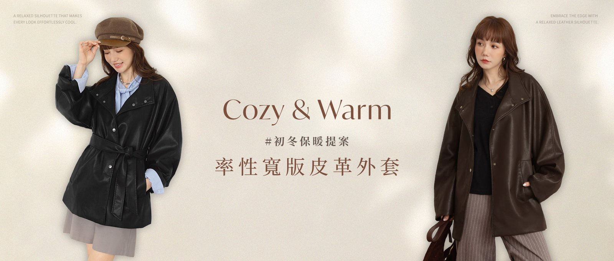 — 출처 <https://cms-static.cdn.91app.com/images/original/41602/92f19e4d-89b7-4330-9570-02cf1dff9742-1794194271-wtfzxkcvms_d_1920x820_1280x547_1124x480_800x342_600x256_400x171.jpg>
- 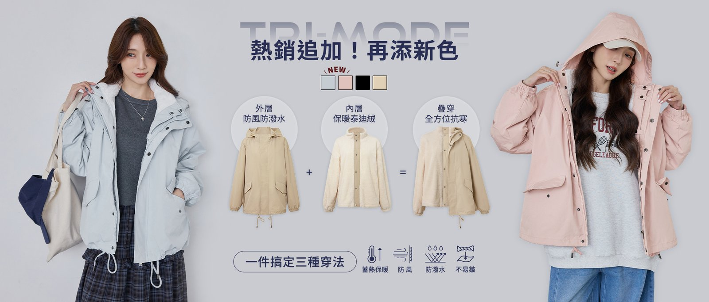 — 출처 <https://cms-static.cdn.91app.com/images/original/41602/92f19e4d-89b7-4330-9570-02cf1dff9742-1794194416-wz3vkxolfi_d_1920x820_1280x547_1124x480_800x342_600x256_400x171.jpg>
-  — 출처 <https://cms-static.cdn.91app.com/images/original/41602/92f19e4d-89b7-4330-9570-02cf1dff9742-1793757667-w0s0fz0ca4_d_1920x820_1280x547_1124x480_800x342_600x256_400x171.jpg>

**페이지 메타 정보**

| page | title | description |
|---|---|---|
| [`home`](https://www.obdesign.com.tw/) | OB嚴選｜高CP值人氣熱銷服飾，流行服飾品牌 | 你的日常穿搭好夥伴，快上OB嚴選找，OB嚴選提供女裝、孕童、運動、男裝各項流行服飾，秉持優質服務給你高CP值的購物體驗。各種風格都能滿足熱愛穿搭的你，天天上新品，快速出貨，一起加入OB style！網路人氣服飾品牌OB嚴選 |

#### [PChome](https://24h.pchome.com.tw/)

- URL: <https://24h.pchome.com.tw/>
- 페이지: **OK 1 · FAIL 0**

**페이지 메타 정보**

| page | title | description |
|---|---|---|
| [`home`](https://24h.pchome.com.tw/) | PChome 24h購物 |  |

#### [Pinkoi Taiwan](https://www.pinkoi.com/)

- URL: <https://www.pinkoi.com/>
- 페이지: **OK 2 · FAIL 0**

**대표 상품 이미지** (상위 6장, 출처 URL 포함)

-  — 출처 <https://cdn04.pinkoi.com/pinkoi.site/logo/og_image.png>

**페이지 메타 정보**

| page | title | description |
|---|---|---|
| [`accessories`](https://en.pinkoi.com/) | Pinkoi | Asia’s cross-border design marketplace | Design the way you are | Shop for original design products from Asia's independent designers. Pinkoi lives and breathes great design, great quality, great service, a |
| [`bags`](https://en.pinkoi.com/) | Pinkoi | Asia’s cross-border design marketplace | Design the way you are | Shop for original design products from Asia's independent designers. Pinkoi lives and breathes great design, great quality, great service, a |

#### [Yahoo Taiwan Shopping](https://tw.buy.yahoo.com/)

- URL: <https://tw.buy.yahoo.com/>
- 페이지: **OK 1 · FAIL 0**

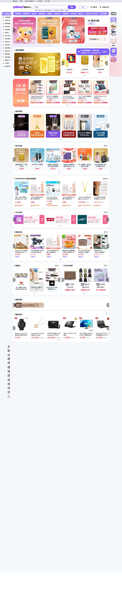

**대표 상품 이미지** (상위 6장, 출처 URL 포함)

- 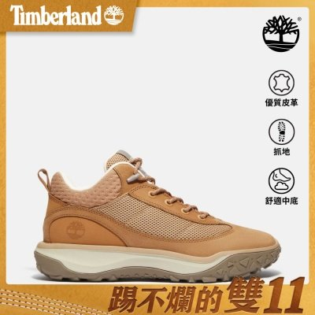 — 출처 <https://img.yec.tw/zp/MerchandiseImages/850397f7b8-Gd-11689377.jpg>
- 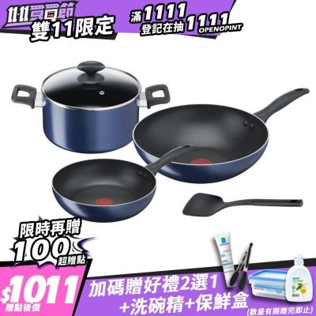 — 출처 <https://img.yec.tw/zp/MerchandiseImages/7cd6d71aec-Gd-12260494.jpg>
- 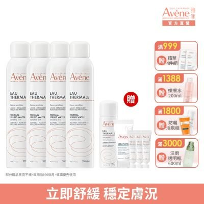 — 출처 <https://img.yec.tw/zp/MerchandiseImages/d858fec156-Gd-11503959.jpg>
-  — 출처 <https://img.yec.tw/up/uploadr/00u21hvmzmjMvuwgh1d8/SHP/mario/270x270_1.gif>

**페이지 메타 정보**

| page | title | description |
|---|---|---|
| [`home`](https://tw.buy.yahoo.com/) | Yahoo購物中心 - 最懂生活的人 | 數百萬件商品，貼心客服為您服務，15天鑑賞期購物保障！ |

### 4.5 태국 _( Thailand )_

- 한국 수출규모 순위: **#8** · region: `asia` · tier `1` · currency `THB`
- 수집 사이트: **5개** (성공 4)
- 메모: 동남아 K-패션 핵심 시장
#### [Central Online](https://www.central.co.th/)

- URL: <https://www.central.co.th/>
- 페이지: **OK 1 · FAIL 0**

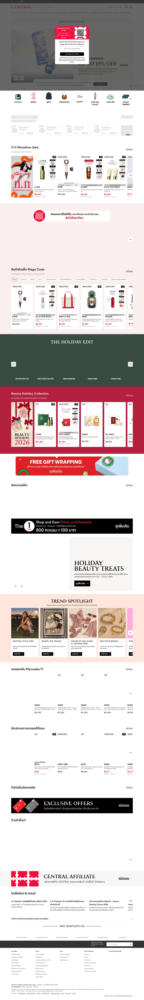

**대표 상품 이미지** (상위 6장, 출처 URL 포함)

-  — 출처 <https://www.central.co.th/_next/image?url=https%3A%2F%2Fassets.central.co.th%2Ffile-assets%2Fassets%2FCMS%2Fcampaign%2F2026%2F11nov%2F20261101_SOG_Homepage_herobanner.jpg&w=3840&q=75>
- 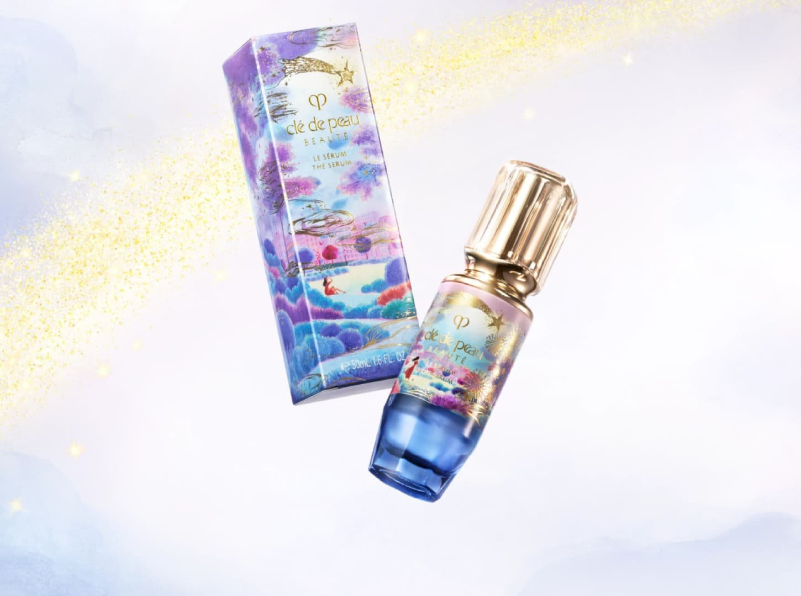 — 출처 <https://www.central.co.th/_next/image?url=https%3A%2F%2Fassets.central.co.th%2Ffile-assets%2Fassets%2FCMS%2Fcampaign%2F2026%2F11nov%2F20261110_cle_de_peau_beaute_heroweb_d.jpg&w=3840&q=75>
- 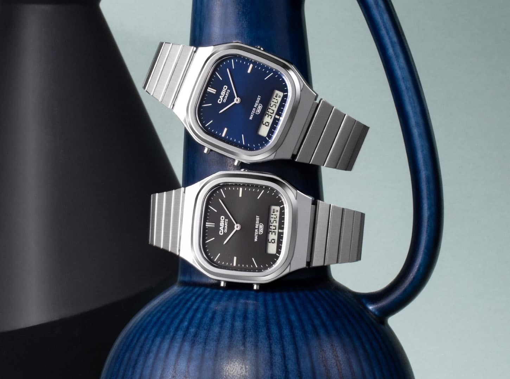 — 출처 <https://www.central.co.th/_next/image?url=https%3A%2F%2Fassets.central.co.th%2Ffile-assets%2Fassets%2FCMS%2Fcampaign%2F2026%2F11nov%2F20261101_casio_heroweb_d.jpg&w=3840&q=75>
- 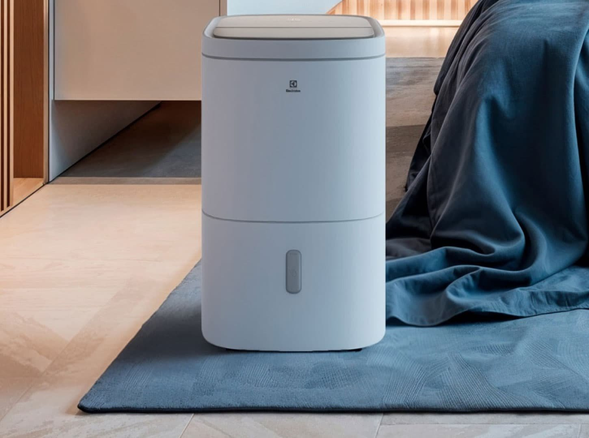 — 출처 <https://www.central.co.th/_next/image?url=https%3A%2F%2Fassets.central.co.th%2Ffile-assets%2Fassets%2FCMS%2Fcampaign%2F2026%2F11nov%2F20261101_electrolux_heroweb_d.jpg&w=3840&q=75>
- 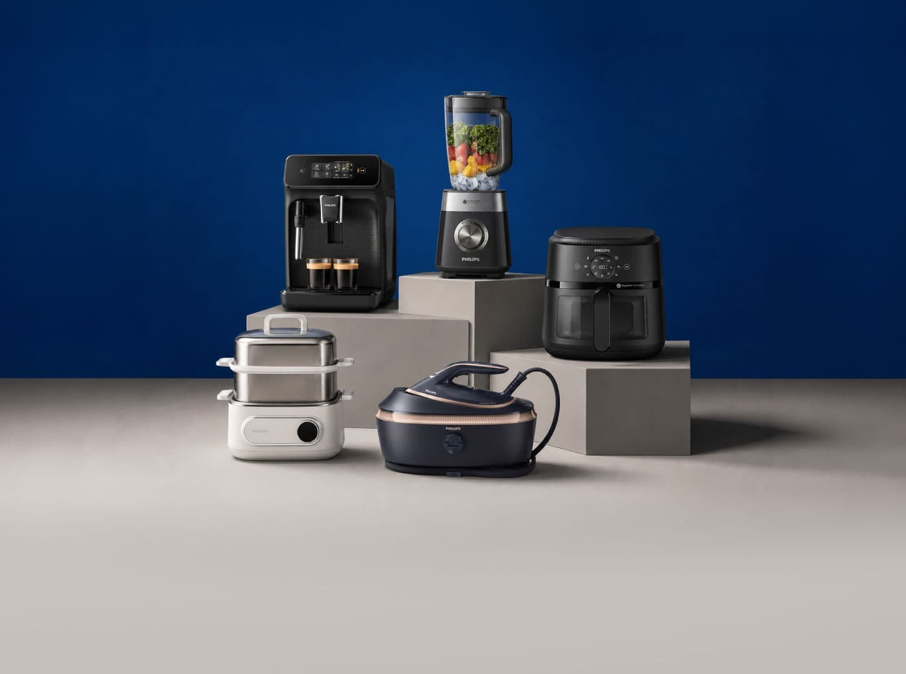 — 출처 <https://www.central.co.th/_next/image?url=https%3A%2F%2Fassets.central.co.th%2Ffile-assets%2Fassets%2FCMS%2Fcampaign%2F2026%2F11nov%2F20261005_philips-da_heroweb_d.jpg&w=3840&q=75>
- 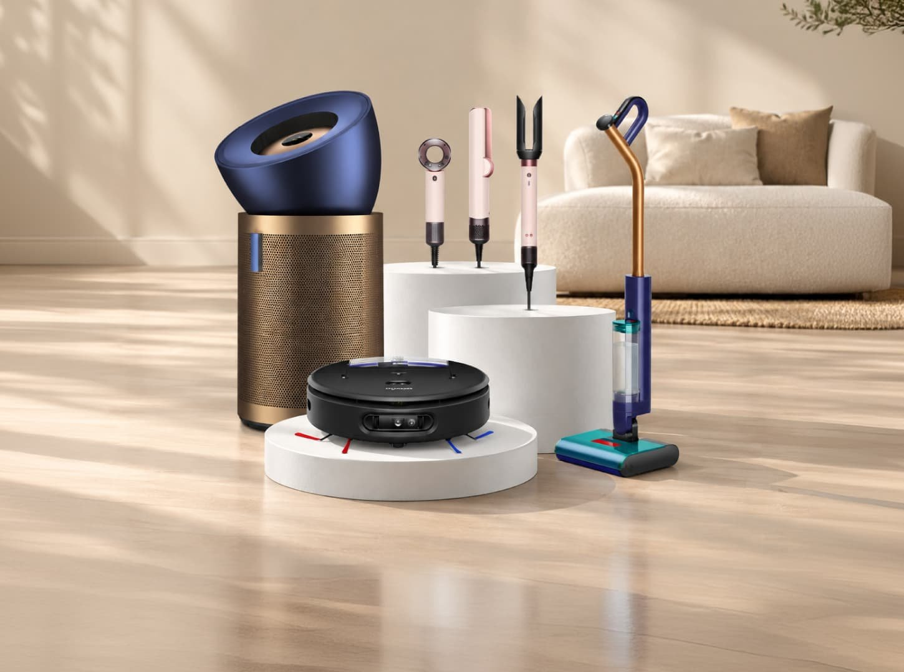 — 출처 <https://www.central.co.th/_next/image?url=https%3A%2F%2Fassets.central.co.th%2Ffile-assets%2Fassets%2FCMS%2Fcampaign%2F2026%2F11nov%2F20261101_dyson_heroweb_d.jpg&w=3840&q=75>

**페이지 메타 정보**

| page | title | description |
|---|---|---|
| [`home`](https://www.central.co.th/th) | Central Online | 11.11 | ลดสูงสุด 70% + คูปองลดเพิ่ม 25% | 11.11 Sale โปรโมชั่นสุดยิ่งใหญ่ของปี 2026 เริ่มต้นขึ้นแล้ว! พบกับสินค้าจากหลากหลายแบรนด์ดังที่เราคัดสรรมาลดราคาสูงสุดถึง 70% พร้อมคูปองลดเพิ |

#### [Lazada Thailand Fashion](https://www.lazada.co.th/)

- URL: <https://www.lazada.co.th/>
- 페이지: **OK 1 · FAIL 0**

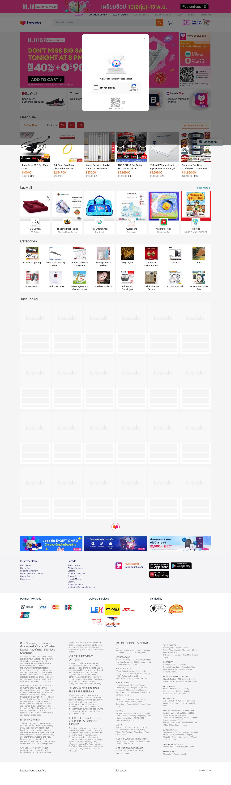

**대표 상품 이미지** (상위 6장, 출처 URL 포함)

-  — 출처 <https://img.lazcdn.com/us/domino/40845120240f19d13f738fa9a7978edd.png>
-  — 출처 <https://img.lazcdn.com/g/tps/images/ims-web/TB1KB2laMFY.1VjSZFnXXcFHXXa.png>
-  — 출처 <https://img.lazcdn.com/us/domino/78ba4d3b-8016-4e7c-9d3e-ca535c921582_TH-1976-688.jpg_2200x2200q80.jpg>
-  — 출처 <https://img.lazcdn.com/us/domino/982bca58-1097-4a9c-8bba-8df8ded13706_TH-1976-688.jpg_2200x2200q80.jpg>
-  — 출처 <https://img.lazcdn.com/us/domino/79f0601b-fd80-4a9e-8aa2-06559ff6121e_TH-1976-688.jpg_2200x2200q80.jpg>
-  — 출처 <https://img.lazcdn.com/us/domino/43c03e20-9dc3-4a16-946c-697b38e67421_TH-1976-688.jpg_2200x2200q80.jpg>

**페이지 메타 정보**

| page | title | description |
|---|---|---|
| [`home`](https://www.lazada.co.th/#?) | Lazada Thailand | ช้อปออนไลน์ สินค้าดี พร้อมดีลพิเศษทุกวัน | พบกับ Lazada แพลตฟอร์มช้อปปิ้งชั้นนำในอาเซียน พร้อมบริการเก็บเงินปลายทาง LazMall LazFlash และดีลเด็ดจากแบรนด์ดังทุกวัน |

#### [Pomelo](https://www.pomelofashion.com/)

- URL: <https://www.pomelofashion.com/>
- 페이지: **OK 0 · FAIL 2**

**실패 페이지**

- `new` — robots_disallowed
- `best` — robots_disallowed

#### [Shopee Thailand Fashion](https://shopee.co.th/)

- URL: <https://shopee.co.th/>
- 페이지: **OK 1 · FAIL 0**

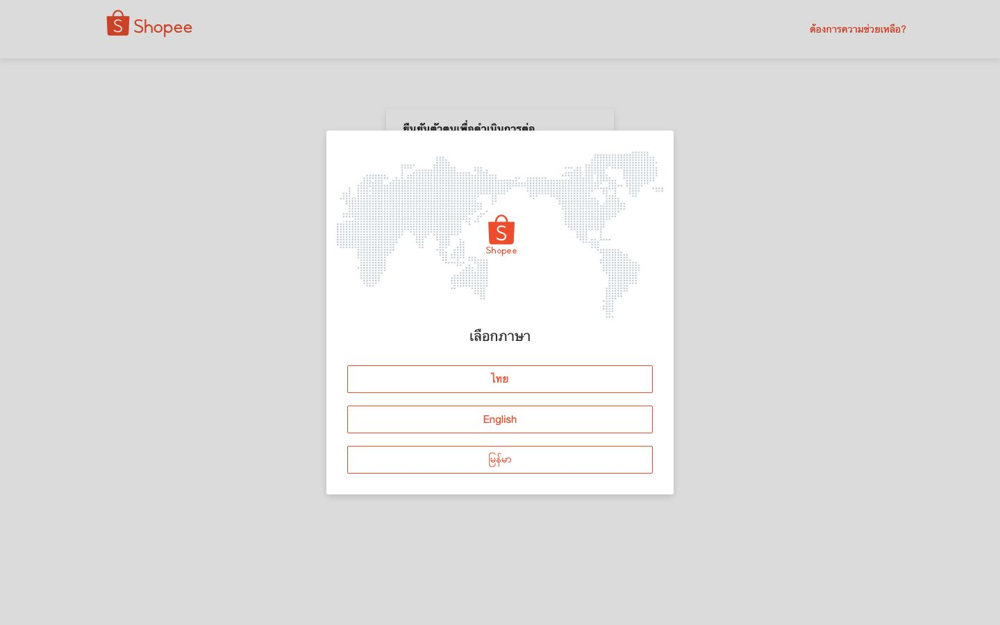

**대표 상품 이미지** (상위 6장, 출처 URL 포함)

-  — 출처 <https://deo.shopeemobile.com/shopee/shopee-pcmall-live-sg/assets/1c8bdaaf45e1fd48.png>
-  — 출처 <https://deo.shopeemobile.com/shopee/shopee-pcmall-live-sg/homepagefe/42ba6075c82a85ab.png>

**페이지 메타 정보**

| page | title | description |
|---|---|---|
| [`home`](https://shopee.co.th/verify/captcha?anti_bot_tracking_id=gqRjZGVrxHSFomtptTE0MjUxOnRyYWNraW5nX2lkX2tleaJrdtEAAqRhbGdv0gAAAGSjZGVrwKJjdMRAAAAADIKMyZ1P2O2Qvasq83S5AwzeFIVi130gJEs0rzTO_4iwfIWyFzi6GeoS0al_i_SqWqJfxR5gmm_2D9B-AqpjaXBoZXJ0ZXh0xQN2AAAADKF4wsQmmR8F3rtceDO-ScMh0htGl8cuvLUKit_9qWO4crF1UVn2gA2hqUvUvu7v-QxpXqK8Qhw4UNO4UG2TWdIRxE3NkyhEzdZt-BciNeXMCIaFtTTOdVowNM749R0kJLz3vDrMOqAamMVKLOCFf-PHY3nLa-ozR7vO9Xh9hxu_YY2XMTqSMhnAfqRbK1B5cWRKxKcM7msKcqO3PFb4mgSo4BA0zjt9drXmBmATLVv8klVEUnmV4tHyufJcth6RNbKXK9KHP_yWKvOCBwwaXeOJdSzKD0yuWZL-1hnverVR-xMmO82ASH4slok0hO9GiBjXEKxFLK7IQELtylzz4nbGCof-L9tMobSi1-GCSvZDhapN2oVTU0Mufm9rs8QXeDNmbO0MecB5Jahywk5RRYxB5hrlWygiEFnNYT_uSwSet9otSdQoV6p72hM2dCa81jcoiDdwZ_skfr7MnP9QfbkL9acXKZYpUGMYicsUkfoYTDWPSPCeh42x3DGBx6VFJy0SJjtSCjrRrnRZwVno6zBKSyiwsj7D4uBRzAS2eshOcaCWV-btnPEKTerv3s_Me6bFwNy6afCYMHrRfUY8O4hChP2euQxSMOwIR8ChN2ygTSqfFMDjQ2TZzJX9_oQgBcE5wKxqwUNieqbJ3tLlIxH-FqTYRqDJg_ynqcF6BH6mAhDWTtkGQg31XGfuuZ-R_tqfJCzWHat5hfgjUWGwkYqoR68yGuQDP9kWqD8PAcugT_bMzPGAQKzkPSn3KGDtlvN-71VoNg03oNODoOFmEQWAkhLCRg56tXQwtpWwbftnilUPFM8Mcnc1IUq2h1ydn2O7lDh0pl88oAzA2TtHH5EaJPOz_4a3O7Hv3Jh-UOQ__Kgp2OUPGjNx_o5u_b28WdxdYmL7omsgE7psf2uprt3l17SA9hFFYbD_6yK52R8hv7xiyySmu1iWnArZdctGJ6G4ruJze9qhlMZ6MHwIwWET3RF-HISe7OF5OZeVbZ3tNHY8zhR98_D8tKCwpyMs3f5tWMcanXuAbsB1qcjf_zYzcltiKP8h-GhTvWLsEh2GnJgOeQExOT1tWuxuM0FpxqyxVwdvn-pOI0vWAJHa2NFS61qGvyFtEy81t2oVE3hjDuQimsrXRaSHGWNLhGk3SDlfkFWw8hk5yfuCw5WPoIDNrQ&app_key=FlashSale.PC&client_id=1&next=https%3A%2F%2Fshopee.co.th%2Fverify%2Ftraffic%3F%3Fclient_id%3D%26next%3Dhttps%253A%252F%252Fshopee.co.th%252F%26redirect_type%3D2%26should_replace_history%3Dfalse&redirect_type=2&scene=crawler_item&should_replace_history=false) | Shopee Thailand | ช้อปปิ้งออนไลน์ ผ่านมือถือและเว็บไซต์ | ซื้อทุกอย่างที่ Shopee! ช้อปปิ้งออนไลน์จบในที่เดียว ซื้อหรือขายก็ง่ายสุดๆ มีโปรและส่วนลดเพียบ การันตีโดย Shopee | ส่งฟรีทั่วไทย | เก็บเงินปล |

#### [Zalora Thailand](https://www.zalora.co.th/)

- URL: <https://www.zalora.co.th/>
- 페이지: **OK 1 · FAIL 0**

**대표 상품 이미지** (상위 6장, 출처 URL 포함)

-  — 출처 <https://www.zalora.co.th/images/landingpage/525x500.gif>

**페이지 메타 정보**

| page | title | description |
|---|---|---|
| [`home`](https://www.zalora.co.th/) | ZALORA - ASIA'S LEADING ONLINE FASHION DESTINATION |  |

### 4.6 미국 _( United States )_

- 한국 수출규모 순위: **#1** · region: `north_america` · tier `1` · currency `USD`
- 수집 사이트: **5개** (성공 4)
- 메모: 한국 의류 최대 수출국. 대형 이커머스와 브랜드 커머스 중심
#### [Etsy](https://www.etsy.com/)

- URL: <https://www.etsy.com/>
- 페이지: **OK 2 · FAIL 0**

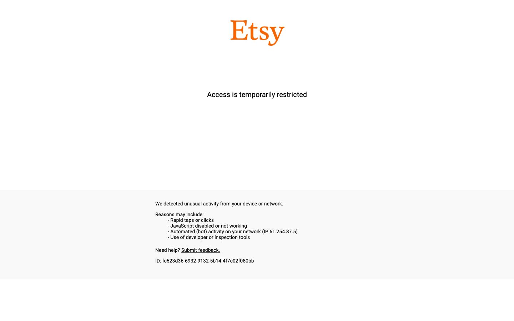

**페이지 메타 정보**

| page | title | description |
|---|---|---|
| [`trending_jewelry`](https://www.etsy.com/c/jewelry) | etsy.com |  |
| [`trending_accessories`](https://www.etsy.com/c/accessories) | etsy.com |  |

#### [Macy's](https://www.macys.com/)

- URL: <https://www.macys.com/>
- 페이지: **OK 1 · FAIL 0**

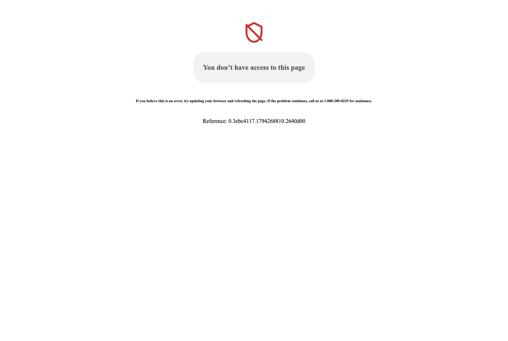

**페이지 메타 정보**

| page | title | description |
|---|---|---|
| [`new`](https://www.macys.com/shop/whats-new?id=14834) | Access Denied - Macy's | Access denied 403 |

#### [Nordstrom](https://www.nordstrom.com/)

- URL: <https://www.nordstrom.com/>
- 페이지: **OK 2 · FAIL 0**

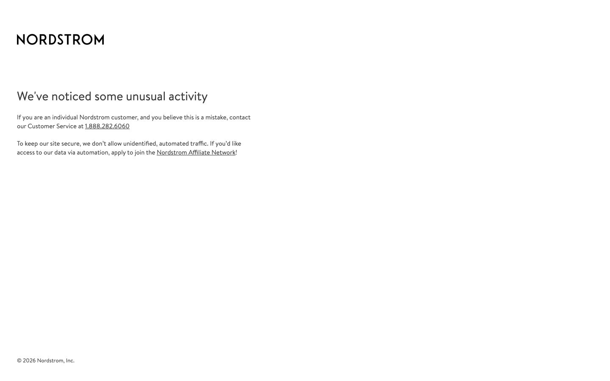

**페이지 메타 정보**

| page | title | description |
|---|---|---|
| [`new`](https://siteclosed.nordstrom.com/invitation.html) | Nordstrom |  |
| [`women`](https://siteclosed.nordstrom.com/invitation.html) | Nordstrom |  |

#### [Revolve](https://www.revolve.com/)

- URL: <https://www.revolve.com/>
- 페이지: **OK 0 · FAIL 2**

**실패 페이지**

- `new` — playwright_error: Error: Page.goto: net::ERR_HTTP2_PROTOCOL_ERROR at https://www.revolve.com/new/br/c79f88/
Call log:
  - navigating to "https://www.revolve.com/new/br/c79f88/", waiting until "domcontentloaded"

- `trending` — playwright_error: Error: Page.goto: net::ERR_HTTP2_PROTOCOL_ERROR at https://www.revolve.com/most-loved/br/4a9ca5/
Call log:
  - navigating to "https://www.revolve.com/most-loved/br/4a9ca5/", waiting until "domcontentloaded"

#### [Urban Outfitters](https://www.urbanoutfitters.com/)

- URL: <https://www.urbanoutfitters.com/>
- 페이지: **OK 1 · FAIL 0**

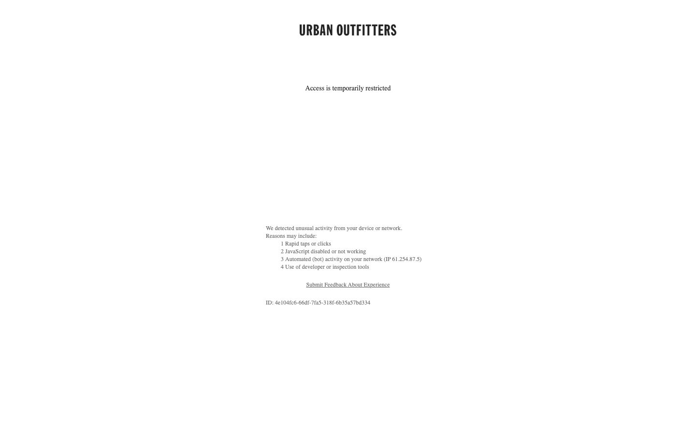

**페이지 메타 정보**

| page | title | description |
|---|---|---|
| [`new_women`](https://www.urbanoutfitters.com/womens-new-arrivals) | urbanoutfitters.com |  |

### 4.7 베트남 _( Vietnam )_

- 한국 수출규모 순위: **#4** · region: `asia` · tier `1` · currency `VND`
- 수집 사이트: **5개** (성공 5)
- 메모: 의류 생산기지/원단 수출 비중 큼. 빠르게 성장하는 이커머스
#### [Canifa](https://canifa.com/)

- URL: <https://canifa.com/>
- 페이지: **OK 1 · FAIL 0**

**대표 상품 이미지** (상위 6장, 출처 URL 포함)

-  — 출처 <https://2885371169.e.cdneverest.net/Simiconnector/BannerSlider/c/h/chaobanmoi_topbanner_desktop-261026.webp>
- 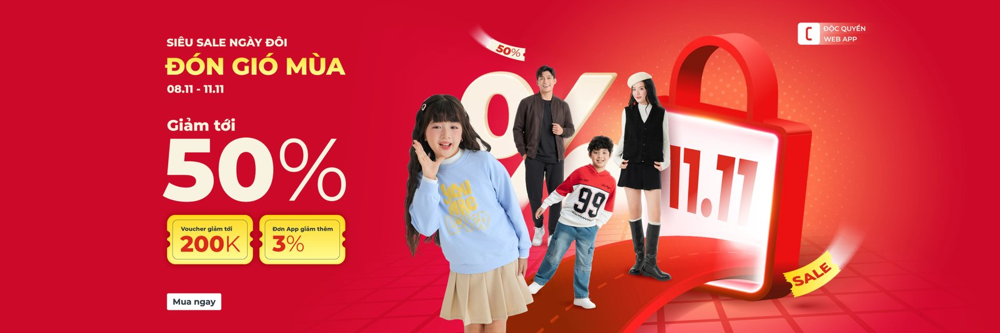 — 출처 <https://2885371169.e.cdneverest.net/Simiconnector/BannerSlider/s/s/ssnd_topbanner_desktop-071126.webp>
-  — 출처 <https://2885371169.e.cdneverest.net/Simiconnector/BannerSlider/t/c/tce_topbanner_desktop-261026.webp>
- 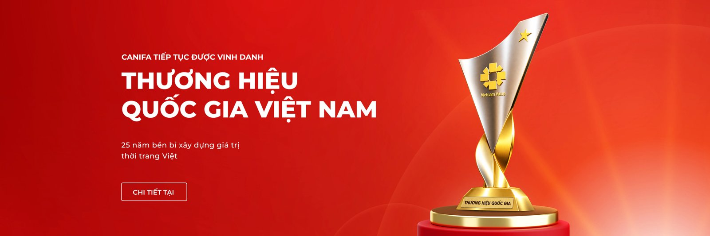 — 출처 <https://2885371169.e.cdneverest.net/Simiconnector/BannerSlider/t/h/thqg_topbanner_desktop-161026.webp>
-  — 출처 <https://2885371169.e.cdneverest.net/Simiconnector/BannerSlider/p/a/pattern-of-life_topbanner_desk-051026.webp>
-  — 출처 <https://canifa.com/_nuxt/img/chatbot-icon.c84d6ec.webp>

**페이지 메타 정보**

| page | title | description |
|---|---|---|
| [`home`](https://canifa.com/) | CANIFA | Patterns of Life | CANIFA - thương hiệu thời trang hàng đầu Việt Nam. Hàng ngàn mẫu quần áo phụ kiện nam, nữ, trẻ em cao cấp, chất lượng, an toàn liên tục được |

#### [IVY moda](https://ivymoda.com/)

- URL: <https://ivymoda.com/>
- 페이지: **OK 1 · FAIL 0**

**대표 상품 이미지** (상위 6장, 출처 URL 포함)

-  — 출처 <https://cotton4u.vn/files/news/2026/11/05/98bb25495aded9e5db7210edb0a245a1.webp>
-  — 출처 <https://cotton4u.vn/files/news/2026/10/14/839870b6bb9a68439a2e1c689b67defe.webp>
-  — 출처 <https://cotton4u.vn/files/news/2026/10/23/89e8eb777a0d21e8986a7f73c2ad29ac.webp>
-  — 출처 <https://cotton4u.vn/files/product/thumab/400/2026/11/05/202681a79166b692151c8c3653bc4384.webp>
- 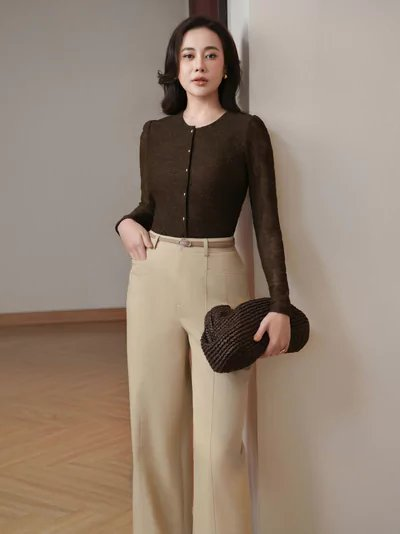 — 출처 <https://cotton4u.vn/files/product/thumab/400/2026/11/05/d725983b9c93c4311ae30b721650de2b.webp>
-  — 출처 <https://cotton4u.vn/files/product/thumab/400/2026/11/05/72d28110d42dda8b029138d886222efe.webp>

**페이지 메타 정보**

| page | title | description |
|---|---|---|
| [`home`](https://ivymoda.com/) | IVY moda - Thời Trang Công Sở Hiện Đại | IVY moda |  |

#### [Lazada Vietnam](https://www.lazada.vn/)

- URL: <https://www.lazada.vn/>
- 페이지: **OK 1 · FAIL 0**

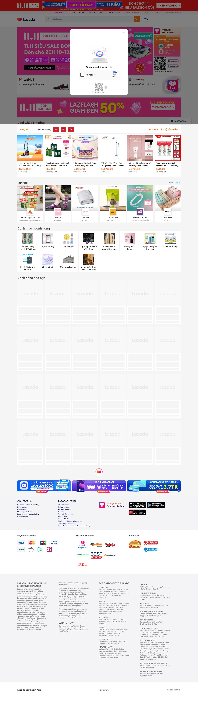

**대표 상품 이미지** (상위 6장, 출처 URL 포함)

-  — 출처 <https://img.lazcdn.com/us/domino/2ad4f22ce5a43dc145f221d13feed352.png>
-  — 출처 <https://img.lazcdn.com/g/tps/images/ims-web/TB1T7K2d8Cw3KVjSZFuXXcAOpXa.png>
-  — 출처 <https://img.lazcdn.com/us/domino/c053ca79-d515-4f60-a981-fd43029e7338_VN-1976-688.jpg_2200x2200q80.jpg>
-  — 출처 <https://img.lazcdn.com/us/domino/4cd7f45f-be99-4a37-94e1-c0519b676a41_VN-1976-688.jpg_2200x2200q80.jpg>
- 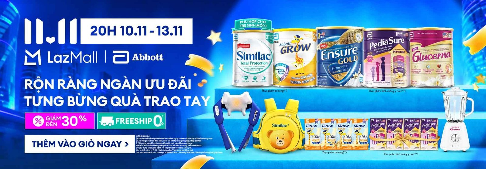 — 출처 <https://img.lazcdn.com/us/domino/f08a2a82-df9f-415b-a4ce-c02f1b66e330_VN-1976-688.jpg_2200x2200q80.jpg>
- 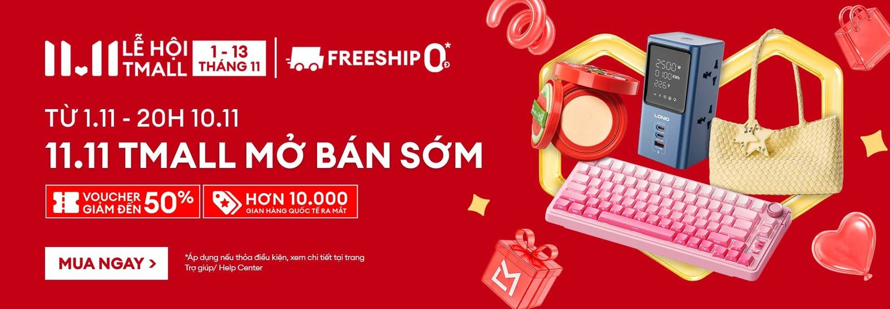 — 출처 <https://img.lazcdn.com/us/domino/275684ef-b345-4875-b8c9-dd354f63bd2f_VN-1976-688.jpg_2200x2200q80.jpg>

**페이지 메타 정보**

| page | title | description |
|---|---|---|
| [`home`](https://www.lazada.vn/#?) | Lazada Việt Nam | Mua Sắm Online, Giá Tốt Nhất Mỗi Ngày | Mua sắm đồ điện tử, thời trang, làm đẹp và đồ chơi giá cả phải chăng. Đảm bảo sản phẩm chính hãng và trải nghiệm mua sắm tiện lợi – mua ngay |

#### [Shopee Vietnam](https://shopee.vn/)

- URL: <https://shopee.vn/>
- 페이지: **OK 1 · FAIL 0**

**대표 상품 이미지** (상위 6장, 출처 URL 포함)

- 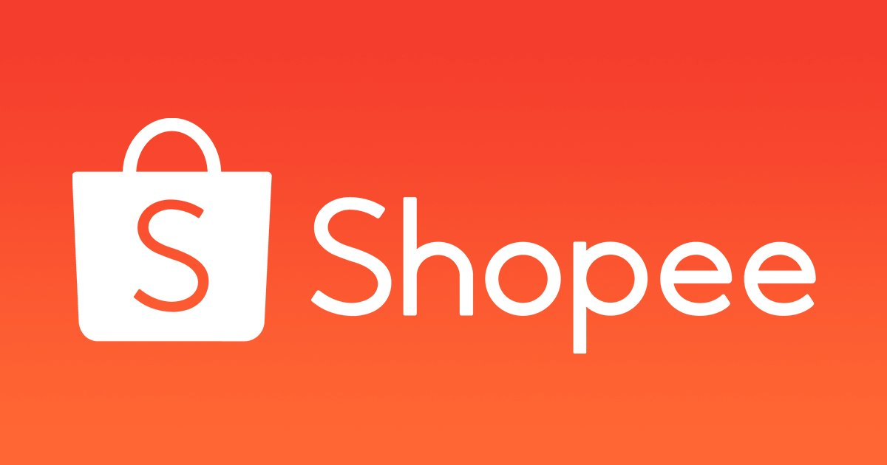 — 출처 <https://deo.shopeemobile.com/shopee/shopee-pcmall-live-sg/homepagefe/42ba6075c82a85ab.png>

**페이지 메타 정보**

| page | title | description |
|---|---|---|
| [`home`](https://shopee.vn/verify/captcha?anti_bot_tracking_id=gqRjZGVrxHSFomtptTE0MjUxOnRyYWNraW5nX2lkX2tleaJrdtEAAqRhbGdv0gAAAGSjZGVrwKJjdMRAAAAADIKMyZ1P2O2Qvasq83S5AwzeFIVi130gJEs0rzTO_4iwfIWyFzi6GeoS0al_i_SqWqJfxR5gmm_2D9B-AqpjaXBoZXJ0ZXh0xQOGAAAADB4c3Kzwe8ZgNhfH6j3oCMs9_kQO6WCdn97s7bPEVYiW4hcjh9DFR6UVMr_6VWm4fDAi2FssLGQMcrqUDAPrDC17i3XVo2BKsiA-iqjFw1Ui6H_hDQkEiZdaj03pwQWLGqYTKhPMjT-ecj9iA_HS-U5jZTMfNMj8-A5h1JoV1AvsEFuVTe-wqzE4rCamM1GCo_uzUiZFGb9Ezc_lXMlTLcDt9NoPys3PwwN8c-b9BXgwvebj-Xh16myqY38crXTie57jjWzpQU5zeI-19qsyBCP_TT8vfzOX0AVDY2w0FNcc3taXKjQgo3G2RFYY93S1JC3h1IgOJtLKF0R-X_P4Hblwybd1RwJuQFIApBYlbq-5G3HFi0AJ9L3YBHFxn-L8JnnTS_JFcXC_9TPR7p1Zg_P9oxDQoVCZwXEwXHfQKfdzOKFvnF75GwukRO_UU1wHk7kDd1zjpu4Sgj7OQNon_1qb5uV6FapWndxE5UT16Va9gW1aQnHq9VQLux6l8t8SkcW6S5Eff6G5xZz01IF3EcdYaJ0L5osWbIFg0F6CZyX8uAT3sDPIQvEoStjMCUgHUKiu6NhMy12wvq9c_PUP1E2SIKerYkfAuzxn4jD1bIQvWVdUqNgKgyrPwFBR99InFMVk6dvayXYn1Xve5inwbbrnZNfEb1nSY4a4QxDJtve_B8zvabSZU8Ckba1Kf-2W5vFkuuat2lxZjVoFsxR0GApXr6lbvfaEASqJnjj4QYNpTsLCQYLQhbVngs5NvK8c6j_-MMlvBIKyegCKeV_dCAV_A-xTw5zQ0H6Fl0SNiJzoi8h4j1uZHm1CpjDxRGcOJe9qwDO2IrS478lZd8nyGiINew_0_exPwWxVOJN0VrGcy9xTAyQbLKPK_19mnLA1Uz158WCGFZCKVfHwPuQdrao2MY0hsifycpxiBO4uPYgWzEeaHtfVGjZTip2RiD1Jckcp9N_UOd-ljAu33McUu7WAKBnHt2rmZf_SvsPkhSVFZPnxwHsVYmFiha0mLIoD0ZzsZ2JaZdnQuIhgLYCU2Iqg764h9gHMkRsg-Exn7sX4aCckpI2x1STFEno2Zszlfx6EmY4dkurW4fI1znrjDbanuHqfLZjF-pCNvPFCZWRlwdenKBjQEhwQaKgaM_b9JHC4_2muao1UPMWlOS7-e-G_vc7ds_hCV1-ZsaduO5GDs0U&app_key=FlashSale.PC&client_id=1&next=https%3A%2F%2Fshopee.vn%2Fverify%2Ftraffic%3F%3Fclient_id%3D%26next%3Dhttps%253A%252F%252Fshopee.vn%252F%26redirect_type%3D2%26should_replace_history%3Dfalse&redirect_type=2&scene=crawler_item&should_replace_history=false) | Shopee Việt Nam | Mua Sắm Online | Mua sắm trực tuyến hàng triệu sản phẩm ở tất cả ngành hàng. Giá tốt & Miễn phí vận chuyển. Mua và bán online trong 30 giây. Voucher Xtra | F |

#### [Tiki](https://tiki.vn/)

- URL: <https://tiki.vn/>
- 페이지: **OK 1 · FAIL 0**

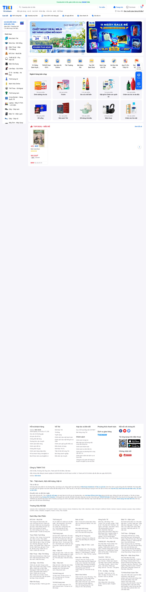

**대표 상품 이미지** (상위 6장, 출처 URL 포함)

-  — 출처 <https://salt.tikicdn.com/cache/100x100/ts/category/ed/20/60/afa9b3b474bf7ad70f10dd6443211d5f.png>
-  — 출처 <https://salt.tikicdn.com/cache/100x100/ts/category/f6/22/46/7e2185d2cf1bca72d5aeac385a865b2b.png>
-  — 출처 <https://salt.tikicdn.com/cache/100x100/ts/category/54/c0/ff/fe98a4afa2d3e5142dc8096addc4e40b.png>
-  — 출처 <https://salt.tikicdn.com/cache/100x100/ts/category/13/64/43/226301adcc7660ffcf44a61bb6df99b7.png>
-  — 출처 <https://salt.tikicdn.com/cache/100x100/ts/category/75/34/29/78e428fdd90408587181005f5cc3de32.png>
-  — 출처 <https://salt.tikicdn.com/cache/100x100/ts/category/61/d4/ea/e6ea3ffc1fcde3b6224d2bb691ea16a2.png>

**페이지 메타 정보**

| page | title | description |
|---|---|---|
| [`home`](https://tiki.vn/) | Tiki - Mua hàng online giá tốt, hàng chuẩn, ship nhanh | Tiện lợi mua sắm hàng triệu mặt hàng, dịch vụ. Vô vàn ưu đãi freeship, mã giảm giá. Hoàn tiền 15% tối đa 600k/tháng với thẻ tín dụng TikiCAR |

## 5. 의류 카테고리별 글로벌 트렌드

| # | 카테고리 | 건수 | 대표 상품명 |
|---:|---|---:|---|
| 1 | `jacket` | 14 | PERTEX T Down Jacket Black · [29CM 단독][유하,다은 PICK]CLASSIC MINK-LIKE FAUX FUR JACKET_BROWN · [29CM 단독][유하 PICK]SIGNATURE TWO-WAY BUTTON JACKET_IVORY |
| 2 | `코트` | 8 | 코듀로이 트림 헤어리 체스터필드 코트 (블랙) · 크리즈 워시 울 싱글 코트 (다크브라운) · [히든포켓✨/자체제작] UTMOST 드로인 알파카 히든 핸드메이드 코트 |
| 3 | `pants` | 7 | MITTO BANDING PANTS_BROWN · MITTO BANDING PANTS_CREAM · LOON CORDUROY PANTS_CHARCOAL |
| 4 | `팬츠` | 7 | [기모추가🔥/50만장돌파/자체제작] 허쉬 코튼 와이드팬츠 (숏/기본/롱) · [made]보니덤블스웨트팬츠 · [🔥기모][서경PICK][골반뽕탈부착][~2XL][11만장🏆][힙딥커버]렌더 코튼 부츠컷 팬츠 (숏/롱ver)(사계절/기모ver)(7color) |
| 5 | `니트` | 6 | [겨울❄️/50만장돌파/자체제작] 시오 니트 (라운드넥/브이넥) · [made]파우더벌룬니트 · 캐시홀가먼트V니트 |
| 6 | `coat` | 5 | [령은 착용] MARGARINE WOOL WASHING FUR-COAT_BEIGE · [단독][NEW컬러 발매] BELLO WOOL COAT_3COLORS · NAVAN DUFFLE HALF COAT (2colors) |
| 7 | `셔츠` | 5 | USAFA 샴브레이 셔츠 블루 · USAFA 샴브레이 셔츠 인디고 · 헤이즐 프릴 목폴라 티셔츠 (4color) |
| 8 | `슬랙스` | 5 | [🍁가을/3기장선택!] made. 모먼트 투커버 올데이슬랙스 (+숏/베이직/롱ver) - 4 size · [기모추가🔥/5만장돌파/자체제작] 모티브 핀턱 슬랙스 (숏/기본) · [🏆역대급100만장/3기장선택!] made. 마켓 와이드 트레이닝슬랙스 (+숏/베이직/롱ver) - 4 size |
| 9 | `skirt` | 4 | Wrap Draped Long Skirt (Charcoal) · MIYU SHIRRING SKIRT_BLACK · REINY WOOL SKIRT_CHARCOAL |
| 10 | `스커트` | 3 | [29CM단독]미엘린 롱스커트 · [다송pick][이지룩][기모][ofm] 이지 트레이닝 롱 스커트 (sk) · 썸띵엘스 슬릭 캐시미어 니트스커트 (3col) 겨울 롱스커트 롱치마 |

**국가별 의류 TOP**

- **korea**: `jacket`(14), `코트`(8), `pants`(7), `팬츠`(7), `니트`(6)
## 6. 악세사리 카테고리별 글로벌 트렌드

| # | 카테고리 | 건수 | 대표 상품명 |
|---:|---|---:|---|
| 1 | `bag` | 2 | [해삐 PICK] Morrow Suede Hobo Bag (Brown) · Morrow Suede Hobo Bag (Mulberry) |
| 2 | `hat` | 1 | FUR SUEDE BUCKET HAT_BROWN |

**국가별 악세사리 TOP**

- **korea**: `bag`(2), `hat`(1)
## 7. 국가별 가격대 비교

| 국가 | 통화 | 표본 | min | p25 | median | p75 | max | median (USD) |
|---|---|---:|---:|---:|---:|---:|---:|---:|
| korea | KRW | 110 | 3920 | 32325 | 82752 | 186418 | 1850830 | 60.78 |

> p25/p75 는 IQR 기준 분위수. USD 환산은 `config/exchange_rates.yaml` 기준 (운영자가 정기 갱신).

## 8. 국내 의류·악세사리 사업동향

### KITA K-stat

- 한국무역통계의 국가 수출입 통계 총괄 페이지입니다.
- 사이트: <https://stat.kita.net/stat/kts/ctr/CtrTotalImpExpList.screen>

| # | topic | title | url |
|---:|---|---|---|
| 1 | `trade` | KITA.NET | <https://www.kita.net/> |
| 2 | `trade` | K-stat 란? | <https://www.kita.net/pdf/statGuide/index.html#p=1> |
| 3 | `무역통계` | 무역통계 분류 | <https://stat.kita.net/stat/guide/guide_18_01.screen> |
| 4 | `trade` | 한국품목코드 | <https://stat.kita.net/stat/kts/statCode/ItemHierCodeList.screen> |
| 5 | `trade` | 해외품목코드 | <https://stat.kita.net/stat/istat/common/IstatHSCode.screen> |
| 6 | `trade` | 대륙/경제코드 | <https://stat.kita.net/stat/kts/statCode/ConEcoCodeList.screen> |
| 7 | `trade` | 수출입 총괄 | <https://stat.kita.net/stat/kts/sum/SumImpExpTotalList.screen> |
| 8 | `trade` | 가공단계 수출입 | <https://stat.kita.net/stat/kts/use/BecList.screen> |
| 9 | `trade` | 품목 수출입 | <https://stat.kita.net/stat/kts/pum/ItemImpExpList.screen> |
| 10 | `trade` | 국가 수출입 | <https://stat.kita.net/stat/kts/ctr/CtrTotalImpExpList.screen> |
| 11 | `trade` | 대륙/경제권 수출입 | <https://stat.kita.net/stat/kts/rel/RelColligationList.screen> |
| 12 | `trade` | 지자체 수출입 | <https://stat.kita.net/stat/kts/prod/ProdWholeList.screen> |
| 13 | `trade` | 항구/공항 수출입 | <https://stat.kita.net/stat/kts/port/PortImpExpList.screen> |
| 14 | `trade` | FTA체결국 수출입 | <https://stat.kita.net/stat/kts/fta/FtaCtrImpExpList.screen> |
| 15 | `trade` | 간접수출 현황 | <https://stat.kita.net/stat/ind/KtsIndMain.screen> |

### Korea Customs Service

- 수출입 현황, 물류통계 등 관세청 무역통계정보를 종합적으로 제공
- 사이트: <https://tradedata.go.kr/cts/index_eng.do>

| # | topic | title | url |
|---:|---|---|---|
| 1 | `trade` | Korea Customs Service | <http://customs.go.kr/english/main.do> |

### KOSIS

- 코시스, 국가데이터처가 제공하는 원스톱 통계 서비스, 국가승인통계, 국제통계, 북한통계, e-지방지표, 통계시각화콘텐츠, 온라인간행물 등 제공
- 사이트: <https://kosis.kr/statisticsList/statisticsListIndex.do?parmTabId=M_01_01&vwcd=MT_ZTITLE&menuId=M_01_01&outLink=Y&entrType=>

| # | topic | title | url |
|---:|---|---|---|
| 1 | `statistics` | 쉽게 보는 통계 | <http://kosis.kr/easyViewStatis/customStatisIndex.do?vwcd=MT_TM1_TITLE&menuId=M_03_01> |
| 2 | `statistics` | 이슈별 접근 | <http://kosis.kr/easyViewStatis/customStatisIndex.do?vwcd=MT_TM2_TITLE&menuId=M_03_02> |
| 3 | `statistics` | 통계시각화콘텐츠 | <http://kosis.kr/easyViewStatis/visualizationIndex.do> |
| 4 | `statistics` | 온라인간행물 | <http://kosis.kr/publication/publicationThema.do> |
| 5 | `statistics` | 기획간행물 | <http://kosis.kr/publication/publicationStat.do> |
| 6 | `statistics` | KOSIS 길라잡이 | <http://kosis.kr/civilComplaint/kosisGuideIndex.do> |
| 7 | `statistics` | 홈페이지 개선의견 | <http://kosis.kr/civilComplaint/siteRequestList.do> |
| 8 | `statistics` | 찾아가는 KOSIS | <http://kosis.kr/civilComplaint/kosisEduIndex.do> |
| 9 | `statistics` | 서비스 소개 | <http://kosis.kr/serviceInfo/kosisIntroduce.do> |
| 10 | `statistics` | 국가통계현황 | <http://kosis.kr/serviceInfo/statisInstitution.do> |
| 11 | `statistics` | 국가통계 공표일정 | <http://kosis.kr/serviceInfo/statisPublicationList.do> |
| 12 | `statistics` | 팩트체크 서비스 | <http://kosis.kr/serviceInfo/factCheckList.do> |
| 13 | `statistics` | 서비스정책 | <http://kosis.kr/serviceInfo/useGuide.do> |
| 14 | `statistics` | 공유서비스 (OpenAPI) | <http://kosis.kr/serviceInfo/openAPIGuide.do> |
| 15 | `statistics` | English | <https://kosis.kr/eng> |

### KOTRA

- 트라이빅(TriBig)은 코트라(KOTRA)가 제공하는 무역투자 빅데이터 플랫폼으로 무역투자통계, 국가별 시장정보, 품목별 유망시장, 기업별 맞춤정보, 해외바이어 정보의 서비스를 제공합니다.
- 사이트: <https://www.kotra.or.kr/bigdata/visualization/korea#search/ALL/ALL/2024>

| # | topic | title | url |
|---:|---|---|---|
| 1 | `trade` | kotra 무역투자24 | <https://www.kotra.or.kr/bigdata/kotraSsoRedirect?targetURL=https://www.kotra.or.kr> |
| 2 | `trade` | 해외비즈니스 정보 포털 | <https://www.kotra.or.kr/bigdata/kotraSsoRedirect?targetURL=https://dream.kotra.or.kr/dream> |
| 3 | `trade` | 글로벌 전시포털 | <https://www.kotra.or.kr/bigdata/kotraSsoRedirect?targetURL=https://www.gep.or.kr/> |
| 4 | `trade` | KOTRA 해외인재유치센터 | <https://www.kotra.or.kr/gtc_kor> |
| 5 | `trade` | 투자유치정보제공 | <https://www.kotra.or.kr/bigdata/kotraSsoRedirect?targetURL=https://www.investkorea.org/> |
| 6 | `수출지원` | 수출지원 온라인 플랫폼 | <https://www.kotra.or.kr/bigdata/kotraSsoRedirect?targetURL=https://www.buykorea.or.kr/> |
| 7 | `trade` | 빅데이터 서비스 | <https://www.kotra.or.kr/bigdata/> |
| 8 | `trade` | 경제외교 활용포털 | <https://www.kotra.or.kr/bigdata/kotraSsoRedirect?targetURL=https://president.globalwindow.org> |
| 9 | `trade` | 방산물자교역지원센터 | <https://www.kotra.or.kr/bigdata/kotraSsoRedirect?targetURL=https://www.kotra.or.kr/kodits> |
| 10 | `trade` | 외투기업고충처리 | <https://www.kotra.or.kr/bigdata/kotraSsoRedirect?targetURL=https://ombudsman.kotra.or.kr/ob-kr> |
| 11 | `trade` | 수출바우처 · 지사화 | <https://www.exportvoucher.com> |
| 12 | `trade` | 무역투자통계 | <https://www.kotra.or.kr/bigdata/visualization/korea> |
| 13 | `trade` | 국가별 시장정보 | <https://www.kotra.or.kr/bigdata/marketAnalysis> |
| 14 | `trade` | 품목별 유망시장 | <https://www.kotra.or.kr/bigdata/bhrcMarket> |
| 15 | `trade` | 해외바이어 정보 | <https://www.kotra.or.kr/bigdata/partner/search> |

### Statistics Korea Online Shopping

- 국가데이터처,List | 전체 | 보도자료 | 새소식
- 사이트: <https://mods.go.kr/board.es?mid=a10301010000&bid=11789>

| # | topic | title | url |
|---:|---|---|---|
| 1 | `statistics` | 정보공개제도 | <https://mods.go.kr/menu.es?mid=a10101010100> |
| 2 | `statistics` | 정보공개청구 | <https://www.open.go.kr/com/main/mainView.do> |
| 3 | `statistics` | 비공개대상정보세부기준 | <https://mods.go.kr/menu.es?mid=a10101030000> |
| 4 | `statistics` | 고객수요분석 | <https://mods.go.kr/menu.es?mid=a10101040000> |
| 5 | `statistics` | 사전정보공표 | <https://mods.go.kr/menu.es?mid=a10103010000> |
| 6 | `statistics` | 사전정보공표목록 | <https://mods.go.kr/menu.es?mid=a10103010100> |
| 7 | `statistics` | 핵심단어목록 | <https://mods.go.kr/menu.es?mid=a10103020100> |
| 8 | `statistics` | 인기정보TOP10 | <https://mods.go.kr/menu.es?mid=a10103030100> |
| 9 | `statistics` | 행정자료실 | <https://mods.go.kr/menu.es?mid=a10104010000> |
| 10 | `statistics` | 업무추진비 | <https://mods.go.kr/menu.es?mid=a10104010100> |
| 11 | `statistics` | 국회관련정보 | <https://mods.go.kr/menu.es?mid=a10104040000> |
| 12 | `statistics` | 정책실명제 | <https://mods.go.kr/menu.es?mid=a10105010000> |
| 13 | `statistics` | 연도별대상사업현황 | <https://mods.go.kr/menu.es?mid=a10105020000> |
| 14 | `statistics` | 중점관리대상사업 | <https://mods.go.kr/menu.es?mid=a10105030600> |
| 15 | `statistics` | 국민신청실명제 | <https://mods.go.kr/menu.es?mid=a10105040000> |

### 기업마당

- 기업마당>정책정보>지원사업 공고
- 사이트: <https://www.bizinfo.go.kr/sii/siia/selectSIIA200View.do?null>

| # | topic | title | url |
|---:|---|---|---|
| 1 | `policy` | 지원사업 공고 | <https://www.bizinfo.go.kr/sii/siia/selectSIIA200View.do> |
| 2 | `policy` | 품목별 법정의무 인증제도 | <https://www.bizinfo.go.kr/biz/biza/selectBIZA100View.do> |
| 3 | `policy` | 입법·행정예고/고시 | <https://www.bizinfo.go.kr/biz/biza/selectBIZA300View.do> |
| 4 | `policy` | 월간 중기누리 | <https://www.bizinfo.go.kr/biz/biza/selectBIZA400View.do> |
| 5 | `policy` | 기업업무용 서식 | <https://www.bizinfo.go.kr/biz/bizb/selectBIZB100View.do> |
| 6 | `policy` | 입주기업 모집공고 | <https://www.bizinfo.go.kr/biz/bizb/selectBIZB200View.do> |
| 7 | `policy` | 온라인화상회의실 | <https://www.k-startup.go.kr/web/contents/webOLNIVIDEOMTRM.do> |
| 8 | `policy` | 정책정보 개방 | <https://www.bizinfo.go.kr/apiList.do> |
| 9 | `policy` | 속보성 대시보드 | <https://www.bizinfo.go.kr/dashboard.do> |
| 10 | `policy` | 고객의 소리 | <https://www.bizinfo.go.kr/biz/bizc/selectBIZC200Regist.do> |
| 11 | `policy` | 자주하는질문 | <https://www.bizinfo.go.kr/biz/bizc/selectBIZC300View.do> |
| 12 | `policy` | 이메일주소 무단 수집 거부안내 | <https://www.bizinfo.go.kr/biz/bizd/selectBIZD110View.do> |
| 13 | `policy` | 웹접근성 정책 | <https://www.bizinfo.go.kr/biz/bizd/selectBIZD130View.do> |
| 14 | `policy` | 전체메뉴보기 | <https://www.bizinfo.go.kr/sitemap/intro.do> |
| 15 | `policy` | [경북] 성주군 2026년 중소기업 운전자금(이차보전) 잔액정리분 접수 계획 공고 | <https://www.bizinfo.go.kr/sii/siia/selectSIIA200Detail.do?hashCode=&rowsSel=&rows=15&cpage=&cat=&schPblancDiv=&schJrsdCodeTy=&schWntyAt=&schAreaDetailCodes=&schEndAt=N&orderGb=&sort=&preKeywords=&condition=&condition1=&keyword=&pblancId=PBLN_000000000127792> |

### 서울경제진흥원

- 서울경제진흥원 에러페이지
- 사이트: <https://www.sba.seoul.kr/Pages/error_404.html?aspxerrorpath=/Pages/NSub06_01.aspx>

### 소상공인24

- 소상공인24는 소상공인시장진흥공단이 운영하는 소상공인 지원사업 통합 플랫폼입니다. 소진공·지방정부·유관기관 지원사업 공고 조회와 신청, 대출상품 조회, 증명서 발급, 소상공인 통계를 한 곳에서 이용할 수 있습니다.
- 사이트: <https://www.sbiz24.kr/#/pbanc>

| # | topic | title | url |
|---:|---|---|---|
| 1 | `policy` | 지원사업 소개 | <https://www.sbiz24.kr/#/cmmn/gnrl/Conts/7> |
| 2 | `policy` | 소진공 지원사업 공고조회 및 신청 | <https://www.sbiz24.kr/#/pbanc> |
| 3 | `policy` | 지방정부 지원사업 공고조회 및 신청 | <https://www.sbiz24.kr/#/lcgPbanc> |
| 4 | `policy` | 유관기관 지원사업 공고조회 | <https://www.sbiz24.kr/#/extldPbanc> |
| 5 | `policy` | 대출상품 조회 | <https://www.sbiz24.kr/#/loanProduct> |
| 6 | `policy` | 지원사업 상담 | <https://www.sbiz24.kr/#/qna> |

### 중소벤처기업부

- 중소기업중앙회 등 기관 중소기업 조사, 통계 DB화 검색, 내려받기 등 제공.
- 사이트: <https://www.mss.go.kr/site/smba/ex/bbs/List.do?cbIdx=86>

| # | topic | title | url |
|---:|---|---|---|
| 1 | `policy` | 어린이 누리집 | <https://www.mss.go.kr/site/kids/main.do> |
| 2 | `policy` | English | <https://www.mss.go.kr/site/eng/main.do> |
| 3 | `policy` | 누리집 안내지도 | <https://www.mss.go.kr/site/smba/ex/siteMap/siteMap.do> |
| 4 | `policy` | 훈령/예규/고시/공고 | <https://www.mss.go.kr/site/smba/ex/bbs/List.do?cbIdx=125&ext6=Y> |
| 5 | `policy` | 입법/행정예고 | <https://www.mss.go.kr/site/smba/ex/bbs/List.do?cbIdx=126&searchRltnYn=Y> |
| 6 | `policy` | 인사·채용 | <https://www.mss.go.kr/site/smba/ex/bbs/List.do?cbIdx=82> |
| 7 | `policy` | 보도설명자료 | <https://www.mss.go.kr/site/smba/ex/bbs/List.do?cbIdx=87> |
| 8 | `policy` | 현장속으로 | <https://www.mss.go.kr/site/smba/brdcststnVod/brdcststnVodList.do?ctgr_code=C01> |
| 9 | `policy` | 중기부소식지 | <https://www.mss.go.kr/site/smba/ex/bbs/List.do?cbIdx=95> |
| 10 | `policy` | 통계설명자료 | <https://www.mss.go.kr/site/smba/foffice/ex/statDB/ptScheduleList.do> |
| 11 | `policy` | 주제별 통계 | <https://www.mss.go.kr/site/smba/foffice/ex/statDB/temaList.do?tabCd=0001> |
| 12 | `policy` | 조사별 통계 | <https://www.mss.go.kr/site/smba/foffice/ex/statDB/surveyList.do?tabCd=0001> |
| 13 | `policy` | 조사보고서 | <https://www.mss.go.kr/site/smba/foffice/ex/statDB/stReportRoList.do?gb=1&nodeId=&roCode=> |
| 14 | `policy` | 주제별 조회 | <https://www.mss.go.kr/site/smba/foffice/ex/statDB/stReportRcList.do?gb=2&nodeId=&rcCode=> |
| 15 | `policy` | 중소기업위상 | <https://www.mss.go.kr/site/smba/foffice/ex/statDB/MainSubStat.do?scd=0001> |

## 9. 한국 사업자 관점 기회 국가 TOP 10

| # | 국가 | tier | region | 점수 | 근거 |
|---:|---|---:|---|---:|---|
| 1 | 태국 _( Thailand )_ | 1 | `asia` | **143.5** | tier1 기본점(90); 아시아 권역(+20); ASEAN 시장(+10); K-패션/콘텐츠 친화 시장(+20); 트렌드 신호 밀도 4 |
| 2 | 대만 _( Taiwan )_ | 1 | `asia` | **136.5** | tier1 기본점(90); 아시아 권역(+20); K-패션/콘텐츠 친화 시장(+20); 트렌드 신호 밀도 6 |
| 3 | 일본 _( Japan )_ | 1 | `asia` | **130.0** | tier1 기본점(90); 아시아 권역(+20); K-패션/콘텐츠 친화 시장(+20) |
| 4 | 베트남 _( Vietnam )_ | 1 | `asia` | **124.5** | tier1 기본점(90); 아시아 권역(+20); ASEAN 시장(+10); 트렌드 신호 밀도 4 |
| 5 | 인도네시아 _( Indonesia )_ | 1 | `asia` | **123.5** | tier1 기본점(90); 아시아 권역(+20); ASEAN 시장(+10); 트렌드 신호 밀도 4 |
| 6 | 필리핀 _( Philippines )_ | 2 | `asia` | **110.0** | tier2 기본점(60); 아시아 권역(+20); ASEAN 시장(+10); K-패션/콘텐츠 친화 시장(+20) |
| 7 | 미국 _( United States )_ | 1 | `north_america` | **90.0** | tier1 기본점(90) |
| 8 | 말레이시아 _( Malaysia )_ | 2 | `asia` | **90.0** | tier2 기본점(60); 아시아 권역(+20); ASEAN 시장(+10) |
| 9 | 싱가포르 _( Singapore )_ | 2 | `asia` | **90.0** | tier2 기본점(60); 아시아 권역(+20); ASEAN 시장(+10) |
| 10 | 홍콩 _( Hong Kong )_ | 2 | `asia` | **80.0** | tier2 기본점(60); 아시아 권역(+20) |

## 10. 실행 제안

### **1위 태국** (점수 144, tier1 · asia)

- 현지 스타일 TOP: `wide` — 시즌 컬렉션 기획 시 우선 반영.
- 현지 컬러 TOP: `red` — 시즌 컬렉션 기획 시 우선 반영.
- 현지 카테고리 TOP: `tee`, `bag`, `accessories` — 시즌 컬렉션 기획 시 우선 반영.
- K-패션 친화도가 명시된 시장이므로 K-브랜드 아이덴티티 및 한류 셀럽 협업을 강조.
- ASEAN 권역 시장 — 물류/관세(FTA) 활용 + 동남아 통합 마케팅 검토 권장.
- tier1 핵심 시장 — 현지 마켓플레이스(예: 해당 국가의 대표 패션 플랫폼) 공식 입점 + 셀러 운영 채널 확보 우선.
- 연계 가능한 국내 수출/지원 사업이 식별되지 않음 — `domestic_sources.yaml` 의 `landing_url` 을 KOTRA 사업 공고/기업마당 수출바우처로 직접 지정 권장.

### **2위 대만** (점수 136, tier1 · asia)

- 현지 컬러 TOP: `pink`, `red` — 시즌 컬렉션 기획 시 우선 반영.
- 현지 소재 TOP: `lace` — 시즌 컬렉션 기획 시 우선 반영.
- K-패션 친화도가 명시된 시장이므로 K-브랜드 아이덴티티 및 한류 셀럽 협업을 강조.
- 아시아 권역 시장 — 시차/언어 친화 + 한국 본사 직배송 모델 검토.
- tier1 핵심 시장 — 현지 마켓플레이스(예: 해당 국가의 대표 패션 플랫폼) 공식 입점 + 셀러 운영 채널 확보 우선.
- 연계 가능한 국내 수출/지원 사업이 식별되지 않음 — `domestic_sources.yaml` 의 `landing_url` 을 KOTRA 사업 공고/기업마당 수출바우처로 직접 지정 권장.

### **3위 일본** (점수 130, tier1 · asia)

- K-패션 친화도가 명시된 시장이므로 K-브랜드 아이덴티티 및 한류 셀럽 협업을 강조.
- 아시아 권역 시장 — 시차/언어 친화 + 한국 본사 직배송 모델 검토.
- tier1 핵심 시장 — 현지 마켓플레이스(예: 해당 국가의 대표 패션 플랫폼) 공식 입점 + 셀러 운영 채널 확보 우선.
- 연계 가능한 국내 수출/지원 사업이 식별되지 않음 — `domestic_sources.yaml` 의 `landing_url` 을 KOTRA 사업 공고/기업마당 수출바우처로 직접 지정 권장.

### 운영 점검 노트

- **한국 어휘사전 매칭 0건**: 메인페이지만 수집되어 색/소재/스타일 신호가 0. 한국 사이트(29CM/W Concept/Musinsa)에 `page_targets` 추가 필요.
- **ASEAN 다중 진출 기회**: TOP10 중 ASEAN 국가가 3개 이상. Shopee/Lazada/Zalora 통합 운영을 통한 동남아 멀티마켓 전략을 검토 권장.

## 11. 수집 실패/주의 사이트

| 국가 | 사이트 | 페이지 | 상태 | 사유 |
|---|---|---|---|---|
| usa | Revolve | new | failed | playwright_error: Error: Page.goto: net::ERR_HTTP2_PROTOCOL_ERROR at https://www.revolve.com/new/br/c79f88/
Call log:
  - navigating to "https://www.revolve.com/new/br/c79f88/", waiting until "domcontentloaded"
 |
| usa | Revolve | trending | failed | playwright_error: Error: Page.goto: net::ERR_HTTP2_PROTOCOL_ERROR at https://www.revolve.com/most-loved/br/4a9ca5/
Call log:
  - navigating to "https://www.revolve.com/most-loved/br/4a9ca5/", waiting until "domcontentloaded"
 |
| japan | ZOZOTOWN | new | failed | playwright_error: Error: Page.goto: net::ERR_TIMED_OUT at https://zozo.jp/category/new/
Call log:
  - navigating to "https://zozo.jp/category/new/", waiting until "domcontentloaded"
 |
| japan | ZOZOTOWN | ranking | failed | playwright_error: TimeoutError: Page.goto: Timeout 30000ms exceeded.
Call log:
  - navigating to "https://zozo.jp/ranking/", waiting until "domcontentloaded"
 |
| japan | Rakuten Fashion | women | failed | http_status_404 |
| indonesia | Tokopedia | home | failed | playwright_error: Error: Page.goto: net::ERR_HTTP2_PROTOCOL_ERROR at https://www.tokopedia.com/
Call log:
  - navigating to "https://www.tokopedia.com/", waiting until "domcontentloaded"
 |
| thailand | Pomelo | new | failed | robots_disallowed |
| thailand | Pomelo | best | failed | robots_disallowed |
| korea | Musinsa | home | failed | robots_disallowed |

## 12. 원문 출처 및 이미지 출처

### 인도네시아

- **Berrybenka** — <https://www.berrybenka.com/>
  - 이미지 출처: <https://berrybenka.com/cdn/shop/files/logo.jpg?v=1791288203&width=3840>
  - 이미지 출처: <http://berrybenka.com/cdn/shop/files/berrybenka_logo.png?v=1788942734>
  - 이미지 출처: <https://berrybenka.com/cdn/shop/files/berrybenka_logo.png?v=1788942734>
- **Hijup** — <https://www.hijup.com/>
- **Shopee Indonesia** — <https://shopee.co.id/>
  - 이미지 출처: <https://deo.shopeemobile.com/shopee/shopee-pcmall-live-sg/assets/1c8bdaaf45e1fd48.png>
  - 이미지 출처: <https://deo.shopeemobile.com/shopee/shopee-pcmall-live-sg/homepagefe/42ba6075c82a85ab.png>
- **Tokopedia** — <https://www.tokopedia.com/>
- **Zalora Indonesia** — <https://www.zalora.co.id/>
  - 이미지 출처: <https://static-id.zacdn.com/next-assets/static-assets/images/logo/icon_mastercard.png>
  - 이미지 출처: <https://static-id.zacdn.com/next-assets/static-assets/images/logo/icon_visa.png>
  - 이미지 출처: <https://static-id.zacdn.com/next-assets/static-assets/images/logo/icon_ovo.png>
  - 이미지 출처: <https://static-id.zacdn.com/next-assets/static-assets/images/logo/icon_indodana.png>

### 일본

- **GU Japan** — <https://www.gu-global.com/jp/>
  - 이미지 출처: <https://image.uniqlo.com/GU/ST3/jp/imagesother/Navigation/WOMEN_Category/2026/261023/261023_category-icon_autumn-winter-sale.png>
  - 이미지 출처: <https://image.uniqlo.com/GU/ST3/jp/imagesother/Navigation/Category-icon_V2/2026/0724/Categoy_Limited-offers.jpg>
  - 이미지 출처: <https://image.uniqlo.com/GU/ST3/jp/imagesother/Navigation/Category-icon_V2/2026/0724/Categoy_SALE.jpg>
  - 이미지 출처: <https://image.uniqlo.com/GU/ST3/jp/imagesother/Navigation/collaboration_Category/26FW/rokh_category_icon.png>
  - 이미지 출처: <https://image.uniqlo.com/GU/ST3/jp/imagesother/Navigation/WOMEN_Category/2026/261106/261106_category_w_outer_360434.png>
  - 이미지 출처: <https://image.uniqlo.com/GU/ST3/jp/imagesother/Navigation/WOMEN_Category/2026/261008/category_w_knit-and-cardigan_360549.png>
  - 이미지 출처: <https://image.uniqlo.com/GU/ST3/jp/imagesother/Navigation/WOMEN_Category/2026/261008/category_w_tops_361505.png>
  - 이미지 출처: <https://image.uniqlo.com/GU/ST3/jp/imagesother/Navigation/WOMEN_Category/2026/260911/Category_w_sweat_361784.png>
  - 이미지 출처: <https://image.uniqlo.com/GU/ST3/jp/imagesother/Navigation/WOMEN_Category/2026/261030/261030_category_w_sheer-T_360571.png>
  - 이미지 출처: <https://image.uniqlo.com/GU/ST3/jp/imagesother/Navigation/WOMEN_Category/2026/261030/261030_category_w_warm-T_360578.png>
  - 이미지 출처: <https://image.uniqlo.com/GU/ST3/jp/imagesother/Navigation/WOMEN_Category/2026/261030/261030_category_w_fleece_361295.png>
  - 이미지 출처: <https://image.uniqlo.com/GU/ST3/jp/imagesother/Navigation/WOMEN_Category/2026/260807/Category_w_shirt_361657.png>
  - 이미지 출처: <https://image.uniqlo.com/GU/ST3/jp/imagesother/Navigation/WOMEN_Category/2026/260724/Category_w_Pants.jpg>
- **Rakuten Fashion** — <https://brandavenue.rakuten.co.jp/>
  - 이미지 출처: <https://brandavenue.r10s.jp/img/library/index/sbn_flagshipstore_20231003.png>
  - 이미지 출처: <https://brandavenue.r10s.jp/img/news/01/408240/pc_n.jpg>
  - 이미지 출처: <https://brandavenue.r10s.jp/img/news/01/406122/pc_n.jpg>
  - 이미지 출처: <https://brandavenue.r10s.jp/img/news/01/407207/pc_n.jpg>
  - 이미지 출처: <https://brandavenue.r10s.jp/img/news/01/407209/pc_n.jpg>
  - 이미지 출처: <https://brandavenue.r10s.jp/img/news/01/407213/pc_n.jpg>
  - 이미지 출처: <https://brandavenue.r10s.jp/img/news/01/407214/pc_n.jpg>
  - 이미지 출처: <https://brandavenue.r10s.jp/img/news/01/408312/pc_n.jpg>
  - 이미지 출처: <https://brandavenue.r10s.jp/img/news/01/407227/pc_n.jpg>
  - 이미지 출처: <https://brandavenue.r10s.jp/img/news/01/408086/pc_n.jpg>
  - 이미지 출처: <https://brandavenue.r10s.jp/img/news/01/406989/pc_n.jpg>
  - 이미지 출처: <https://brandavenue.r10s.jp/img/news/01/406131/pc_n.jpg>
  - 이미지 출처: <https://brandavenue.r10s.jp/img/news/01/406419/pc_n.jpg>
  - 이미지 출처: <https://brandavenue.r10s.jp/img/news/01/408064/pc_n.jpg>
  - 이미지 출처: <https://brandavenue.r10s.jp/img/news/01/408193/pc_n.jpg>
  - 이미지 출처: <https://brandavenue.r10s.jp/img/news/01/408199/pc_n.jpg>
  - 이미지 출처: <https://brandavenue.r10s.jp/img/news/01/408401/pc_n.jpg>
  - 이미지 출처: <https://brandavenue.r10s.jp/img/news/01/406205/pc_n.jpg>
  - 이미지 출처: <https://brandavenue.r10s.jp/img/news/01/408281/pc_n.jpg>
- **Uniqlo Japan** — <https://www.uniqlo.com/jp/>
- **WEAR** — <https://wear.jp/>
- **ZOZOTOWN** — <https://zozo.jp/>

### 한국

- **29CM** — <https://www.29cm.co.kr/>
  - 이미지 출처: <https://img.29cm.co.kr/cms/202611/11f1d9aac84ca5acb5d9c590eb524720.jpg?width=3840&format=webp>
  - 이미지 출처: <https://img.29cm.co.kr/cms/202611/11f1d9aabf60dd2eb5d94d8bb30d4788.jpg?width=3840&format=webp>
  - 이미지 출처: <https://img.29cm.co.kr/cms/202611/11f1d9aaa30a12b6aa2de170f071d531.jpg?width=3840&format=webp>
  - 이미지 출처: <https://img.29cm.co.kr/cms/202611/11f1d9aa99ea68f0aa2d69985b95954e.jpg?width=3840&format=webp>
  - 이미지 출처: <https://img.29cm.co.kr/cms/202611/11f1d9aa8cfe74e4aa2d5be3c7222fef.jpg?width=3840&format=webp>
  - 이미지 출처: <https://img.29cm.co.kr/cms/202611/11f1d9aa84d427aeaa2d85781c33f870.jpg?width=3840&format=webp>
  - 이미지 출처: <https://img.29cm.co.kr/cms/202611/11f1d9aa7dc2ec6eb5d939fcf9f17fa4.jpg?width=3840&format=webp>
  - 이미지 출처: <https://img.29cm.co.kr/cms/202611/11f1d9aa753bff68aa2dc5acf9e4bcb9.jpg?width=3840&format=webp>
  - 이미지 출처: <https://img.29cm.co.kr/cms/202611/11f1d8ddd57cbe29aa2d6b754fab3717.jpg?width=3840&format=webp>
  - 이미지 출처: <https://img.29cm.co.kr/cms/202611/11f1d8ddcc5aca79aa2d857f574841e3.jpg?width=3840&format=webp>
  - 이미지 출처: <https://img.29cm.co.kr/cms/202611/11f1d8ddbdacdb21aa2dc3f43718b844.jpg?width=3840&format=webp>
  - 이미지 출처: <https://img.29cm.co.kr/cms/202611/11f1d8ddb4f40989aa2de52d7c706960.jpg?width=3840&format=webp>
  - 이미지 출처: <https://img.29cm.co.kr/cms/202611/11f1d8ddac15aeb0b5d92bd8e2fd1f79.jpg?width=3840&format=webp>
  - 이미지 출처: <https://img.29cm.co.kr/cms/202611/11f1d7fb66f3c1f9b5d925a2d4701907.jpg?width=3840&format=webp>
  - 이미지 출처: <https://img.29cm.co.kr/cms/202611/11f1d72bbbe860a0b5d971dd620d5462.jpg?width=3840&format=webp>
  - 이미지 출처: <https://img.29cm.co.kr/cms/202611/11f1d72baa7648b4aa2d6df4da4bfc08.jpg?width=3840&format=webp>
  - 이미지 출처: <https://img.29cm.co.kr/cms/202611/11f1d6658314dee0b5d90d38f2b3df85.jpg?width=3840&format=webp>
  - 이미지 출처: <https://img.29cm.co.kr/cms/202611/11f1d66579e3d00ab5d9e9b0100994d3.jpg?width=3840&format=webp>
- **Musinsa** — <https://www.musinsa.com/>
- **W Concept** — <https://www.wconcept.co.kr/>
- **Zigzag** — <https://zigzag.kr/>

### 대만

- **momo** — <https://www.momoshop.com.tw/>
- **OB Design** — <https://www.obdesign.com.tw/>
  - 이미지 출처: <https://cms-static.cdn.91app.com/images/original/41602/92f19e4d-89b7-4330-9570-02cf1dff9742-1793588497-3rum8nrsiv_d_1920x820_1280x547_1124x480_800x342_600x256_400x171.jpg>
  - 이미지 출처: <https://cms-static.cdn.91app.com/images/original/41602/92f19e4d-89b7-4330-9570-02cf1dff9742-1794204068-szm5kt30au_d_1920x820_1280x547_1124x480_800x342_600x256_400x171.jpg>
  - 이미지 출처: <https://cms-static.cdn.91app.com/images/original/41602/92f19e4d-89b7-4330-9570-02cf1dff9742-1794193864-y85juga1zg_d_1920x820_1280x547_1124x480_800x342_600x256_400x171.jpg>
  - 이미지 출처: <https://cms-static.cdn.91app.com/images/original/41602/92f19e4d-89b7-4330-9570-02cf1dff9742-1794194271-wtfzxkcvms_d_1920x820_1280x547_1124x480_800x342_600x256_400x171.jpg>
  - 이미지 출처: <https://cms-static.cdn.91app.com/images/original/41602/92f19e4d-89b7-4330-9570-02cf1dff9742-1794194416-wz3vkxolfi_d_1920x820_1280x547_1124x480_800x342_600x256_400x171.jpg>
  - 이미지 출처: <https://cms-static.cdn.91app.com/images/original/41602/92f19e4d-89b7-4330-9570-02cf1dff9742-1793757667-w0s0fz0ca4_d_1920x820_1280x547_1124x480_800x342_600x256_400x171.jpg>
  - 이미지 출처: <https://cms-static.cdn.91app.com/images/original/41602/92f19e4d-89b7-4330-9570-02cf1dff9742-1793671583-wzsgkiumfx_d_1920x820_1280x547_1124x480_800x342_600x256_400x171.jpg>
  - 이미지 출처: <https://cms-static.cdn.91app.com/images/original/41602/92f19e4d-89b7-4330-9570-02cf1dff9742-1794194144-a0d3jhklbp_d_1920x820_1280x547_1124x480_800x342_600x256_400x171.jpg>
  - 이미지 출처: <https://cms-static.cdn.91app.com/images/original/41602/20e150ef-f3b9-41e5-a7d1-3e246e070a59-1766996640-zaqbt3m2o6_m.png>
  - 이미지 출처: <https://cms-static.cdn.91app.com/images/original/41602/20e150ef-f3b9-41e5-a7d1-3e246e070a59-1767328066-hpr7vgg5h2_m.png>
  - 이미지 출처: <https://cms-static.cdn.91app.com/images/original/41602/20e150ef-f3b9-41e5-a7d1-3e246e070a59-1767067052-avl82sdmyk_m.gif>
  - 이미지 출처: <https://cms-static.cdn.91app.com/images/original/41602/20e150ef-f3b9-41e5-a7d1-3e246e070a59-1772016038-bahn8sg6xa_m.png>
  - 이미지 출처: <https://cms-static.cdn.91app.com/images/original/41602/92f19e4d-89b7-4330-9570-02cf1dff9742-1789354550-oy3ba049j8_m_1280x600_1124x527_800x375_600x281_400x188.jpg>
  - 이미지 출처: <https://cms-static.cdn.91app.com/images/original/41602/92f19e4d-89b7-4330-9570-02cf1dff9742-1793671377-0fgge121r3_m_1280x600_1124x527_800x375_600x281_400x188.jpg>
  - 이미지 출처: <https://cms-static.cdn.91app.com/images/compress/41602/92f19e4d-89b7-4330-9570-02cf1dff9742-1793671377-0fgge121r3_m_400x188.webp>
  - 이미지 출처: <https://cms-static.cdn.91app.com/images/original/41602/92f19e4d-89b7-4330-9570-02cf1dff9742-1793588952-ymm4osncd8_m_600x700_400x467.jpg>
- **PChome** — <https://24h.pchome.com.tw/>
- **Pinkoi Taiwan** — <https://www.pinkoi.com/>
  - 이미지 출처: <https://cdn04.pinkoi.com/pinkoi.site/logo/og_image.png>
- **Yahoo Taiwan Shopping** — <https://tw.buy.yahoo.com/>
  - 이미지 출처: <https://img.yec.tw/zp/MerchandiseImages/850397f7b8-Gd-11689377.jpg>
  - 이미지 출처: <https://img.yec.tw/zp/MerchandiseImages/7cd6d71aec-Gd-12260494.jpg>
  - 이미지 출처: <https://img.yec.tw/zp/MerchandiseImages/d858fec156-Gd-11503959.jpg>
  - 이미지 출처: <https://img.yec.tw/up/uploadr/00u21hvmzmjMvuwgh1d8/SHP/mario/270x270_1.gif>

### 태국

- **Central Online** — <https://www.central.co.th/>
  - 이미지 출처: <https://www.central.co.th/_next/image?url=https%3A%2F%2Fassets.central.co.th%2Ffile-assets%2Fassets%2FCMS%2Fcampaign%2F2026%2F11nov%2F20261101_SOG_Homepage_herobanner.jpg&w=3840&q=75>
  - 이미지 출처: <https://www.central.co.th/_next/image?url=https%3A%2F%2Fassets.central.co.th%2Ffile-assets%2Fassets%2FCMS%2Fcampaign%2F2026%2F11nov%2F20261110_cle_de_peau_beaute_heroweb_d.jpg&w=3840&q=75>
  - 이미지 출처: <https://www.central.co.th/_next/image?url=https%3A%2F%2Fassets.central.co.th%2Ffile-assets%2Fassets%2FCMS%2Fcampaign%2F2026%2F11nov%2F20261101_casio_heroweb_d.jpg&w=3840&q=75>
  - 이미지 출처: <https://www.central.co.th/_next/image?url=https%3A%2F%2Fassets.central.co.th%2Ffile-assets%2Fassets%2FCMS%2Fcampaign%2F2026%2F11nov%2F20261101_electrolux_heroweb_d.jpg&w=3840&q=75>
  - 이미지 출처: <https://www.central.co.th/_next/image?url=https%3A%2F%2Fassets.central.co.th%2Ffile-assets%2Fassets%2FCMS%2Fcampaign%2F2026%2F11nov%2F20261005_philips-da_heroweb_d.jpg&w=3840&q=75>
  - 이미지 출처: <https://www.central.co.th/_next/image?url=https%3A%2F%2Fassets.central.co.th%2Ffile-assets%2Fassets%2FCMS%2Fcampaign%2F2026%2F11nov%2F20261101_dyson_heroweb_d.jpg&w=3840&q=75>
  - 이미지 출처: <https://www.central.co.th/_next/image?url=https%3A%2F%2Fassets.central.co.th%2Ffile-assets%2Fassets%2FCMS%2Fcampaign%2F2026%2F11nov%2F20261109_lancome_heroweb.jpg&w=3840&q=75>
  - 이미지 출처: <https://www.central.co.th/_next/image?url=https%3A%2F%2Fassets.central.co.th%2Ffile-assets%2Fassets%2FCMS%2Fcampaign%2F2026%2F11nov%2F20261105_ga_heroweb.jpg&w=3840&q=75>
  - 이미지 출처: <https://www.central.co.th/_next/image?url=https%3A%2F%2Fassets.central.co.th%2Ffile-assets%2Fassets%2FCMS%2Fcampaign%2F2026%2F11nov%2F20261110_dior_heroweb_d.jpg&w=3840&q=75>
  - 이미지 출처: <https://www.central.co.th/_next/image?url=https%3A%2F%2Fassets.central.co.th%2Ffile-assets%2Fassets%2FCMS%2Fcampaign%2F2026%2F11nov%2F20261101_SEIKO_heroweb_d.jpg&w=3840&q=75>
  - 이미지 출처: <https://www.central.co.th/_next/image?url=https%3A%2F%2Fassets.central.co.th%2Ffile-assets%2Fassets%2FCMS%2Fcampaign%2F2026%2F11nov%2F20261107_ck_heroweb_d.jpg&w=3840&q=75>
  - 이미지 출처: <https://www.central.co.th/_next/image?url=https%3A%2F%2Fassets.central.co.th%2Ffile-assets%2Fassets%2FCMS%2Fcampaign%2F2026%2F11nov%2F20261101_mlb_heroweb_d.jpg&w=3840&q=75>
  - 이미지 출처: <https://www.central.co.th/_next/image?url=https%3A%2F%2Fassets.central.co.th%2Ffile-assets%2Fassets%2FCMS%2Fcampaign%2F2026%2F11nov%2F20261101_WRANGLER_heroweb_d.jpg&w=3840&q=75>
  - 이미지 출처: <https://www.central.co.th/_next/image?url=https%3A%2F%2Fassets.central.co.th%2Ffile-assets%2Fassets%2FCMS%2Fcampaign%2F2026%2F11nov%2F20261101_smiggle_heroweb_d.jpg&w=3840&q=75>
  - 이미지 출처: <https://www.central.co.th/_next/image?url=https%3A%2F%2Fassets.central.co.th%2Ffile-assets%2Fassets%2FCMS%2Fevm%2Fcategory-navigation%2FCategory-carousel%2FBeauty%2FTH_beauty.png&w=3840&q=75>
  - 이미지 출처: <https://www.central.co.th/_next/image?url=https%3A%2F%2Fassets.central.co.th%2Ffile-assets%2Fassets%2FCMS%2Fevm%2Fcategory-navigation%2FCategory-carousel%2FWomen%2FTH_women.png&w=3840&q=75>
  - 이미지 출처: <https://www.central.co.th/_next/image?url=https%3A%2F%2Fassets.central.co.th%2Ffile-assets%2Fassets%2FCMS%2Fevm%2Fcategory-navigation%2FCategory-carousel%2FMen%2FTH_men.png&w=3840&q=75>
- **Lazada Thailand Fashion** — <https://www.lazada.co.th/>
  - 이미지 출처: <https://img.lazcdn.com/us/domino/40845120240f19d13f738fa9a7978edd.png>
  - 이미지 출처: <https://img.lazcdn.com/g/tps/images/ims-web/TB1KB2laMFY.1VjSZFnXXcFHXXa.png>
  - 이미지 출처: <https://img.lazcdn.com/us/domino/78ba4d3b-8016-4e7c-9d3e-ca535c921582_TH-1976-688.jpg_2200x2200q80.jpg>
  - 이미지 출처: <https://img.lazcdn.com/us/domino/982bca58-1097-4a9c-8bba-8df8ded13706_TH-1976-688.jpg_2200x2200q80.jpg>
  - 이미지 출처: <https://img.lazcdn.com/us/domino/79f0601b-fd80-4a9e-8aa2-06559ff6121e_TH-1976-688.jpg_2200x2200q80.jpg>
  - 이미지 출처: <https://img.lazcdn.com/us/domino/43c03e20-9dc3-4a16-946c-697b38e67421_TH-1976-688.jpg_2200x2200q80.jpg>
  - 이미지 출처: <https://img.lazcdn.com/us/domino/f96acf73-9f54-42aa-9825-0291642bb3a5_TH-1976-688.jpg_2200x2200q80.jpg>
  - 이미지 출처: <https://img.lazcdn.com/us/domino/70e3838a-99a5-444b-9a86-4a65e0dcb05f_TH-1976-688.jpg_2200x2200q80.jpg>
  - 이미지 출처: <https://img.lazcdn.com/us/domino/a221337f-0584-48b6-a077-e71e2f786b9c_TH-1976-688.jpg_2200x2200q80.jpg>
  - 이미지 출처: <https://img.lazcdn.com/us/domino/e92246a2-5dd2-4508-a104-9e11e11a7bf5_TH-1976-688.jpg_2200x2200q80.jpg>
  - 이미지 출처: <https://img.lazcdn.com/us/domino/ae0097cdb1eceff6a1c6c8e67b5c09f7.png_360x360q80.png>
  - 이미지 출처: <https://img.lazcdn.com/us/domino/2982506b-639f-44f6-8482-d49a42106fe6_TH-276-260.png_300x300q80.png>
- **Pomelo** — <https://www.pomelofashion.com/>
- **Shopee Thailand Fashion** — <https://shopee.co.th/>
  - 이미지 출처: <https://deo.shopeemobile.com/shopee/shopee-pcmall-live-sg/assets/1c8bdaaf45e1fd48.png>
  - 이미지 출처: <https://deo.shopeemobile.com/shopee/shopee-pcmall-live-sg/homepagefe/42ba6075c82a85ab.png>
- **Zalora Thailand** — <https://www.zalora.co.th/>
  - 이미지 출처: <https://www.zalora.co.th/images/landingpage/525x500.gif>

### 미국

- **Etsy** — <https://www.etsy.com/>
- **Macy's** — <https://www.macys.com/>
- **Nordstrom** — <https://www.nordstrom.com/>
- **Revolve** — <https://www.revolve.com/>
- **Urban Outfitters** — <https://www.urbanoutfitters.com/>

### 베트남

- **Canifa** — <https://canifa.com/>
  - 이미지 출처: <https://2885371169.e.cdneverest.net/Simiconnector/BannerSlider/c/h/chaobanmoi_topbanner_desktop-261026.webp>
  - 이미지 출처: <https://2885371169.e.cdneverest.net/Simiconnector/BannerSlider/s/s/ssnd_topbanner_desktop-071126.webp>
  - 이미지 출처: <https://2885371169.e.cdneverest.net/Simiconnector/BannerSlider/t/c/tce_topbanner_desktop-261026.webp>
  - 이미지 출처: <https://2885371169.e.cdneverest.net/Simiconnector/BannerSlider/t/h/thqg_topbanner_desktop-161026.webp>
  - 이미지 출처: <https://2885371169.e.cdneverest.net/Simiconnector/BannerSlider/p/a/pattern-of-life_topbanner_desk-051026.webp>
  - 이미지 출처: <https://canifa.com/_nuxt/img/chatbot-icon.c84d6ec.webp>
  - 이미지 출처: <https://canifa.com/_nuxt/img/chat-zalo.ab5351f.webp>
- **IVY moda** — <https://ivymoda.com/>
  - 이미지 출처: <https://cotton4u.vn/files/news/2026/11/05/98bb25495aded9e5db7210edb0a245a1.webp>
  - 이미지 출처: <https://cotton4u.vn/files/news/2026/10/14/839870b6bb9a68439a2e1c689b67defe.webp>
  - 이미지 출처: <https://cotton4u.vn/files/news/2026/10/23/89e8eb777a0d21e8986a7f73c2ad29ac.webp>
  - 이미지 출처: <https://cotton4u.vn/files/product/thumab/400/2026/11/05/202681a79166b692151c8c3653bc4384.webp>
  - 이미지 출처: <https://cotton4u.vn/files/product/thumab/400/2026/11/05/d725983b9c93c4311ae30b721650de2b.webp>
  - 이미지 출처: <https://cotton4u.vn/files/product/thumab/400/2026/11/05/72d28110d42dda8b029138d886222efe.webp>
  - 이미지 출처: <https://cotton4u.vn/files/product/thumab/400/2026/11/05/b0ff4cadad2dbdda14fb32ec610cb9ce.webp>
  - 이미지 출처: <https://cotton4u.vn/files/product/thumab/400/2026/11/05/d6e8f93ac4d10d3d815d7fc7cb9d9835.webp>
  - 이미지 출처: <https://cotton4u.vn/files/product/thumab/400/2026/11/05/cdbb181d6f5e2d39dc37177cffcc7736.webp>
  - 이미지 출처: <https://cotton4u.vn/files/product/thumab/400/2026/11/05/ca4057a3149727834d972d13c06e45a7.webp>
  - 이미지 출처: <https://cotton4u.vn/files/product/thumab/400/2026/11/05/9ce09cf61dd2f363696d970302ef2365.webp>
  - 이미지 출처: <https://cotton4u.vn/files/product/thumab/400/2026/11/05/054513c05bfb077372c1ba6df9542456.webp>
- **Lazada Vietnam** — <https://www.lazada.vn/>
  - 이미지 출처: <https://img.lazcdn.com/us/domino/2ad4f22ce5a43dc145f221d13feed352.png>
  - 이미지 출처: <https://img.lazcdn.com/g/tps/images/ims-web/TB1T7K2d8Cw3KVjSZFuXXcAOpXa.png>
  - 이미지 출처: <https://img.lazcdn.com/us/domino/c053ca79-d515-4f60-a981-fd43029e7338_VN-1976-688.jpg_2200x2200q80.jpg>
  - 이미지 출처: <https://img.lazcdn.com/us/domino/4cd7f45f-be99-4a37-94e1-c0519b676a41_VN-1976-688.jpg_2200x2200q80.jpg>
  - 이미지 출처: <https://img.lazcdn.com/us/domino/f08a2a82-df9f-415b-a4ce-c02f1b66e330_VN-1976-688.jpg_2200x2200q80.jpg>
  - 이미지 출처: <https://img.lazcdn.com/us/domino/275684ef-b345-4875-b8c9-dd354f63bd2f_VN-1976-688.jpg_2200x2200q80.jpg>
  - 이미지 출처: <https://img.lazcdn.com/us/domino/d34f73f1-940f-44a2-9841-847e81748934_VN-1976-688.jpg_2200x2200q80.jpg>
  - 이미지 출처: <https://img.lazcdn.com/us/domino/e1ed99e2-256a-432b-a588-e4703e829a24_VN-1976-688.jpg_2200x2200q80.jpg>
  - 이미지 출처: <https://img.lazcdn.com/us/domino/f4a43d2a-f217-4060-8ecb-9c601c954a11_VN-1976-688.jpg_2200x2200q80.jpg>
  - 이미지 출처: <https://img.lazcdn.com/us/domino/46a6637b-5c5a-4572-8253-3a1527b602ff_VN-1976-688.jpg_2200x2200q80.jpg>
  - 이미지 출처: <https://img.lazcdn.com/us/domino/d99365a6-fb88-4b84-8dcd-cae1224caf32_VN-1976-688.jpg_2200x2200q80.jpg>
  - 이미지 출처: <https://img.lazcdn.com/us/domino/df3ad147-4ac9-4ad7-a56e-82f10c1a53e9_VN-1976-688.jpg_2200x2200q80.jpg>
  - 이미지 출처: <https://img.lazcdn.com/us/domino/727fd409-980d-464d-a918-c917a5977414_VN-1976-688.jpg_2200x2200q80.jpg>
  - 이미지 출처: <https://img.lazcdn.com/us/domino/2228b2aa-da9b-4969-828c-9fc802e4fdc2_VN-1976-688.jpg_2200x2200q80.jpg>
  - 이미지 출처: <https://img.lazcdn.com/us/domino/a96c58a6a88070c43bc63444f6774f51.png_120x120q80.png>
  - 이미지 출처: <https://img.lazcdn.com/us/domino/c7412e89f2d826219b7a37ed5f7d6d50.png_360x360q80.png>
- **Shopee Vietnam** — <https://shopee.vn/>
  - 이미지 출처: <https://deo.shopeemobile.com/shopee/shopee-pcmall-live-sg/homepagefe/42ba6075c82a85ab.png>
- **Tiki** — <https://tiki.vn/>
  - 이미지 출처: <https://salt.tikicdn.com/cache/100x100/ts/category/ed/20/60/afa9b3b474bf7ad70f10dd6443211d5f.png>
  - 이미지 출처: <https://salt.tikicdn.com/cache/100x100/ts/category/f6/22/46/7e2185d2cf1bca72d5aeac385a865b2b.png>
  - 이미지 출처: <https://salt.tikicdn.com/cache/100x100/ts/category/54/c0/ff/fe98a4afa2d3e5142dc8096addc4e40b.png>
  - 이미지 출처: <https://salt.tikicdn.com/cache/100x100/ts/category/13/64/43/226301adcc7660ffcf44a61bb6df99b7.png>
  - 이미지 출처: <https://salt.tikicdn.com/cache/100x100/ts/category/75/34/29/78e428fdd90408587181005f5cc3de32.png>
  - 이미지 출처: <https://salt.tikicdn.com/cache/100x100/ts/category/61/d4/ea/e6ea3ffc1fcde3b6224d2bb691ea16a2.png>

---

_본 보고서는 fashion-sensing-agent 가 자동 생성한 운영용 리포트입니다. 이미지/스크린샷의 저작권은 원 출처에 있으며, 외부 공개 시 출처 표기 또는 링크 전환을 권장합니다._
