# 글로벌 패션·악세사리 트렌드 리포트

- **날짜**: 2026-11-12
- **생성**: 2026-11-12 09:09 KST
- **센싱 국가**: 7개
- **센싱 사이트**: 34개 (성공 29)
- **수집 페이지**: OK 32 / FAIL 9
- **다운로드 이미지**: 173장

---

## 1. Executive Summary

오늘 7개국 34개 사이트에서 32개 페이지를 수집하고, 173장의 대표 이미지를 정규화/저장했습니다.

## 2. 글로벌 트렌드 TOP 10

### 키워드

| # | keyword | count | 출처 사이트 수 |
|---:|---|---:|---:|
| 1 | `online` | 18 | 7 |
| 2 | `design` | 12 | 1 |
| 3 | `mua` | 12 | 4 |
| 4 | `lazada` | 10 | 2 |
| 5 | `shopee` | 8 | 2 |
| 6 | `pinkoi` | 8 | 1 |
| 7 | `great` | 8 | 1 |
| 8 | `nordstrom` | 8 | 1 |
| 9 | `ファッション` | 7 | 1 |
| 10 | `fashion` | 7 | 3 |

### 컬러

| # | keyword | count | 출처 사이트 수 |
|---:|---|---:|---:|
| 1 | `pink` | 8 | 1 |
| 2 | `red` | 2 | 2 |
| 3 | `black` | 1 | 1 |

### 소재

| # | keyword | count | 출처 사이트 수 |
|---:|---|---:|---:|
| 1 | `lace` | 5 | 2 |
| 2 | `cashmere` | 5 | 1 |
| 3 | `cotton` | 3 | 2 |
| 4 | `leather` | 2 | 1 |
| 5 | `fur` | 1 | 1 |
| 6 | `satin` | 1 | 1 |
| 7 | `wool` | 1 | 1 |
| 8 | `knit` | 1 | 1 |
| 9 | `corduroy` | 1 | 1 |
| 10 | `silk` | 1 | 1 |

### 스타일

| # | keyword | count | 출처 사이트 수 |
|---:|---|---:|---:|
| 1 | `wide` | 8 | 3 |
| 2 | `classic` | 2 | 1 |
| 3 | `casual` | 1 | 1 |
| 4 | `modern` | 1 | 1 |

### 카테고리

| # | keyword | count | 출처 사이트 수 |
|---:|---|---:|---:|
| 1 | `shoes` | 5 | 2 |
| 2 | `dress` | 4 | 2 |
| 3 | `accessories` | 4 | 2 |
| 4 | `sweater` | 4 | 1 |
| 5 | `bag` | 3 | 2 |
| 6 | `jeans` | 3 | 1 |
| 7 | `hat` | 3 | 2 |
| 8 | `scarf` | 2 | 1 |
| 9 | `coat` | 2 | 1 |
| 10 | `blouse` | 1 | 1 |

## 3. 국가별 핵심 트렌드 요약

### 인도네시아

- **키워드** (10): `berrybenka`(5), `online`(5), `shopee`(4), `indonesia`(3), `belanja`(3)- **카테고리** (4): `shoes`(2), `dress`(2), `scarf`(2), `blouse`(1)
### 일본

- **키워드** (10): `ファッション`(7), `楽天`(6), `cookie`(5), `rakuten`(5), `fashion`(5)
### 한국

- **키워드** (10): `취향`(2), `곁에`(2), `패션`(1), `라이프스타일`(1), `컬처까지`(1)
### 대만

- **키워드** (10): `design`(12), `pinkoi`(8), `great`(8), `asia`(4), `cross-border`(4)- **컬러** (2): `pink`(8), `red`(1)- **소재** (1): `lace`(4)
### 태국

- **키워드** (10): `lazada`(6), `online`(5), `central`(4), `thailand`(4), `shopee`(4)- **컬러** (1): `red`(1)- **스타일** (1): `wide`(3)- **카테고리** (3): `tee`(1), `bag`(1), `accessories`(1)
### 미국

- **키워드** (10): `nordstrom`(8), `new`(7), `now`(5), `cashmere`(5), `shop`(4)- **컬러** (1): `black`(1)- **소재** (9): `cashmere`(5), `leather`(2), `cotton`(1), `fur`(1), `lace`(1)- **스타일** (2): `wide`(3), `classic`(2)- **카테고리** (10): `sweater`(4), `jeans`(3), `accessories`(3), `shoes`(3), `dress`(2)
### 베트남

- **키워드** (10): `mua`(12), `online`(8), `trang`(7), `nam`(7), `canifa`(5)- **소재** (3): `cotton`(2), `silk`(1), `tweed`(1)- **스타일** (3): `wide`(2), `casual`(1), `modern`(1)- **카테고리** (1): `hat`(1)

## 4. 국가별 상세 센싱 결과

### 4.1 인도네시아 _( Indonesia )_

- 한국 수출규모 순위: **#5** · region: `asia` · tier `1` · currency `IDR`
- 수집 사이트: **5개** (성공 4)
- 메모: 동남아 최대 인구, modest fashion 비중 큼
#### [Berrybenka](https://www.berrybenka.com/)

- URL: <https://www.berrybenka.com/>
- 페이지: **OK 1 · FAIL 0**

**대표 상품 이미지** (상위 6장, 출처 URL 포함)

-  — 출처 <https://berrybenka.com/cdn/shop/files/logo.jpg?v=1791288203&width=3840>
-  — 출처 <http://berrybenka.com/cdn/shop/files/berrybenka_logo.png?v=1788942734>
-  — 출처 <https://berrybenka.com/cdn/shop/files/berrybenka_logo.png?v=1788942734>

**페이지 메타 정보**

| page | title | description |
|---|---|---|
| [`home`](https://berrybenka.com/password) | – Berrybenka | #berrybenka #trendy fashion # berrybenka_Thailand  #Trendy Shoes #Flat shoes |

#### [Hijup](https://www.hijup.com/)

- URL: <https://www.hijup.com/>
- 페이지: **OK 1 · FAIL 0**

**대표 상품 이미지** (상위 6장, 출처 URL 포함)

-  — 출처 <https://www.hijup.com/_next/image?url=%2Fimages%2Fwa.icon.png&w=128&q=100>

**페이지 메타 정보**

| page | title | description |
|---|---|---|
| [`home`](https://www.hijup.com/) | Latest Scarf, Tunic, Long Dress Collection | HIJUP | Trusted Muslim Women's Clothing Online Shopping Site. Buy latest collection of Abaya, Blouse, Dress, Tunic, Printed Scarf. International shi |

#### [Shopee Indonesia](https://shopee.co.id/)

- URL: <https://shopee.co.id/>
- 페이지: **OK 1 · FAIL 0**

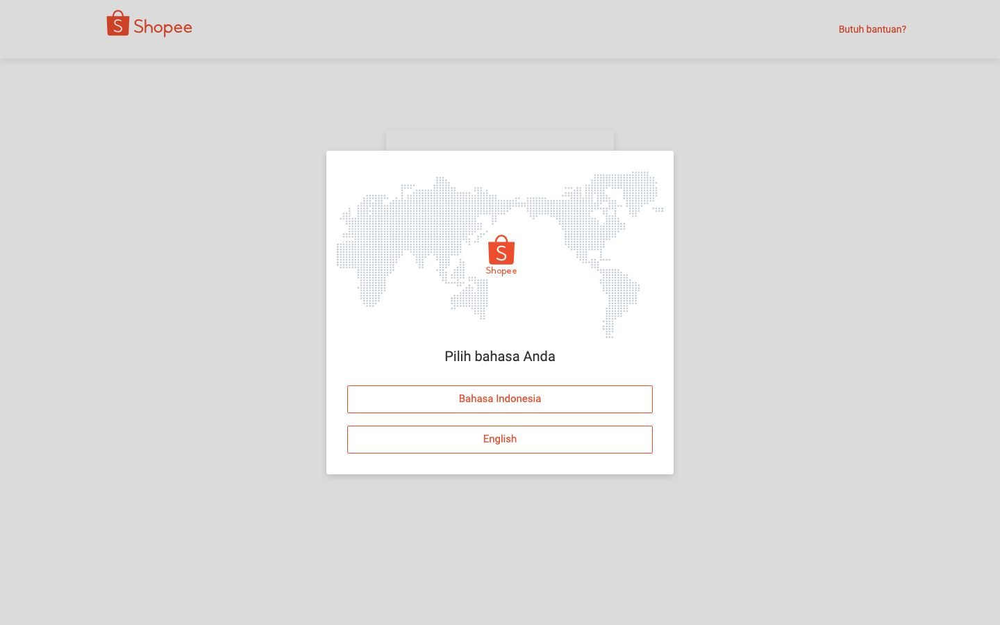

**대표 상품 이미지** (상위 6장, 출처 URL 포함)

-  — 출처 <https://deo.shopeemobile.com/shopee/shopee-pcmall-live-sg/assets/1c8bdaaf45e1fd48.png>

**페이지 메타 정보**

| page | title | description |
|---|---|---|
| [`home`](https://shopee.co.id/verify/captcha?anti_bot_tracking_id=gqRjZGVrxHSFomtptTE0MjUxOnRyYWNraW5nX2lkX2tleaJrdtEAAqRhbGdv0gAAAGSjZGVrwKJjdMRAAAAADIKMyZ1P2O2Qvasq83S5AwzeFIVi130gJEs0rzTO_4iwfIWyFzi6GeoS0al_i_SqWqJfxR5gmm_2D9B-AqpjaXBoZXJ0ZXh0xQOJAAAADPZYIRp0h44LsJAp1fcDWOSLFWPjSGmoETmZ3lLf62kBbn2z0o_buRnJOPn5ppUniFDXfecxqTRUMAxxHPN_Yga2fvZWy9WJ_iAcJxQOHxMx_ElBok9wJEkQ-8s7LQN-L0ZWSlsVY9BygfI7gbabXr5gNawellBkJ4itH7Be8rPjcNgwlHhxCGP8QCh4q1PdI0OQZaD6CIJLEIa0BmywwRoit33nQgf2HFUlj5q6N5S0STh3aAv874ZVG_g3uJPZ9cp9gJF8odzUbeqjqIMJbFfRO3edZb0nqxLewEFWr3PSM3U5KAiuEwQ4Huj_vvTC97IhmMCQT334JESmdQzHFENdttctHk5GKPllPgu6IAk9VJL7DTV8V6aT3f3zhtsR1oFQbAICq7nPNNKTHRWVn5tjLRJm9e_fm8uNxA9bAd-pbTDS5X6pzQx3cBGine_GmvOsdY2gUzjTl2QDnzK_TS9_4ErAIzLdROf7gpGNn0VP6kpwXdKu9PR9_NTPnsXwO3aQfCAX8hIrqtLBFNAwbzd58GPtlurFOba-I7cj2BDKVQQKzBNJKAGjkq6J9_3ISyWVz9qlkIre1azZsIOdgU7q33S4L_BuHrTYa-pzAhsIKMUlZO1OKi9oHYcP_RdaEieHTQZBYkfDe6TStZbh13KP0UEdrvpUrAmI9IgI5R_iibHNr_vK8Q41ozqqEsQMDe1HouVOnTVkg2-Y_wCDGZMOXDWPTlspviLPHOP5z9jrzQMutQgdc9pHjAF8Med-XiW4WhXa34pJPJirDHxKJcxm0g1f1lggwvuUtF4ifyPoDwTTLpyDdc6C2_tQRDxcbSU591uXT2Y3dVqFohrC0qAWW7VuM9iKLi3kMkp7johk2yqg-WgvD2UZYXghG4vhF2PlHAJGtnT00TZPek1QMRX80e8eh_szl-CzHoVmfHa8KT8cZ2zvzUl_2U0Iqk3D0a5sPSA7VLCRh5vrNIUwmbKZDnPTKRSlNOMZBPpZAi0iaMqrbqyvBPoXMFuAzApSGAOEXhVKb2M7ti-t9BUJLFswQ6ulu_wrRZZcknA81XGDl4GNwEEvnHrtyPf7AG-rnGxuWRtl_YfwA2G49y-8fPGr2sZwoioikyvjHwkqbS32zFPK_S1H7gay45SoJr0c3ovMYkYkBNVyN4crLio2eN8SfRh52JeDWeLk6PgZsJNeKUo1Pp0&app_key=FlashSale.PC&client_id=1&next=https%3A%2F%2Fshopee.co.id%2Fverify%2Ftraffic%3F%3Fclient_id%3D%26next%3Dhttps%253A%252F%252Fshopee.co.id%252F%26redirect_type%3D2%26should_replace_history%3Dfalse&redirect_type=2&scene=crawler_item&should_replace_history=false) | Shopee Indonesia | Belanja Online Terlengkap & Terpercaya | Belanja Online di Shopee Indonesia!  Nikmati Keuntungan Jual Beli Online Mudah dengan Shopee COD (Bayar di Tempat), Gratis Ongkir, & Pengiri |

#### [Tokopedia](https://www.tokopedia.com/)

- URL: <https://www.tokopedia.com/>
- 페이지: **OK 0 · FAIL 1**

**실패 페이지**

- `home` — playwright_error: Error: Page.goto: net::ERR_HTTP2_PROTOCOL_ERROR at https://www.tokopedia.com/
Call log:
  - navigating to "https://www.tokopedia.com/", waiting until "domcontentloaded"

#### [Zalora Indonesia](https://www.zalora.co.id/)

- URL: <https://www.zalora.co.id/>
- 페이지: **OK 1 · FAIL 0**

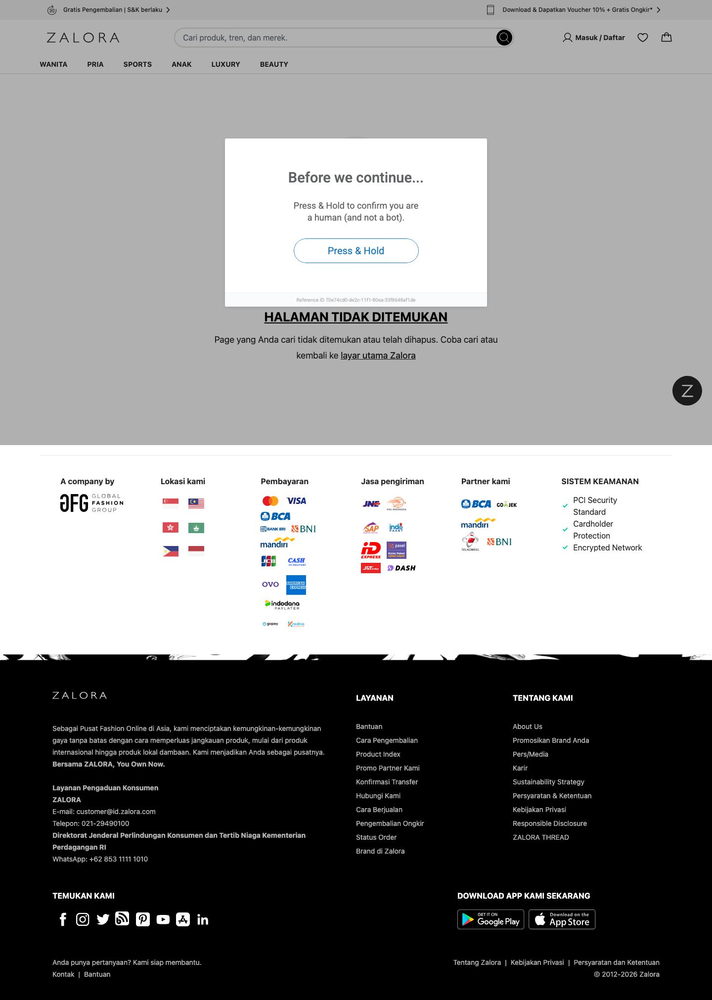

**대표 상품 이미지** (상위 6장, 출처 URL 포함)

-  — 출처 <https://static-id.zacdn.com/next-assets/static-assets/images/logo/icon_mastercard.png>
-  — 출처 <https://static-id.zacdn.com/next-assets/static-assets/images/logo/icon_visa.png>
-  — 출처 <https://static-id.zacdn.com/next-assets/static-assets/images/logo/icon_ovo.png>
-  — 출처 <https://static-id.zacdn.com/next-assets/static-assets/images/logo/icon_indodana.png>

**페이지 메타 정보**

| page | title | description |
|---|---|---|
| [`new_women`](https://www.zalora.co.id/wanita/new-arrivals) | Halaman tidak ditemukan | ZALORA |  |

### 4.2 일본 _( Japan )_

- 한국 수출규모 순위: **#2** · region: `asia` · tier `1` · currency `JPY`
- 수집 사이트: **5개** (성공 4)
- 메모: K-패션 선호도 높고 온라인 패션몰 발달
#### [GU Japan](https://www.gu-global.com/jp/)

- URL: <https://www.gu-global.com/jp/>
- 페이지: **OK 1 · FAIL 0**

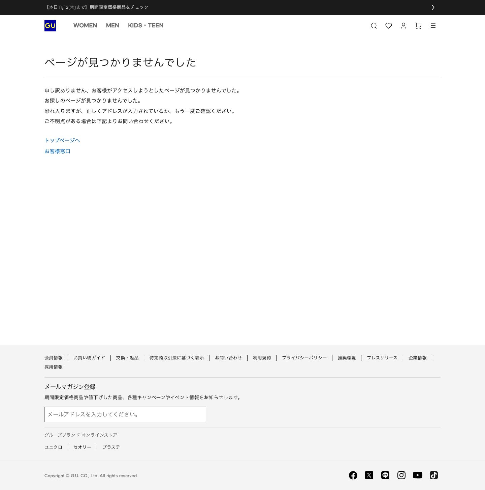

**대표 상품 이미지** (상위 6장, 출처 URL 포함)

-  — 출처 <https://image.uniqlo.com/GU/ST3/jp/imagesother/Navigation/WOMEN_Category/2026/261023/261023_category-icon_autumn-winter-sale.png>
-  — 출처 <https://image.uniqlo.com/GU/ST3/jp/imagesother/Navigation/Category-icon_V2/2026/0724/Categoy_Limited-offers.jpg>
-  — 출처 <https://image.uniqlo.com/GU/ST3/jp/imagesother/Navigation/Category-icon_V2/2026/0724/Categoy_SALE.jpg>
-  — 출처 <https://image.uniqlo.com/GU/ST3/jp/imagesother/Navigation/collaboration_Category/26FW/rokh_category_icon.png>
-  — 출처 <https://image.uniqlo.com/GU/ST3/jp/imagesother/Navigation/WOMEN_Category/2026/261106/261106_category_w_outer_360434.png>
-  — 출처 <https://image.uniqlo.com/GU/ST3/jp/imagesother/Navigation/WOMEN_Category/2026/261008/category_w_knit-and-cardigan_360549.png>

**페이지 메타 정보**

| page | title | description |
|---|---|---|
| [`new_arrivals`](https://www.gu-global.com/jp/ja/not-found) | 申し訳ありません、お客様がアクセスしようとしたページが見つかりませんでした。恐れ入りますが、正しくアドレスが入力されているか、もう一度ご確認ください。 | ジーユー | 申し訳ありません、お客様がアクセスしようとしたページが見つかりませんでした。恐れ入りますが、正しくアドレスが入力されているか、もう一度ご確認ください。 |

#### [Rakuten Fashion](https://brandavenue.rakuten.co.jp/)

- URL: <https://brandavenue.rakuten.co.jp/>
- 페이지: **OK 1 · FAIL 1**

**대표 상품 이미지** (상위 6장, 출처 URL 포함)

-  — 출처 <https://brandavenue.r10s.jp/img/library/index/sbn_flagshipstore_20231003.png>
- 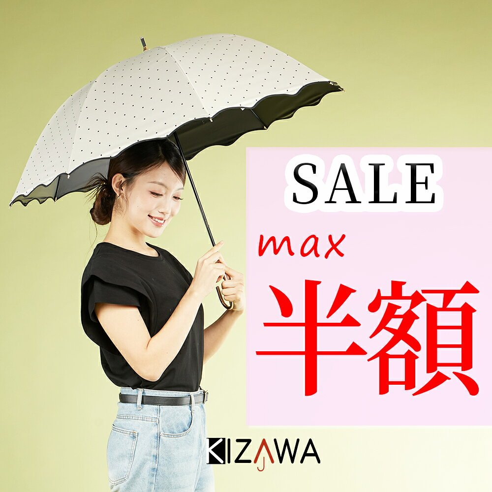 — 출처 <https://brandavenue.r10s.jp/img/news/01/406128/pc_n.jpg>
- 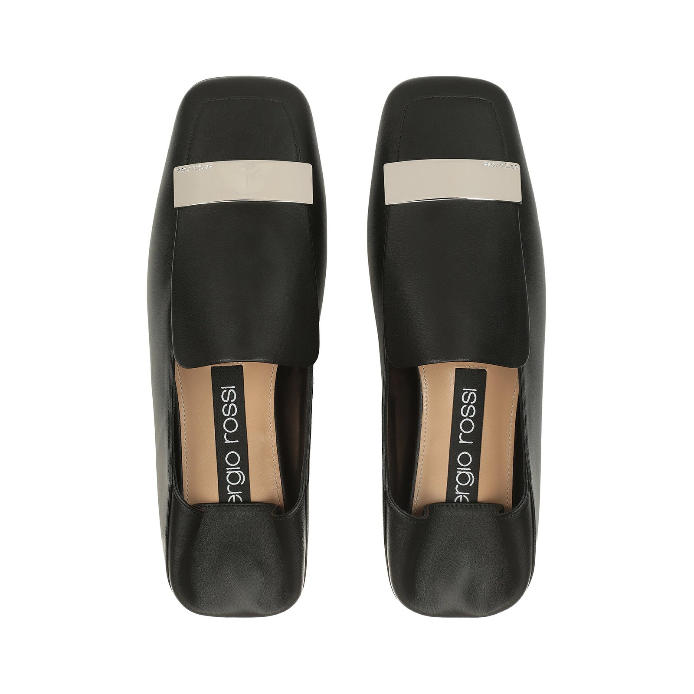 — 출처 <https://brandavenue.r10s.jp/img/news/13/408767/pc_n.jpg>
- 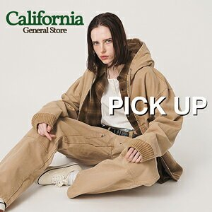 — 출처 <https://brandavenue.r10s.jp/img/news/01/408553/pc_n.jpg>
-  — 출처 <https://brandavenue.r10s.jp/img/news/01/408665/pc_n.jpg>
-  — 출처 <https://brandavenue.r10s.jp/img/news/01/408668/pc_n.jpg>

**페이지 메타 정보**

| page | title | description |
|---|---|---|
| [`men`](https://brandavenue.rakuten.co.jp/men/) | MEN | ファッション通販 Rakuten Fashion(楽天ファッション／旧楽天ブランドアベニュー) | Rakuten Fashion(楽天ファッション)は人気ブランドを取り扱うファッション通販サイトです。新作アイテム続々入荷！セール商品やクーポン対象商品も豊富。／税込3,980円以上購入で送料無料／楽天ポイントが使えて貯まる！ |

**실패 페이지**

- `women` — http_status_404

#### [Uniqlo Japan](https://www.uniqlo.com/jp/)

- URL: <https://www.uniqlo.com/jp/>
- 페이지: **OK 1 · FAIL 0**

**페이지 메타 정보**

| page | title | description |
|---|---|---|
| [`new_arrivals`](https://www.uniqlo.com/jp/ja/contents/feature/new-arrivals/) | 404 Not Found |  |

#### [WEAR](https://wear.jp/)

- URL: <https://wear.jp/>
- 페이지: **OK 1 · FAIL 0**

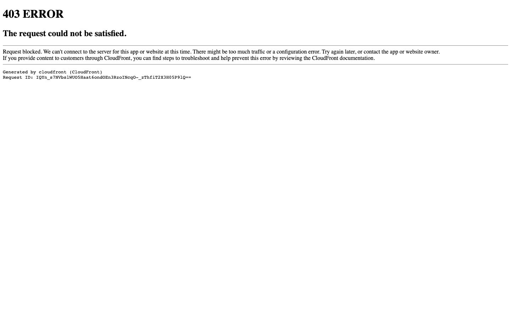

**페이지 메타 정보**

| page | title | description |
|---|---|---|
| [`ranking`](https://wear.jp/ranking/coordinate/) | ERROR: The request could not be satisfied |  |

#### [ZOZOTOWN](https://zozo.jp/)

- URL: <https://zozo.jp/>
- 페이지: **OK 0 · FAIL 2**

**실패 페이지**

- `new` — playwright_error: Error: Page.goto: net::ERR_TIMED_OUT at https://zozo.jp/category/new/
Call log:
  - navigating to "https://zozo.jp/category/new/", waiting until "domcontentloaded"

- `ranking` — playwright_error: Error: Page.goto: net::ERR_TIMED_OUT at https://zozo.jp/ranking/
Call log:
  - navigating to "https://zozo.jp/ranking/", waiting until "domcontentloaded"

### 4.3 한국 _( South Korea )_

- 한국 수출규모 순위: **#30** · region: `asia` · tier `1` · currency `KRW`
- 수집 사이트: **4개** (성공 3)
- 메모: 비교 기준 (자국). 국내 사업동향 센싱
#### [29CM](https://www.29cm.co.kr/)

- URL: <https://www.29cm.co.kr/>
- 페이지: **OK 1 · FAIL 0**

**최근 유행 상품** (43건 · 상품명 클릭 시 해당 사이트로 이동)

| # | 상품명 | 브랜드 | 가격 | 페이지 |
|---:|---|---|---:|---|
| 1 | [[2차 재입고] 캐슈 퍼 자켓](https://product.29cm.co.kr/catalog/4324745) | 오르 | 428,100 KRW | `home` |
| 2 | [[3차 재입고] 윈터 루 팬츠](https://product.29cm.co.kr/catalog/4338392) | 오르 | 112,750 KRW | `home` |
| 3 | [[3차 재입고] 윈터 루 스커트](https://product.29cm.co.kr/catalog/4338398) | 오르 | 129,090 KRW | `home` |
| 4 | [Waxed cowhide reversible liner jacket _ brown](https://product.29cm.co.kr/catalog/4223306) | 프리즘웍스 | 446,300 KRW | `home` |
| 5 | [Waxed cowhide reversible liner jacket _ black](https://product.29cm.co.kr/catalog/4223301) | 프리즘웍스 | 446,300 KRW | `home` |
| 6 | [Patina cowhide tanker jacket _ washed brown](https://product.29cm.co.kr/catalog/4191316) | 프리즘웍스 | 361,300 KRW | `home` |
| 7 | [풀업 스웨이드 버튼 해링턴 자켓 BLACK](https://product.29cm.co.kr/catalog/3479332) | 도프제이슨 | 128,140 KRW | `home` |
| 8 | [라이트 쉘 모터사이클 자켓 BLACK](https://product.29cm.co.kr/catalog/3479212) | 도프제이슨 | 119,540 KRW | `home` |
| 9 | [풀업 스웨이드 버튼 해링턴 자켓 CAMEL](https://product.29cm.co.kr/catalog/3479244) | 도프제이슨 | 128,140 KRW | `home` |
| 10 | [[29CM 단독] 하연 작가, 웜 하트 리버시블 사계절 차렵이불](https://product.29cm.co.kr/catalog/3622874) | 뚜누 | 44,240 KRW | `home` |
| 11 | [[29CM 단독] 하연 작가, 동글동글 pvc 주방매트](https://product.29cm.co.kr/catalog/3727625) | 뚜누 | 35,010 KRW | `home` |
| 12 | [[29CM 단독] 하연 작가, 물을 머금은 꽃 극세사 담요](https://product.29cm.co.kr/catalog/3648472) | 뚜누 | 41,540 KRW | `home` |
| 13 | [All day 조거팬츠 (올리브)](https://product.29cm.co.kr/catalog/3986398) | 지노키오 | 41,180 KRW | `home` |
| 14 | [COMO 알러지케어 60수 고밀도 베개커버 50x70 (라이트 블루 스트라이프)](https://product.29cm.co.kr/catalog/4296486) | 지노키오 | 14,200 KRW | `home` |
| 15 | [COMO 알러지케어 60수 고밀도 베개커버 50x70 (브라운 스트라이프)](https://product.29cm.co.kr/catalog/4296475) | 지노키오 | 14,200 KRW | `home` |
| 16 | [귀여운 강아지 니트 인형 무니 Orange](https://product.29cm.co.kr/catalog/2388735) | 닛닛 | 31,240 KRW | `home` |
| 17 | [Zgen Urban Collection 윌리엄 핸드메이드 인형](https://product.29cm.co.kr/catalog/3826684) | 닛닛 | 176,080 KRW | `home` |
| 18 | [Zgen Urban Collection 샬롯 핸드메이드 인형](https://product.29cm.co.kr/catalog/3826683) | 닛닛 | 176,080 KRW | `home` |
| 19 | [[29CM 단독] 라일락 스트리아 60수 고밀도 차렵/이불커버 2SIZES](https://product.29cm.co.kr/catalog/3856970) | 프람 | 113,600 KRW | `home` |
| 20 | [뉴오레오 테이블](https://product.29cm.co.kr/catalog/3811578) | 인히어런트 | 21,090 KRW | `home` |

**대표 상품 이미지** (상위 6장, 출처 URL 포함)

-  — 출처 <https://img.29cm.co.kr/cms/202611/11f1dcc2f172badbb5d90b8796219230.jpg?width=3840&format=webp>
- 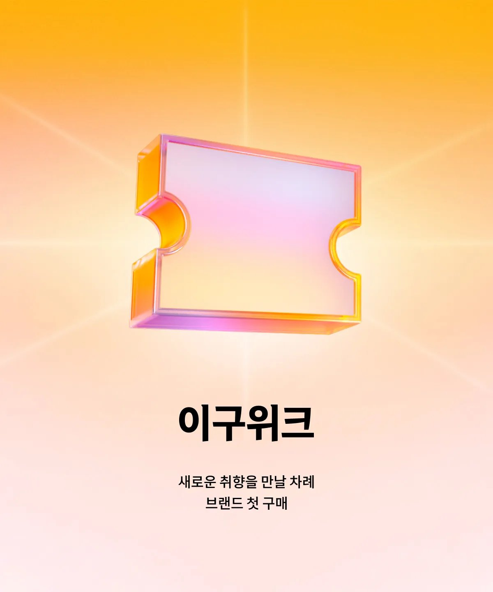 — 출처 <https://img.29cm.co.kr/cms/202611/11f1dcc2e9da4d44aa2dada18efe30d7.jpg?width=3840&format=webp>
- 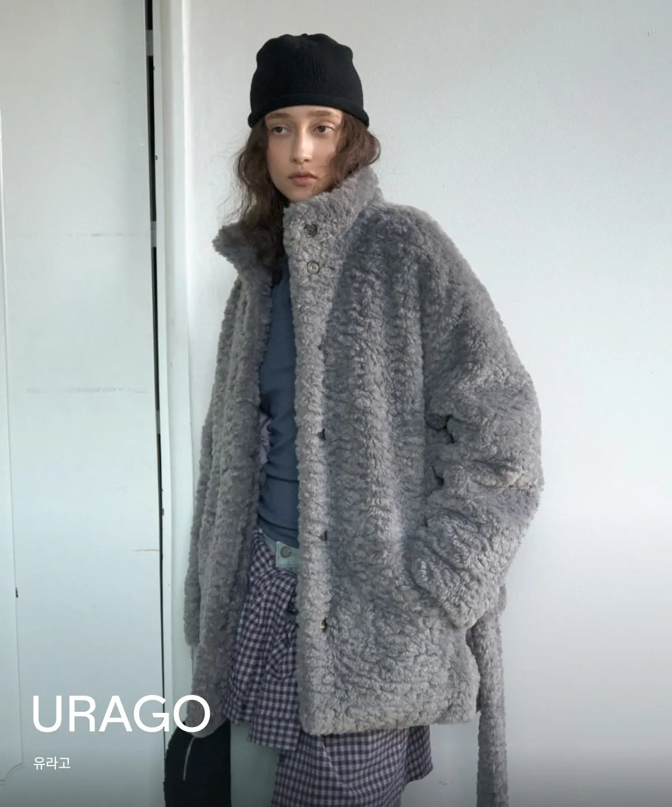 — 출처 <https://img.29cm.co.kr/cms/202611/11f1dcc2d6385c96aa2d4bfc6fa7e3d8.jpg?width=3840&format=webp>
- 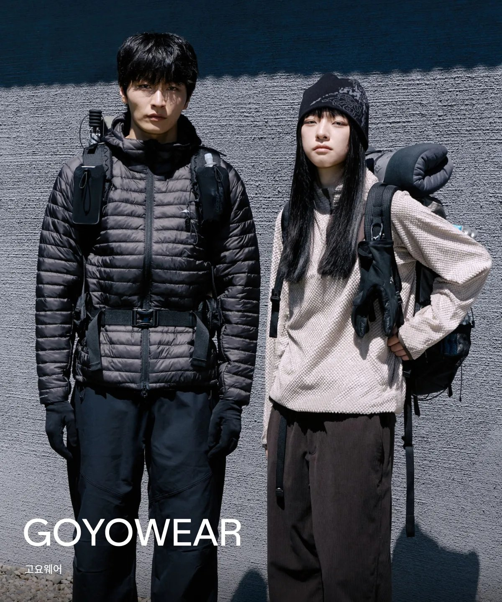 — 출처 <https://img.29cm.co.kr/cms/202611/11f1dcc2a7e93278aa2da78c654a9183.jpg?width=3840&format=webp>
- 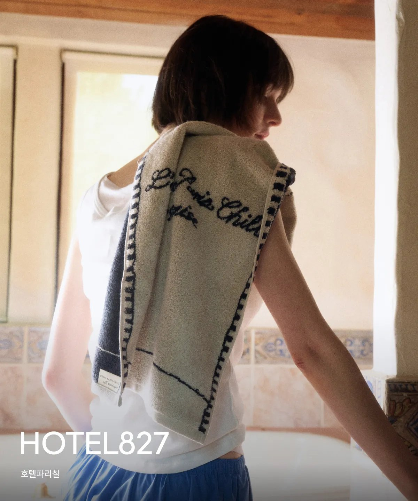 — 출처 <https://img.29cm.co.kr/cms/202611/11f1dcc29d6b7f5eaa2d03ddd5a92dd2.jpg?width=3840&format=webp>
- 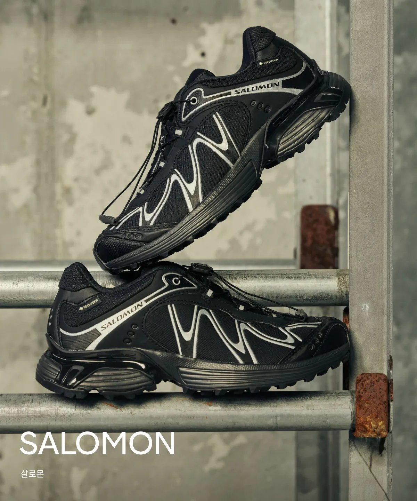 — 출처 <https://img.29cm.co.kr/cms/202611/11f1dcc29379435caa2df169937aa467.jpg?width=3840&format=webp>

**페이지 메타 정보**

| page | title | description |
|---|---|---|
| [`home`](https://www.29cm.co.kr/) | 모든 취향 곁에, 29CM | 패션, 라이프스타일, 컬처까지 29CM만의 감도 깊은 셀렉션을 만나보세요. |

#### [Musinsa](https://www.musinsa.com/)

- URL: <https://www.musinsa.com/>
- 페이지: **OK 0 · FAIL 1**

**실패 페이지**

- `home` — robots_disallowed

#### [W Concept](https://www.wconcept.co.kr/)

- URL: <https://www.wconcept.co.kr/>
- 페이지: **OK 1 · FAIL 0**

**최근 유행 상품** (30건 · 상품명 클릭 시 해당 사이트로 이동)

| # | 상품명 | 브랜드 | 가격 | 페이지 |
|---:|---|---|---:|---|
| 1 | [SIJN6087 아르코 커브드 데님_Vintage brown](https://m.wconcept.co.kr/Product/306630722) | 시야쥬 | 74,366 KRW | `home` |
| 2 | [SIOT4127 덕다운 퀼팅 헌팅 자켓_Black](https://m.wconcept.co.kr/Product/306164143) | 시야쥬 | 136,291 KRW | `home` |
| 3 | [[루피타 PICK] SIST9076 페이크 스웨이드 미디 스커트_Black](https://m.wconcept.co.kr/Product/309103585) | 시야쥬 | 65,960 KRW | `home` |
| 4 | [SIOT4151 경량 패딩 야상 자켓_Charcoal](https://m.wconcept.co.kr/Product/307592901) | 시야쥬 | 119,221 KRW | `home` |
| 5 | [SIPT7106 에센셜 원턱 기모 슬랙스_Charcoal](https://m.wconcept.co.kr/Product/304223841) | 시야쥬 | 56,202 KRW | `home` |
| 6 | [[루티파, 강문경 PICK]SIOT4173 페이크 무스탕 봄버 자켓_2Colors](https://m.wconcept.co.kr/Product/307510755) | 시야쥬 | 163,390 KRW | `home` |
| 7 | [[강문경 PICK] SIOT4223 소프트 시어링 퍼 자켓_Cream](https://m.wconcept.co.kr/Product/309103935) | 시야쥬 | 158,935 KRW | `home` |
| 8 | [[루피타, 강문경 PICK] SIOT4227 핸드메이드 윙 슬리브 롱 코트_Charcoal](https://m.wconcept.co.kr/Product/309103919) | 시야쥬 | 248,045 KRW | `home` |
| 9 | [SIPT7106 에센셜 원턱 기모 슬랙스_Black](https://m.wconcept.co.kr/Product/304223842) | 시야쥬 | 56,202 KRW | `home` |
| 10 | [SIPT7056  high waist corduroy pants_Cream](https://m.wconcept.co.kr/Product/301851971) | 시야쥬 | 73,507 KRW | `home` |
| 11 | [[루피타 PICK] SIPT7218 커브드 밴딩 조거 팬츠_Cream](https://m.wconcept.co.kr/Product/309103614) | 시야쥬 | 60,431 KRW | `home` |
| 12 | [SIOT4079 페이크 레더 봄버 자켓_Black](https://m.wconcept.co.kr/Product/303443918) | 시야쥬 | 123,895 KRW | `home` |
| 13 | [SIOT4223 소프트 시어링 퍼 자켓_Beige](https://m.wconcept.co.kr/Product/309103934) | 시야쥬 | 162,520 KRW | `home` |
| 14 | [SIKN2156 울 블렌드 루즈 브이넥 니트_Black](https://m.wconcept.co.kr/Product/307381363) | 시야쥬 | 73,088 KRW | `home` |
| 15 | [SIOT4227 핸드메이드 윙 슬리브 롱 코트_Melange black](https://m.wconcept.co.kr/Product/309103917) | 시야쥬 | 248,045 KRW | `home` |
| 16 | [SIOT4151 경량 패딩 야상 자켓_Greige](https://m.wconcept.co.kr/Product/309103881) | 시야쥬 | 128,520 KRW | `home` |
| 17 | [SIKN2156 울 블렌드 루즈 브이넥 니트_Wine](https://m.wconcept.co.kr/Product/308894970) | 시야쥬 | 84,474 KRW | `home` |
| 18 | [[루피타 PICK] SIOT4219 신슐레이트 하이넥 패딩 코트_Black](https://m.wconcept.co.kr/Product/309103994) | 시야쥬 | 173,220 KRW | `home` |
| 19 | [SIKN2156 울 블렌드 루즈 브이넥 니트_Olive](https://m.wconcept.co.kr/Product/308894969) | 시야쥬 | 84,474 KRW | `home` |
| 20 | [SIOT4010 Duck Down Crop PD_5colors](https://m.wconcept.co.kr/Product/301499657) | 시야쥬 | 134,748 KRW | `home` |

**페이지 메타 정보**

| page | title | description |
|---|---|---|
| [`home`](https://www.wconcept.co.kr/) | _(empty)_ |  |

#### [Zigzag](https://zigzag.kr/)

- URL: <https://zigzag.kr/>
- 페이지: **OK 1 · FAIL 0**

**최근 유행 상품** (36건 · 상품명 클릭 시 해당 사이트로 이동)

| # | 상품명 | 브랜드 | 가격 | 페이지 |
|---:|---|---|---:|---|
| 1 | [[울90%+캐시미어10%] [DEMOOR] 베니스 하이넥 캐시미어 핸드메이드 하프 코트](https://store.zigzag.kr/app/catalog/products/172550952?browsing_type=NATIVE_BROWSER) | 드무어 | 159,370 KRW | `home` |
| 2 | [[다송pick][이지룩][기모][ofm] 이지 트레이닝 롱 스커트 (sk)](https://store.zigzag.kr/app/catalog/products/167660806?browsing_type=NATIVE_BROWSER) | 메리어라운드 | 23,920 KRW | `home` |
| 3 | [[🏆역대급100만장/3기장선택!] made. 마켓 와이드 트레이닝슬랙스 (+숏/베이직/롱ver) - 4 size](https://store.zigzag.kr/app/catalog/products/141360158?browsing_type=NATIVE_BROWSER) | 슬로우앤드 | 26,320 KRW | `home` |
| 4 | [[🏆팬츠1위🏆누적5만장][🔥+기모/S~L/2기장] 밸런스 데일리 팬츠 / 부츠컷추리닝 / 부츠컷트레이닝팬츠 / 기모팬츠 / 겨울바지 / 로우라이즈팬츠 / 융기모바지](https://store.zigzag.kr/app/catalog/products/168688249?browsing_type=NATIVE_BROWSER) | 코코블랑 | 23,920 KRW | `home` |
| 5 | [[기모🔥+골반패드탈부착/부츠컷원조1등🏆누적130만장💙마법보정핏+미친편안함/재구매율끝판왕/기모바지/부츠컷/니썸][made]세인트부츠컷데님 - 9color](https://store.zigzag.kr/app/catalog/products/111046579?browsing_type=NATIVE_BROWSER) | 니썸 | 25,760 KRW | `home` |
| 6 | [[🍁가을/3기장선택!] made. 모먼트 투커버 올데이슬랙스 (+숏/베이직/롱ver) - 4 size](https://store.zigzag.kr/app/catalog/products/136095576?browsing_type=NATIVE_BROWSER) | 슬로우앤드 | 31,840 KRW | `home` |
| 7 | [[made/R,U넥]에센스골지티셔츠](https://store.zigzag.kr/app/catalog/products/167976864?browsing_type=NATIVE_BROWSER) | 어텀 | 13,440 KRW | `home` |
| 8 | [[made]모먼트울쇼츠](https://store.zigzag.kr/app/catalog/products/167600416?browsing_type=NATIVE_BROWSER) | 어텀 | 20,800 KRW | `home` |
| 9 | [[made]파우더벌룬니트](https://store.zigzag.kr/app/catalog/products/166494898?browsing_type=NATIVE_BROWSER) | 어텀 | 23,200 KRW | `home` |
| 10 | [[역대급블프🖤/두장세트가격] made. 듀얼팩 365 베이직 티셔츠 (2PACK) - 2 type (무료배송)](https://store.zigzag.kr/app/catalog/products/173218005?browsing_type=NATIVE_BROWSER) | 슬로우앤드 | 26,820 KRW | `home` |
| 11 | [[🏆30만장돌파] made. 모어소프트 트레이닝팬츠 (베이직/롱/반바지)](https://store.zigzag.kr/app/catalog/products/133475453?browsing_type=NATIVE_BROWSER) | 슬로우앤드 | 26,400 KRW | `home` |
| 12 | [[기모추가🔥/50만장돌파/자체제작] 허쉬 코튼 와이드팬츠 (숏/기본/롱)](https://store.zigzag.kr/app/catalog/products/143224732?browsing_type=NATIVE_BROWSER) | 리얼코코 | 13,640 KRW | `home` |
| 13 | [[made]웨더융기모팬츠](https://store.zigzag.kr/app/catalog/products/172759988?browsing_type=NATIVE_BROWSER) | 어텀 | 44,800 KRW | `home` |
| 14 | [[히든포켓✨/자체제작] UTMOST 드로인 알파카 히든 핸드메이드 코트](https://store.zigzag.kr/app/catalog/products/150026968?browsing_type=NATIVE_BROWSER) | 리얼코코 | 157,430 KRW | `home` |
| 15 | [에르디 프릴 티 (3c)](https://store.zigzag.kr/app/catalog/products/173208874?browsing_type=NATIVE_BROWSER) | 아이히 | 39,600 KRW | `home` |
| 16 | [[겨울❄️/브이넥&라운드넥/자체제작] 에트 니트 (6color)](https://store.zigzag.kr/app/catalog/products/129456378?browsing_type=NATIVE_BROWSER) | 리얼코코 | 14,800 KRW | `home` |
| 17 | [[Muse12]모에르 울100 퍼 자켓](https://store.zigzag.kr/app/catalog/products/173194788?browsing_type=NATIVE_BROWSER) | 뮤즈12 | 219,000 KRW | `home` |
| 18 | [(당일)드온도 알파카 하프 코트 클래식무드 포멀 울부클 카라 안감 퀼팅 누빔코트(88722)](https://store.zigzag.kr/app/catalog/products/155024799?browsing_type=NATIVE_BROWSER) | 디투링크 | 156,520 KRW | `home` |
| 19 | [[기모추가🔥/5만장돌파/자체제작] 모티브 핀턱 슬랙스 (숏/기본)](https://store.zigzag.kr/app/catalog/products/141911042?browsing_type=NATIVE_BROWSER) | 리얼코코 | 13,410 KRW | `home` |
| 20 | [[기모추가🔥/15만장돌파🏆/반팔추가/자체제작] 코튼 스판 베이직 긴팔티셔츠 (라운드넥/유넥)](https://store.zigzag.kr/app/catalog/products/109044865?browsing_type=NATIVE_BROWSER) | 리얼코코 | 18,270 KRW | `home` |

**페이지 메타 정보**

| page | title | description |
|---|---|---|
| [`home`](https://zigzag.kr/) | _(empty)_ |  |

### 4.4 대만 _( Taiwan )_

- 한국 수출규모 순위: **#7** · region: `asia` · tier `1` · currency `TWD`
- 수집 사이트: **5개** (성공 5)
- 메모: K-패션 친화도 높음
#### [momo](https://www.momoshop.com.tw/)

- URL: <https://www.momoshop.com.tw/>
- 페이지: **OK 1 · FAIL 0**

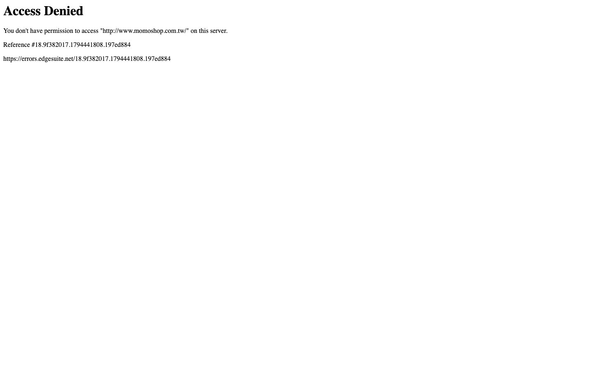

**페이지 메타 정보**

| page | title | description |
|---|---|---|
| [`home`](https://www.momoshop.com.tw/) | Access Denied |  |

#### [OB Design](https://www.obdesign.com.tw/)

- URL: <https://www.obdesign.com.tw/>
- 페이지: **OK 1 · FAIL 0**

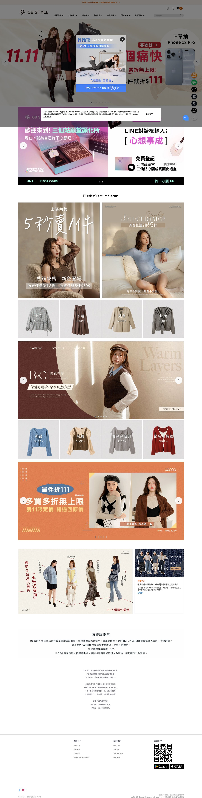

**대표 상품 이미지** (상위 6장, 출처 URL 포함)

- 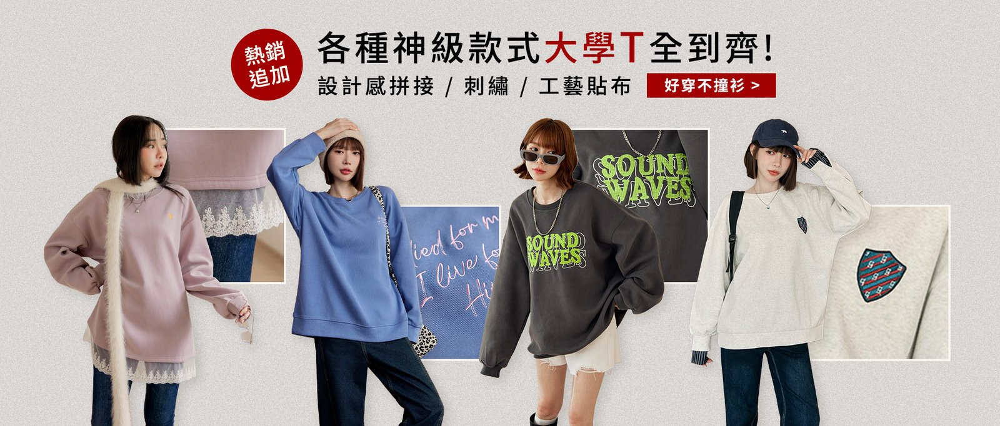 — 출처 <https://cms-static.cdn.91app.com/images/original/41602/92f19e4d-89b7-4330-9570-02cf1dff9742-1794293521-8shypjqjk5_d_1920x820_1280x547_1124x480_800x342_600x256_400x171.jpg>
-  — 출처 <https://cms-static.cdn.91app.com/images/compress/41602/92f19e4d-89b7-4330-9570-02cf1dff9742-1794293521-8shypjqjk5_d_400x171.webp>
- 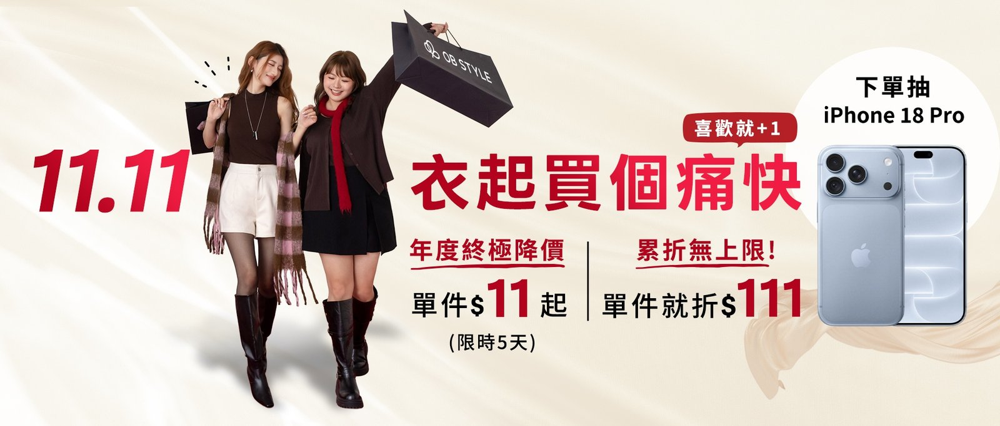 — 출처 <https://cms-static.cdn.91app.com/images/original/41602/92f19e4d-89b7-4330-9570-02cf1dff9742-1793070308-6drun5zyc4_d_1920x820_1280x547_1124x480_800x342_600x256_400x171.jpg>
-  — 출처 <https://cms-static.cdn.91app.com/images/original/41602/92f19e4d-89b7-4330-9570-02cf1dff9742-1794368782-w0s0fz0ca4_d_1920x820_1280x547_1124x480_800x342_600x256_400x171.jpg>
- 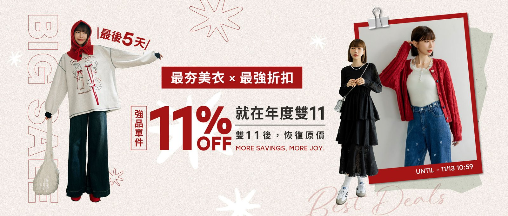 — 출처 <https://cms-static.cdn.91app.com/images/original/41602/92f19e4d-89b7-4330-9570-02cf1dff9742-1794193864-y85juga1zg_d_1920x820_1280x547_1124x480_800x342_600x256_400x171.jpg>
- 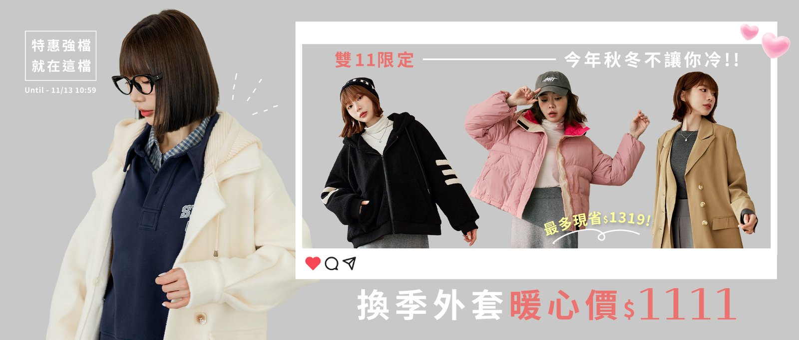 — 출처 <https://cms-static.cdn.91app.com/images/original/41602/92f19e4d-89b7-4330-9570-02cf1dff9742-1794360670-wtfzxkcvms_d_1920x820_1280x547_1124x480_800x342_600x256_400x171.jpg>

**페이지 메타 정보**

| page | title | description |
|---|---|---|
| [`home`](https://www.obdesign.com.tw/) | OB嚴選｜高CP值人氣熱銷服飾，流行服飾品牌 | 你的日常穿搭好夥伴，快上OB嚴選找，OB嚴選提供女裝、孕童、運動、男裝各項流行服飾，秉持優質服務給你高CP值的購物體驗。各種風格都能滿足熱愛穿搭的你，天天上新品，快速出貨，一起加入OB style！網路人氣服飾品牌OB嚴選 |

#### [PChome](https://24h.pchome.com.tw/)

- URL: <https://24h.pchome.com.tw/>
- 페이지: **OK 1 · FAIL 0**

**페이지 메타 정보**

| page | title | description |
|---|---|---|
| [`home`](https://24h.pchome.com.tw/) | PChome 24h購物 |  |

#### [Pinkoi Taiwan](https://www.pinkoi.com/)

- URL: <https://www.pinkoi.com/>
- 페이지: **OK 2 · FAIL 0**

**대표 상품 이미지** (상위 6장, 출처 URL 포함)

-  — 출처 <https://cdn04.pinkoi.com/pinkoi.site/logo/og_image.png>

**페이지 메타 정보**

| page | title | description |
|---|---|---|
| [`accessories`](https://en.pinkoi.com/) | Pinkoi | Asia’s cross-border design marketplace | Design the way you are | Shop for original design products from Asia's independent designers. Pinkoi lives and breathes great design, great quality, great service, a |
| [`bags`](https://en.pinkoi.com/) | Pinkoi | Asia’s cross-border design marketplace | Design the way you are | Shop for original design products from Asia's independent designers. Pinkoi lives and breathes great design, great quality, great service, a |

#### [Yahoo Taiwan Shopping](https://tw.buy.yahoo.com/)

- URL: <https://tw.buy.yahoo.com/>
- 페이지: **OK 1 · FAIL 0**

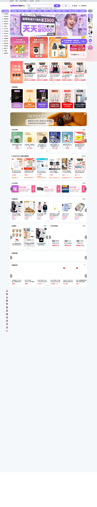

**대표 상품 이미지** (상위 6장, 출처 URL 포함)

- 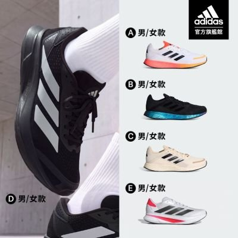 — 출처 <https://img.yec.tw/zp/MerchandiseImages/9f7c32198e-Gd-12074110.jpg>
- 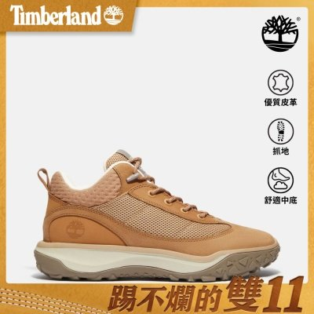 — 출처 <https://img.yec.tw/zp/MerchandiseImages/850397f7b8-Gd-11689377.jpg>
- 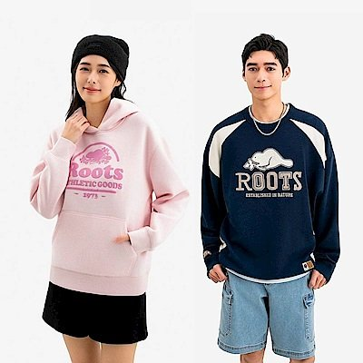 — 출처 <https://img.yec.tw/zp/MerchandiseImages/DA7038AE92-Gd-12322107.jpg>
-  — 출처 <https://img.yec.tw/up/uploadr/00u21hvmzmjMvuwgh1d8/SHP/mario/270x270_1.gif>

**페이지 메타 정보**

| page | title | description |
|---|---|---|
| [`home`](https://tw.buy.yahoo.com/) | Yahoo購物中心 - 最懂生活的人 | 數百萬件商品，貼心客服為您服務，15天鑑賞期購物保障！ |

### 4.5 태국 _( Thailand )_

- 한국 수출규모 순위: **#8** · region: `asia` · tier `1` · currency `THB`
- 수집 사이트: **5개** (성공 4)
- 메모: 동남아 K-패션 핵심 시장
#### [Central Online](https://www.central.co.th/)

- URL: <https://www.central.co.th/>
- 페이지: **OK 1 · FAIL 0**

**대표 상품 이미지** (상위 6장, 출처 URL 포함)

-  — 출처 <https://www.central.co.th/_next/image?url=https%3A%2F%2Fassets.central.co.th%2Ffile-assets%2Fassets%2FCMS%2Fcampaign%2F2026%2F11nov%2F20261101_SOG_Homepage_herobanner.jpg&w=3840&q=75>
- 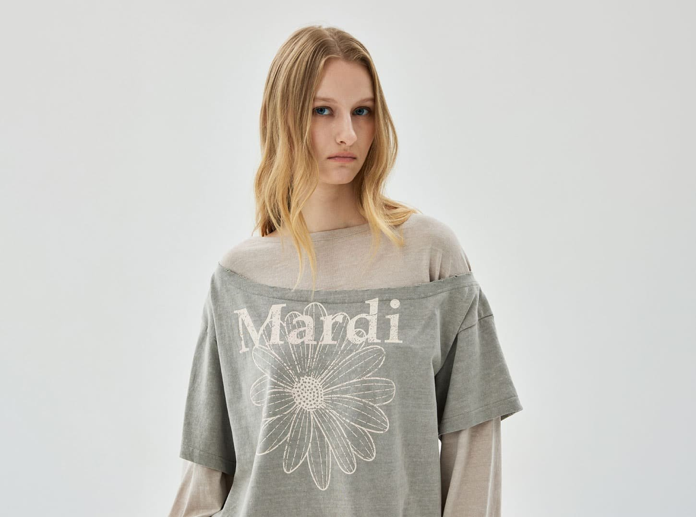 — 출처 <https://www.central.co.th/_next/image?url=https%3A%2F%2Fassets.central.co.th%2Ffile-assets%2Fassets%2FCMS%2Fcampaign%2F2026%2F11nov%2F20261109_mardimercredi_heroweb_d.jpg&w=3840&q=75>
-  — 출처 <https://www.central.co.th/_next/image?url=https%3A%2F%2Fassets.central.co.th%2Ffile-assets%2Fassets%2FCMS%2Fcampaign%2F2026%2F11nov%2F20261102_coty_heroweb_d.jpg&w=3840&q=75>
-  — 출처 <https://www.central.co.th/_next/image?url=https%3A%2F%2Fassets.central.co.th%2Ffile-assets%2Fassets%2FCMS%2Fcampaign%2F2026%2F11nov%2F20261107_clarins_heroweb_d.jpg&w=3840&q=75>
- 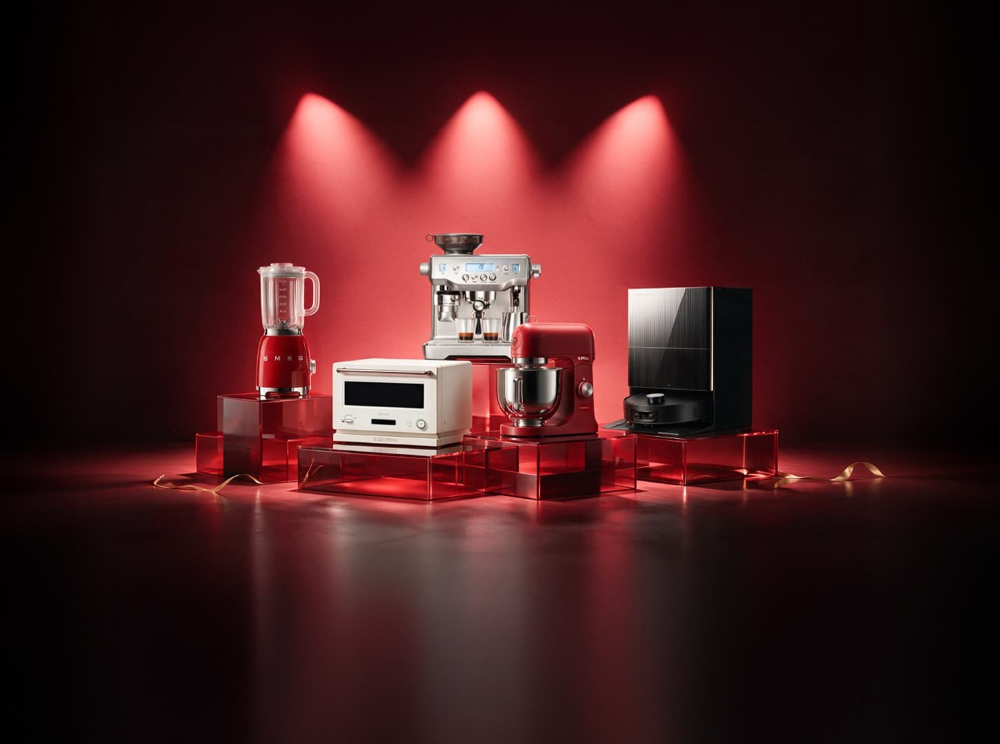 — 출처 <https://www.central.co.th/_next/image?url=https%3A%2F%2Fassets.central.co.th%2Ffile-assets%2Fassets%2FCMS%2Fcampaign%2F2026%2F11nov%2F20261026_MEGA-SALE_PRO_heroweb_d.jpg&w=3840&q=75>
-  — 출처 <https://www.central.co.th/_next/image?url=https%3A%2F%2Fassets.central.co.th%2Ffile-assets%2Fassets%2FCMS%2Fcampaign%2F2026%2F11nov%2F20261102_Estee-Lauder_PRO_heroweb_d.jpg&w=3840&q=75>

**페이지 메타 정보**

| page | title | description |
|---|---|---|
| [`home`](https://www.central.co.th/th) | Central Online | 11.11 | ลดสูงสุด 70% + คูปองลดเพิ่ม 25% | 11.11 Sale โปรโมชั่นสุดยิ่งใหญ่ของปี 2026 เริ่มต้นขึ้นแล้ว! พบกับสินค้าจากหลากหลายแบรนด์ดังที่เราคัดสรรมาลดราคาสูงสุดถึง 70% พร้อมคูปองลดเพิ |

#### [Lazada Thailand Fashion](https://www.lazada.co.th/)

- URL: <https://www.lazada.co.th/>
- 페이지: **OK 1 · FAIL 0**

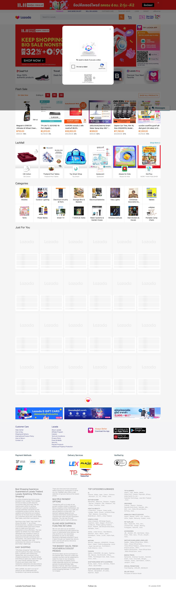

**대표 상품 이미지** (상위 6장, 출처 URL 포함)

-  — 출처 <https://img.lazcdn.com/us/domino/40845120240f19d13f738fa9a7978edd.png>
-  — 출처 <https://img.lazcdn.com/g/tps/images/ims-web/TB1KB2laMFY.1VjSZFnXXcFHXXa.png>
- 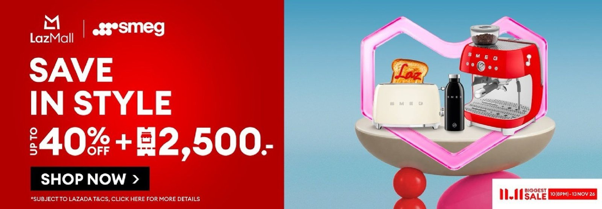 — 출처 <https://img.lazcdn.com/us/domino/09774a18-e409-4fe2-b5d4-2884ee962759_TH-1976-688.jpg_2200x2200q80.jpg>
-  — 출처 <https://img.lazcdn.com/us/domino/c0a7b4b6-19dc-4a8b-a5d0-1dd556af8f11_TH-1976-688.jpg_2200x2200q80.jpg>
-  — 출처 <https://img.lazcdn.com/us/domino/2ded4056-3f4c-4728-897c-53db952b9dc8_TH-1976-688.jpg_2200x2200q80.jpg>
-  — 출처 <https://img.lazcdn.com/us/domino/6758af42-c4d7-4cbc-af62-fc47baca24d4_TH-1976-688.jpg_2200x2200q80.jpg>

**페이지 메타 정보**

| page | title | description |
|---|---|---|
| [`home`](https://www.lazada.co.th/#?) | Lazada Thailand | ช้อปออนไลน์ สินค้าดี พร้อมดีลพิเศษทุกวัน | พบกับ Lazada แพลตฟอร์มช้อปปิ้งชั้นนำในอาเซียน พร้อมบริการเก็บเงินปลายทาง LazMall LazFlash และดีลเด็ดจากแบรนด์ดังทุกวัน |

#### [Pomelo](https://www.pomelofashion.com/)

- URL: <https://www.pomelofashion.com/>
- 페이지: **OK 0 · FAIL 2**

**실패 페이지**

- `new` — robots_disallowed
- `best` — robots_disallowed

#### [Shopee Thailand Fashion](https://shopee.co.th/)

- URL: <https://shopee.co.th/>
- 페이지: **OK 1 · FAIL 0**

**대표 상품 이미지** (상위 6장, 출처 URL 포함)

-  — 출처 <https://deo.shopeemobile.com/shopee/shopee-pcmall-live-sg/assets/1c8bdaaf45e1fd48.png>
-  — 출처 <https://deo.shopeemobile.com/shopee/shopee-pcmall-live-sg/homepagefe/42ba6075c82a85ab.png>

**페이지 메타 정보**

| page | title | description |
|---|---|---|
| [`home`](https://shopee.co.th/verify/captcha?anti_bot_tracking_id=gqRjZGVrxHSFomtptTE0MjUxOnRyYWNraW5nX2lkX2tleaJrdtEAAqRhbGdv0gAAAGSjZGVrwKJjdMRAAAAADIKMyZ1P2O2Qvasq83S5AwzeFIVi130gJEs0rzTO_4iwfIWyFzi6GeoS0al_i_SqWqJfxR5gmm_2D9B-AqpjaXBoZXJ0ZXh0xQOJAAAADNtVCRrb-xnBTZiULvY_s3jo-HwWavNkVaA0S8JiCblEFBLrwkuYKtcHRI7DyeEzX76Lm7DcEEAplR5PR5Bf293OkRVcvevH_8cZvsfGAFh3QVWYG_FBIxgVn6lAS1x5tMR8XjP8EXYJW5tFAEqpQZSBjWANa-bq6J-TT85vZTxoyxUTXHqb82DEzF_GV4EbKtFDoLrFdqMCYxYQJDs6FHVVboFQv4LdZNvMY4IMBuFbFEYa2Bup6uAqRWXiTkWmAPYVEswyzYnb7i842_Nuwwm6f3UuyaK01Ib4OWCqRDNGu6O1S8Mu2lc_D8fFg27G7YJmY7jtPALdRrCUnJyePJE_0JBTsHVdnH9wgKQhK-hs46ekGEoOZaTQg0NM1DckwivtgmoKz4_U8VaJn4ze-SYkeifvZXVjt22iNT6K09jv6RtnCG6kcN3Xf8rZnh3xY9IUrFJ7goxy8QxeWPJRO7yjm5qLk8dYXCWxoSsEwfYifBNbwltEB1lX2QDfQ7H8haKn2duZJDfDMI93xBFbXdJF5sTQYGE572KhU1bRwowr305BbxgdawpLCjjUg7n09XwAlGvY4k_mi8w1F9_StnnrIESiEPw-N8o7BR341mBSoTkly2akYMcZN8t8tGK16elmv5UqxChMbAT73qR_rhOl75Qym9-nwX49UIc4iRruMTASYlNDtZmt-bhnnanx5fH_UKDZ2AGeP-5tlfMj5CF4gLxOuBhNJo8riLxk8v6KJ-v--aNhu9eBDEOSpRdndrqN3blcUiKQE_RGkRobPLTHEFu_lK9ZXV0ryyW-5JmPkk3jYUr9-g6Dm0C7KqJTg2GWEKxqkLzK1yD0OXuIUtGDYtUJCTC2d5_g7xnzG3TrLKPC1mV4B3sYezfhySt-QcV9h4w5AwMHUNSZA2By2qrZkZAKrLz4Y2jB2w-TTHTJ9PdoLvaq6lztsp2RxtPYysdUy2t4kNfnaBMAGSG-J5DVEuDdcdtOgUnxaSkXGA965frAeRdRpFyw8zixNi59Bbv9eDH1mEWt_1IxLSzthd3F9e7XB47IAuPyJTrRb1JNQOcpqfk4pwYxM_MKuZk033r9ZrjFdoH1BkmfiDiCZUfJILZPhocjnB0ZEwT21S7ur5i8-O1LB4w_mCoDWNYMoQr_CigbhQ_Xv-TPA1yeMLuA7JjDL6WTHLxBGdlN7yLWfhmtEuA&app_key=FlashSale.PC&client_id=1&next=https%3A%2F%2Fshopee.co.th%2Fverify%2Ftraffic%3F%3Fclient_id%3D%26next%3Dhttps%253A%252F%252Fshopee.co.th%252F%26redirect_type%3D2%26should_replace_history%3Dfalse&redirect_type=2&scene=crawler_item&should_replace_history=false) | Shopee Thailand | ช้อปปิ้งออนไลน์ ผ่านมือถือและเว็บไซต์ | ซื้อทุกอย่างที่ Shopee! ช้อปปิ้งออนไลน์จบในที่เดียว ซื้อหรือขายก็ง่ายสุดๆ มีโปรและส่วนลดเพียบ การันตีโดย Shopee | ส่งฟรีทั่วไทย | เก็บเงินปล |

#### [Zalora Thailand](https://www.zalora.co.th/)

- URL: <https://www.zalora.co.th/>
- 페이지: **OK 1 · FAIL 0**

**대표 상품 이미지** (상위 6장, 출처 URL 포함)

-  — 출처 <https://www.zalora.co.th/images/landingpage/525x500.gif>

**페이지 메타 정보**

| page | title | description |
|---|---|---|
| [`home`](https://www.zalora.co.th/) | ZALORA - ASIA'S LEADING ONLINE FASHION DESTINATION |  |

### 4.6 미국 _( United States )_

- 한국 수출규모 순위: **#1** · region: `north_america` · tier `1` · currency `USD`
- 수집 사이트: **5개** (성공 4)
- 메모: 한국 의류 최대 수출국. 대형 이커머스와 브랜드 커머스 중심
#### [Etsy](https://www.etsy.com/)

- URL: <https://www.etsy.com/>
- 페이지: **OK 2 · FAIL 0**

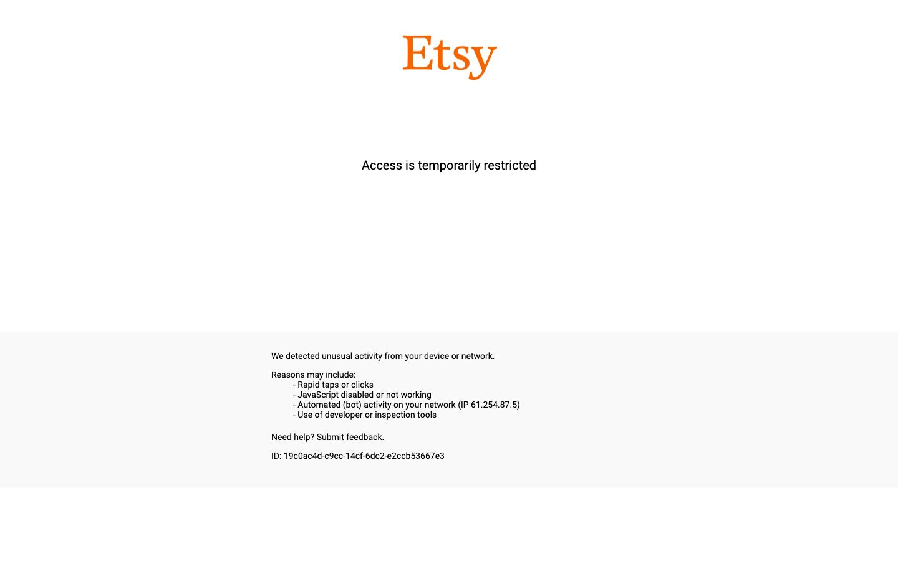

**페이지 메타 정보**

| page | title | description |
|---|---|---|
| [`trending_jewelry`](https://www.etsy.com/c/jewelry) | etsy.com |  |
| [`trending_accessories`](https://www.etsy.com/c/accessories) | etsy.com |  |

#### [Macy's](https://www.macys.com/)

- URL: <https://www.macys.com/>
- 페이지: **OK 1 · FAIL 0**

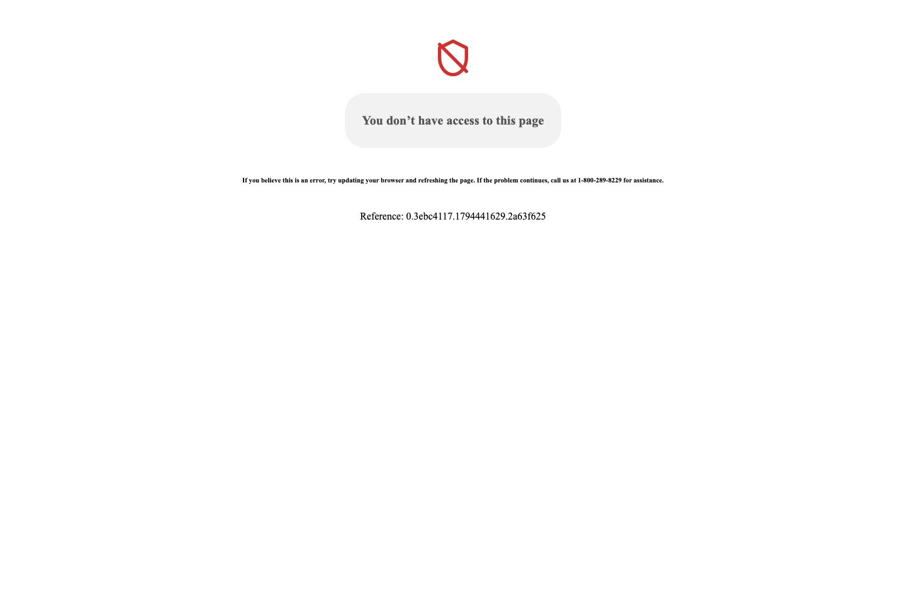

**페이지 메타 정보**

| page | title | description |
|---|---|---|
| [`new`](https://www.macys.com/shop/whats-new?id=14834) | Access Denied - Macy's | Access denied 403 |

#### [Nordstrom](https://www.nordstrom.com/)

- URL: <https://www.nordstrom.com/>
- 페이지: **OK 2 · FAIL 0**

**대표 상품 이미지** (상위 6장, 출처 URL 포함)

-  — 출처 <https://n.nordstrommedia.com/it/7f51c20a-b069-4154-9cfb-1e6d13a7c608.gif>
- 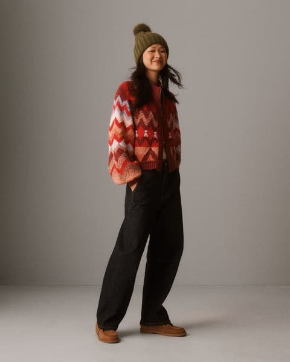 — 출처 <https://n.nordstrommedia.com/is/image/nordstrom/WMNS_TRD03F_1026_0039.jpeg?width=240&dpr=2&crop=4857.28%3A6071.6%2Coffset-x50%2Coffset-y50&trim=0.083%2C0%2C0.035%2C0>
-  — 출처 <https://n.nordstrommedia.com/is/image/nordstrom/MENS_OUT02F_1026_V2_0030.jpeg?width=240&dpr=2&crop=4829.76%3A6037.2%2Coffset-x68.314%2Coffset-y50&trim=0.05%2C0%2C0.073%2C0>
- 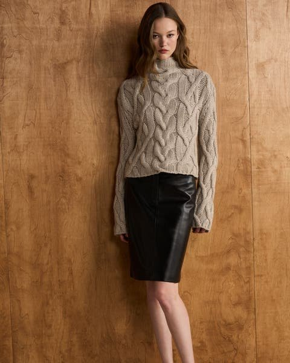 — 출처 <https://n.nordstrommedia.com/is/image/nordstrom/DESW_APP02F_1126_073.jpeg?width=240&dpr=2&crop=2134%3A2667.5%2Coffset-x50%2Coffset-y0>
- 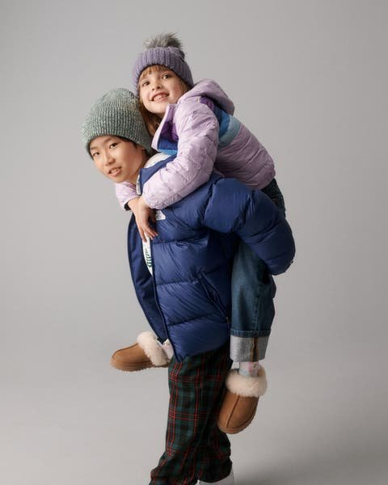 — 출처 <https://n.nordstrommedia.com/is/image/nordstrom/KIDS_LB01F_1026_v2_0021.jpeg?width=240&dpr=2&crop=5504%3A6880%2Coffset-x83.75%2Coffset-y50>
- 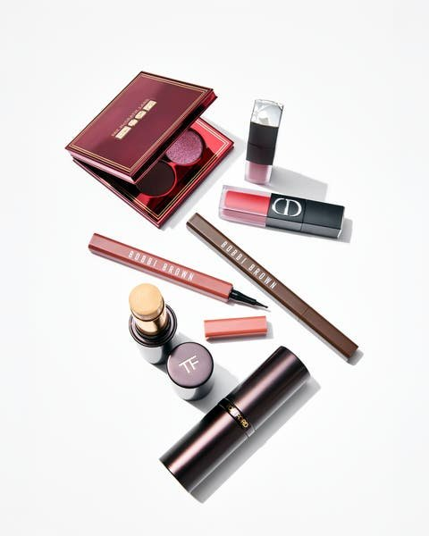 — 출처 <https://n.nordstrommedia.com/is/image/nordstrom/BEA_MKUP04P_1026.jpeg?width=240&dpr=2&crop=6425.6%3A8032%2Coffset-x50%2Coffset-y50>

**페이지 메타 정보**

| page | title | description |
|---|---|---|
| [`new`](https://www.nordstrom.com/browse/new) | New & Now | Nordstrom | Shop a great selection of New Arrivals at Nordstrom.com. Top brands. New trends. |
| [`women`](https://www.nordstrom.com/browse/women) | Women's Clothing, Shoes, & Accessories | Nordstrom | Find a great selection of Women's Clothing, Shoes, & Accessories at Nordstrom.com. Shop popular brands and top designers. |

#### [Revolve](https://www.revolve.com/)

- URL: <https://www.revolve.com/>
- 페이지: **OK 0 · FAIL 2**

**실패 페이지**

- `new` — playwright_error: Error: Page.goto: net::ERR_HTTP2_PROTOCOL_ERROR at https://www.revolve.com/new/br/c79f88/
Call log:
  - navigating to "https://www.revolve.com/new/br/c79f88/", waiting until "domcontentloaded"

- `trending` — playwright_error: Error: Page.goto: net::ERR_HTTP2_PROTOCOL_ERROR at https://www.revolve.com/most-loved/br/4a9ca5/
Call log:
  - navigating to "https://www.revolve.com/most-loved/br/4a9ca5/", waiting until "domcontentloaded"

#### [Urban Outfitters](https://www.urbanoutfitters.com/)

- URL: <https://www.urbanoutfitters.com/>
- 페이지: **OK 1 · FAIL 0**

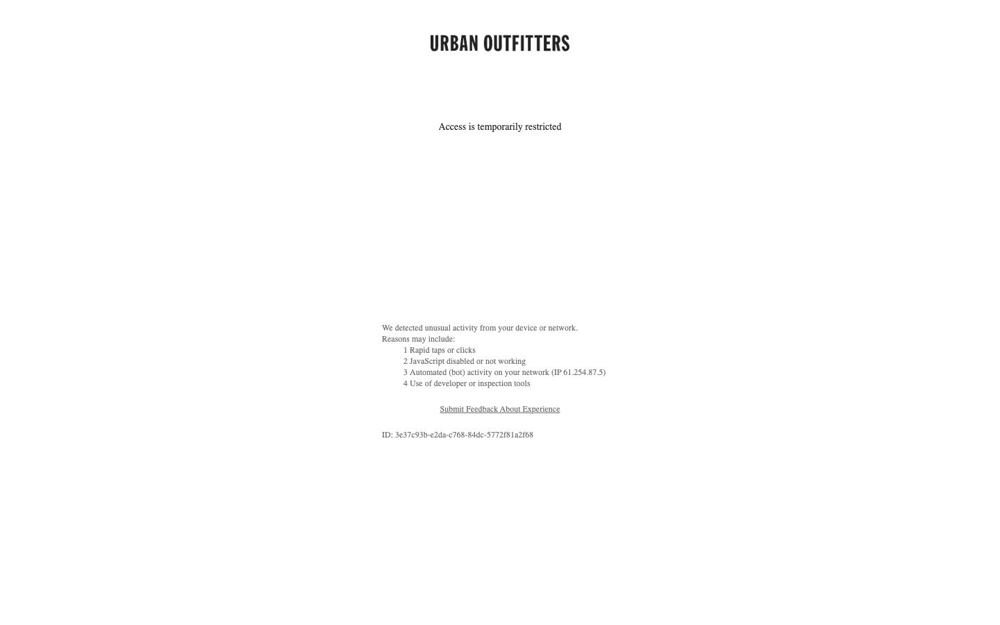

**페이지 메타 정보**

| page | title | description |
|---|---|---|
| [`new_women`](https://www.urbanoutfitters.com/womens-new-arrivals) | urbanoutfitters.com |  |

### 4.7 베트남 _( Vietnam )_

- 한국 수출규모 순위: **#4** · region: `asia` · tier `1` · currency `VND`
- 수집 사이트: **5개** (성공 5)
- 메모: 의류 생산기지/원단 수출 비중 큼. 빠르게 성장하는 이커머스
#### [Canifa](https://canifa.com/)

- URL: <https://canifa.com/>
- 페이지: **OK 1 · FAIL 0**

**대표 상품 이미지** (상위 6장, 출처 URL 포함)

- 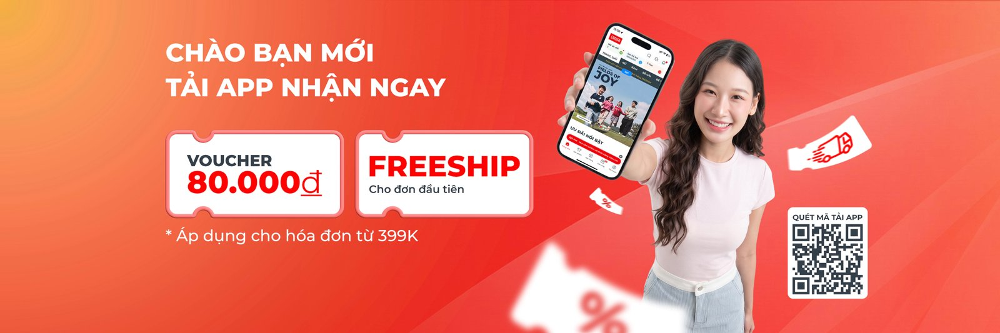 — 출처 <https://2885371169.e.cdneverest.net/Simiconnector/BannerSlider/c/h/chaobanmoi_topbanner_desktop-261026.webp>
- 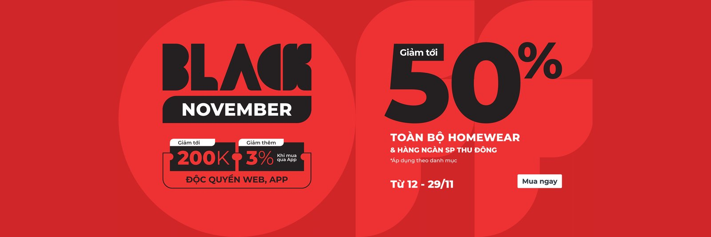 — 출처 <https://2885371169.e.cdneverest.net/Simiconnector/BannerSlider/b/l/blacknov_topbanner_desktop-111126.webp>
-  — 출처 <https://2885371169.e.cdneverest.net/Simiconnector/BannerSlider/t/c/tce_topbanner_desktop-261026.webp>
-  — 출처 <https://2885371169.e.cdneverest.net/Simiconnector/BannerSlider/t/h/thqg_topbanner_desktop-161026.webp>
-  — 출처 <https://2885371169.e.cdneverest.net/Simiconnector/BannerSlider/p/a/pattern-of-life_topbanner_desk-051026.webp>
-  — 출처 <https://canifa.com/_nuxt/img/chatbot-icon.c84d6ec.webp>

**페이지 메타 정보**

| page | title | description |
|---|---|---|
| [`home`](https://canifa.com/) | CANIFA | Patterns of Life | CANIFA - thương hiệu thời trang hàng đầu Việt Nam. Hàng ngàn mẫu quần áo phụ kiện nam, nữ, trẻ em cao cấp, chất lượng, an toàn liên tục được |

#### [IVY moda](https://ivymoda.com/)

- URL: <https://ivymoda.com/>
- 페이지: **OK 1 · FAIL 0**

**대표 상품 이미지** (상위 6장, 출처 URL 포함)

-  — 출처 <https://cotton4u.vn/files/news/2026/11/05/98bb25495aded9e5db7210edb0a245a1.webp>
- 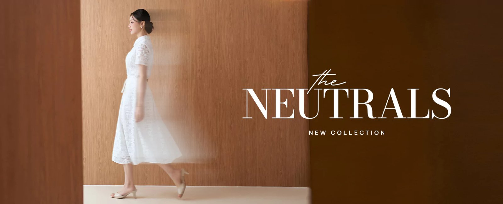 — 출처 <https://cotton4u.vn/files/news/2026/11/11/963d830686b12777f8c68635a5eaae3e.webp>
-  — 출처 <https://cotton4u.vn/files/news/2026/10/23/89e8eb777a0d21e8986a7f73c2ad29ac.webp>
-  — 출처 <https://cotton4u.vn/files/product/thumab/400/2026/11/10/f5119046e1cb2f875a652a6d058febaa.webp>
- 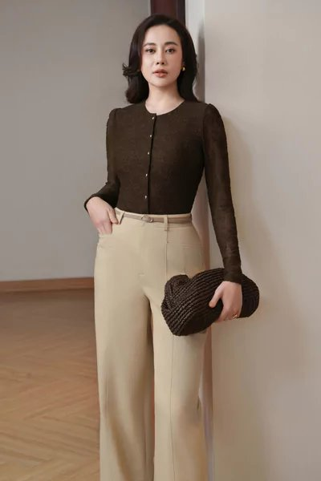 — 출처 <https://cotton4u.vn/files/product/thumab/400/2026/11/10/bf77056c8aace919558adc193244b044.webp>
-  — 출처 <https://cotton4u.vn/files/product/thumab/400/2026/11/10/fa942401246bd319a258c9ec212d5154.webp>

**페이지 메타 정보**

| page | title | description |
|---|---|---|
| [`home`](https://ivymoda.com/) | IVY moda - Thời Trang Công Sở Hiện Đại | IVY moda |  |

#### [Lazada Vietnam](https://www.lazada.vn/)

- URL: <https://www.lazada.vn/>
- 페이지: **OK 1 · FAIL 0**

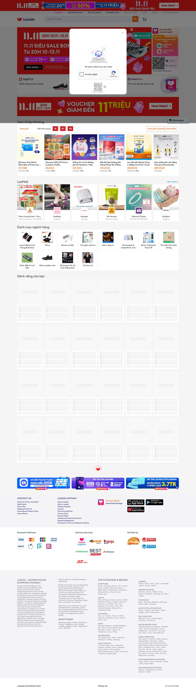

**대표 상품 이미지** (상위 6장, 출처 URL 포함)

-  — 출처 <https://img.lazcdn.com/us/domino/2ad4f22ce5a43dc145f221d13feed352.png>
-  — 출처 <https://img.lazcdn.com/g/tps/images/ims-web/TB1T7K2d8Cw3KVjSZFuXXcAOpXa.png>
- 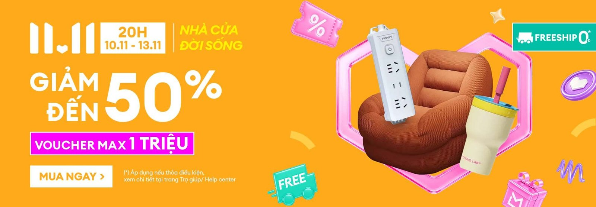 — 출처 <https://img.lazcdn.com/us/domino/80e09fe2-13c0-4aa7-93b7-844adf28bbc3_VN-1976-688.jpg_2200x2200q80.jpg>
-  — 출처 <https://img.lazcdn.com/us/domino/f7a3c7a0-6ce9-49e1-9be9-10fb890576b4_VN-1976-688.jpg_2200x2200q80.jpg>
- 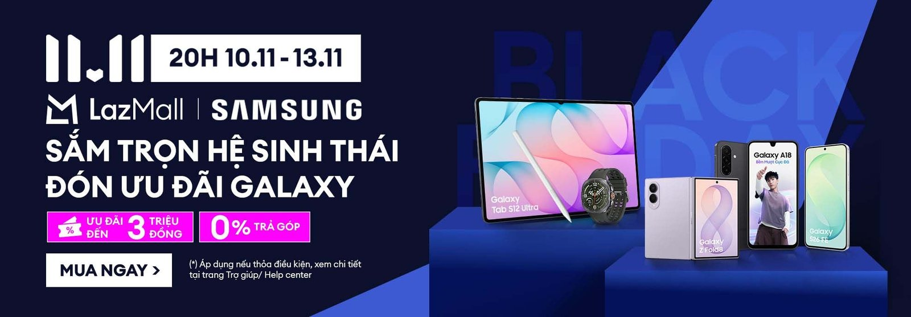 — 출처 <https://img.lazcdn.com/us/domino/1f837a00-b8b3-40a2-a4e8-4bcedbae0e40_VN-1976-688.jpg_2200x2200q80.jpg>
- 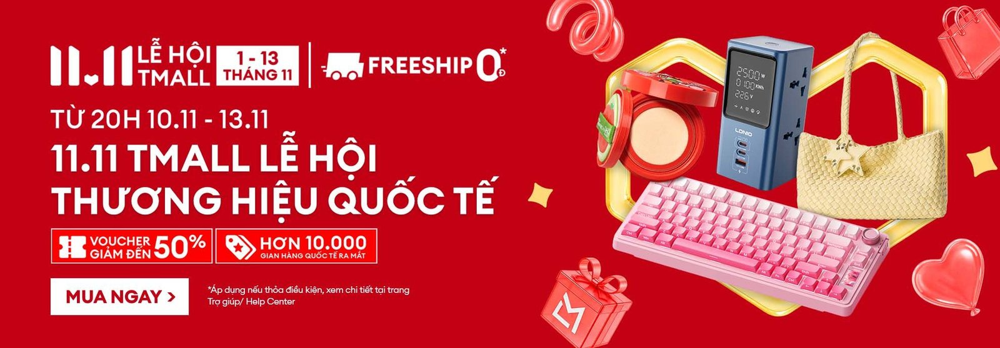 — 출처 <https://img.lazcdn.com/us/domino/619c1e08-c6c7-4d47-8f7c-6135135c6307_VN-1976-688.jpg_2200x2200q80.jpg>

**페이지 메타 정보**

| page | title | description |
|---|---|---|
| [`home`](https://www.lazada.vn/#?) | Lazada Việt Nam | Mua Sắm Online, Giá Tốt Nhất Mỗi Ngày | Mua sắm đồ điện tử, thời trang, làm đẹp và đồ chơi giá cả phải chăng. Đảm bảo sản phẩm chính hãng và trải nghiệm mua sắm tiện lợi – mua ngay |

#### [Shopee Vietnam](https://shopee.vn/)

- URL: <https://shopee.vn/>
- 페이지: **OK 1 · FAIL 0**

**페이지 메타 정보**

| page | title | description |
|---|---|---|
| [`home`](https://shopee.vn/verify/captcha?anti_bot_tracking_id=gqRjZGVrxHSFomtptTE0MjUxOnRyYWNraW5nX2lkX2tleaJrdtEAAqRhbGdv0gAAAGSjZGVrwKJjdMRAAAAADIKMyZ1P2O2Qvasq83S5AwzeFIVi130gJEs0rzTO_4iwfIWyFzi6GeoS0al_i_SqWqJfxR5gmm_2D9B-AqpjaXBoZXJ0ZXh0xQLMAAAADNxu4Xhhz6oFdes0_ZXy5Ntn5mrd_zpXOCo5fl_FJaI2wuKgKLI8YkBEGQXTbtgI5EpnzsrCGEEbv3X2GWXZP-HvPRmDID03SvUhkOi4c6-btWLftAB5WLbKA5fP0seOEy_yXg94ljBT0US7HJY1IfsSHJK6LWd0cnsacDloiJypf2PIGoOCOWA9W-z4cCPB46yRlTk-PoqajHleoF_e6HxemJ7RqcdEX3GOuBr7TB-qPUkcpr5b07wgGgZBjXGiiKoBnS4XC1Rumm5if3cxEZX-LNQ4iLmy3zUKbRVgkHHVXxp1VVnSZWN6DVXSK25qYOO8Df3SxNvVEok1zWizERO7eZloJmiA8I9NDzp4hofaEeIYUNMp3DpmrPyyig3pm3PzK7iMAcRO9Szc9_C6HoUcuhG0EUEnwvEfypfZKx7smvI6Xc-WfPXxX6b0UddwEoovGQ-4QyT-oVIbChDectmyZ-zGhSeLzbj4axwUvREykJCjFB0lR0CbiCCbG1YmRFqp8US7V9E0yjedM9Zo64Lxb7CDw0q8F2vu5Xa_FYOGFsIJGMO4A0-raPDlZmzJpq-UrUyGFNvb-45-YQqqenNALnTOwZGBw1AMFx6FWH32qoMVdLCFpi2Av-7M-sm-7-nT5y2GQktv4WPuOBQPjc58OE15Z8JwoViT3wh-Rbc8HGp2ha9vOfPpwkwhY0YU7CAAKpQ2RNZVHaGixB0bdTpMxyuk8F_6lRAcAZ6Ovr4JgFbmhBQD65QEg1jlwIgfsI6RPGJ6DuOfVo_efZteo4UAR26kZLlOqSWd-ec1TAreL9EXde784YdwBJ5gWb4tDU1lS6rh-Tn_t4rCo6uBkADZuQD4vz2hAKY-8kDh5YVYglXHLJbL1hrXG0ACvV2LdV7bDOIOoyHroMN_sgiMBPjC-kWrpGwMHnivpTdkIG6T-F9KPdKMpqc&app_key=FlashSale.PC&client_id=1&next=https%3A%2F%2Fshopee.vn%2Fverify%2Ftraffic%3F%3Fclient_id%3D%26next%3Dhttps%253A%252F%252Fshopee.vn%252F%26redirect_type%3D2%26should_replace_history%3Dfalse&redirect_type=2&scene=crawler_item&should_replace_history=false) | Shopee Việt Nam | Mua Sắm Online | Mua sắm trực tuyến hàng triệu sản phẩm ở tất cả ngành hàng. Giá tốt & Miễn phí vận chuyển. Mua và bán online trong 30 giây. Voucher Xtra | F |

#### [Tiki](https://tiki.vn/)

- URL: <https://tiki.vn/>
- 페이지: **OK 1 · FAIL 0**

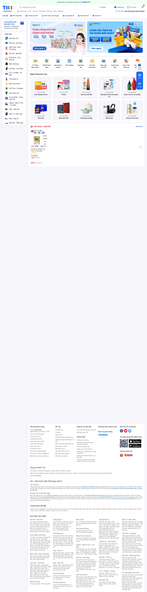

**대표 상품 이미지** (상위 6장, 출처 URL 포함)

-  — 출처 <https://salt.tikicdn.com/cache/100x100/ts/category/ed/20/60/afa9b3b474bf7ad70f10dd6443211d5f.png>
-  — 출처 <https://salt.tikicdn.com/cache/100x100/ts/category/f6/22/46/7e2185d2cf1bca72d5aeac385a865b2b.png>
-  — 출처 <https://salt.tikicdn.com/cache/100x100/ts/category/54/c0/ff/fe98a4afa2d3e5142dc8096addc4e40b.png>
-  — 출처 <https://salt.tikicdn.com/cache/100x100/ts/category/13/64/43/226301adcc7660ffcf44a61bb6df99b7.png>
-  — 출처 <https://salt.tikicdn.com/cache/100x100/ts/category/75/34/29/78e428fdd90408587181005f5cc3de32.png>
-  — 출처 <https://salt.tikicdn.com/cache/100x100/ts/category/61/d4/ea/e6ea3ffc1fcde3b6224d2bb691ea16a2.png>

**페이지 메타 정보**

| page | title | description |
|---|---|---|
| [`home`](https://tiki.vn/) | Tiki - Mua hàng online giá tốt, hàng chuẩn, ship nhanh | Tiện lợi mua sắm hàng triệu mặt hàng, dịch vụ. Vô vàn ưu đãi freeship, mã giảm giá. Hoàn tiền 15% tối đa 600k/tháng với thẻ tín dụng TikiCAR |

## 5. 의류 카테고리별 글로벌 트렌드

| # | 카테고리 | 건수 | 대표 상품명 |
|---:|---|---:|---|
| 1 | `자켓` | 14 | [2차 재입고] 캐슈 퍼 자켓 · 풀업 스웨이드 버튼 해링턴 자켓 BLACK · 라이트 쉘 모터사이클 자켓 BLACK |
| 2 | `코트` | 12 | [루피타, 강문경 PICK] SIOT4227 핸드메이드 윙 슬리브 롱 코트_Charcoal · SIOT4227 핸드메이드 윙 슬리브 롱 코트_Melange black · [루피타 PICK] SIOT4219 신슐레이트 하이넥 패딩 코트_Black |
| 3 | `팬츠` | 10 | [3차 재입고] 윈터 루 팬츠 · All day 조거팬츠 (올리브) · [루피타 PICK] SIPT7218 커브드 밴딩 조거 팬츠_Cream |
| 4 | `니트` | 8 | 귀여운 강아지 니트 인형 무니 Orange · SIKN2156 울 블렌드 루즈 브이넥 니트_Black · SIKN2156 울 블렌드 루즈 브이넥 니트_Wine |
| 5 | `스커트` | 5 | [3차 재입고] 윈터 루 스커트 · [루피타 PICK] SIST9076 페이크 스웨이드 미디 스커트_Black · [다송pick][이지룩][기모][ofm] 이지 트레이닝 롱 스커트 (sk) |
| 6 | `슬랙스` | 5 | SIPT7106 에센셜 원턱 기모 슬랙스_Charcoal · SIPT7106 에센셜 원턱 기모 슬랙스_Black · [🏆역대급100만장/3기장선택!] made. 마켓 와이드 트레이닝슬랙스 (+숏/베이직/롱ver) - 4 size |
| 7 | `셔츠` | 4 | SITP5160 루즈핏 링클 실키 셔츠_Black · [made/R,U넥]에센스골지티셔츠 · [역대급블프🖤/두장세트가격] made. 듀얼팩 365 베이직 티셔츠 (2PACK) - 2 type (무료배송) |
| 8 | `jacket` | 3 | Waxed cowhide reversible liner jacket _ brown · Waxed cowhide reversible liner jacket _ black · Patina cowhide tanker jacket _ washed brown |
| 9 | `블라우스` | 3 | [루피타 PICK] SITP5321 루즈핏 타이 블라우스_Charcoal · [하객룩🕊️/자체제작] 라베아 타이 블라우스 (4color) · [겨울하객룩✨][MADE]드넬 하이넥 타이 블라우스[3color] |
| 10 | `데님` | 2 | SIJN6087 아르코 커브드 데님_Vintage brown · [made]딥나이트데님 |

**국가별 의류 TOP**

- **korea**: `자켓`(14), `코트`(12), `팬츠`(10), `니트`(8), `스커트`(5)
## 6. 악세사리 카테고리별 글로벌 트렌드

| # | 카테고리 | 건수 | 대표 상품명 |
|---:|---|---:|---|
| 1 | `양말` | 1 | 매일 톡톡한 워싱 디자인 양말 여성용,남성용 |

**국가별 악세사리 TOP**

- **korea**: `양말`(1)
## 7. 국가별 가격대 비교

| 국가 | 통화 | 표본 | min | p25 | median | p75 | max | median (USD) |
|---|---|---:|---:|---:|---:|---:|---:|---:|
| korea | KRW | 109 | 3200 | 30362 | 63000 | 129090 | 446300 | 46.96 |

> p25/p75 는 IQR 기준 분위수. USD 환산은 `config/exchange_rates.yaml` 기준 (운영자가 정기 갱신).

## 8. 국내 의류·악세사리 사업동향

### KITA K-stat

- 한국무역통계의 국가 수출입 통계 총괄 페이지입니다.
- 사이트: <https://stat.kita.net/stat/kts/ctr/CtrTotalImpExpList.screen>

| # | topic | title | url |
|---:|---|---|---|
| 1 | `trade` | KITA.NET | <https://www.kita.net/> |
| 2 | `trade` | K-stat 란? | <https://www.kita.net/pdf/statGuide/index.html#p=1> |
| 3 | `무역통계` | 무역통계 분류 | <https://stat.kita.net/stat/guide/guide_18_01.screen> |
| 4 | `trade` | 한국품목코드 | <https://stat.kita.net/stat/kts/statCode/ItemHierCodeList.screen> |
| 5 | `trade` | 해외품목코드 | <https://stat.kita.net/stat/istat/common/IstatHSCode.screen> |
| 6 | `trade` | 대륙/경제코드 | <https://stat.kita.net/stat/kts/statCode/ConEcoCodeList.screen> |
| 7 | `trade` | 수출입 총괄 | <https://stat.kita.net/stat/kts/sum/SumImpExpTotalList.screen> |
| 8 | `trade` | 가공단계 수출입 | <https://stat.kita.net/stat/kts/use/BecList.screen> |
| 9 | `trade` | 품목 수출입 | <https://stat.kita.net/stat/kts/pum/ItemImpExpList.screen> |
| 10 | `trade` | 국가 수출입 | <https://stat.kita.net/stat/kts/ctr/CtrTotalImpExpList.screen> |
| 11 | `trade` | 대륙/경제권 수출입 | <https://stat.kita.net/stat/kts/rel/RelColligationList.screen> |
| 12 | `trade` | 지자체 수출입 | <https://stat.kita.net/stat/kts/prod/ProdWholeList.screen> |
| 13 | `trade` | 항구/공항 수출입 | <https://stat.kita.net/stat/kts/port/PortImpExpList.screen> |
| 14 | `trade` | FTA체결국 수출입 | <https://stat.kita.net/stat/kts/fta/FtaCtrImpExpList.screen> |
| 15 | `trade` | 간접수출 현황 | <https://stat.kita.net/stat/ind/KtsIndMain.screen> |

### Korea Customs Service

- 수출입 현황, 물류통계 등 관세청 무역통계정보를 종합적으로 제공
- 사이트: <https://tradedata.go.kr/cts/index_eng.do>

| # | topic | title | url |
|---:|---|---|---|
| 1 | `trade` | Korea Customs Service | <http://customs.go.kr/english/main.do> |

### KOSIS

- 코시스, 국가데이터처가 제공하는 원스톱 통계 서비스, 국가승인통계, 국제통계, 북한통계, e-지방지표, 통계시각화콘텐츠, 온라인간행물 등 제공
- 사이트: <https://kosis.kr/statisticsList/statisticsListIndex.do?parmTabId=M_01_01&vwcd=MT_ZTITLE&menuId=M_01_01&outLink=Y&entrType=>

| # | topic | title | url |
|---:|---|---|---|
| 1 | `statistics` | 쉽게 보는 통계 | <http://kosis.kr/easyViewStatis/customStatisIndex.do?vwcd=MT_TM1_TITLE&menuId=M_03_01> |
| 2 | `statistics` | 이슈별 접근 | <http://kosis.kr/easyViewStatis/customStatisIndex.do?vwcd=MT_TM2_TITLE&menuId=M_03_02> |
| 3 | `statistics` | 통계시각화콘텐츠 | <http://kosis.kr/easyViewStatis/visualizationIndex.do> |
| 4 | `statistics` | 온라인간행물 | <http://kosis.kr/publication/publicationThema.do> |
| 5 | `statistics` | 기획간행물 | <http://kosis.kr/publication/publicationStat.do> |
| 6 | `statistics` | KOSIS 길라잡이 | <http://kosis.kr/civilComplaint/kosisGuideIndex.do> |
| 7 | `statistics` | 홈페이지 개선의견 | <http://kosis.kr/civilComplaint/siteRequestList.do> |
| 8 | `statistics` | 찾아가는 KOSIS | <http://kosis.kr/civilComplaint/kosisEduIndex.do> |
| 9 | `statistics` | 서비스 소개 | <http://kosis.kr/serviceInfo/kosisIntroduce.do> |
| 10 | `statistics` | 국가통계현황 | <http://kosis.kr/serviceInfo/statisInstitution.do> |
| 11 | `statistics` | 국가통계 공표일정 | <http://kosis.kr/serviceInfo/statisPublicationList.do> |
| 12 | `statistics` | 팩트체크 서비스 | <http://kosis.kr/serviceInfo/factCheckList.do> |
| 13 | `statistics` | 서비스정책 | <http://kosis.kr/serviceInfo/useGuide.do> |
| 14 | `statistics` | 공유서비스 (OpenAPI) | <http://kosis.kr/serviceInfo/openAPIGuide.do> |
| 15 | `statistics` | English | <https://kosis.kr/eng> |

### KOTRA

- 트라이빅(TriBig)은 코트라(KOTRA)가 제공하는 무역투자 빅데이터 플랫폼으로 무역투자통계, 국가별 시장정보, 품목별 유망시장, 기업별 맞춤정보, 해외바이어 정보의 서비스를 제공합니다.
- 사이트: <https://www.kotra.or.kr/bigdata/visualization/korea#search/ALL/ALL/2024>

| # | topic | title | url |
|---:|---|---|---|
| 1 | `trade` | kotra 무역투자24 | <https://www.kotra.or.kr/bigdata/kotraSsoRedirect?targetURL=https://www.kotra.or.kr> |
| 2 | `trade` | 해외비즈니스 정보 포털 | <https://www.kotra.or.kr/bigdata/kotraSsoRedirect?targetURL=https://dream.kotra.or.kr/dream> |
| 3 | `trade` | 글로벌 전시포털 | <https://www.kotra.or.kr/bigdata/kotraSsoRedirect?targetURL=https://www.gep.or.kr/> |
| 4 | `trade` | KOTRA 해외인재유치센터 | <https://www.kotra.or.kr/gtc_kor> |
| 5 | `trade` | 투자유치정보제공 | <https://www.kotra.or.kr/bigdata/kotraSsoRedirect?targetURL=https://www.investkorea.org/> |
| 6 | `수출지원` | 수출지원 온라인 플랫폼 | <https://www.kotra.or.kr/bigdata/kotraSsoRedirect?targetURL=https://www.buykorea.or.kr/> |
| 7 | `trade` | 빅데이터 서비스 | <https://www.kotra.or.kr/bigdata/> |
| 8 | `trade` | 경제외교 활용포털 | <https://www.kotra.or.kr/bigdata/kotraSsoRedirect?targetURL=https://president.globalwindow.org> |
| 9 | `trade` | 방산물자교역지원센터 | <https://www.kotra.or.kr/bigdata/kotraSsoRedirect?targetURL=https://www.kotra.or.kr/kodits> |
| 10 | `trade` | 외투기업고충처리 | <https://www.kotra.or.kr/bigdata/kotraSsoRedirect?targetURL=https://ombudsman.kotra.or.kr/ob-kr> |
| 11 | `trade` | 수출바우처 · 지사화 | <https://www.exportvoucher.com> |
| 12 | `trade` | 무역투자통계 | <https://www.kotra.or.kr/bigdata/visualization/korea> |
| 13 | `trade` | 국가별 시장정보 | <https://www.kotra.or.kr/bigdata/marketAnalysis> |
| 14 | `trade` | 품목별 유망시장 | <https://www.kotra.or.kr/bigdata/bhrcMarket> |
| 15 | `trade` | 해외바이어 정보 | <https://www.kotra.or.kr/bigdata/partner/search> |

### Statistics Korea Online Shopping

- 국가데이터처,List | 전체 | 보도자료 | 새소식
- 사이트: <https://mods.go.kr/board.es?mid=a10301010000&bid=11789>

| # | topic | title | url |
|---:|---|---|---|
| 1 | `statistics` | 정보공개제도 | <https://mods.go.kr/menu.es?mid=a10101010100> |
| 2 | `statistics` | 정보공개청구 | <https://www.open.go.kr/com/main/mainView.do> |
| 3 | `statistics` | 비공개대상정보세부기준 | <https://mods.go.kr/menu.es?mid=a10101030000> |
| 4 | `statistics` | 고객수요분석 | <https://mods.go.kr/menu.es?mid=a10101040000> |
| 5 | `statistics` | 사전정보공표 | <https://mods.go.kr/menu.es?mid=a10103010000> |
| 6 | `statistics` | 사전정보공표목록 | <https://mods.go.kr/menu.es?mid=a10103010100> |
| 7 | `statistics` | 핵심단어목록 | <https://mods.go.kr/menu.es?mid=a10103020100> |
| 8 | `statistics` | 인기정보TOP10 | <https://mods.go.kr/menu.es?mid=a10103030100> |
| 9 | `statistics` | 행정자료실 | <https://mods.go.kr/menu.es?mid=a10104010000> |
| 10 | `statistics` | 업무추진비 | <https://mods.go.kr/menu.es?mid=a10104010100> |
| 11 | `statistics` | 국회관련정보 | <https://mods.go.kr/menu.es?mid=a10104040000> |
| 12 | `statistics` | 정책실명제 | <https://mods.go.kr/menu.es?mid=a10105010000> |
| 13 | `statistics` | 연도별대상사업현황 | <https://mods.go.kr/menu.es?mid=a10105020000> |
| 14 | `statistics` | 중점관리대상사업 | <https://mods.go.kr/menu.es?mid=a10105030600> |
| 15 | `statistics` | 국민신청실명제 | <https://mods.go.kr/menu.es?mid=a10105040000> |

### 기업마당

- 기업마당>정책정보>지원사업 공고
- 사이트: <https://www.bizinfo.go.kr/sii/siia/selectSIIA200View.do?null>

| # | topic | title | url |
|---:|---|---|---|
| 1 | `policy` | 지원사업 공고 | <https://www.bizinfo.go.kr/sii/siia/selectSIIA200View.do> |
| 2 | `policy` | 품목별 법정의무 인증제도 | <https://www.bizinfo.go.kr/biz/biza/selectBIZA100View.do> |
| 3 | `policy` | 입법·행정예고/고시 | <https://www.bizinfo.go.kr/biz/biza/selectBIZA300View.do> |
| 4 | `policy` | 월간 중기누리 | <https://www.bizinfo.go.kr/biz/biza/selectBIZA400View.do> |
| 5 | `policy` | 기업업무용 서식 | <https://www.bizinfo.go.kr/biz/bizb/selectBIZB100View.do> |
| 6 | `policy` | 입주기업 모집공고 | <https://www.bizinfo.go.kr/biz/bizb/selectBIZB200View.do> |
| 7 | `policy` | 온라인화상회의실 | <https://www.k-startup.go.kr/web/contents/webOLNIVIDEOMTRM.do> |
| 8 | `policy` | 정책정보 개방 | <https://www.bizinfo.go.kr/apiList.do> |
| 9 | `policy` | 속보성 대시보드 | <https://www.bizinfo.go.kr/dashboard.do> |
| 10 | `policy` | 고객의 소리 | <https://www.bizinfo.go.kr/biz/bizc/selectBIZC200Regist.do> |
| 11 | `policy` | 자주하는질문 | <https://www.bizinfo.go.kr/biz/bizc/selectBIZC300View.do> |
| 12 | `policy` | 이메일주소 무단 수집 거부안내 | <https://www.bizinfo.go.kr/biz/bizd/selectBIZD110View.do> |
| 13 | `policy` | 웹접근성 정책 | <https://www.bizinfo.go.kr/biz/bizd/selectBIZD130View.do> |
| 14 | `policy` | 전체메뉴보기 | <https://www.bizinfo.go.kr/sitemap/intro.do> |
| 15 | `policy` | [강원] 평창군 2026년 생계형 1인 자영업자 사회보험료 지원 공고 | <https://www.bizinfo.go.kr/sii/siia/selectSIIA200Detail.do?hashCode=&rowsSel=&rows=15&cpage=&cat=&schPblancDiv=&schJrsdCodeTy=&schWntyAt=&schAreaDetailCodes=&schEndAt=N&orderGb=&sort=&preKeywords=&condition=&condition1=&keyword=&pblancId=PBLN_000000000127869> |

### 서울경제진흥원

- 서울경제진흥원 에러페이지
- 사이트: <https://www.sba.seoul.kr/Pages/error_404.html?aspxerrorpath=/Pages/NSub06_01.aspx>

### 소상공인24

- 소상공인24는 소상공인시장진흥공단이 운영하는 소상공인 지원사업 통합 플랫폼입니다. 소진공·지방정부·유관기관 지원사업 공고 조회와 신청, 대출상품 조회, 증명서 발급, 소상공인 통계를 한 곳에서 이용할 수 있습니다.
- 사이트: <https://www.sbiz24.kr/#/pbanc>

| # | topic | title | url |
|---:|---|---|---|
| 1 | `policy` | 지원사업 소개 | <https://www.sbiz24.kr/#/cmmn/gnrl/Conts/7> |
| 2 | `policy` | 소진공 지원사업 공고조회 및 신청 | <https://www.sbiz24.kr/#/pbanc> |
| 3 | `policy` | 지방정부 지원사업 공고조회 및 신청 | <https://www.sbiz24.kr/#/lcgPbanc> |
| 4 | `policy` | 유관기관 지원사업 공고조회 | <https://www.sbiz24.kr/#/extldPbanc> |
| 5 | `policy` | 대출상품 조회 | <https://www.sbiz24.kr/#/loanProduct> |
| 6 | `policy` | 지원사업 상담 | <https://www.sbiz24.kr/#/qna> |

### 중소벤처기업부

- 중소기업중앙회 등 기관 중소기업 조사, 통계 DB화 검색, 내려받기 등 제공.
- 사이트: <https://www.mss.go.kr/site/smba/ex/bbs/List.do?cbIdx=86>

| # | topic | title | url |
|---:|---|---|---|
| 1 | `policy` | 어린이 누리집 | <https://www.mss.go.kr/site/kids/main.do> |
| 2 | `policy` | English | <https://www.mss.go.kr/site/eng/main.do> |
| 3 | `policy` | 누리집 안내지도 | <https://www.mss.go.kr/site/smba/ex/siteMap/siteMap.do> |
| 4 | `policy` | 훈령/예규/고시/공고 | <https://www.mss.go.kr/site/smba/ex/bbs/List.do?cbIdx=125&ext6=Y> |
| 5 | `policy` | 입법/행정예고 | <https://www.mss.go.kr/site/smba/ex/bbs/List.do?cbIdx=126&searchRltnYn=Y> |
| 6 | `policy` | 인사·채용 | <https://www.mss.go.kr/site/smba/ex/bbs/List.do?cbIdx=82> |
| 7 | `policy` | 보도설명자료 | <https://www.mss.go.kr/site/smba/ex/bbs/List.do?cbIdx=87> |
| 8 | `policy` | 현장속으로 | <https://www.mss.go.kr/site/smba/brdcststnVod/brdcststnVodList.do?ctgr_code=C01> |
| 9 | `policy` | 중기부소식지 | <https://www.mss.go.kr/site/smba/ex/bbs/List.do?cbIdx=95> |
| 10 | `policy` | 통계설명자료 | <https://www.mss.go.kr/site/smba/foffice/ex/statDB/ptScheduleList.do> |
| 11 | `policy` | 주제별 통계 | <https://www.mss.go.kr/site/smba/foffice/ex/statDB/temaList.do?tabCd=0001> |
| 12 | `policy` | 조사별 통계 | <https://www.mss.go.kr/site/smba/foffice/ex/statDB/surveyList.do?tabCd=0001> |
| 13 | `policy` | 조사보고서 | <https://www.mss.go.kr/site/smba/foffice/ex/statDB/stReportRoList.do?gb=1&nodeId=&roCode=> |
| 14 | `policy` | 주제별 조회 | <https://www.mss.go.kr/site/smba/foffice/ex/statDB/stReportRcList.do?gb=2&nodeId=&rcCode=> |
| 15 | `policy` | 중소기업위상 | <https://www.mss.go.kr/site/smba/foffice/ex/statDB/MainSubStat.do?scd=0001> |

## 9. 한국 사업자 관점 기회 국가 TOP 10

| # | 국가 | tier | region | 점수 | 근거 |
|---:|---|---:|---|---:|---|
| 1 | 태국 _( Thailand )_ | 1 | `asia` | **143.5** | tier1 기본점(90); 아시아 권역(+20); ASEAN 시장(+10); K-패션/콘텐츠 친화 시장(+20); 트렌드 신호 밀도 4 |
| 2 | 대만 _( Taiwan )_ | 1 | `asia` | **136.5** | tier1 기본점(90); 아시아 권역(+20); K-패션/콘텐츠 친화 시장(+20); 트렌드 신호 밀도 6 |
| 3 | 일본 _( Japan )_ | 1 | `asia` | **130.0** | tier1 기본점(90); 아시아 권역(+20); K-패션/콘텐츠 친화 시장(+20) |
| 4 | 베트남 _( Vietnam )_ | 1 | `asia` | **124.5** | tier1 기본점(90); 아시아 권역(+20); ASEAN 시장(+10); 트렌드 신호 밀도 4 |
| 5 | 인도네시아 _( Indonesia )_ | 1 | `asia` | **123.5** | tier1 기본점(90); 아시아 권역(+20); ASEAN 시장(+10); 트렌드 신호 밀도 4 |
| 6 | 미국 _( United States )_ | 1 | `north_america` | **111.5** | tier1 기본점(90); 트렌드 신호 밀도 22 |
| 7 | 필리핀 _( Philippines )_ | 2 | `asia` | **110.0** | tier2 기본점(60); 아시아 권역(+20); ASEAN 시장(+10); K-패션/콘텐츠 친화 시장(+20) |
| 8 | 말레이시아 _( Malaysia )_ | 2 | `asia` | **90.0** | tier2 기본점(60); 아시아 권역(+20); ASEAN 시장(+10) |
| 9 | 싱가포르 _( Singapore )_ | 2 | `asia` | **90.0** | tier2 기본점(60); 아시아 권역(+20); ASEAN 시장(+10) |
| 10 | 홍콩 _( Hong Kong )_ | 2 | `asia` | **80.0** | tier2 기본점(60); 아시아 권역(+20) |

## 10. 실행 제안

### **1위 태국** (점수 144, tier1 · asia)

- 현지 스타일 TOP: `wide` — 시즌 컬렉션 기획 시 우선 반영.
- 현지 컬러 TOP: `red` — 시즌 컬렉션 기획 시 우선 반영.
- 현지 카테고리 TOP: `tee`, `bag`, `accessories` — 시즌 컬렉션 기획 시 우선 반영.
- K-패션 친화도가 명시된 시장이므로 K-브랜드 아이덴티티 및 한류 셀럽 협업을 강조.
- ASEAN 권역 시장 — 물류/관세(FTA) 활용 + 동남아 통합 마케팅 검토 권장.
- tier1 핵심 시장 — 현지 마켓플레이스(예: 해당 국가의 대표 패션 플랫폼) 공식 입점 + 셀러 운영 채널 확보 우선.
- 연계 가능한 국내 수출/지원 사업이 식별되지 않음 — `domestic_sources.yaml` 의 `landing_url` 을 KOTRA 사업 공고/기업마당 수출바우처로 직접 지정 권장.

### **2위 대만** (점수 136, tier1 · asia)

- 현지 컬러 TOP: `pink`, `red` — 시즌 컬렉션 기획 시 우선 반영.
- 현지 소재 TOP: `lace` — 시즌 컬렉션 기획 시 우선 반영.
- K-패션 친화도가 명시된 시장이므로 K-브랜드 아이덴티티 및 한류 셀럽 협업을 강조.
- 아시아 권역 시장 — 시차/언어 친화 + 한국 본사 직배송 모델 검토.
- tier1 핵심 시장 — 현지 마켓플레이스(예: 해당 국가의 대표 패션 플랫폼) 공식 입점 + 셀러 운영 채널 확보 우선.
- 연계 가능한 국내 수출/지원 사업이 식별되지 않음 — `domestic_sources.yaml` 의 `landing_url` 을 KOTRA 사업 공고/기업마당 수출바우처로 직접 지정 권장.

### **3위 일본** (점수 130, tier1 · asia)

- K-패션 친화도가 명시된 시장이므로 K-브랜드 아이덴티티 및 한류 셀럽 협업을 강조.
- 아시아 권역 시장 — 시차/언어 친화 + 한국 본사 직배송 모델 검토.
- tier1 핵심 시장 — 현지 마켓플레이스(예: 해당 국가의 대표 패션 플랫폼) 공식 입점 + 셀러 운영 채널 확보 우선.
- 연계 가능한 국내 수출/지원 사업이 식별되지 않음 — `domestic_sources.yaml` 의 `landing_url` 을 KOTRA 사업 공고/기업마당 수출바우처로 직접 지정 권장.

### 운영 점검 노트

- **한국 어휘사전 매칭 0건**: 메인페이지만 수집되어 색/소재/스타일 신호가 0. 한국 사이트(29CM/W Concept/Musinsa)에 `page_targets` 추가 필요.
- **ASEAN 다중 진출 기회**: TOP10 중 ASEAN 국가가 3개 이상. Shopee/Lazada/Zalora 통합 운영을 통한 동남아 멀티마켓 전략을 검토 권장.

## 11. 수집 실패/주의 사이트

| 국가 | 사이트 | 페이지 | 상태 | 사유 |
|---|---|---|---|---|
| usa | Revolve | new | failed | playwright_error: Error: Page.goto: net::ERR_HTTP2_PROTOCOL_ERROR at https://www.revolve.com/new/br/c79f88/
Call log:
  - navigating to "https://www.revolve.com/new/br/c79f88/", waiting until "domcontentloaded"
 |
| usa | Revolve | trending | failed | playwright_error: Error: Page.goto: net::ERR_HTTP2_PROTOCOL_ERROR at https://www.revolve.com/most-loved/br/4a9ca5/
Call log:
  - navigating to "https://www.revolve.com/most-loved/br/4a9ca5/", waiting until "domcontentloaded"
 |
| japan | ZOZOTOWN | new | failed | playwright_error: Error: Page.goto: net::ERR_TIMED_OUT at https://zozo.jp/category/new/
Call log:
  - navigating to "https://zozo.jp/category/new/", waiting until "domcontentloaded"
 |
| japan | ZOZOTOWN | ranking | failed | playwright_error: Error: Page.goto: net::ERR_TIMED_OUT at https://zozo.jp/ranking/
Call log:
  - navigating to "https://zozo.jp/ranking/", waiting until "domcontentloaded"
 |
| japan | Rakuten Fashion | women | failed | http_status_404 |
| indonesia | Tokopedia | home | failed | playwright_error: Error: Page.goto: net::ERR_HTTP2_PROTOCOL_ERROR at https://www.tokopedia.com/
Call log:
  - navigating to "https://www.tokopedia.com/", waiting until "domcontentloaded"
 |
| thailand | Pomelo | new | failed | robots_disallowed |
| thailand | Pomelo | best | failed | robots_disallowed |
| korea | Musinsa | home | failed | robots_disallowed |

## 12. 원문 출처 및 이미지 출처

### 인도네시아

- **Berrybenka** — <https://www.berrybenka.com/>
  - 이미지 출처: <https://berrybenka.com/cdn/shop/files/logo.jpg?v=1791288203&width=3840>
  - 이미지 출처: <http://berrybenka.com/cdn/shop/files/berrybenka_logo.png?v=1788942734>
  - 이미지 출처: <https://berrybenka.com/cdn/shop/files/berrybenka_logo.png?v=1788942734>
- **Hijup** — <https://www.hijup.com/>
  - 이미지 출처: <https://www.hijup.com/_next/image?url=%2Fimages%2Fwa.icon.png&w=128&q=100>
- **Shopee Indonesia** — <https://shopee.co.id/>
  - 이미지 출처: <https://deo.shopeemobile.com/shopee/shopee-pcmall-live-sg/assets/1c8bdaaf45e1fd48.png>
- **Tokopedia** — <https://www.tokopedia.com/>
- **Zalora Indonesia** — <https://www.zalora.co.id/>
  - 이미지 출처: <https://static-id.zacdn.com/next-assets/static-assets/images/logo/icon_mastercard.png>
  - 이미지 출처: <https://static-id.zacdn.com/next-assets/static-assets/images/logo/icon_visa.png>
  - 이미지 출처: <https://static-id.zacdn.com/next-assets/static-assets/images/logo/icon_ovo.png>
  - 이미지 출처: <https://static-id.zacdn.com/next-assets/static-assets/images/logo/icon_indodana.png>

### 일본

- **GU Japan** — <https://www.gu-global.com/jp/>
  - 이미지 출처: <https://image.uniqlo.com/GU/ST3/jp/imagesother/Navigation/WOMEN_Category/2026/261023/261023_category-icon_autumn-winter-sale.png>
  - 이미지 출처: <https://image.uniqlo.com/GU/ST3/jp/imagesother/Navigation/Category-icon_V2/2026/0724/Categoy_Limited-offers.jpg>
  - 이미지 출처: <https://image.uniqlo.com/GU/ST3/jp/imagesother/Navigation/Category-icon_V2/2026/0724/Categoy_SALE.jpg>
  - 이미지 출처: <https://image.uniqlo.com/GU/ST3/jp/imagesother/Navigation/collaboration_Category/26FW/rokh_category_icon.png>
  - 이미지 출처: <https://image.uniqlo.com/GU/ST3/jp/imagesother/Navigation/WOMEN_Category/2026/261106/261106_category_w_outer_360434.png>
  - 이미지 출처: <https://image.uniqlo.com/GU/ST3/jp/imagesother/Navigation/WOMEN_Category/2026/261008/category_w_knit-and-cardigan_360549.png>
  - 이미지 출처: <https://image.uniqlo.com/GU/ST3/jp/imagesother/Navigation/WOMEN_Category/2026/261008/category_w_tops_361505.png>
  - 이미지 출처: <https://image.uniqlo.com/GU/ST3/jp/imagesother/Navigation/WOMEN_Category/2026/260911/Category_w_sweat_361784.png>
  - 이미지 출처: <https://image.uniqlo.com/GU/ST3/jp/imagesother/Navigation/WOMEN_Category/2026/261030/261030_category_w_sheer-T_360571.png>
  - 이미지 출처: <https://image.uniqlo.com/GU/ST3/jp/imagesother/Navigation/WOMEN_Category/2026/261030/261030_category_w_warm-T_360578.png>
  - 이미지 출처: <https://image.uniqlo.com/GU/ST3/jp/imagesother/Navigation/WOMEN_Category/2026/261030/261030_category_w_fleece_361295.png>
  - 이미지 출처: <https://image.uniqlo.com/GU/ST3/jp/imagesother/Navigation/WOMEN_Category/2026/260807/Category_w_shirt_361657.png>
  - 이미지 출처: <https://image.uniqlo.com/GU/ST3/jp/imagesother/Navigation/WOMEN_Category/2026/260724/Category_w_Pants.jpg>
- **Rakuten Fashion** — <https://brandavenue.rakuten.co.jp/>
  - 이미지 출처: <https://brandavenue.r10s.jp/img/library/index/sbn_flagshipstore_20231003.png>
  - 이미지 출처: <https://brandavenue.r10s.jp/img/news/01/406128/pc_n.jpg>
  - 이미지 출처: <https://brandavenue.r10s.jp/img/news/13/408767/pc_n.jpg>
  - 이미지 출처: <https://brandavenue.r10s.jp/img/news/01/408553/pc_n.jpg>
  - 이미지 출처: <https://brandavenue.r10s.jp/img/news/01/408665/pc_n.jpg>
  - 이미지 출처: <https://brandavenue.r10s.jp/img/news/01/408668/pc_n.jpg>
  - 이미지 출처: <https://brandavenue.r10s.jp/img/news/01/408670/pc_n.jpg>
  - 이미지 출처: <https://brandavenue.r10s.jp/img/news/01/408673/pc_n.jpg>
  - 이미지 출처: <https://brandavenue.r10s.jp/img/news/01/408674/pc_n.jpg>
  - 이미지 출처: <https://brandavenue.r10s.jp/img/news/01/408836/pc_n.jpg>
  - 이미지 출처: <https://brandavenue.r10s.jp/img/news/01/408300/pc_n.jpg>
  - 이미지 출처: <https://brandavenue.r10s.jp/img/news/01/406421/pc_n.jpg>
  - 이미지 출처: <https://brandavenue.r10s.jp/img/news/01/408813/pc_n.jpg>
  - 이미지 출처: <https://brandavenue.r10s.jp/img/news/01/408523/pc_n.jpg>
  - 이미지 출처: <https://brandavenue.r10s.jp/img/news/01/408849/pc_n.jpg>
  - 이미지 출처: <https://brandavenue.r10s.jp/img/news/01/408600/pc_n.jpg>
  - 이미지 출처: <https://brandavenue.r10s.jp/img/news/01/408837/pc_n.jpg>
  - 이미지 출처: <https://brandavenue.r10s.jp/img/news/01/408734/pc_n.jpg>
  - 이미지 출처: <https://brandavenue.r10s.jp/img/news/01/408672/pc_n.jpg>
- **Uniqlo Japan** — <https://www.uniqlo.com/jp/>
- **WEAR** — <https://wear.jp/>
- **ZOZOTOWN** — <https://zozo.jp/>

### 한국

- **29CM** — <https://www.29cm.co.kr/>
  - 이미지 출처: <https://img.29cm.co.kr/cms/202611/11f1dcc2f172badbb5d90b8796219230.jpg?width=3840&format=webp>
  - 이미지 출처: <https://img.29cm.co.kr/cms/202611/11f1dcc2e9da4d44aa2dada18efe30d7.jpg?width=3840&format=webp>
  - 이미지 출처: <https://img.29cm.co.kr/cms/202611/11f1dcc2d6385c96aa2d4bfc6fa7e3d8.jpg?width=3840&format=webp>
  - 이미지 출처: <https://img.29cm.co.kr/cms/202611/11f1dcc2a7e93278aa2da78c654a9183.jpg?width=3840&format=webp>
  - 이미지 출처: <https://img.29cm.co.kr/cms/202611/11f1dcc29d6b7f5eaa2d03ddd5a92dd2.jpg?width=3840&format=webp>
  - 이미지 출처: <https://img.29cm.co.kr/cms/202611/11f1dcc29379435caa2df169937aa467.jpg?width=3840&format=webp>
  - 이미지 출처: <https://img.29cm.co.kr/cms/202611/11f1dcc28aa60cdcaa2d3bbf15de5811.jpg?width=3840&format=webp>
  - 이미지 출처: <https://img.29cm.co.kr/cms/202611/11f1dcc27b428873b5d95587db675384.jpg?width=3840&format=webp>
  - 이미지 출처: <https://img.29cm.co.kr/cms/202611/11f1dbe93992c985aa2d91f81e83dcd7.jpg?width=3840&format=webp>
  - 이미지 출처: <https://img.29cm.co.kr/cms/202611/11f1dbe931babae3aa2da1517c17cb72.jpg?width=3840&format=webp>
  - 이미지 출처: <https://img.29cm.co.kr/cms/202611/11f1dbe92b231b86b5d907310e454fbc.jpg?width=3840&format=webp>
  - 이미지 출처: <https://img.29cm.co.kr/cms/202611/11f1dbe922c254faaa2dc5f2225113e5.jpg?width=3840&format=webp>
  - 이미지 출처: <https://img.29cm.co.kr/cms/202611/11f1dbe918b3b762aa2db3c2a764d00a.jpg?width=3840&format=webp>
  - 이미지 출처: <https://img.29cm.co.kr/cms/202611/11f1d9aaa30a12b6aa2de170f071d531.jpg?width=3840&format=webp>
  - 이미지 출처: <https://img.29cm.co.kr/cms/202611/11f1d9aa99ea68f0aa2d69985b95954e.jpg?width=3840&format=webp>
  - 이미지 출처: <https://img.29cm.co.kr/cms/202611/11f1d9aa8cfe74e4aa2d5be3c7222fef.jpg?width=3840&format=webp>
  - 이미지 출처: <https://img.29cm.co.kr/cms/202611/11f1d9aa84d427aeaa2d85781c33f870.jpg?width=3840&format=webp>
  - 이미지 출처: <https://img.29cm.co.kr/cms/202611/11f1d9aa7dc2ec6eb5d939fcf9f17fa4.jpg?width=3840&format=webp>
- **Musinsa** — <https://www.musinsa.com/>
- **W Concept** — <https://www.wconcept.co.kr/>
- **Zigzag** — <https://zigzag.kr/>

### 대만

- **momo** — <https://www.momoshop.com.tw/>
- **OB Design** — <https://www.obdesign.com.tw/>
  - 이미지 출처: <https://cms-static.cdn.91app.com/images/original/41602/92f19e4d-89b7-4330-9570-02cf1dff9742-1794293521-8shypjqjk5_d_1920x820_1280x547_1124x480_800x342_600x256_400x171.jpg>
  - 이미지 출처: <https://cms-static.cdn.91app.com/images/compress/41602/92f19e4d-89b7-4330-9570-02cf1dff9742-1794293521-8shypjqjk5_d_400x171.webp>
  - 이미지 출처: <https://cms-static.cdn.91app.com/images/original/41602/92f19e4d-89b7-4330-9570-02cf1dff9742-1793070308-6drun5zyc4_d_1920x820_1280x547_1124x480_800x342_600x256_400x171.jpg>
  - 이미지 출처: <https://cms-static.cdn.91app.com/images/original/41602/92f19e4d-89b7-4330-9570-02cf1dff9742-1794368782-w0s0fz0ca4_d_1920x820_1280x547_1124x480_800x342_600x256_400x171.jpg>
  - 이미지 출처: <https://cms-static.cdn.91app.com/images/original/41602/92f19e4d-89b7-4330-9570-02cf1dff9742-1794193864-y85juga1zg_d_1920x820_1280x547_1124x480_800x342_600x256_400x171.jpg>
  - 이미지 출처: <https://cms-static.cdn.91app.com/images/original/41602/92f19e4d-89b7-4330-9570-02cf1dff9742-1794360670-wtfzxkcvms_d_1920x820_1280x547_1124x480_800x342_600x256_400x171.jpg>
  - 이미지 출처: <https://cms-static.cdn.91app.com/images/original/41602/92f19e4d-89b7-4330-9570-02cf1dff9742-1794278808-dn1wmx9ffo_d_1920x820_1280x547_1124x480_800x342_600x256_400x171.jpg>
  - 이미지 출처: <https://cms-static.cdn.91app.com/images/original/41602/92f19e4d-89b7-4330-9570-02cf1dff9742-1794196182-fr6djqcxlx_d_1920x820_1280x547_1124x480_800x342_600x256_400x171.jpg>
  - 이미지 출처: <https://cms-static.cdn.91app.com/images/original/41602/92f19e4d-89b7-4330-9570-02cf1dff9742-1794290688-3rum8nrsiv_d_1920x820_1280x547_1124x480_800x342_600x256_400x171.jpg>
  - 이미지 출처: <https://cms-static.cdn.91app.com/images/original/41602/20e150ef-f3b9-41e5-a7d1-3e246e070a59-1766996640-zaqbt3m2o6_m.png>
  - 이미지 출처: <https://cms-static.cdn.91app.com/images/original/41602/20e150ef-f3b9-41e5-a7d1-3e246e070a59-1767328066-hpr7vgg5h2_m.png>
  - 이미지 출처: <https://cms-static.cdn.91app.com/images/original/41602/20e150ef-f3b9-41e5-a7d1-3e246e070a59-1767067052-avl82sdmyk_m.gif>
  - 이미지 출처: <https://cms-static.cdn.91app.com/images/original/41602/20e150ef-f3b9-41e5-a7d1-3e246e070a59-1772016038-bahn8sg6xa_m.png>
  - 이미지 출처: <https://cms-static.cdn.91app.com/images/original/41602/92f19e4d-89b7-4330-9570-02cf1dff9742-1789354550-oy3ba049j8_m_1280x600_1124x527_800x375_600x281_400x188.jpg>
  - 이미지 출처: <https://cms-static.cdn.91app.com/images/original/41602/92f19e4d-89b7-4330-9570-02cf1dff9742-1793671377-0fgge121r3_m_1280x600_1124x527_800x375_600x281_400x188.jpg>
  - 이미지 출처: <https://cms-static.cdn.91app.com/images/compress/41602/92f19e4d-89b7-4330-9570-02cf1dff9742-1793671377-0fgge121r3_m_400x188.webp>
- **PChome** — <https://24h.pchome.com.tw/>
- **Pinkoi Taiwan** — <https://www.pinkoi.com/>
  - 이미지 출처: <https://cdn04.pinkoi.com/pinkoi.site/logo/og_image.png>
- **Yahoo Taiwan Shopping** — <https://tw.buy.yahoo.com/>
  - 이미지 출처: <https://img.yec.tw/zp/MerchandiseImages/9f7c32198e-Gd-12074110.jpg>
  - 이미지 출처: <https://img.yec.tw/zp/MerchandiseImages/850397f7b8-Gd-11689377.jpg>
  - 이미지 출처: <https://img.yec.tw/zp/MerchandiseImages/DA7038AE92-Gd-12322107.jpg>
  - 이미지 출처: <https://img.yec.tw/up/uploadr/00u21hvmzmjMvuwgh1d8/SHP/mario/270x270_1.gif>

### 태국

- **Central Online** — <https://www.central.co.th/>
  - 이미지 출처: <https://www.central.co.th/_next/image?url=https%3A%2F%2Fassets.central.co.th%2Ffile-assets%2Fassets%2FCMS%2Fcampaign%2F2026%2F11nov%2F20261101_SOG_Homepage_herobanner.jpg&w=3840&q=75>
  - 이미지 출처: <https://www.central.co.th/_next/image?url=https%3A%2F%2Fassets.central.co.th%2Ffile-assets%2Fassets%2FCMS%2Fcampaign%2F2026%2F11nov%2F20261109_mardimercredi_heroweb_d.jpg&w=3840&q=75>
  - 이미지 출처: <https://www.central.co.th/_next/image?url=https%3A%2F%2Fassets.central.co.th%2Ffile-assets%2Fassets%2FCMS%2Fcampaign%2F2026%2F11nov%2F20261102_coty_heroweb_d.jpg&w=3840&q=75>
  - 이미지 출처: <https://www.central.co.th/_next/image?url=https%3A%2F%2Fassets.central.co.th%2Ffile-assets%2Fassets%2FCMS%2Fcampaign%2F2026%2F11nov%2F20261107_clarins_heroweb_d.jpg&w=3840&q=75>
  - 이미지 출처: <https://www.central.co.th/_next/image?url=https%3A%2F%2Fassets.central.co.th%2Ffile-assets%2Fassets%2FCMS%2Fcampaign%2F2026%2F11nov%2F20261026_MEGA-SALE_PRO_heroweb_d.jpg&w=3840&q=75>
  - 이미지 출처: <https://www.central.co.th/_next/image?url=https%3A%2F%2Fassets.central.co.th%2Ffile-assets%2Fassets%2FCMS%2Fcampaign%2F2026%2F11nov%2F20261102_Estee-Lauder_PRO_heroweb_d.jpg&w=3840&q=75>
  - 이미지 출처: <https://www.central.co.th/_next/image?url=https%3A%2F%2Fassets.central.co.th%2Ffile-assets%2Fassets%2FCMS%2Fcampaign%2F2026%2F11nov%2F20261110_dior_heroweb_d.jpg&w=3840&q=75>
  - 이미지 출처: <https://www.central.co.th/_next/image?url=https%3A%2F%2Fassets.central.co.th%2Ffile-assets%2Fassets%2FCMS%2Fcampaign%2F2026%2F11nov%2F20261109_ysl_heroweb_d.jpg&w=3840&q=75>
  - 이미지 출처: <https://www.central.co.th/_next/image?url=https%3A%2F%2Fassets.central.co.th%2Ffile-assets%2Fassets%2FCMS%2Fcampaign%2F2026%2F11nov%2F20261101_sunglasshut_heroweb_d.jpg&w=3840&q=75>
  - 이미지 출처: <https://www.central.co.th/_next/image?url=https%3A%2F%2Fassets.central.co.th%2Ffile-assets%2Fassets%2FCMS%2Fcampaign%2F2026%2F11nov%2F20261101_PASAYA_heroweb_d.jpg&w=3840&q=75>
  - 이미지 출처: <https://www.central.co.th/_next/image?url=https%3A%2F%2Fassets.central.co.th%2Ffile-assets%2Fassets%2FCMS%2Fcampaign%2F2026%2F11nov%2F20261028_Garmin_PRO_heroweb_d.jpg&w=3840&q=75>
  - 이미지 출처: <https://www.central.co.th/_next/image?url=https%3A%2F%2Fassets.central.co.th%2Ffile-assets%2Fassets%2FCMS%2Fcampaign%2F2026%2F11nov%2F20261101_toshiba_heroweb_d.jpg&w=3840&q=75>
  - 이미지 출처: <https://www.central.co.th/_next/image?url=https%3A%2F%2Fassets.central.co.th%2Ffile-assets%2Fassets%2FCMS%2Fcampaign%2F2026%2F11nov%2F20261101_philipsavent_heroweb_d.jpg&w=3840&q=75>
  - 이미지 출처: <https://www.central.co.th/_next/image?url=https%3A%2F%2Fassets.central.co.th%2Ffile-assets%2Fassets%2FCMS%2Fcampaign%2F2026%2F10oct%2F20261021_TOPS_NEW_heroweb_d.jpg&w=3840&q=75>
  - 이미지 출처: <https://www.central.co.th/_next/image?url=https%3A%2F%2Fassets.central.co.th%2Ffile-assets%2Fassets%2FCMS%2Fevm%2Fcategory-navigation%2FCategory-carousel%2FBeauty%2FTH_beauty.png&w=3840&q=75>
  - 이미지 출처: <https://www.central.co.th/_next/image?url=https%3A%2F%2Fassets.central.co.th%2Ffile-assets%2Fassets%2FCMS%2Fevm%2Fcategory-navigation%2FCategory-carousel%2FWomen%2FTH_women.png&w=3840&q=75>
  - 이미지 출처: <https://www.central.co.th/_next/image?url=https%3A%2F%2Fassets.central.co.th%2Ffile-assets%2Fassets%2FCMS%2Fevm%2Fcategory-navigation%2FCategory-carousel%2FMen%2FTH_men.png&w=3840&q=75>
- **Lazada Thailand Fashion** — <https://www.lazada.co.th/>
  - 이미지 출처: <https://img.lazcdn.com/us/domino/40845120240f19d13f738fa9a7978edd.png>
  - 이미지 출처: <https://img.lazcdn.com/g/tps/images/ims-web/TB1KB2laMFY.1VjSZFnXXcFHXXa.png>
  - 이미지 출처: <https://img.lazcdn.com/us/domino/09774a18-e409-4fe2-b5d4-2884ee962759_TH-1976-688.jpg_2200x2200q80.jpg>
  - 이미지 출처: <https://img.lazcdn.com/us/domino/c0a7b4b6-19dc-4a8b-a5d0-1dd556af8f11_TH-1976-688.jpg_2200x2200q80.jpg>
  - 이미지 출처: <https://img.lazcdn.com/us/domino/2ded4056-3f4c-4728-897c-53db952b9dc8_TH-1976-688.jpg_2200x2200q80.jpg>
  - 이미지 출처: <https://img.lazcdn.com/us/domino/6758af42-c4d7-4cbc-af62-fc47baca24d4_TH-1976-688.jpg_2200x2200q80.jpg>
  - 이미지 출처: <https://img.lazcdn.com/us/domino/7ec65d26-65cc-4c60-8e59-05d140da334f_TH-1976-688.jpg_2200x2200q80.jpg>
  - 이미지 출처: <https://img.lazcdn.com/us/domino/21cf171e-30c8-4f16-ada0-662927bc8595_TH-1976-688.jpg_2200x2200q80.jpg>
  - 이미지 출처: <https://img.lazcdn.com/us/domino/f877d4c4-0b92-42f6-aa0f-4d793a8d61aa_TH-1976-688.jpg_2200x2200q80.jpg>
  - 이미지 출처: <https://img.lazcdn.com/us/domino/deb94ff0-73a3-4429-94b3-10192671edc8_TH-1976-688.jpg_2200x2200q80.jpg>
  - 이미지 출처: <https://img.lazcdn.com/us/domino/ae0097cdb1eceff6a1c6c8e67b5c09f7.png_360x360q80.png>
  - 이미지 출처: <https://img.lazcdn.com/us/domino/2982506b-639f-44f6-8482-d49a42106fe6_TH-276-260.png_300x300q80.png>
- **Pomelo** — <https://www.pomelofashion.com/>
- **Shopee Thailand Fashion** — <https://shopee.co.th/>
  - 이미지 출처: <https://deo.shopeemobile.com/shopee/shopee-pcmall-live-sg/assets/1c8bdaaf45e1fd48.png>
  - 이미지 출처: <https://deo.shopeemobile.com/shopee/shopee-pcmall-live-sg/homepagefe/42ba6075c82a85ab.png>
- **Zalora Thailand** — <https://www.zalora.co.th/>
  - 이미지 출처: <https://www.zalora.co.th/images/landingpage/525x500.gif>

### 미국

- **Etsy** — <https://www.etsy.com/>
- **Macy's** — <https://www.macys.com/>
- **Nordstrom** — <https://www.nordstrom.com/>
  - 이미지 출처: <https://n.nordstrommedia.com/it/7f51c20a-b069-4154-9cfb-1e6d13a7c608.gif>
  - 이미지 출처: <https://n.nordstrommedia.com/is/image/nordstrom/WMNS_TRD03F_1026_0039.jpeg?width=240&dpr=2&crop=4857.28%3A6071.6%2Coffset-x50%2Coffset-y50&trim=0.083%2C0%2C0.035%2C0>
  - 이미지 출처: <https://n.nordstrommedia.com/is/image/nordstrom/MENS_OUT02F_1026_V2_0030.jpeg?width=240&dpr=2&crop=4829.76%3A6037.2%2Coffset-x68.314%2Coffset-y50&trim=0.05%2C0%2C0.073%2C0>
  - 이미지 출처: <https://n.nordstrommedia.com/is/image/nordstrom/DESW_APP02F_1126_073.jpeg?width=240&dpr=2&crop=2134%3A2667.5%2Coffset-x50%2Coffset-y0>
  - 이미지 출처: <https://n.nordstrommedia.com/is/image/nordstrom/KIDS_LB01F_1026_v2_0021.jpeg?width=240&dpr=2&crop=5504%3A6880%2Coffset-x83.75%2Coffset-y50>
  - 이미지 출처: <https://n.nordstrommedia.com/is/image/nordstrom/BEA_MKUP04P_1026.jpeg?width=240&dpr=2&crop=6425.6%3A8032%2Coffset-x50%2Coffset-y50>
  - 이미지 출처: <https://n.nordstrommedia.com/is/image/nordstrom/ACC_HDBG03P_1026_V1.jpeg?width=240&dpr=2&crop=5356%3A6695%2Coffset-x50%2Coffset-y43.974>
  - 이미지 출처: <https://n.nordstrommedia.com/it/80596ad8-e8ff-463d-b84f-cf8da3abf7e7.jpeg?q=45&dpr=2&h=353&w=230>
  - 이미지 출처: <https://n.nordstrommedia.com/it/6998dfb9-aa9b-422b-a7dc-51ef2d3e54d1.jpeg?q=45&dpr=2&h=353&w=230>
  - 이미지 출처: <https://n.nordstrommedia.com/it/cd089f49-19a9-458d-86ea-fd430471c63c.jpeg?q=45&dpr=2&h=353&w=230>
  - 이미지 출처: <https://n.nordstrommedia.com/it/82ea2d9c-81ea-4e67-9e1e-dc36c18fa4cf.jpeg?q=45&dpr=2&h=353&w=230>
  - 이미지 출처: <https://n.nordstrommedia.com/it/730f20f2-0c92-4f91-901f-775d49f4bd8c.jpeg?q=45&dpr=2&h=353&w=230>
  - 이미지 출처: <https://n.nordstrommedia.com/it/6ef57583-06de-49c7-9e03-a42d99ff8004.jpeg?q=45&dpr=2&h=353&w=230>
  - 이미지 출처: <https://n.nordstrommedia.com/it/3b9eb935-681b-47e5-acac-c92b64282c19.jpeg?q=45&dpr=2&h=353&w=230>
  - 이미지 출처: <https://n.nordstrommedia.com/it/b0acf4fb-4c99-457e-8b7d-bef099b9794a.jpeg?q=45&dpr=2&h=353&w=230>
  - 이미지 출처: <https://n.nordstrommedia.com/it/3c815e6e-d660-46f3-b6ae-01016456590c.jpeg?q=45&dpr=2&h=353&w=230>
  - 이미지 출처: <https://n.nordstrommedia.com/it/7118fb1b-e999-46fc-b457-0fe1e569751f.jpeg?q=45&dpr=2&h=353&w=230>
  - 이미지 출처: <https://n.nordstrommedia.com/it/4544eebd-1000-4c05-9976-8a6afeb1c953.jpeg?q=45&dpr=2&h=353&w=230>
  - 이미지 출처: <https://n.nordstrommedia.com/it/5e922bfe-5902-4f52-95a7-5396ae342450.jpeg?q=45&dpr=2&h=353&w=230>
  - 이미지 출처: <https://n.nordstrommedia.com/is/image/nordstrom/40_1-1_12586872.png?width=240&dpr=2&crop=1280%3A1600%2Coffset-x51.333%2Coffset-y50>
- **Revolve** — <https://www.revolve.com/>
- **Urban Outfitters** — <https://www.urbanoutfitters.com/>

### 베트남

- **Canifa** — <https://canifa.com/>
  - 이미지 출처: <https://2885371169.e.cdneverest.net/Simiconnector/BannerSlider/c/h/chaobanmoi_topbanner_desktop-261026.webp>
  - 이미지 출처: <https://2885371169.e.cdneverest.net/Simiconnector/BannerSlider/b/l/blacknov_topbanner_desktop-111126.webp>
  - 이미지 출처: <https://2885371169.e.cdneverest.net/Simiconnector/BannerSlider/t/c/tce_topbanner_desktop-261026.webp>
  - 이미지 출처: <https://2885371169.e.cdneverest.net/Simiconnector/BannerSlider/t/h/thqg_topbanner_desktop-161026.webp>
  - 이미지 출처: <https://2885371169.e.cdneverest.net/Simiconnector/BannerSlider/p/a/pattern-of-life_topbanner_desk-051026.webp>
  - 이미지 출처: <https://canifa.com/_nuxt/img/chatbot-icon.c84d6ec.webp>
  - 이미지 출처: <https://canifa.com/_nuxt/img/chat-zalo.ab5351f.webp>
- **IVY moda** — <https://ivymoda.com/>
  - 이미지 출처: <https://cotton4u.vn/files/news/2026/11/05/98bb25495aded9e5db7210edb0a245a1.webp>
  - 이미지 출처: <https://cotton4u.vn/files/news/2026/11/11/963d830686b12777f8c68635a5eaae3e.webp>
  - 이미지 출처: <https://cotton4u.vn/files/news/2026/10/23/89e8eb777a0d21e8986a7f73c2ad29ac.webp>
  - 이미지 출처: <https://cotton4u.vn/files/product/thumab/400/2026/11/10/f5119046e1cb2f875a652a6d058febaa.webp>
  - 이미지 출처: <https://cotton4u.vn/files/product/thumab/400/2026/11/10/bf77056c8aace919558adc193244b044.webp>
  - 이미지 출처: <https://cotton4u.vn/files/product/thumab/400/2026/11/10/fa942401246bd319a258c9ec212d5154.webp>
  - 이미지 출처: <https://cotton4u.vn/files/product/thumab/400/2026/11/10/cb3ad5759e66e3387cdb8435798172db.webp>
  - 이미지 출처: <https://cotton4u.vn/files/product/thumab/400/2026/11/10/0ea9c10167f0b5c1bbd87401aadace41.webp>
  - 이미지 출처: <https://cotton4u.vn/files/product/thumab/400/2026/11/10/cba21863087984b27c023625909e0067.webp>
  - 이미지 출처: <https://cotton4u.vn/files/product/thumab/400/2026/11/10/ec2933887c3bcf112cf0fcbda7d19a2d.webp>
  - 이미지 출처: <https://cotton4u.vn/files/product/thumab/400/2026/11/10/be6033a2c398305358799cf133453e2d.webp>
  - 이미지 출처: <https://cotton4u.vn/files/product/thumab/400/2026/11/10/827b60600c66bba0638acfd9adc0051b.webp>
- **Lazada Vietnam** — <https://www.lazada.vn/>
  - 이미지 출처: <https://img.lazcdn.com/us/domino/2ad4f22ce5a43dc145f221d13feed352.png>
  - 이미지 출처: <https://img.lazcdn.com/g/tps/images/ims-web/TB1T7K2d8Cw3KVjSZFuXXcAOpXa.png>
  - 이미지 출처: <https://img.lazcdn.com/us/domino/80e09fe2-13c0-4aa7-93b7-844adf28bbc3_VN-1976-688.jpg_2200x2200q80.jpg>
  - 이미지 출처: <https://img.lazcdn.com/us/domino/f7a3c7a0-6ce9-49e1-9be9-10fb890576b4_VN-1976-688.jpg_2200x2200q80.jpg>
  - 이미지 출처: <https://img.lazcdn.com/us/domino/1f837a00-b8b3-40a2-a4e8-4bcedbae0e40_VN-1976-688.jpg_2200x2200q80.jpg>
  - 이미지 출처: <https://img.lazcdn.com/us/domino/619c1e08-c6c7-4d47-8f7c-6135135c6307_VN-1976-688.jpg_2200x2200q80.jpg>
  - 이미지 출처: <https://img.lazcdn.com/us/domino/6a4d6618-98b7-4e7e-8e31-daacb2b85a65_VN-1976-688.jpg_2200x2200q80.jpg>
  - 이미지 출처: <https://img.lazcdn.com/us/domino/ccc0c92f-6758-4006-905b-96ca3cf3250c_VN-1976-688.jpg_2200x2200q80.jpg>
  - 이미지 출처: <https://img.lazcdn.com/us/domino/5887043d-cbb8-4837-a8a4-86dcfe98f57d_VN-1976-688.jpg_2200x2200q80.jpg>
  - 이미지 출처: <https://img.lazcdn.com/us/domino/7b046b68-4eb2-461a-ac77-df23cf145104_VN-1976-688.jpg_2200x2200q80.jpg>
  - 이미지 출처: <https://img.lazcdn.com/us/domino/d33a2c90-b8c2-43b8-9558-9b3c3545c965_VN-1976-688.jpg_2200x2200q80.jpg>
  - 이미지 출처: <https://img.lazcdn.com/us/domino/13c1e8ba-f07b-46b5-9d53-3f83f2679e3f_VN-1976-688.jpg_2200x2200q80.jpg>
  - 이미지 출처: <https://img.lazcdn.com/us/domino/255719bb-77f1-491d-9097-34f9f78dac5a_VN-1976-688.jpg_2200x2200q80.jpg>
  - 이미지 출처: <https://img.lazcdn.com/us/domino/ef443aa6-c45c-4859-ae69-a2bd96a9ddab_VN-1976-688.jpg_2200x2200q80.jpg>
  - 이미지 출처: <https://img.lazcdn.com/us/domino/a96c58a6a88070c43bc63444f6774f51.png_120x120q80.png>
  - 이미지 출처: <https://img.lazcdn.com/us/domino/c7412e89f2d826219b7a37ed5f7d6d50.png_360x360q80.png>
- **Shopee Vietnam** — <https://shopee.vn/>
- **Tiki** — <https://tiki.vn/>
  - 이미지 출처: <https://salt.tikicdn.com/cache/100x100/ts/category/ed/20/60/afa9b3b474bf7ad70f10dd6443211d5f.png>
  - 이미지 출처: <https://salt.tikicdn.com/cache/100x100/ts/category/f6/22/46/7e2185d2cf1bca72d5aeac385a865b2b.png>
  - 이미지 출처: <https://salt.tikicdn.com/cache/100x100/ts/category/54/c0/ff/fe98a4afa2d3e5142dc8096addc4e40b.png>
  - 이미지 출처: <https://salt.tikicdn.com/cache/100x100/ts/category/13/64/43/226301adcc7660ffcf44a61bb6df99b7.png>
  - 이미지 출처: <https://salt.tikicdn.com/cache/100x100/ts/category/75/34/29/78e428fdd90408587181005f5cc3de32.png>
  - 이미지 출처: <https://salt.tikicdn.com/cache/100x100/ts/category/61/d4/ea/e6ea3ffc1fcde3b6224d2bb691ea16a2.png>

---

_본 보고서는 fashion-sensing-agent 가 자동 생성한 운영용 리포트입니다. 이미지/스크린샷의 저작권은 원 출처에 있으며, 외부 공개 시 출처 표기 또는 링크 전환을 권장합니다._
