# 글로벌 패션·악세사리 트렌드 리포트

- **날짜**: 2026-11-14
- **생성**: 2026-11-14 09:09 KST
- **센싱 국가**: 7개
- **센싱 사이트**: 34개 (성공 29)
- **수집 페이지**: OK 32 / FAIL 9
- **다운로드 이미지**: 171장

---

## 1. Executive Summary

오늘 7개국 34개 사이트에서 32개 페이지를 수집하고, 171장의 대표 이미지를 정규화/저장했습니다.

## 2. 글로벌 트렌드 TOP 10

### 키워드

| # | keyword | count | 출처 사이트 수 |
|---:|---|---:|---:|
| 1 | `online` | 18 | 7 |
| 2 | `design` | 12 | 1 |
| 3 | `mua` | 12 | 4 |
| 4 | `lazada` | 10 | 2 |
| 5 | `shopee` | 8 | 2 |
| 6 | `pinkoi` | 8 | 1 |
| 7 | `great` | 8 | 1 |
| 8 | `ファッション` | 7 | 1 |
| 9 | `fashion` | 7 | 3 |
| 10 | `trang` | 7 | 3 |

### 컬러

| # | keyword | count | 출처 사이트 수 |
|---:|---|---:|---:|
| 1 | `pink` | 8 | 1 |
| 2 | `red` | 3 | 3 |

### 소재

| # | keyword | count | 출처 사이트 수 |
|---:|---|---:|---:|
| 1 | `lace` | 4 | 1 |
| 2 | `cashmere` | 4 | 1 |
| 3 | `cotton` | 3 | 2 |
| 4 | `linen` | 1 | 1 |
| 5 | `knit` | 1 | 1 |
| 6 | `silk` | 1 | 1 |
| 7 | `tweed` | 1 | 1 |

### 스타일

| # | keyword | count | 출처 사이트 수 |
|---:|---|---:|---:|
| 1 | `wide` | 7 | 3 |
| 2 | `classic` | 1 | 1 |
| 3 | `casual` | 1 | 1 |
| 4 | `modern` | 1 | 1 |

### 카테고리

| # | keyword | count | 출처 사이트 수 |
|---:|---|---:|---:|
| 1 | `shoes` | 5 | 2 |
| 2 | `sweater` | 5 | 1 |
| 3 | `accessories` | 4 | 2 |
| 4 | `dress` | 3 | 2 |
| 5 | `scarf` | 2 | 1 |
| 6 | `coat` | 2 | 1 |
| 7 | `jeans` | 2 | 1 |
| 8 | `blouse` | 1 | 1 |
| 9 | `tee` | 1 | 1 |
| 10 | `bag` | 1 | 1 |

## 3. 국가별 핵심 트렌드 요약

### 인도네시아

- **키워드** (10): `berrybenka`(5), `online`(5), `shopee`(4), `indonesia`(3), `belanja`(3)- **카테고리** (4): `shoes`(2), `dress`(2), `scarf`(2), `blouse`(1)
### 일본

- **키워드** (10): `ファッション`(7), `楽天`(6), `cookie`(5), `rakuten`(5), `fashion`(5)
### 한국

- **키워드** (10): `취향`(2), `곁에`(2), `패션`(1), `라이프스타일`(1), `컬처까지`(1)
### 대만

- **키워드** (10): `design`(12), `pinkoi`(8), `great`(8), `asia`(4), `cross-border`(4)- **컬러** (2): `pink`(8), `red`(1)- **소재** (1): `lace`(4)
### 태국

- **키워드** (10): `lazada`(6), `online`(5), `central`(4), `thailand`(4), `shopee`(4)- **컬러** (1): `red`(1)- **스타일** (1): `wide`(3)- **카테고리** (3): `tee`(1), `bag`(1), `accessories`(1)
### 미국

- **키워드** (10): `nordstrom`(6), `sweater`(5), `women's`(4), `cashmere`(4), `clothing`(3)- **컬러** (1): `red`(1)- **소재** (4): `cashmere`(4), `linen`(1), `cotton`(1), `knit`(1)- **스타일** (2): `wide`(2), `classic`(1)- **카테고리** (10): `sweater`(5), `accessories`(3), `shoes`(3), `coat`(2), `jeans`(2)
### 베트남

- **키워드** (10): `mua`(12), `online`(8), `trang`(7), `nam`(7), `canifa`(5)- **소재** (3): `cotton`(2), `silk`(1), `tweed`(1)- **스타일** (3): `wide`(2), `casual`(1), `modern`(1)- **카테고리** (1): `hat`(1)

## 4. 국가별 상세 센싱 결과

### 4.1 인도네시아 _( Indonesia )_

- 한국 수출규모 순위: **#5** · region: `asia` · tier `1` · currency `IDR`
- 수집 사이트: **5개** (성공 4)
- 메모: 동남아 최대 인구, modest fashion 비중 큼
#### [Berrybenka](https://www.berrybenka.com/)

- URL: <https://www.berrybenka.com/>
- 페이지: **OK 1 · FAIL 0**

**대표 상품 이미지** (상위 6장, 출처 URL 포함)

-  — 출처 <https://berrybenka.com/cdn/shop/files/logo.jpg?v=1791288203&width=3840>
-  — 출처 <http://berrybenka.com/cdn/shop/files/berrybenka_logo.png?v=1788942734>
-  — 출처 <https://berrybenka.com/cdn/shop/files/berrybenka_logo.png?v=1788942734>

**페이지 메타 정보**

| page | title | description |
|---|---|---|
| [`home`](https://berrybenka.com/password) | – Berrybenka | #berrybenka #trendy fashion # berrybenka_Thailand  #Trendy Shoes #Flat shoes |

#### [Hijup](https://www.hijup.com/)

- URL: <https://www.hijup.com/>
- 페이지: **OK 1 · FAIL 0**

**대표 상품 이미지** (상위 6장, 출처 URL 포함)

-  — 출처 <https://www.hijup.com/_next/image?url=%2Fimages%2Fwa.icon.png&w=128&q=100>

**페이지 메타 정보**

| page | title | description |
|---|---|---|
| [`home`](https://www.hijup.com/) | Latest Scarf, Tunic, Long Dress Collection | HIJUP | Trusted Muslim Women's Clothing Online Shopping Site. Buy latest collection of Abaya, Blouse, Dress, Tunic, Printed Scarf. International shi |

#### [Shopee Indonesia](https://shopee.co.id/)

- URL: <https://shopee.co.id/>
- 페이지: **OK 1 · FAIL 0**

**대표 상품 이미지** (상위 6장, 출처 URL 포함)

-  — 출처 <https://deo.shopeemobile.com/shopee/shopee-pcmall-live-sg/assets/1c8bdaaf45e1fd48.png>

**페이지 메타 정보**

| page | title | description |
|---|---|---|
| [`home`](https://shopee.co.id/verify/captcha?anti_bot_tracking_id=gqRjZGVrxHSFomtptTE0MjUxOnRyYWNraW5nX2lkX2tleaJrdtEAAqRhbGdv0gAAAGSjZGVrwKJjdMRAAAAADIKMyZ1P2O2Qvasq83S5AwzeFIVi130gJEs0rzTO_4iwfIWyFzi6GeoS0al_i_SqWqJfxR5gmm_2D9B-AqpjaXBoZXJ0ZXh0xQOJAAAADJ6ki8KdYAQDLKlrBgLCuDYzzaCPwS-hfWLpp3cFt-hxQzzBSZM_azc5ZASQlS7SnL9F0L1OfPT9uJU9kvi7gbViPFEq-UWRkKUS42Baih6IWOg4jdrDeyGxoBmWVO5WvWsYLrF6if9AyoMshO-CpXVffrsjbUujg5OPQDkhsRn6-HLBW3mstn4riYPuW6i3J52fnZ5PfB3qCqzU0o5ZT4Czw72-7iqklMcNywl58ZS95XJl8mVuTyKFO6ZI7CFCmzF8VxwaZyNJlBh9gQ5h8h3vFdtBOJ2akPJUUPjtqpyPuIUCJwq5WkTuhCFetB1nR9DikQ70UquKxNuz4yJJoAlAkz4N0_L4anDjZxSMLqYEHiDqfp9Xn0R7AlcAd_-5O4NTVONaHz0JaJYSm4W042m-WNdqn7iYSVQsrOClJ8cImKMN5QjJLKn6Cq1iM6n88rkMKPiMN3Lp2jRvq-TSJqM-l01cglcJ1AlXPG5SAfDtQN0wQZCvT8lhU9shsJup4_rS_Ztj3bw6hHUyprsdx6GXUpiWAYCmW6aLVuHT_XyfnkBbNV4GWTh0R8Tslsm_abzGYPA3XaBALF2d26x_hyxWXe7gYKusf8YGWu_kfrealImnxwQbE28WhYb4ftkhoTt3uqom0sLlT0K_GtmQVdyUeKwaXK84ANxxiuCvMyHmuYRtyd7b0a-Ckr8kPdChF_ZL-YivqMPc07PPG7p7AIe-vMvhMklBoKIdgAO5mmSom7AU6-APEXOIR0QU6kCwXIbFONd_xzru-t7IX06n2Ncc0KfIoVjL-CS5EW_TM-VXK-FZh60HdVi8kOqp2U99MzhIdmLVkOLNyRfwNaZAOk3UnAZLhy_MR9BfzvfDGf45PbzYQyLH73y3W-DV0DLjgsg-HpaeEIGSQWTxmuAOUALTAr5AHTWhjqZtE8j_W49taIOPWfl2nScXBZpGgnp30qdq7ofIT3YCdvDaq6W0E5JGVNy4is_0JOh30lGKBFQXZrqSAg-UQpRkHpifenUVZmwiyVE6M3Na_RBp1z8AK1qxRuskWE030co3RYv0XabEsFQe5sFK_AyIPuc-KUjQD2Ppt0ZD2qDz3lFO5YYEpPTC4iqQkfNFPGsaWUsyqNh--BuUw2bL6QvvmB8F8z8XFcNHN3SMTka26eNLi-i9lDPXUaCprwQaT-Al8-NdVFXw1aLbYlA&app_key=FlashSale.PC&client_id=1&next=https%3A%2F%2Fshopee.co.id%2Fverify%2Ftraffic%3F%3Fclient_id%3D%26next%3Dhttps%253A%252F%252Fshopee.co.id%252F%26redirect_type%3D2%26should_replace_history%3Dfalse&redirect_type=2&scene=crawler_item&should_replace_history=false) | Shopee Indonesia | Belanja Online Terlengkap & Terpercaya | Belanja Online di Shopee Indonesia!  Nikmati Keuntungan Jual Beli Online Mudah dengan Shopee COD (Bayar di Tempat), Gratis Ongkir, & Pengiri |

#### [Tokopedia](https://www.tokopedia.com/)

- URL: <https://www.tokopedia.com/>
- 페이지: **OK 0 · FAIL 1**

**실패 페이지**

- `home` — playwright_error: Error: Page.goto: net::ERR_HTTP2_PROTOCOL_ERROR at https://www.tokopedia.com/
Call log:
  - navigating to "https://www.tokopedia.com/", waiting until "domcontentloaded"

#### [Zalora Indonesia](https://www.zalora.co.id/)

- URL: <https://www.zalora.co.id/>
- 페이지: **OK 1 · FAIL 0**

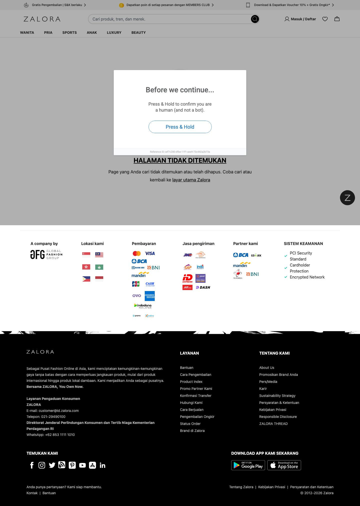

**대표 상품 이미지** (상위 6장, 출처 URL 포함)

-  — 출처 <https://static-id.zacdn.com/next-assets/static-assets/images/logo/icon_mastercard.png>
-  — 출처 <https://static-id.zacdn.com/next-assets/static-assets/images/logo/icon_visa.png>
-  — 출처 <https://static-id.zacdn.com/next-assets/static-assets/images/logo/icon_ovo.png>

**페이지 메타 정보**

| page | title | description |
|---|---|---|
| [`new_women`](https://www.zalora.co.id/wanita/new-arrivals) | Halaman tidak ditemukan | ZALORA |  |

### 4.2 일본 _( Japan )_

- 한국 수출규모 순위: **#2** · region: `asia` · tier `1` · currency `JPY`
- 수집 사이트: **5개** (성공 4)
- 메모: K-패션 선호도 높고 온라인 패션몰 발달
#### [GU Japan](https://www.gu-global.com/jp/)

- URL: <https://www.gu-global.com/jp/>
- 페이지: **OK 1 · FAIL 0**

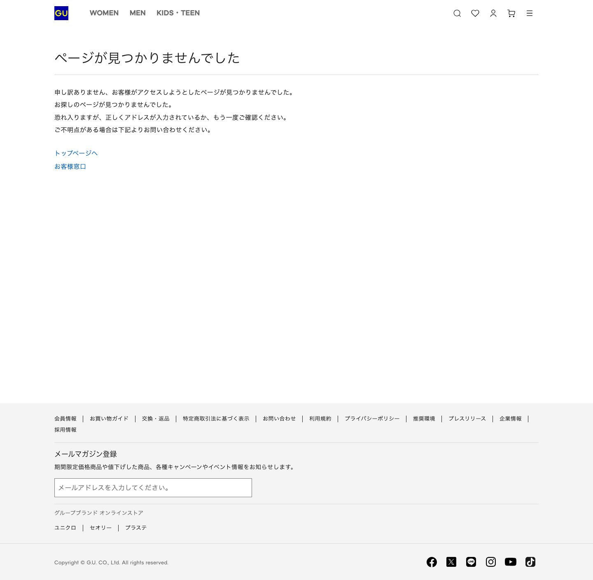

**대표 상품 이미지** (상위 6장, 출처 URL 포함)

-  — 출처 <https://image.uniqlo.com/GU/ST3/jp/imagesother/Navigation/Category-icon_V2/2026/Category_wmk_Kanshasai.png>
-  — 출처 <https://image.uniqlo.com/GU/ST3/jp/imagesother/Navigation/Category-icon_V2/2026/0724/Categoy_Limited-offers.jpg>
-  — 출처 <https://image.uniqlo.com/GU/ST3/jp/imagesother/Navigation/Category-icon_V2/2026/0724/Categoy_SALE.jpg>
-  — 출처 <https://image.uniqlo.com/GU/ST3/jp/imagesother/Navigation/collaboration_Category/26FW/rokh_category_icon.png>
-  — 출처 <https://image.uniqlo.com/GU/ST3/jp/imagesother/Navigation/WOMEN_Category/2026/261106/261106_category_w_outer_360434.png>
-  — 출처 <https://image.uniqlo.com/GU/ST3/jp/imagesother/Navigation/WOMEN_Category/2026/261008/category_w_knit-and-cardigan_360549.png>

**페이지 메타 정보**

| page | title | description |
|---|---|---|
| [`new_arrivals`](https://www.gu-global.com/jp/ja/not-found) | 申し訳ありません、お客様がアクセスしようとしたページが見つかりませんでした。恐れ入りますが、正しくアドレスが入力されているか、もう一度ご確認ください。 | ジーユー | 申し訳ありません、お客様がアクセスしようとしたページが見つかりませんでした。恐れ入りますが、正しくアドレスが入力されているか、もう一度ご確認ください。 |

#### [Rakuten Fashion](https://brandavenue.rakuten.co.jp/)

- URL: <https://brandavenue.rakuten.co.jp/>
- 페이지: **OK 1 · FAIL 1**

**대표 상품 이미지** (상위 6장, 출처 URL 포함)

-  — 출처 <https://brandavenue.r10s.jp/img/library/index/sbn_flagshipstore_20231003.png>
- 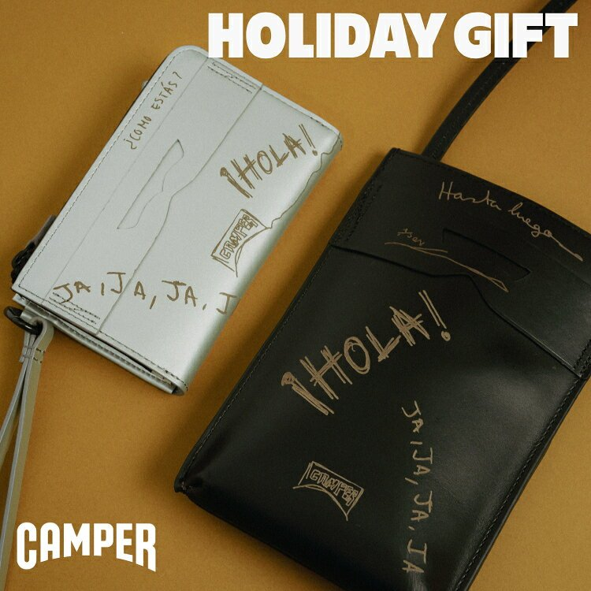 — 출처 <https://brandavenue.r10s.jp/img/news/01/409189/pc_n.jpg>
-  — 출처 <https://brandavenue.r10s.jp/img/news/01/408735/pc_n.jpg>
-  — 출처 <https://brandavenue.r10s.jp/img/news/01/408738/pc_n.jpg>
-  — 출처 <https://brandavenue.r10s.jp/img/news/01/408741/pc_n.jpg>
-  — 출처 <https://brandavenue.r10s.jp/img/news/01/408742/pc_n.jpg>

**페이지 메타 정보**

| page | title | description |
|---|---|---|
| [`men`](https://brandavenue.rakuten.co.jp/men/) | MEN | ファッション通販 Rakuten Fashion(楽天ファッション／旧楽天ブランドアベニュー) | Rakuten Fashion(楽天ファッション)は人気ブランドを取り扱うファッション通販サイトです。新作アイテム続々入荷！セール商品やクーポン対象商品も豊富。／税込3,980円以上購入で送料無料／楽天ポイントが使えて貯まる！ |

**실패 페이지**

- `women` — http_status_404

#### [Uniqlo Japan](https://www.uniqlo.com/jp/)

- URL: <https://www.uniqlo.com/jp/>
- 페이지: **OK 1 · FAIL 0**

**페이지 메타 정보**

| page | title | description |
|---|---|---|
| [`new_arrivals`](https://www.uniqlo.com/jp/ja/contents/feature/new-arrivals/) | 404 Not Found |  |

#### [WEAR](https://wear.jp/)

- URL: <https://wear.jp/>
- 페이지: **OK 1 · FAIL 0**

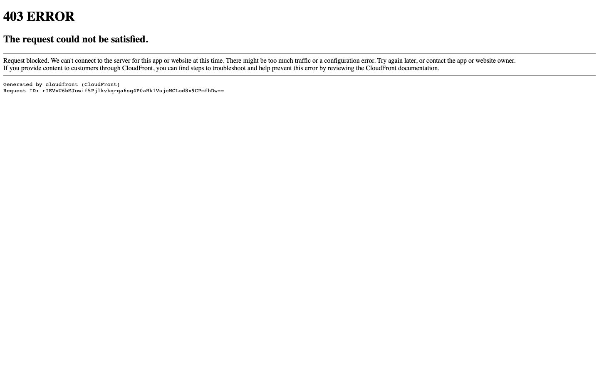

**페이지 메타 정보**

| page | title | description |
|---|---|---|
| [`ranking`](https://wear.jp/ranking/coordinate/) | ERROR: The request could not be satisfied |  |

#### [ZOZOTOWN](https://zozo.jp/)

- URL: <https://zozo.jp/>
- 페이지: **OK 0 · FAIL 2**

**실패 페이지**

- `new` — playwright_error: TimeoutError: Page.goto: Timeout 30000ms exceeded.
Call log:
  - navigating to "https://zozo.jp/category/new/", waiting until "domcontentloaded"

- `ranking` — playwright_error: TimeoutError: Page.goto: Timeout 30000ms exceeded.
Call log:
  - navigating to "https://zozo.jp/ranking/", waiting until "domcontentloaded"

### 4.3 한국 _( South Korea )_

- 한국 수출규모 순위: **#30** · region: `asia` · tier `1` · currency `KRW`
- 수집 사이트: **4개** (성공 3)
- 메모: 비교 기준 (자국). 국내 사업동향 센싱
#### [29CM](https://www.29cm.co.kr/)

- URL: <https://www.29cm.co.kr/>
- 페이지: **OK 1 · FAIL 0**

**최근 유행 상품** (50건 · 상품명 클릭 시 해당 사이트로 이동)

| # | 상품명 | 브랜드 | 가격 | 페이지 |
|---:|---|---|---:|---|
| 1 | [LEMNOS 렘노스 Draw 드로우 벽시계](https://product.29cm.co.kr/catalog/4327951) | 렘노스 | 84,280 KRW | `home` |
| 2 | [LEMNOS 렘노스 City Pop S 시티팝 스몰 알람시계](https://product.29cm.co.kr/catalog/4327766) | 렘노스 | 72,670 KRW | `home` |
| 3 | [LEMNOS 렘노스 KEHAI 케하이 벽시계](https://product.29cm.co.kr/catalog/4309237) | 렘노스 | 111,800 KRW | `home` |
| 4 | [[Monthly Color] 11월 Cappuccino Brown 큐브 시리즈 모듈선반](https://product.29cm.co.kr/catalog/4354567) | 킷투 | 342,210 KRW | `home` |
| 5 | [Mix Color 컬러 조합 가능한 큐브 시리즈 모듈선반](https://product.29cm.co.kr/catalog/4123374) | 킷투 | 214,440 KRW | `home` |
| 6 | [Manta Black 큐브 시리즈 모듈선반](https://product.29cm.co.kr/catalog/4226783) | 킷투 | 129,600 KRW | `home` |
| 7 | [[라이프데이 혜택증정]캄포[미니] 4인소파+스툴](https://product.29cm.co.kr/catalog/2969700) | 까사미아 | 1,850,000 KRW | `home` |
| 8 | [[라이프데이 혜택증정]캄포[미니] 4인소파](https://product.29cm.co.kr/catalog/2969701) | 까사미아 | 1,520,000 KRW | `home` |
| 9 | [[라이프데이 혜택증정]캄포구스30 [슬림] 4인소파+스툴](https://product.29cm.co.kr/catalog/3579375) | 까사미아 | 2,901,000 KRW | `home` |
| 10 | [아르떼미데 네시노 Green 단스탠드 조명 Nessino Table Lamp Green(전구포함)](https://product.29cm.co.kr/catalog/3176961) | 아르떼미데 | 432,000 KRW | `home` |
| 11 | [아르떼미데 톨로메오 핀자 집게 조명 Tolomeo Pinza Wall Lamp(LED전구포함)](https://product.29cm.co.kr/catalog/2729321) | 아르떼미데 | 396,000 KRW | `home` |
| 12 | [아르떼미데 톨로메오 메가 플로어 크림 42 Tolomeo Mega Floor Cream 42 디밍전구포함(무상설치)](https://product.29cm.co.kr/catalog/2382579) | 아르떼미데 | 1,890,000 KRW | `home` |
| 13 | [[모베x샐리홈 29CM 단독 공구]모노 모션베드 슈퍼싱글 퀸 트윈](https://product.29cm.co.kr/catalog/4347942) | 모베 모션베드 | 2,190,000 KRW | `home` |
| 14 | [모베 모션베드 헤라 Q 퀸 스마트침대](https://product.29cm.co.kr/catalog/4212431) | 모베 모션베드 | 1,050,000 KRW | `home` |
| 15 | [모베 모션베드 플러피 TW 트윈침대 스마트침대](https://product.29cm.co.kr/catalog/4213573) | 모베 모션베드 | 3,090,000 KRW | `home` |
| 16 | [캐스터네츠 책장 캣타워 (1200폭 6단, 쿠션형)](https://product.29cm.co.kr/catalog/2300628) | 일룸 | 449,100 KRW | `home` |
| 17 | [세르크 1200폭 콘솔형 책장](https://product.29cm.co.kr/catalog/2282771) | 일룸 | 215,100 KRW | `home` |
| 18 | [플란테 1000폭 벤치 선반장](https://product.29cm.co.kr/catalog/4094894) | 일룸 | 224,100 KRW | `home` |
| 19 | [오크빌 위빙 2단 미니수납장](https://product.29cm.co.kr/catalog/4217329) | 오크빌 | 90,460 KRW | `home` |
| 20 | [오테카 원목 책장 낮은 1200](https://product.29cm.co.kr/catalog/4312523) | 오크빌 | 249,360 KRW | `home` |

**대표 상품 이미지** (상위 6장, 출처 URL 포함)

-  — 출처 <https://img.29cm.co.kr/cms/202611/11f1de420ab35a1597a835b39d70f15b.jpg?width=3840&format=webp>
- 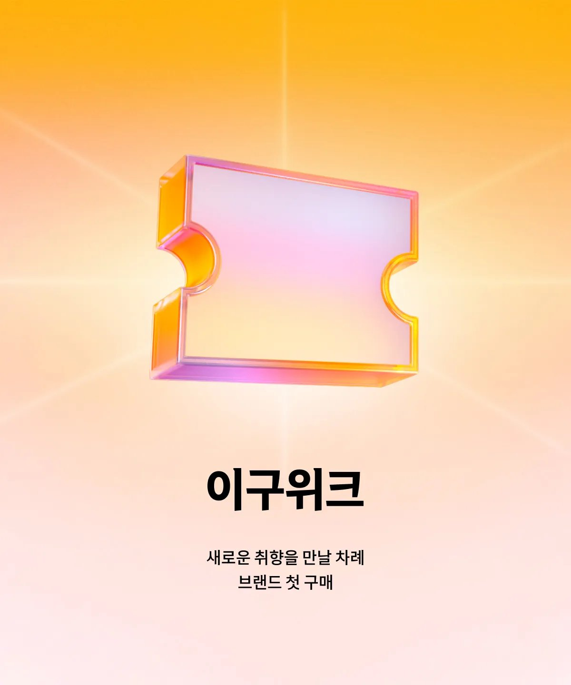 — 출처 <https://img.29cm.co.kr/cms/202611/11f1de420375de70aa2d777935d6e236.jpg?width=3840&format=webp>
- 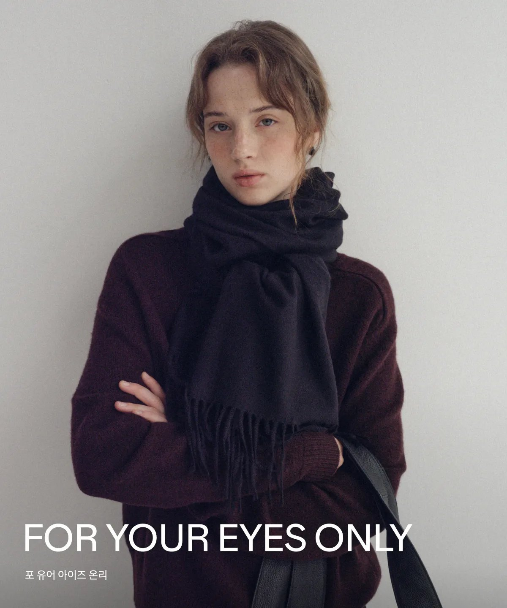 — 출처 <https://img.29cm.co.kr/cms/202611/11f1de41f7ffe838aa2d99e08f21d583.jpg?width=3840&format=webp>
- 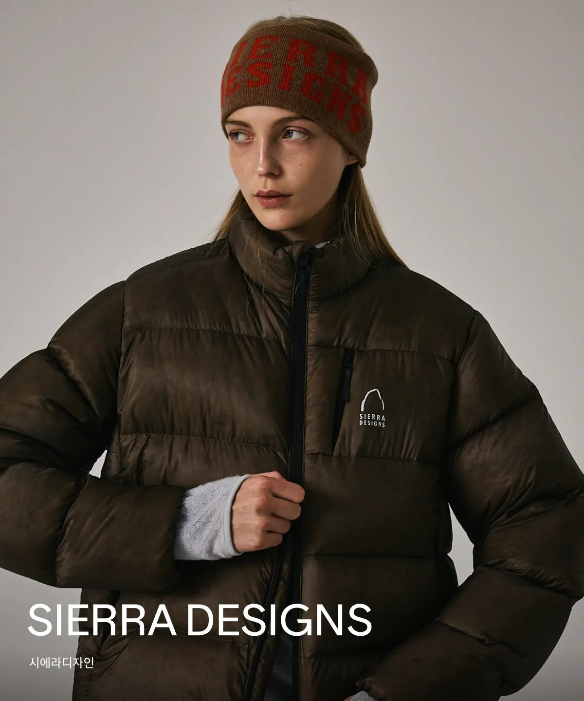 — 출처 <https://img.29cm.co.kr/cms/202611/11f1de41eea1fdc197a8ddc71a532492.jpg?width=3840&format=webp>
- 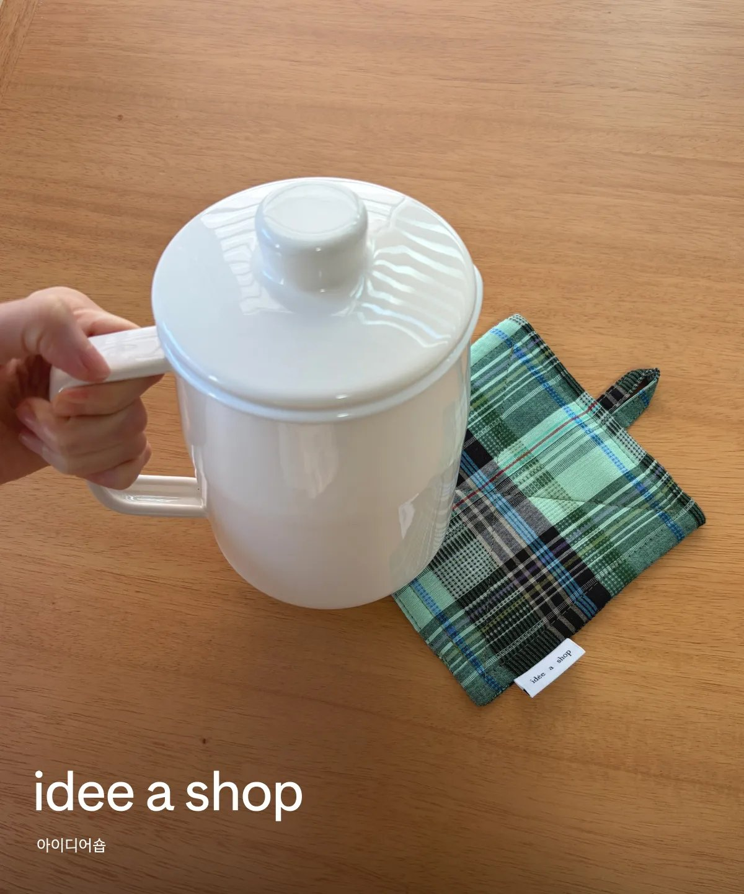 — 출처 <https://img.29cm.co.kr/cms/202611/11f1de41e51b2dfeaa2d5b98fc94b310.jpg?width=3840&format=webp>
- 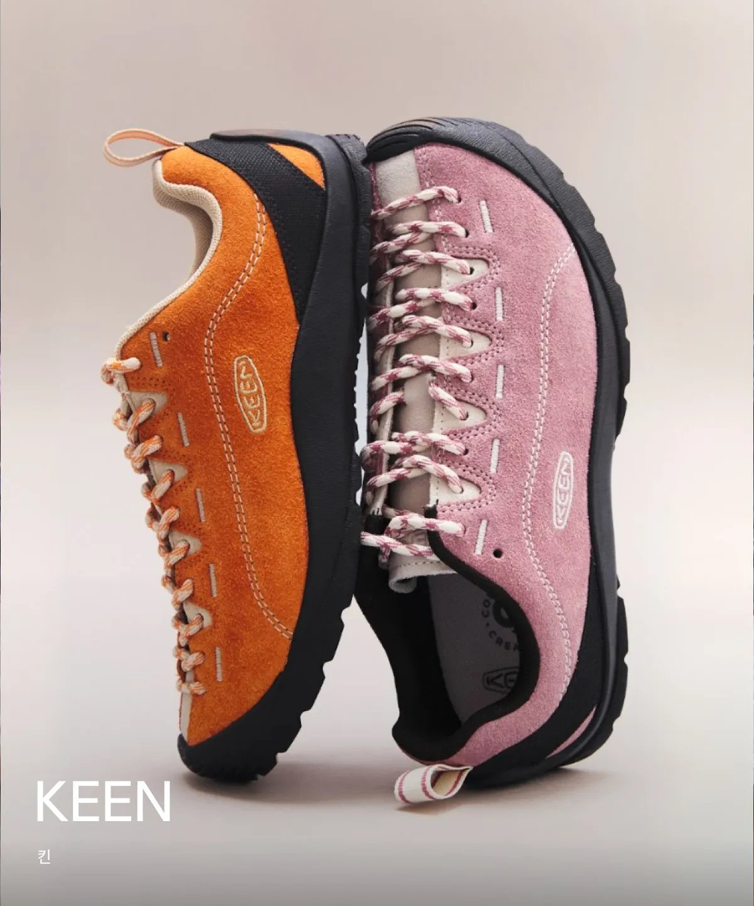 — 출처 <https://img.29cm.co.kr/cms/202611/11f1de41dbee8b9e97a82979bf8c9296.jpg?width=3840&format=webp>

**페이지 메타 정보**

| page | title | description |
|---|---|---|
| [`home`](https://www.29cm.co.kr/) | 모든 취향 곁에, 29CM | 패션, 라이프스타일, 컬처까지 29CM만의 감도 깊은 셀렉션을 만나보세요. |

#### [Musinsa](https://www.musinsa.com/)

- URL: <https://www.musinsa.com/>
- 페이지: **OK 0 · FAIL 1**

**실패 페이지**

- `home` — robots_disallowed

#### [W Concept](https://www.wconcept.co.kr/)

- URL: <https://www.wconcept.co.kr/>
- 페이지: **OK 1 · FAIL 0**

**최근 유행 상품** (30건 · 상품명 클릭 시 해당 사이트로 이동)

| # | 상품명 | 브랜드 | 가격 | 페이지 |
|---:|---|---|---:|---|
| 1 | [[5차 리오더][버터 단독]마리 하프 울 코트 / MARY HALF WOOL COAT_3colors](https://m.wconcept.co.kr/Product/302138970) | 룩캐스트 | 200,670 KRW | `home` |
| 2 | [[단독][소량 재오픈] 몬드리 덕 다운 패딩  / MONDRY DUCK DOWN PADDING_2colors](https://m.wconcept.co.kr/Product/306110002) | 룩캐스트 | 130,872 KRW | `home` |
| 3 | [[5차 리오더] 알렉스 롱부츠_블랙 / ALEX LONG BOOTS_BLACK](https://m.wconcept.co.kr/Product/306028747) | 룩캐스트 | 71,820 KRW | `home` |
| 4 | [리나 울 쇼츠_차콜 / LINA WOOL SHORT_CHARCOAL](https://m.wconcept.co.kr/Product/307517990) | 룩캐스트 | 64,638 KRW | `home` |
| 5 | [[단독]나틸다 울 플리츠 롱 스커트_차콜 / NATILDA WOOL PLEATS LONG SKIRT_CHARCOAL](https://m.wconcept.co.kr/Product/307518078) | 룩캐스트 | 82,593 KRW | `home` |
| 6 | [울 하이넥 타이 티셔츠 / WOOL HIGH NECK TIE T-SHIRT_3colors](https://m.wconcept.co.kr/Product/309024731) | 룩캐스트 | 34,753 KRW | `home` |
| 7 | [[그레이 단독]캐시미어 딥 브이넥 카라 니트 / CASHMERE DEEP V-NECK COLLAR KNIT_5colors](https://m.wconcept.co.kr/Product/309024718) | 룩캐스트 | 86,157 KRW | `home` |
| 8 | [[단독] 앙고라 울 하이넥 더플 코트_차콜 / ANGORA WOOL HIGH NECK DUFFLE COAT_CHARCOAL](https://m.wconcept.co.kr/Product/309113820) | 룩캐스트 | 211,576 KRW | `home` |
| 9 | [[6차 리오더]리앤 울 핸드메이드 하프 코트 / LEANNE WOOL HANDMADE HALF COAT_4colors](https://m.wconcept.co.kr/Product/306028904) | 룩캐스트 | 162,499 KRW | `home` |
| 10 | [[5차 리오더][안감누빔] 베이비 알파카 트위드 자켓 / BABY ALPACA TWEED JACKET_2colors](https://m.wconcept.co.kr/Product/303353236) | 룩캐스트 | 160,398 KRW | `home` |
| 11 | [[5차 리오더]소이 울 싱글 코트 / SOY WOOL SINGLE COAT_3colors](https://m.wconcept.co.kr/Product/301419521) | 룩캐스트 | 172,368 KRW | `home` |
| 12 | [엘르 비건 레더 벨트 / ELLE VEGAN LEATHER BELT_4colors](https://m.wconcept.co.kr/Product/306028730) | 룩캐스트 | 17,955 KRW | `home` |
| 13 | [[단독][3차 리오더]나틸다 울 플리츠 롱 스커트_블랙 / NATILDA WOOL PLEATS LONG SKIRT_BLACK](https://m.wconcept.co.kr/Product/307518074) | 룩캐스트 | 82,593 KRW | `home` |
| 14 | [[아이보리 단독] 울 헤어리 레이어드 니트 탑 / WOOL HAIRY LAYERED KNIT TOP_3colors](https://m.wconcept.co.kr/Product/309024723) | 룩캐스트 | 100,548 KRW | `home` |
| 15 | [[단독]캐시미어 딥 브이넥 니트 / CASHMERE DEEP V-NECK KNIT_5colors](https://m.wconcept.co.kr/Product/308892198) | 룩캐스트 | 89,017 KRW | `home` |
| 16 | [오웬 랩 스커트 팬츠 / OWEN WRAP SKIRT PANTS_2colors](https://m.wconcept.co.kr/Product/307518081) | 룩캐스트 | 64,638 KRW | `home` |
| 17 | [[버터 단독][5차 리오더] 레이어 알파카 자켓 / LAYER ALPACA JACKET_2colors](https://m.wconcept.co.kr/Product/307518229) | 룩캐스트 | 190,323 KRW | `home` |
| 18 | [[단독][4차 리오더] 에일린 울 핸드메이드 자켓 / AILEEN WOOL HANDMADE JACKET_3colors](https://m.wconcept.co.kr/Product/307329760) | 룩캐스트 | 118,503 KRW | `home` |
| 19 | [울 홀가먼트 하이 넥 베스트 니트 탑 / WOOL WHOLEGARMENT HIGH NECK VEST KNIT TOP_5colors](https://m.wconcept.co.kr/Product/309024722) | 룩캐스트 | 69,665 KRW | `home` |
| 20 | [[차콜 단독][캐시미어 10%] 울 핸드메이드 드레이프 하이넥 하프 코트 / WOOL HANDMADE DRAPE HIGH NECK HALF COAT_3colors](https://m.wconcept.co.kr/Product/309024748) | 룩캐스트 | 172,368 KRW | `home` |

**페이지 메타 정보**

| page | title | description |
|---|---|---|
| [`home`](https://www.wconcept.co.kr/) | _(empty)_ |  |

#### [Zigzag](https://zigzag.kr/)

- URL: <https://zigzag.kr/>
- 페이지: **OK 1 · FAIL 0**

**최근 유행 상품** (36건 · 상품명 클릭 시 해당 사이트로 이동)

| # | 상품명 | 브랜드 | 가격 | 페이지 |
|---:|---|---|---:|---|
| 1 | [[🍁가을/3기장선택!] made. 모먼트 투커버 올데이슬랙스 (+숏/베이직/롱ver) - 4 size](https://store.zigzag.kr/app/catalog/products/136095576?browsing_type=NATIVE_BROWSER) | 슬로우앤드 | 31,840 KRW | `home` |
| 2 | [[🏆팬츠1위🏆누적6만장][🔥+기모/S~L/2기장] 밸런스 데일리 팬츠 / 부츠컷추리닝 / 부츠컷트레이닝 / 기모팬츠 / 겨울바지 / 융기모바지 / 와이드팬츠 / 부츠컷기모](https://store.zigzag.kr/app/catalog/products/168688249?browsing_type=NATIVE_BROWSER) | 코코블랑 | 23,920 KRW | `home` |
| 3 | [[기모추가🔥/50만장돌파/자체제작] 허쉬 코튼 와이드팬츠 (숏/기본/롱)](https://store.zigzag.kr/app/catalog/products/143224732?browsing_type=NATIVE_BROWSER) | 리얼코코 | 13,640 KRW | `home` |
| 4 | [[다송pick][이지룩][기모][ofm] 이지 트레이닝 롱 스커트 (sk)](https://store.zigzag.kr/app/catalog/products/167660806?browsing_type=NATIVE_BROWSER) | 메리어라운드 | 23,920 KRW | `home` |
| 5 | [[예약 순차배송][인생퍼자켓/여돌손민수템] 시프네 더블 버튼 퍼 자켓 ( 3 colors )](https://store.zigzag.kr/app/catalog/products/166283667?browsing_type=NATIVE_BROWSER) | 레터프롬문 | 131,670 KRW | `home` |
| 6 | [[made]모먼트울쇼츠](https://store.zigzag.kr/app/catalog/products/167600416?browsing_type=NATIVE_BROWSER) | 어텀 | 20,800 KRW | `home` |
| 7 | [메리브이넥니트](https://store.zigzag.kr/app/catalog/products/172502142?browsing_type=NATIVE_BROWSER) | 어텀 | 20,800 KRW | `home` |
| 8 | [[✨매일입어요] made. 솔트 클린 긴팔티셔츠 (스탠다드핏/루즈핏) - 6 color](https://store.zigzag.kr/app/catalog/products/148608703?browsing_type=NATIVE_BROWSER) | 슬로우앤드 | 17,820 KRW | `home` |
| 9 | [[울70] 핸드메이드 롱코트_MIWJHGV1PB](https://store.zigzag.kr/app/catalog/products/171904453?browsing_type=NATIVE_BROWSER) | 미쏘 | 159,150 KRW | `home` |
| 10 | [[울90%+캐시미어10%] [DEMOOR] 베니스 하이넥 캐시미어 핸드메이드 하프 코트](https://store.zigzag.kr/app/catalog/products/172550952?browsing_type=NATIVE_BROWSER) | 드무어 | 159,370 KRW | `home` |
| 11 | [(자체제작) 먼크 발마칸코트 하이넥 겨울 울 키작녀롱코트](https://store.zigzag.kr/app/catalog/products/173210848?browsing_type=NATIVE_BROWSER) | 르아느 | 170,280 KRW | `home` |
| 12 | [[🖤블프특가][겨울하객룩][2만장돌파/트임걱정ZERO] made 포이즈 H라인 랩 롱 스커트 SK166](https://store.zigzag.kr/app/catalog/products/168536695?browsing_type=NATIVE_BROWSER) | 텐가트 | 24,170 KRW | `home` |
| 13 | [[울50] 울블렌디드 하프코트_MIWJHGV3PG](https://store.zigzag.kr/app/catalog/products/171900742?browsing_type=NATIVE_BROWSER) | 미쏘 | 79,910 KRW | `home` |
| 14 | [정다빈,소미pick [7만장돌파][S,M/탈부착패딩내피][MADE] 알파카 히든 핸드메이드 롱 코트](https://store.zigzag.kr/app/catalog/products/128615515?browsing_type=NATIVE_BROWSER) | 디어먼트 | 157,500 KRW | `home` |
| 15 | [[ HANDMADE ] 칸 헤비웨이트 라운드 하프코트](https://store.zigzag.kr/app/catalog/products/173243881?browsing_type=NATIVE_BROWSER) | 아워리 | 110,800 KRW | `home` |
| 16 | [[울70] 핸드메이드 하이넥 숏코트_MIWJHGV31B](https://store.zigzag.kr/app/catalog/products/171946196?browsing_type=NATIVE_BROWSER) | 미쏘 | 143,150 KRW | `home` |
| 17 | [에드 울 반팔 니트](https://store.zigzag.kr/app/catalog/products/173254219?browsing_type=NATIVE_BROWSER) | 더보느 | 44,000 KRW | `home` |
| 18 | [슬림핏 유넥 겨울 발열 히트텍 이너 티셔츠 내의 4color](https://store.zigzag.kr/app/catalog/products/115859598?browsing_type=NATIVE_BROWSER) | 예핏 | 14,850 KRW | `home` |
| 19 | [[겨울하객룩✨][MADE]드넬 하이넥 타이 블라우스[3color]](https://store.zigzag.kr/app/catalog/products/167182302?browsing_type=NATIVE_BROWSER) | 슬로우리스트 | 36,720 KRW | `home` |
| 20 | [[히든포켓✨/자체제작] UTMOST 드로인 알파카 히든 핸드메이드 코트](https://store.zigzag.kr/app/catalog/products/150026968?browsing_type=NATIVE_BROWSER) | 리얼코코 | 157,430 KRW | `home` |

**페이지 메타 정보**

| page | title | description |
|---|---|---|
| [`home`](https://zigzag.kr/) | _(empty)_ |  |

### 4.4 대만 _( Taiwan )_

- 한국 수출규모 순위: **#7** · region: `asia` · tier `1` · currency `TWD`
- 수집 사이트: **5개** (성공 5)
- 메모: K-패션 친화도 높음
#### [momo](https://www.momoshop.com.tw/)

- URL: <https://www.momoshop.com.tw/>
- 페이지: **OK 1 · FAIL 0**

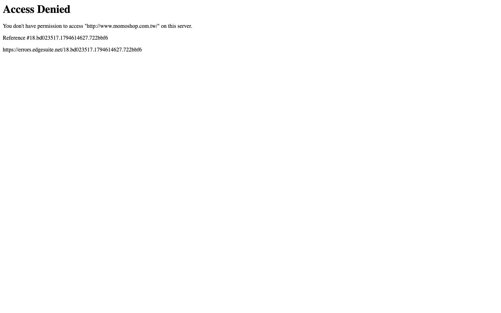

**페이지 메타 정보**

| page | title | description |
|---|---|---|
| [`home`](https://www.momoshop.com.tw/) | Access Denied |  |

#### [OB Design](https://www.obdesign.com.tw/)

- URL: <https://www.obdesign.com.tw/>
- 페이지: **OK 1 · FAIL 0**

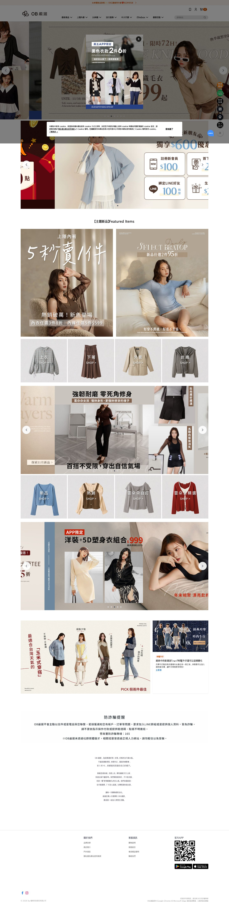

**대표 상품 이미지** (상위 6장, 출처 URL 포함)

- 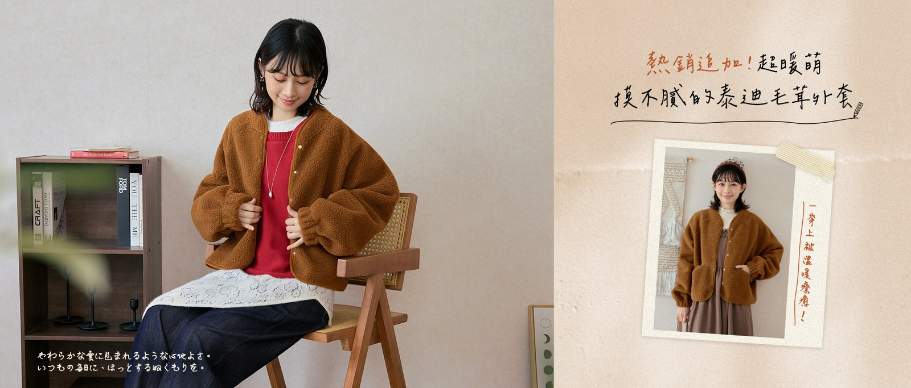 — 출처 <https://cms-static.cdn.91app.com/images/original/41602/92f19e4d-89b7-4330-9570-02cf1dff9742-1794290688-3rum8nrsiv_d_1920x820_1280x547_1124x480_800x342_600x256_400x171.jpg>
- 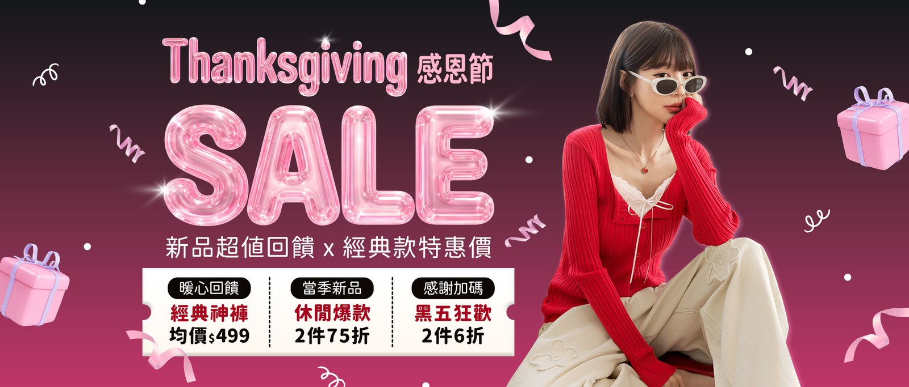 — 출처 <https://cms-static.cdn.91app.com/images/original/41602/92f19e4d-89b7-4330-9570-02cf1dff9742-1794534903-w0s0fz0ca4_d_1920x820_1280x547_1124x480_800x342_600x256_400x171.jpg>
- 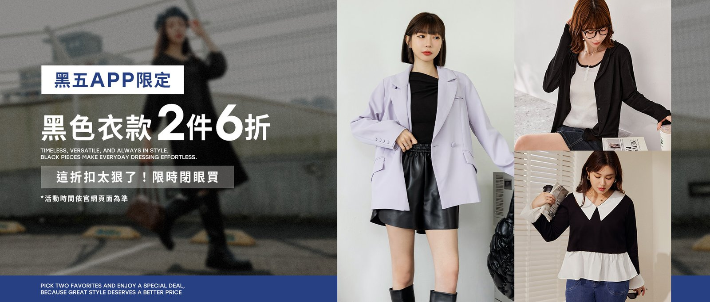 — 출처 <https://cms-static.cdn.91app.com/images/original/41602/92f19e4d-89b7-4330-9570-02cf1dff9742-1794534867-6drun5zyc4_d_1920x820_1280x547_1124x480_800x342_600x256_400x171.jpg>
- 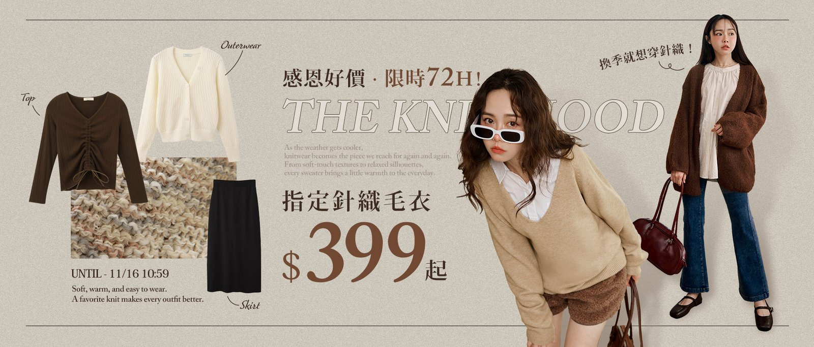 — 출처 <https://cms-static.cdn.91app.com/images/original/41602/92f19e4d-89b7-4330-9570-02cf1dff9742-1794534942-p7ileh8xvh_d_1920x820_1280x547_1124x480_800x342_600x256_400x171.jpg>
- 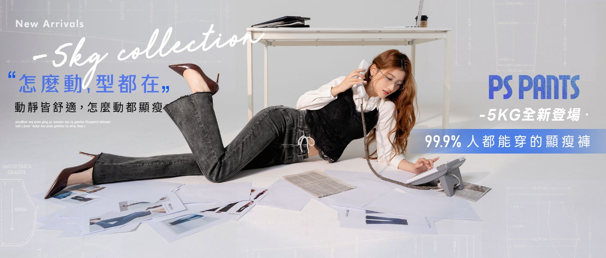 — 출처 <https://cms-static.cdn.91app.com/images/original/41602/92f19e4d-89b7-4330-9570-02cf1dff9742-1794278808-dn1wmx9ffo_d_1920x820_1280x547_1124x480_800x342_600x256_400x171.jpg>
- 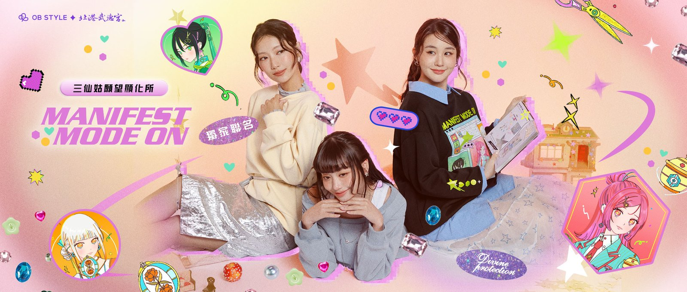 — 출처 <https://cms-static.cdn.91app.com/images/original/41602/92f19e4d-89b7-4330-9570-02cf1dff9742-1794536405-wtfzxkcvms_d_1920x820_1280x547_1124x480_800x342_600x256_400x171.jpg>

**페이지 메타 정보**

| page | title | description |
|---|---|---|
| [`home`](https://www.obdesign.com.tw/) | OB嚴選｜高CP值人氣熱銷服飾，流行服飾品牌 | 你的日常穿搭好夥伴，快上OB嚴選找，OB嚴選提供女裝、孕童、運動、男裝各項流行服飾，秉持優質服務給你高CP值的購物體驗。各種風格都能滿足熱愛穿搭的你，天天上新品，快速出貨，一起加入OB style！網路人氣服飾品牌OB嚴選 |

#### [PChome](https://24h.pchome.com.tw/)

- URL: <https://24h.pchome.com.tw/>
- 페이지: **OK 1 · FAIL 0**

**페이지 메타 정보**

| page | title | description |
|---|---|---|
| [`home`](https://24h.pchome.com.tw/) | PChome 24h購物 |  |

#### [Pinkoi Taiwan](https://www.pinkoi.com/)

- URL: <https://www.pinkoi.com/>
- 페이지: **OK 2 · FAIL 0**

**대표 상품 이미지** (상위 6장, 출처 URL 포함)

-  — 출처 <https://cdn04.pinkoi.com/pinkoi.site/logo/og_image.png>

**페이지 메타 정보**

| page | title | description |
|---|---|---|
| [`accessories`](https://en.pinkoi.com/) | Pinkoi | Asia’s cross-border design marketplace | Design the way you are | Shop for original design products from Asia's independent designers. Pinkoi lives and breathes great design, great quality, great service, a |
| [`bags`](https://en.pinkoi.com/) | Pinkoi | Asia’s cross-border design marketplace | Design the way you are | Shop for original design products from Asia's independent designers. Pinkoi lives and breathes great design, great quality, great service, a |

#### [Yahoo Taiwan Shopping](https://tw.buy.yahoo.com/)

- URL: <https://tw.buy.yahoo.com/>
- 페이지: **OK 1 · FAIL 0**

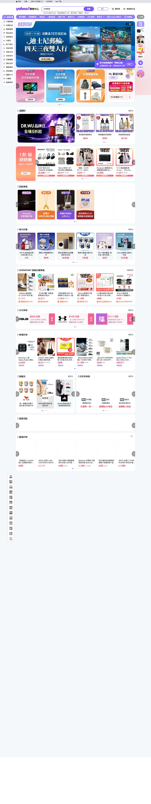

**대표 상품 이미지** (상위 6장, 출처 URL 포함)

- 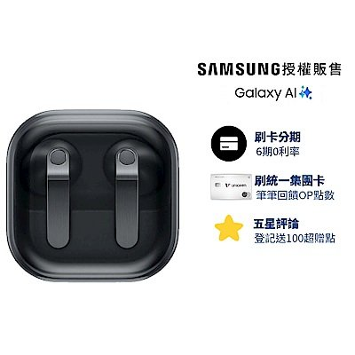 — 출처 <https://img.yec.tw/zp/MerchandiseImages/64330314CE-Gd-11999180.jpg>
- 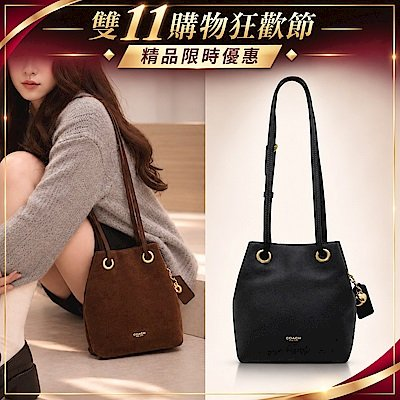 — 출처 <https://img.yec.tw/zp/MerchandiseImages/D33992E8F7-Gd-12289547.jpg>
- 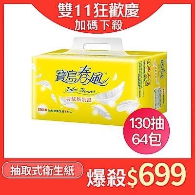 — 출처 <https://img.yec.tw/zp/MerchandiseImages/EE46D7C671-Gd-7746830.jpg>
-  — 출처 <https://img.yec.tw/up/uploadr/00u21hvmzmjMvuwgh1d8/SHP/mario/270x270_1.gif>

**페이지 메타 정보**

| page | title | description |
|---|---|---|
| [`home`](https://tw.buy.yahoo.com/) | Yahoo購物中心 - 最懂生活的人 | 數百萬件商品，貼心客服為您服務，15天鑑賞期購物保障！ |

### 4.5 태국 _( Thailand )_

- 한국 수출규모 순위: **#8** · region: `asia` · tier `1` · currency `THB`
- 수집 사이트: **5개** (성공 4)
- 메모: 동남아 K-패션 핵심 시장
#### [Central Online](https://www.central.co.th/)

- URL: <https://www.central.co.th/>
- 페이지: **OK 1 · FAIL 0**

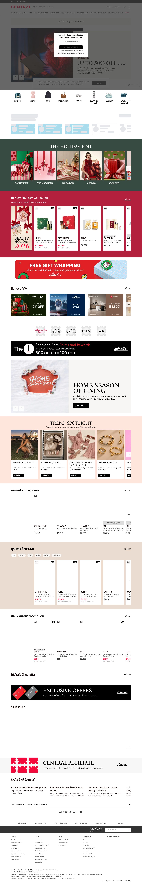

**대표 상품 이미지** (상위 6장, 출처 URL 포함)

- 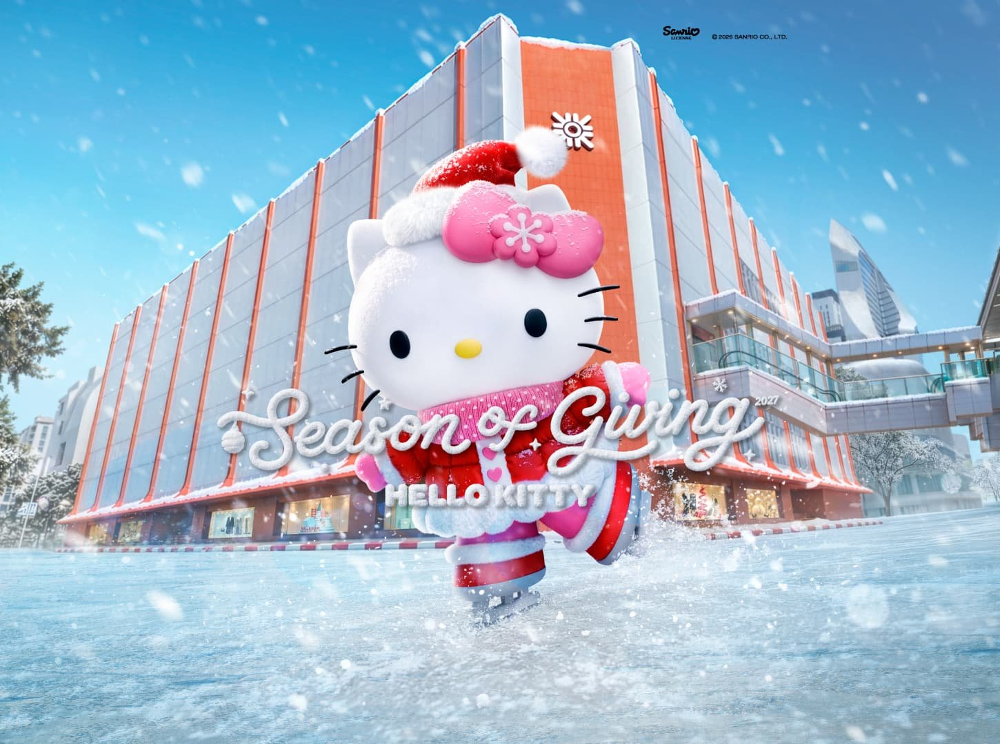 — 출처 <https://www.central.co.th/_next/image?url=https%3A%2F%2Fassets.central.co.th%2Ffile-assets%2Fassets%2FCMS%2Fcampaign%2F2026%2F11nov%2F20261103_mc_sog_heroweb_d.jpg&w=3840&q=75>
- 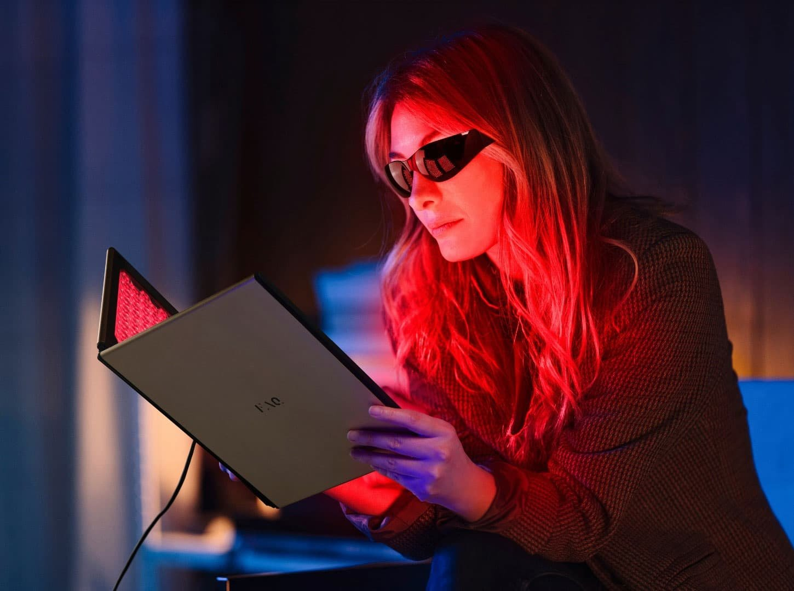 — 출처 <https://www.central.co.th/_next/image?url=https%3A%2F%2Fassets.central.co.th%2Ffile-assets%2Fassets%2FCMS%2Fcampaign%2F2026%2F11nov%2F20261114_foreo_heroweb_d.jpg&w=3840&q=75>
- 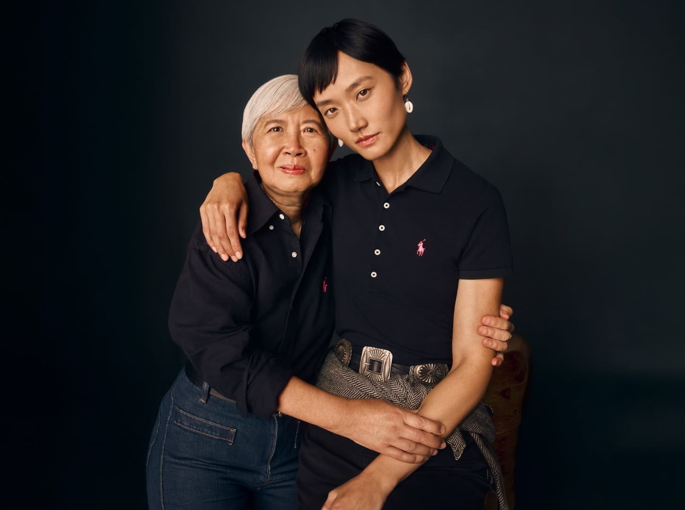 — 출처 <https://www.central.co.th/_next/image?url=https%3A%2F%2Fassets.central.co.th%2Ffile-assets%2Fassets%2FCMS%2Fcampaign%2F2026%2F11nov%2F20261101_polo_heroweb_d.jpg&w=3840&q=75>
- 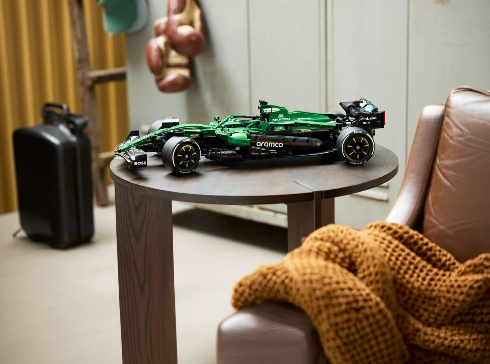 — 출처 <https://www.central.co.th/_next/image?url=https%3A%2F%2Fassets.central.co.th%2Ffile-assets%2Fassets%2FCMS%2Fcampaign%2F2026%2F11nov%2F20261101_lego_heroweb_d.jpg&w=3840&q=75>
- 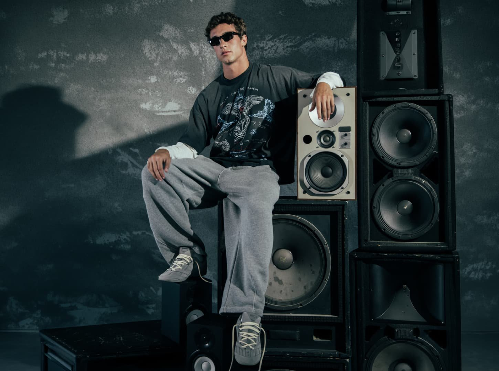 — 출처 <https://www.central.co.th/_next/image?url=https%3A%2F%2Fassets.central.co.th%2Ffile-assets%2Fassets%2FCMS%2Fcampaign%2F2026%2F11nov%2F20261109_represent_heroweb_d.jpg&w=3840&q=75>
-  — 출처 <https://www.central.co.th/_next/image?url=https%3A%2F%2Fassets.central.co.th%2Ffile-assets%2Fassets%2FCMS%2Fcampaign%2F2026%2F11nov%2F20261114_hermes_heroweb_d.jpg&w=3840&q=75>

**페이지 메타 정보**

| page | title | description |
|---|---|---|
| [`home`](https://www.central.co.th/th) | Central Online | 11.11 | ลดสูงสุด 70% + คูปองลดเพิ่ม 25% | 11.11 Sale โปรโมชั่นสุดยิ่งใหญ่ของปี 2026 เริ่มต้นขึ้นแล้ว! พบกับสินค้าจากหลากหลายแบรนด์ดังที่เราคัดสรรมาลดราคาสูงสุดถึง 70% พร้อมคูปองลดเพิ |

#### [Lazada Thailand Fashion](https://www.lazada.co.th/)

- URL: <https://www.lazada.co.th/>
- 페이지: **OK 1 · FAIL 0**

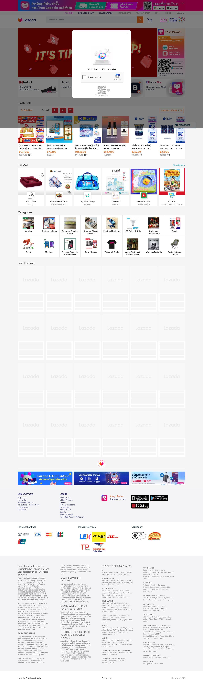

**대표 상품 이미지** (상위 6장, 출처 URL 포함)

-  — 출처 <https://img.lazcdn.com/us/domino/40845120240f19d13f738fa9a7978edd.png>
-  — 출처 <https://img.lazcdn.com/g/tps/images/ims-web/TB1KB2laMFY.1VjSZFnXXcFHXXa.png>
-  — 출처 <https://img.lazcdn.com/us/domino/5925a7aa-cc81-4caf-bd3b-4b6c951ad6a8_TH-1976-688.jpg_2200x2200q80.jpg>
-  — 출처 <https://img.lazcdn.com/us/domino/94cd9919-5ae7-4a39-b397-2062b59edf6f_TH-1976-688.jpg_2200x2200q80.jpg>
-  — 출처 <https://img.lazcdn.com/us/domino/998258a5-c5ad-4cea-96a7-749b37f65619_TH-1976-688.jpg_2200x2200q80.jpg>
-  — 출처 <https://img.lazcdn.com/us/domino/e0ea0af9-fae9-40b7-8d4c-cebc973e749e_TH-1976-688.jpg_2200x2200q80.jpg>

**페이지 메타 정보**

| page | title | description |
|---|---|---|
| [`home`](https://www.lazada.co.th/#?) | Lazada Thailand | ช้อปออนไลน์ สินค้าดี พร้อมดีลพิเศษทุกวัน | พบกับ Lazada แพลตฟอร์มช้อปปิ้งชั้นนำในอาเซียน พร้อมบริการเก็บเงินปลายทาง LazMall LazFlash และดีลเด็ดจากแบรนด์ดังทุกวัน |

#### [Pomelo](https://www.pomelofashion.com/)

- URL: <https://www.pomelofashion.com/>
- 페이지: **OK 0 · FAIL 2**

**실패 페이지**

- `new` — robots_disallowed
- `best` — robots_disallowed

#### [Shopee Thailand Fashion](https://shopee.co.th/)

- URL: <https://shopee.co.th/>
- 페이지: **OK 1 · FAIL 0**

**대표 상품 이미지** (상위 6장, 출처 URL 포함)

-  — 출처 <https://deo.shopeemobile.com/shopee/shopee-pcmall-live-sg/assets/1c8bdaaf45e1fd48.png>
-  — 출처 <https://deo.shopeemobile.com/shopee/shopee-pcmall-live-sg/homepagefe/42ba6075c82a85ab.png>

**페이지 메타 정보**

| page | title | description |
|---|---|---|
| [`home`](https://shopee.co.th/verify/captcha?anti_bot_tracking_id=gqRjZGVrxHSFomtptTE0MjUxOnRyYWNraW5nX2lkX2tleaJrdtEAAqRhbGdv0gAAAGSjZGVrwKJjdMRAAAAADIKMyZ1P2O2Qvasq83S5AwzeFIVi130gJEs0rzTO_4iwfIWyFzi6GeoS0al_i_SqWqJfxR5gmm_2D9B-AqpjaXBoZXJ0ZXh0xQOJAAAADEsYEJ_PBHMo6yc_xEh51Cl5Rrf1qkRCL9o8k6_MyK8lfJcR1-lPJdKGwyR7IFytO1Kbtw-GE1BxcWlp0XLywVyPwDa6H1z2taRuxkII8mfUqvh1bFhUf3krn9SRqh5Fn5jw8C35os_-_gQVmK68hJjYx9KaBSlQINu62gHif_UhruZSqVAm35Ou4q5spGOhUAK533m-8nC3HyAXkg5DePzl_ObLdaVZg9Kx7pyg7vHHloJlzTVOQhcRsGMLnmfNAiDs6E01IUblPwVq5rkwiXdyn_exjTGmvuD-xGrVo1rodvLcnnr5eMJ18I_TMeiwP05JLukwvQ2RpF-qp6c9Q09vBhhEgjXgWBCgAHaa7LmdALneZhBWjEKGvXWwfytkaztRSOJdkQWdr6ykKYXI1YaWpoT5zkRvQiolinKMTSTSEHNv_NaSZwATgh_muIS_RRpBjIh9VvNG7g_fQlM_ch0YlpAOIgAIh4tDhuIO9Ds10IazSvS7iv5K0sUJefnWPtDWUEsvl8Bruplh2O6besX26GTdt9bqszUizWc-_kJId5btSJIxGBuLHoAuoasXkheVPWweHQmchE-whKavRazekt8NlnTUALBc0D_dsioAvLzeo6VFov7X1rhKVXODUzyZ_HhyCNtqOS13_3TIk__FAYrYgjwiIVChuypRCc5WPvJJCAjIX3r1iQP5nXtyhazLJJGaiefiVW6476rhbfO4SvMkgH5NnCi_1wwalU0KFNPYy4Yn8TP95DjSVZ2K4w7KZC5kNE8tfTF6mvwPyKHzcTz9P8_uTsFVlG-OQJHt58DIohZKCAfioX7RUli7Gwv6o7B0czy1TUhlDSReLplPWpFtHmKBiFctzYiudHMqvt0BNExpnxOyYLJs2qCqww6sayDqLGl1LlNy_0Xj6V_U3zdrVt4wvaaefahgU1FKfHspuqSUsS85Ma4Ex4G7c2iHA0g_TQTK871KM4tMhD6jQyWx4LmfEWbABCIj9nIYTA2-bI3lG6RrCYjJJq6rdAlBs7G8o663ulTLTWNfAK64UIazDp28McUZVda9HnLH7OddD8w0mda-mCYZTETSHpNvOqNkQyoLbgK_DhAe-PZsaZpmWFztkb7SpyuxT2mJvmJ5Ixq3uomr9Xt4ONXNFIvJItBSEUagtFuAJp6W41L6egWR2iUj-7Db6THh52kho7f_JMs&app_key=FlashSale.PC&client_id=1&next=https%3A%2F%2Fshopee.co.th%2Fverify%2Ftraffic%3F%3Fclient_id%3D%26next%3Dhttps%253A%252F%252Fshopee.co.th%252F%26redirect_type%3D2%26should_replace_history%3Dfalse&redirect_type=2&scene=crawler_item&should_replace_history=false) | Shopee Thailand | ช้อปปิ้งออนไลน์ ผ่านมือถือและเว็บไซต์ | ซื้อทุกอย่างที่ Shopee! ช้อปปิ้งออนไลน์จบในที่เดียว ซื้อหรือขายก็ง่ายสุดๆ มีโปรและส่วนลดเพียบ การันตีโดย Shopee | ส่งฟรีทั่วไทย | เก็บเงินปล |

#### [Zalora Thailand](https://www.zalora.co.th/)

- URL: <https://www.zalora.co.th/>
- 페이지: **OK 1 · FAIL 0**

**대표 상품 이미지** (상위 6장, 출처 URL 포함)

-  — 출처 <https://www.zalora.co.th/images/landingpage/525x500.gif>

**페이지 메타 정보**

| page | title | description |
|---|---|---|
| [`home`](https://www.zalora.co.th/) | ZALORA - ASIA'S LEADING ONLINE FASHION DESTINATION |  |

### 4.6 미국 _( United States )_

- 한국 수출규모 순위: **#1** · region: `north_america` · tier `1` · currency `USD`
- 수집 사이트: **5개** (성공 4)
- 메모: 한국 의류 최대 수출국. 대형 이커머스와 브랜드 커머스 중심
#### [Etsy](https://www.etsy.com/)

- URL: <https://www.etsy.com/>
- 페이지: **OK 2 · FAIL 0**

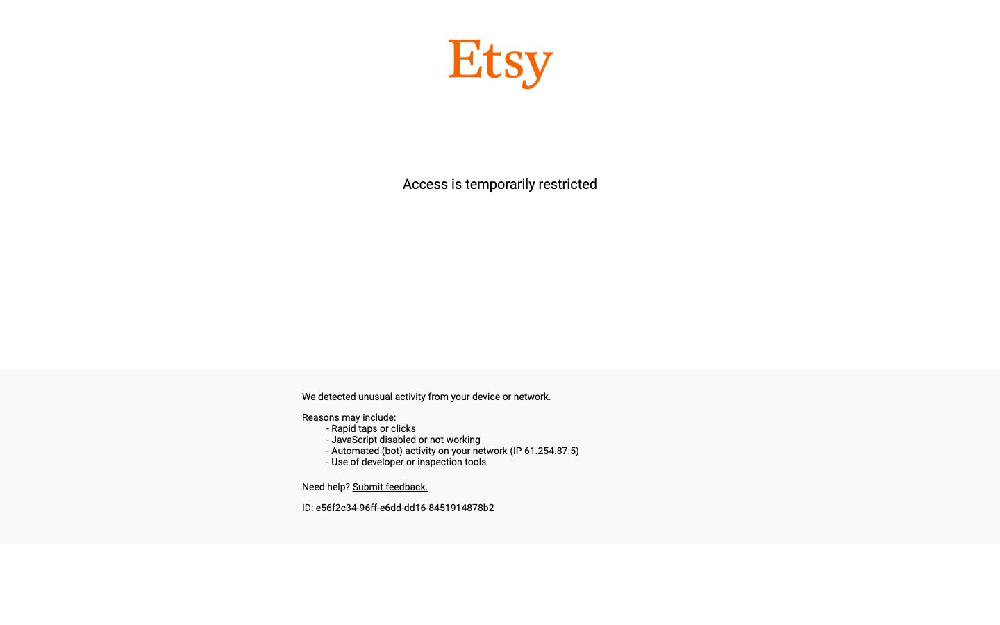

**페이지 메타 정보**

| page | title | description |
|---|---|---|
| [`trending_jewelry`](https://www.etsy.com/c/jewelry) | etsy.com |  |
| [`trending_accessories`](https://www.etsy.com/c/accessories) | etsy.com |  |

#### [Macy's](https://www.macys.com/)

- URL: <https://www.macys.com/>
- 페이지: **OK 1 · FAIL 0**

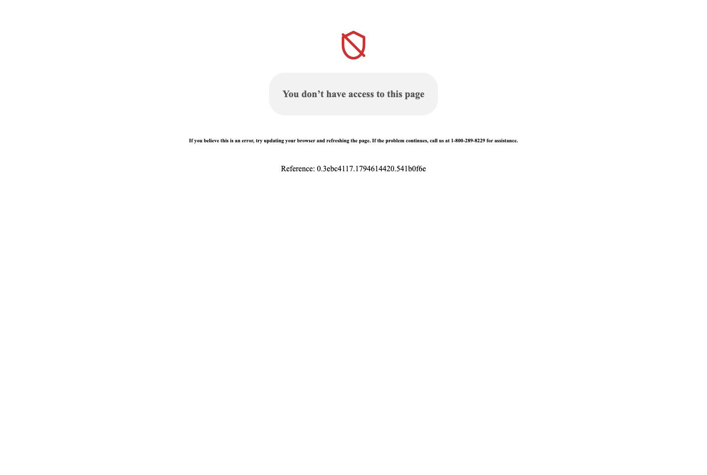

**페이지 메타 정보**

| page | title | description |
|---|---|---|
| [`new`](https://www.macys.com/shop/whats-new?id=14834) | Access Denied - Macy's | Access denied 403 |

#### [Nordstrom](https://www.nordstrom.com/)

- URL: <https://www.nordstrom.com/>
- 페이지: **OK 2 · FAIL 0**

**대표 상품 이미지** (상위 6장, 출처 URL 포함)

-  — 출처 <https://n.nordstrommedia.com/it/7f51c20a-b069-4154-9cfb-1e6d13a7c608.gif>
- 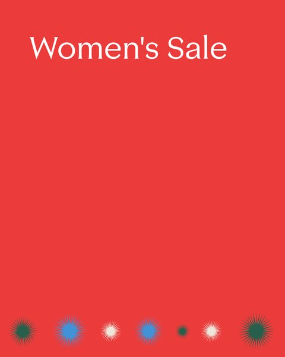 — 출처 <https://n.nordstrommedia.com/is/image/nordstrom/40_1-1_12586872.png?width=240&dpr=2&crop=1280%3A1600%2Coffset-x51.333%2Coffset-y50>
- 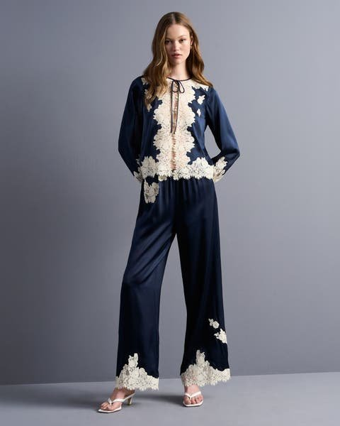 — 출처 <https://n.nordstrommedia.com/is/image/nordstrom/WMNS_ADC01F_1126_060_altBgd_ext_8-5.jpeg?width=240&dpr=2&crop=1532.928%3A1916.161%2Coffset-x50%2Coffset-y50&trim=0.042%2C0%2C0%2C0>
- 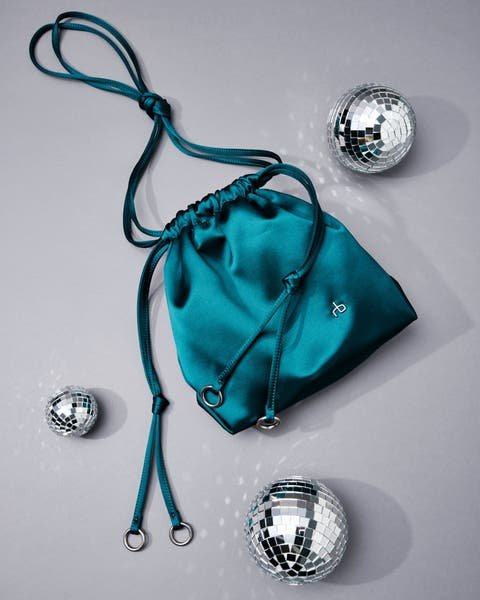 — 출처 <https://n.nordstrommedia.com/is/image/nordstrom/ACC_HDBG06P_1126.jpeg?width=240&dpr=2&crop=2135%3A2668.75%2Coffset-x50%2Coffset-y50>
- 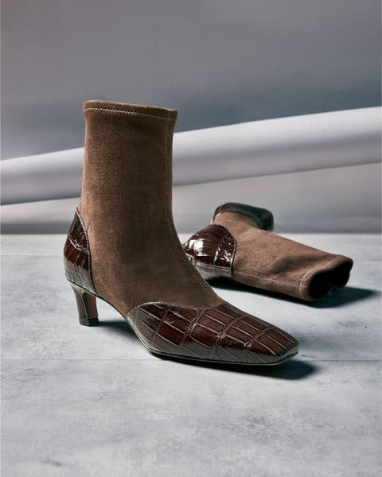 — 출처 <https://n.nordstrommedia.com/is/image/nordstrom/WSH_YC02P_0926_V1.jpeg?width=240&dpr=2&crop=5357%3A6696.25%2Coffset-x50%2Coffset-y50>
-  — 출처 <https://n.nordstrommedia.com/is/image/nordstrom/FRA_FRGW03P_1126.jpeg?width=240&dpr=2&crop=1448.013%3A1810.016%2Coffset-x64.11%2Coffset-y50&trim=0%2C0%2C0.154%2C0>

**페이지 메타 정보**

| page | title | description |
|---|---|---|
| [`new`](https://www.nordstrom.com/browse/new) | _(empty)_ |  |
| [`women`](https://www.nordstrom.com/browse/women) | Women's Clothing, Shoes, & Accessories | Nordstrom | Find a great selection of Women's Clothing, Shoes, & Accessories at Nordstrom.com. Shop popular brands and top designers. |

#### [Revolve](https://www.revolve.com/)

- URL: <https://www.revolve.com/>
- 페이지: **OK 0 · FAIL 2**

**실패 페이지**

- `new` — playwright_error: Error: Page.goto: net::ERR_HTTP2_PROTOCOL_ERROR at https://www.revolve.com/new/br/c79f88/
Call log:
  - navigating to "https://www.revolve.com/new/br/c79f88/", waiting until "domcontentloaded"

- `trending` — playwright_error: Error: Page.goto: net::ERR_HTTP2_PROTOCOL_ERROR at https://www.revolve.com/most-loved/br/4a9ca5/
Call log:
  - navigating to "https://www.revolve.com/most-loved/br/4a9ca5/", waiting until "domcontentloaded"

#### [Urban Outfitters](https://www.urbanoutfitters.com/)

- URL: <https://www.urbanoutfitters.com/>
- 페이지: **OK 1 · FAIL 0**

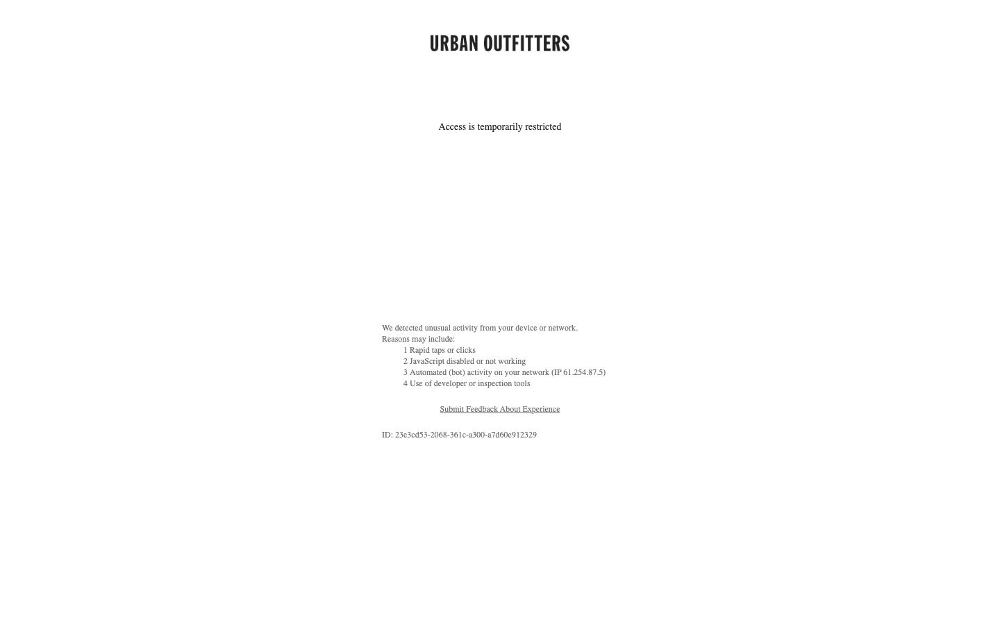

**페이지 메타 정보**

| page | title | description |
|---|---|---|
| [`new_women`](https://www.urbanoutfitters.com/womens-new-arrivals) | urbanoutfitters.com |  |

### 4.7 베트남 _( Vietnam )_

- 한국 수출규모 순위: **#4** · region: `asia` · tier `1` · currency `VND`
- 수집 사이트: **5개** (성공 5)
- 메모: 의류 생산기지/원단 수출 비중 큼. 빠르게 성장하는 이커머스
#### [Canifa](https://canifa.com/)

- URL: <https://canifa.com/>
- 페이지: **OK 1 · FAIL 0**

**대표 상품 이미지** (상위 6장, 출처 URL 포함)

-  — 출처 <https://2885371169.e.cdneverest.net/Simiconnector/BannerSlider/c/h/chaobanmoi_topbanner_desktop-261026.webp>
- 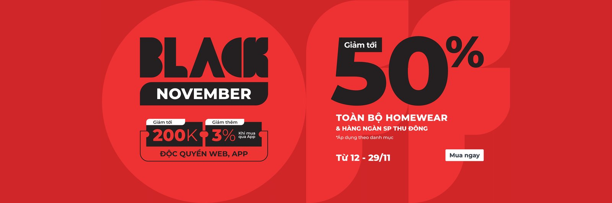 — 출처 <https://2885371169.e.cdneverest.net/Simiconnector/BannerSlider/b/l/blacknov_topbanner_desktop-111126.webp>
-  — 출처 <https://2885371169.e.cdneverest.net/Simiconnector/BannerSlider/t/c/tce_topbanner_desktop-261026.webp>
-  — 출처 <https://2885371169.e.cdneverest.net/Simiconnector/BannerSlider/t/h/thqg_topbanner_desktop-161026.webp>
-  — 출처 <https://2885371169.e.cdneverest.net/Simiconnector/BannerSlider/p/a/pattern-of-life_topbanner_desk-051026.webp>
-  — 출처 <https://canifa.com/_nuxt/img/chatbot-icon.c84d6ec.webp>

**페이지 메타 정보**

| page | title | description |
|---|---|---|
| [`home`](https://canifa.com/) | CANIFA | Patterns of Life | CANIFA - thương hiệu thời trang hàng đầu Việt Nam. Hàng ngàn mẫu quần áo phụ kiện nam, nữ, trẻ em cao cấp, chất lượng, an toàn liên tục được |

#### [IVY moda](https://ivymoda.com/)

- URL: <https://ivymoda.com/>
- 페이지: **OK 1 · FAIL 0**

**대표 상품 이미지** (상위 6장, 출처 URL 포함)

- 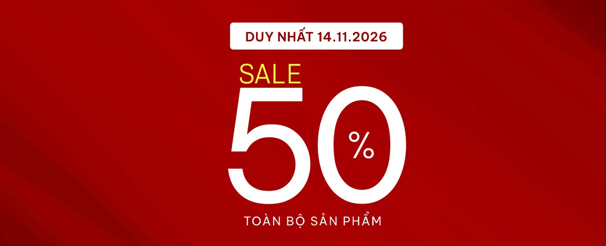 — 출처 <https://cotton4u.vn/files/news/2026/11/13/28ef0a3fadc9b170bea6e06c8d5cf3a2.webp>
- 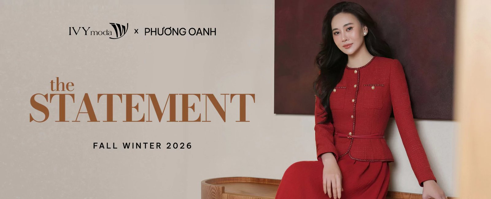 — 출처 <https://cotton4u.vn/files/news/2026/11/05/98bb25495aded9e5db7210edb0a245a1.webp>
- 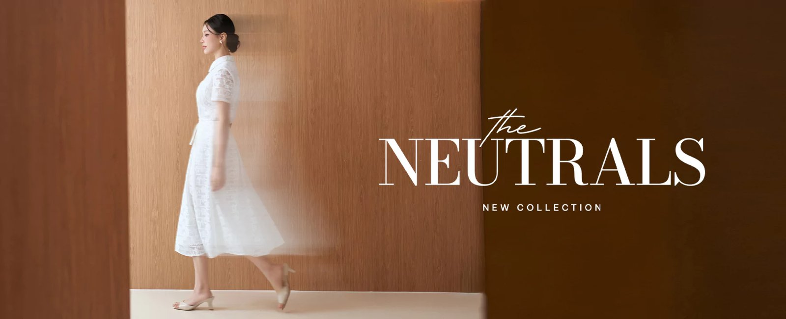 — 출처 <https://cotton4u.vn/files/news/2026/11/11/963d830686b12777f8c68635a5eaae3e.webp>
-  — 출처 <https://cotton4u.vn/files/news/2026/10/23/89e8eb777a0d21e8986a7f73c2ad29ac.webp>
-  — 출처 <https://cotton4u.vn/files/product/thumab/400/2026/11/10/f5119046e1cb2f875a652a6d058febaa.webp>
- 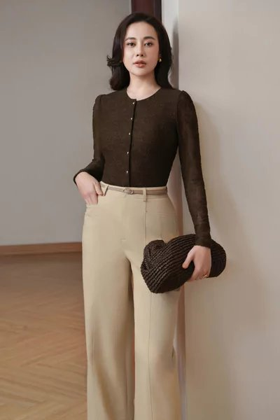 — 출처 <https://cotton4u.vn/files/product/thumab/400/2026/11/10/bf77056c8aace919558adc193244b044.webp>

**페이지 메타 정보**

| page | title | description |
|---|---|---|
| [`home`](https://ivymoda.com/) | IVY moda - Thời Trang Công Sở Hiện Đại | IVY moda |  |

#### [Lazada Vietnam](https://www.lazada.vn/)

- URL: <https://www.lazada.vn/>
- 페이지: **OK 1 · FAIL 0**

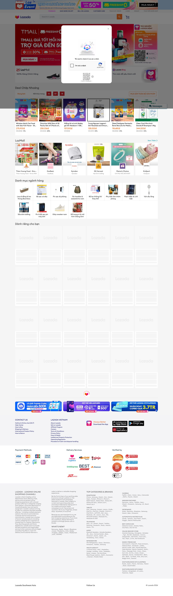

**대표 상품 이미지** (상위 6장, 출처 URL 포함)

-  — 출처 <https://img.lazcdn.com/us/domino/2ad4f22ce5a43dc145f221d13feed352.png>
-  — 출처 <https://img.lazcdn.com/g/tps/images/ims-web/TB1T7K2d8Cw3KVjSZFuXXcAOpXa.png>
- 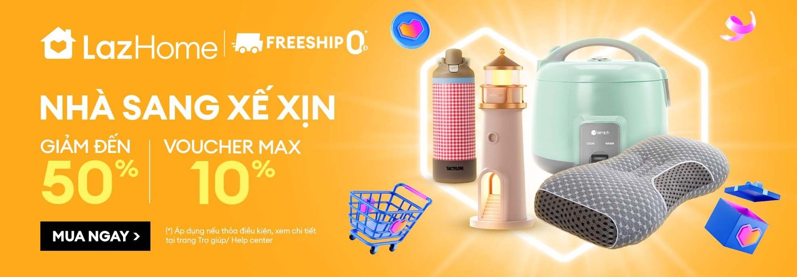 — 출처 <https://img.lazcdn.com/us/domino/29ffe8e4-b688-4c39-8e2a-cadbd858d9b0_VN-1976-688.jpg_2200x2200q80.jpg>
- 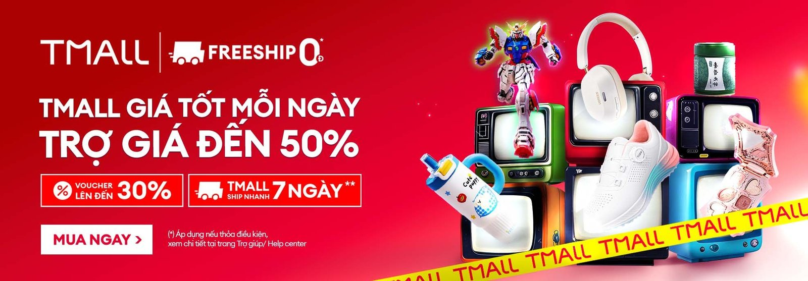 — 출처 <https://img.lazcdn.com/us/domino/fd538772-20fc-4fa6-984b-aa656383eece_VN-1976-688.jpg_2200x2200q80.jpg>
- 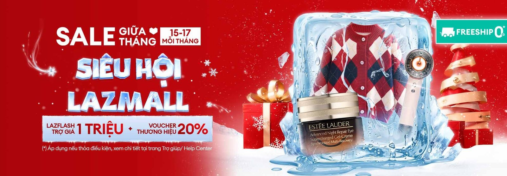 — 출처 <https://img.lazcdn.com/us/domino/b3b738ac-3d70-44f0-9c02-93f3c7a5c135_VN-1976-688.jpg_2200x2200q80.jpg>
-  — 출처 <https://img.lazcdn.com/us/domino/6333714e-87a4-4fb9-87d2-6342edf913ff_VN-1976-688.jpg_2200x2200q80.jpg>

**페이지 메타 정보**

| page | title | description |
|---|---|---|
| [`home`](https://www.lazada.vn/#?) | Lazada Việt Nam | Mua Sắm Online, Giá Tốt Nhất Mỗi Ngày | Mua sắm đồ điện tử, thời trang, làm đẹp và đồ chơi giá cả phải chăng. Đảm bảo sản phẩm chính hãng và trải nghiệm mua sắm tiện lợi – mua ngay |

#### [Shopee Vietnam](https://shopee.vn/)

- URL: <https://shopee.vn/>
- 페이지: **OK 1 · FAIL 0**

**대표 상품 이미지** (상위 6장, 출처 URL 포함)

-  — 출처 <https://deo.shopeemobile.com/shopee/shopee-pcmall-live-sg/homepagefe/42ba6075c82a85ab.png>

**페이지 메타 정보**

| page | title | description |
|---|---|---|
| [`home`](https://shopee.vn/verify/captcha?anti_bot_tracking_id=gqRjZGVrxHSFomtptTE0MjUxOnRyYWNraW5nX2lkX2tleaJrdtEAAqRhbGdv0gAAAGSjZGVrwKJjdMRAAAAADIKMyZ1P2O2Qvasq83S5AwzeFIVi130gJEs0rzTO_4iwfIWyFzi6GeoS0al_i_SqWqJfxR5gmm_2D9B-AqpjaXBoZXJ0ZXh0xQOGAAAADPjux7SnwNI4gWfMbGHBjZ7nZVtknk1qleBfZQYwFVWmQrQF6SpOgm4z8SCDTcgkRq02-Evd23CT-kxr-s1sqgB-3_sKP8kj2x-JCzqQnJSC820TEWkdiOGykGTSOCnvXmNrQaP8KL1vHBvQorLxmqD0707Tx0_95zm_Ib6E0ZvPTGAqJxYHLl7OyrCp2Rapbtxkf5TKLo_9qG2Ky5Te2ZsTLNRDTSIrb7EBbrDwagaWRhskED3PZ2nPkFNuHlQxZZMcU643PyNiJsc3P_RYNqCkQ9kJw8rkqX2VNZ7jmyD8UEuoI0rDk55Snre53ZXDYwidjHmHjLGfO9ucm6-uFmtRRGsprgOjiXzOXkUqdBtVNaW5sRrNsfmm_JLSw9WcH6ToVoS3u1mjtjGW0nhx8cmBK4AHnibWBmEpxT2T_2C79unKRtP4R1__pOzUCXivZKxfVSaIl0kR16SkWZwAFa5OMjBboKCW29sojCInv1hMhZoB8gIUQtrESLsEecK6XQusay8LYjXcFAWsk_tWp6eR1MMnPYGyqxVzqYKVf85V4Eg9ExrrOEXF4ao_MQO1m0nv9-7r2sOqHHFfQgVKzI297H5IagvHgsU3W8CHBHKw3zO3gKthHlfhL5MDFCR72O8JeL16rRoPQiZmN8GZQtd6_BTq_xQMft_HiV2eebs5Z8BnBEd5Z11RdgZgVNnMaiGH4ThkUSLYannKJgklPBvV0sM-MteNc16I_mr_zdSIxzO8c0nu-PXVJgucmIx1Vjl9BpNC5hzZjQgksvyK74wum0Q8x7rMZ7UXwUUzQkGddeLCr4WckjYJ_Qh_biDv2F5KYtNWdposmoz5rh1GARHnlanqFs5DKbKsMHmUuH5fDITD-LZ5tc7vtP8Cdi-jgICakxHv9AoT0_L0hdUEgA7fsXwAyUJ7XLhYegWj-wQBUAqZeCf2JpPPbIuNCamP6Z1_SZUYOvnyRMWQkkkQBa_MnsCVHcAI8snQAvFfesTBGdbCvgPM9dMctadK-S_Z_ICs5fRA0T-eDmvc43LOWCJPcauwEIQMbhhIhykHQV2ZkIoibwBeVhXgNOSKqupS2SGxFs24KA9iik9TlCeyxvnbqf7ruUu6lPSxf48MAUy8ml644Mvg4vvlDQbENlrVfX6xEPn_cJ86a7phdk03gKKmp5NfLfwNGHT-FnvOK53olto&app_key=FlashSale.PC&client_id=1&next=https%3A%2F%2Fshopee.vn%2Fverify%2Ftraffic%3F%3Fclient_id%3D%26next%3Dhttps%253A%252F%252Fshopee.vn%252F%26redirect_type%3D2%26should_replace_history%3Dfalse&redirect_type=2&scene=crawler_item&should_replace_history=false) | Shopee Việt Nam | Mua Sắm Online | Mua sắm trực tuyến hàng triệu sản phẩm ở tất cả ngành hàng. Giá tốt & Miễn phí vận chuyển. Mua và bán online trong 30 giây. Voucher Xtra | F |

#### [Tiki](https://tiki.vn/)

- URL: <https://tiki.vn/>
- 페이지: **OK 1 · FAIL 0**

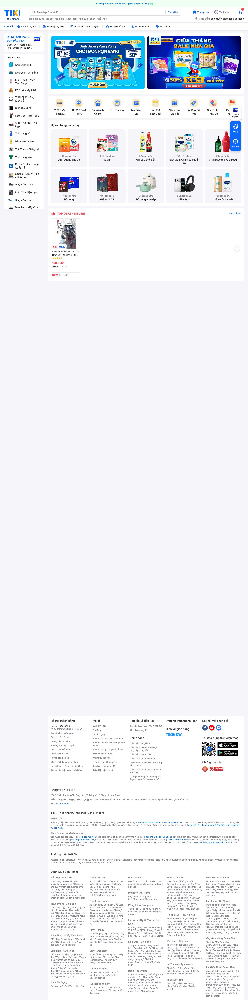

**대표 상품 이미지** (상위 6장, 출처 URL 포함)

-  — 출처 <https://salt.tikicdn.com/cache/100x100/ts/category/ed/20/60/afa9b3b474bf7ad70f10dd6443211d5f.png>
-  — 출처 <https://salt.tikicdn.com/cache/100x100/ts/category/f6/22/46/7e2185d2cf1bca72d5aeac385a865b2b.png>
-  — 출처 <https://salt.tikicdn.com/cache/100x100/ts/category/54/c0/ff/fe98a4afa2d3e5142dc8096addc4e40b.png>
-  — 출처 <https://salt.tikicdn.com/cache/100x100/ts/category/13/64/43/226301adcc7660ffcf44a61bb6df99b7.png>
-  — 출처 <https://salt.tikicdn.com/cache/100x100/ts/category/75/34/29/78e428fdd90408587181005f5cc3de32.png>
-  — 출처 <https://salt.tikicdn.com/cache/100x100/ts/category/61/d4/ea/e6ea3ffc1fcde3b6224d2bb691ea16a2.png>

**페이지 메타 정보**

| page | title | description |
|---|---|---|
| [`home`](https://tiki.vn/) | Tiki - Mua hàng online giá tốt, hàng chuẩn, ship nhanh | Tiện lợi mua sắm hàng triệu mặt hàng, dịch vụ. Vô vàn ưu đãi freeship, mã giảm giá. Hoàn tiền 15% tối đa 600k/tháng với thẻ tín dụng TikiCAR |

## 5. 의류 카테고리별 글로벌 트렌드

| # | 카테고리 | 건수 | 대표 상품명 |
|---:|---|---:|---|
| 1 | `코트` | 19 | [5차 리오더][버터 단독]마리 하프 울 코트 / MARY HALF WOOL COAT_3colors · [단독] 앙고라 울 하이넥 더플 코트_차콜 / ANGORA WOOL HIGH NECK DUFFLE COAT_CHARCOAL · [6차 리오더]리앤 울 핸드메이드 하프 코트 / LEANNE WOOL HANDMADE HALF COAT_4colors |
| 2 | `니트` | 8 | [그레이 단독]캐시미어 딥 브이넥 카라 니트 / CASHMERE DEEP V-NECK COLLAR KNIT_5colors · [아이보리 단독] 울 헤어리 레이어드 니트 탑 / WOOL HAIRY LAYERED KNIT TOP_3colors · [단독]캐시미어 딥 브이넥 니트 / CASHMERE DEEP V-NECK KNIT_5colors |
| 3 | `스커트` | 7 | [단독]나틸다 울 플리츠 롱 스커트_차콜 / NATILDA WOOL PLEATS LONG SKIRT_CHARCOAL · [단독][3차 리오더]나틸다 울 플리츠 롱 스커트_블랙 / NATILDA WOOL PLEATS LONG SKIRT_BLACK · 오웬 랩 스커트 팬츠 / OWEN WRAP SKIRT PANTS_2colors |
| 4 | `팬츠` | 6 | [당일출고] 코튼 카고 팬츠_블랙 · [당일출고] 코튼 카고 팬츠_차콜 · [당일출고] 코튼 카고 팬츠_베이지 |
| 5 | `셔츠` | 6 | 울 하이넥 타이 티셔츠 / WOOL HIGH NECK TIE T-SHIRT_3colors · [✨매일입어요] made. 솔트 클린 긴팔티셔츠 (스탠다드핏/루즈핏) - 6 color · 슬림핏 유넥 겨울 발열 히트텍 이너 티셔츠 내의 4color |
| 6 | `자켓` | 5 | [5차 리오더][안감누빔] 베이비 알파카 트위드 자켓 / BABY ALPACA TWEED JACKET_2colors · [버터 단독][5차 리오더] 레이어 알파카 자켓 / LAYER ALPACA JACKET_2colors · [단독][4차 리오더] 에일린 울 핸드메이드 자켓 / AILEEN WOOL HANDMADE JACKET_3colors |
| 7 | `슬랙스` | 4 | [단독] 울 세미 부츠컷 슬릿 슬랙스 / WOOL SEMI BOOTS CUT SLIT SLACKS_2colors · [🍁가을/3기장선택!] made. 모먼트 투커버 올데이슬랙스 (+숏/베이직/롱ver) - 4 size · [기모추가🔥/5만장돌파/자체제작] 모티브 핀턱 슬랙스 (숏/기본) |
| 8 | `jacket` | 2 | [8th] Round Fur Jacket - Crop (Ivory) · [25FW]LAVE WORK JACKET_2COLORS |
| 9 | `패딩` | 2 | [단독][소량 재오픈] 몬드리 덕 다운 패딩  / MONDRY DUCK DOWN PADDING_2colors · 플리스하프패딩 |
| 10 | `tee` | 1 | Tie Long Tee (Beige) |

**국가별 의류 TOP**

- **korea**: `코트`(19), `니트`(8), `스커트`(7), `팬츠`(6), `셔츠`(6)
## 6. 악세사리 카테고리별 글로벌 트렌드

| # | 카테고리 | 건수 | 대표 상품명 |
|---:|---|---:|---|
| 1 | `부츠` | 2 | [5차 리오더] 알렉스 롱부츠_블랙 / ALEX LONG BOOTS_BLACK · [4차 리오더] 레베카 미들부츠_블랙 / REBECCA MIDDLE BOOTS_BLACK |
| 2 | `cap` | 1 | [Monthly Color] 11월 Cappuccino Brown 큐브 시리즈 모듈선반 |
| 3 | `벨트` | 1 | 엘르 비건 레더 벨트 / ELLE VEGAN LEATHER BELT_4colors |

**국가별 악세사리 TOP**

- **korea**: `부츠`(2), `cap`(1), `벨트`(1)
## 7. 국가별 가격대 비교

| 국가 | 통화 | 표본 | min | p25 | median | p75 | max | median (USD) |
|---|---|---:|---:|---:|---:|---:|---:|---:|
| korea | KRW | 116 | 13160 | 47140 | 124052 | 216350 | 3090000 | 92.98 |

> p25/p75 는 IQR 기준 분위수. USD 환산은 `config/exchange_rates.yaml` 기준 (운영자가 정기 갱신).

## 8. 국내 의류·악세사리 사업동향

### KITA K-stat

- 한국무역통계의 국가 수출입 통계 총괄 페이지입니다.
- 사이트: <https://stat.kita.net/stat/kts/ctr/CtrTotalImpExpList.screen>

| # | topic | title | url |
|---:|---|---|---|
| 1 | `trade` | KITA.NET | <https://www.kita.net/> |
| 2 | `trade` | K-stat 란? | <https://www.kita.net/pdf/statGuide/index.html#p=1> |
| 3 | `무역통계` | 무역통계 분류 | <https://stat.kita.net/stat/guide/guide_18_01.screen> |
| 4 | `trade` | 한국품목코드 | <https://stat.kita.net/stat/kts/statCode/ItemHierCodeList.screen> |
| 5 | `trade` | 해외품목코드 | <https://stat.kita.net/stat/istat/common/IstatHSCode.screen> |
| 6 | `trade` | 대륙/경제코드 | <https://stat.kita.net/stat/kts/statCode/ConEcoCodeList.screen> |
| 7 | `trade` | 수출입 총괄 | <https://stat.kita.net/stat/kts/sum/SumImpExpTotalList.screen> |
| 8 | `trade` | 가공단계 수출입 | <https://stat.kita.net/stat/kts/use/BecList.screen> |
| 9 | `trade` | 품목 수출입 | <https://stat.kita.net/stat/kts/pum/ItemImpExpList.screen> |
| 10 | `trade` | 국가 수출입 | <https://stat.kita.net/stat/kts/ctr/CtrTotalImpExpList.screen> |
| 11 | `trade` | 대륙/경제권 수출입 | <https://stat.kita.net/stat/kts/rel/RelColligationList.screen> |
| 12 | `trade` | 지자체 수출입 | <https://stat.kita.net/stat/kts/prod/ProdWholeList.screen> |
| 13 | `trade` | 항구/공항 수출입 | <https://stat.kita.net/stat/kts/port/PortImpExpList.screen> |
| 14 | `trade` | FTA체결국 수출입 | <https://stat.kita.net/stat/kts/fta/FtaCtrImpExpList.screen> |
| 15 | `trade` | 간접수출 현황 | <https://stat.kita.net/stat/ind/KtsIndMain.screen> |

### Korea Customs Service

- 수출입 현황, 물류통계 등 관세청 무역통계정보를 종합적으로 제공
- 사이트: <https://tradedata.go.kr/cts/index_eng.do>

| # | topic | title | url |
|---:|---|---|---|
| 1 | `trade` | Korea Customs Service | <http://customs.go.kr/english/main.do> |

### KOSIS

- 코시스, 국가데이터처가 제공하는 원스톱 통계 서비스, 국가승인통계, 국제통계, 북한통계, e-지방지표, 통계시각화콘텐츠, 온라인간행물 등 제공
- 사이트: <https://kosis.kr/statisticsList/statisticsListIndex.do?parmTabId=M_01_01&vwcd=MT_ZTITLE&menuId=M_01_01&outLink=Y&entrType=>

| # | topic | title | url |
|---:|---|---|---|
| 1 | `statistics` | 쉽게 보는 통계 | <http://kosis.kr/easyViewStatis/customStatisIndex.do?vwcd=MT_TM1_TITLE&menuId=M_03_01> |
| 2 | `statistics` | 이슈별 접근 | <http://kosis.kr/easyViewStatis/customStatisIndex.do?vwcd=MT_TM2_TITLE&menuId=M_03_02> |
| 3 | `statistics` | 통계시각화콘텐츠 | <http://kosis.kr/easyViewStatis/visualizationIndex.do> |
| 4 | `statistics` | 온라인간행물 | <http://kosis.kr/publication/publicationThema.do> |
| 5 | `statistics` | 기획간행물 | <http://kosis.kr/publication/publicationStat.do> |
| 6 | `statistics` | KOSIS 길라잡이 | <http://kosis.kr/civilComplaint/kosisGuideIndex.do> |
| 7 | `statistics` | 홈페이지 개선의견 | <http://kosis.kr/civilComplaint/siteRequestList.do> |
| 8 | `statistics` | 찾아가는 KOSIS | <http://kosis.kr/civilComplaint/kosisEduIndex.do> |
| 9 | `statistics` | 서비스 소개 | <http://kosis.kr/serviceInfo/kosisIntroduce.do> |
| 10 | `statistics` | 국가통계현황 | <http://kosis.kr/serviceInfo/statisInstitution.do> |
| 11 | `statistics` | 국가통계 공표일정 | <http://kosis.kr/serviceInfo/statisPublicationList.do> |
| 12 | `statistics` | 팩트체크 서비스 | <http://kosis.kr/serviceInfo/factCheckList.do> |
| 13 | `statistics` | 서비스정책 | <http://kosis.kr/serviceInfo/useGuide.do> |
| 14 | `statistics` | 공유서비스 (OpenAPI) | <http://kosis.kr/serviceInfo/openAPIGuide.do> |
| 15 | `statistics` | English | <https://kosis.kr/eng> |

### KOTRA

- 트라이빅(TriBig)은 코트라(KOTRA)가 제공하는 무역투자 빅데이터 플랫폼으로 무역투자통계, 국가별 시장정보, 품목별 유망시장, 기업별 맞춤정보, 해외바이어 정보의 서비스를 제공합니다.
- 사이트: <https://www.kotra.or.kr/bigdata/visualization/korea#search/ALL/ALL/2024>

| # | topic | title | url |
|---:|---|---|---|
| 1 | `trade` | kotra 무역투자24 | <https://www.kotra.or.kr/bigdata/kotraSsoRedirect?targetURL=https://www.kotra.or.kr> |
| 2 | `trade` | 해외비즈니스 정보 포털 | <https://www.kotra.or.kr/bigdata/kotraSsoRedirect?targetURL=https://dream.kotra.or.kr/dream> |
| 3 | `trade` | 글로벌 전시포털 | <https://www.kotra.or.kr/bigdata/kotraSsoRedirect?targetURL=https://www.gep.or.kr/> |
| 4 | `trade` | KOTRA 해외인재유치센터 | <https://www.kotra.or.kr/gtc_kor> |
| 5 | `trade` | 투자유치정보제공 | <https://www.kotra.or.kr/bigdata/kotraSsoRedirect?targetURL=https://www.investkorea.org/> |
| 6 | `수출지원` | 수출지원 온라인 플랫폼 | <https://www.kotra.or.kr/bigdata/kotraSsoRedirect?targetURL=https://www.buykorea.or.kr/> |
| 7 | `trade` | 빅데이터 서비스 | <https://www.kotra.or.kr/bigdata/> |
| 8 | `trade` | 경제외교 활용포털 | <https://www.kotra.or.kr/bigdata/kotraSsoRedirect?targetURL=https://president.globalwindow.org> |
| 9 | `trade` | 방산물자교역지원센터 | <https://www.kotra.or.kr/bigdata/kotraSsoRedirect?targetURL=https://www.kotra.or.kr/kodits> |
| 10 | `trade` | 외투기업고충처리 | <https://www.kotra.or.kr/bigdata/kotraSsoRedirect?targetURL=https://ombudsman.kotra.or.kr/ob-kr> |
| 11 | `trade` | 수출바우처 · 지사화 | <https://www.exportvoucher.com> |
| 12 | `trade` | 무역투자통계 | <https://www.kotra.or.kr/bigdata/visualization/korea> |
| 13 | `trade` | 국가별 시장정보 | <https://www.kotra.or.kr/bigdata/marketAnalysis> |
| 14 | `trade` | 품목별 유망시장 | <https://www.kotra.or.kr/bigdata/bhrcMarket> |
| 15 | `trade` | 해외바이어 정보 | <https://www.kotra.or.kr/bigdata/partner/search> |

### Statistics Korea Online Shopping

- 국가데이터처,List | 전체 | 보도자료 | 새소식
- 사이트: <https://mods.go.kr/board.es?mid=a10301010000&bid=11789>

| # | topic | title | url |
|---:|---|---|---|
| 1 | `statistics` | 정보공개제도 | <https://mods.go.kr/menu.es?mid=a10101010100> |
| 2 | `statistics` | 정보공개청구 | <https://www.open.go.kr/com/main/mainView.do> |
| 3 | `statistics` | 비공개대상정보세부기준 | <https://mods.go.kr/menu.es?mid=a10101030000> |
| 4 | `statistics` | 고객수요분석 | <https://mods.go.kr/menu.es?mid=a10101040000> |
| 5 | `statistics` | 사전정보공표 | <https://mods.go.kr/menu.es?mid=a10103010000> |
| 6 | `statistics` | 사전정보공표목록 | <https://mods.go.kr/menu.es?mid=a10103010100> |
| 7 | `statistics` | 핵심단어목록 | <https://mods.go.kr/menu.es?mid=a10103020100> |
| 8 | `statistics` | 인기정보TOP10 | <https://mods.go.kr/menu.es?mid=a10103030100> |
| 9 | `statistics` | 행정자료실 | <https://mods.go.kr/menu.es?mid=a10104010000> |
| 10 | `statistics` | 업무추진비 | <https://mods.go.kr/menu.es?mid=a10104010100> |
| 11 | `statistics` | 국회관련정보 | <https://mods.go.kr/menu.es?mid=a10104040000> |
| 12 | `statistics` | 정책실명제 | <https://mods.go.kr/menu.es?mid=a10105010000> |
| 13 | `statistics` | 연도별대상사업현황 | <https://mods.go.kr/menu.es?mid=a10105020000> |
| 14 | `statistics` | 중점관리대상사업 | <https://mods.go.kr/menu.es?mid=a10105030600> |
| 15 | `statistics` | 국민신청실명제 | <https://mods.go.kr/menu.es?mid=a10105040000> |

### 기업마당

- 기업마당>정책정보>지원사업 공고
- 사이트: <https://www.bizinfo.go.kr/sii/siia/selectSIIA200View.do?null>

| # | topic | title | url |
|---:|---|---|---|
| 1 | `policy` | 지원사업 공고 | <https://www.bizinfo.go.kr/sii/siia/selectSIIA200View.do> |
| 2 | `policy` | 품목별 법정의무 인증제도 | <https://www.bizinfo.go.kr/biz/biza/selectBIZA100View.do> |
| 3 | `policy` | 입법·행정예고/고시 | <https://www.bizinfo.go.kr/biz/biza/selectBIZA300View.do> |
| 4 | `policy` | 월간 중기누리 | <https://www.bizinfo.go.kr/biz/biza/selectBIZA400View.do> |
| 5 | `policy` | 기업업무용 서식 | <https://www.bizinfo.go.kr/biz/bizb/selectBIZB100View.do> |
| 6 | `policy` | 입주기업 모집공고 | <https://www.bizinfo.go.kr/biz/bizb/selectBIZB200View.do> |
| 7 | `policy` | 온라인화상회의실 | <https://www.k-startup.go.kr/web/contents/webOLNIVIDEOMTRM.do> |
| 8 | `policy` | 정책정보 개방 | <https://www.bizinfo.go.kr/apiList.do> |
| 9 | `policy` | 속보성 대시보드 | <https://www.bizinfo.go.kr/dashboard.do> |
| 10 | `policy` | 고객의 소리 | <https://www.bizinfo.go.kr/biz/bizc/selectBIZC200Regist.do> |
| 11 | `policy` | 자주하는질문 | <https://www.bizinfo.go.kr/biz/bizc/selectBIZC300View.do> |
| 12 | `policy` | 이메일주소 무단 수집 거부안내 | <https://www.bizinfo.go.kr/biz/bizd/selectBIZD110View.do> |
| 13 | `policy` | 웹접근성 정책 | <https://www.bizinfo.go.kr/biz/bizd/selectBIZD130View.do> |
| 14 | `policy` | 전체메뉴보기 | <https://www.bizinfo.go.kr/sitemap/intro.do> |
| 15 | `policy` | [전남광주] 강진군 2026년 음식점 입식식탁ㆍ경사로 설치 신청업소 모집 재공고 | <https://www.bizinfo.go.kr/sii/siia/selectSIIA200Detail.do?hashCode=&rowsSel=&rows=15&cpage=&cat=&schPblancDiv=&schJrsdCodeTy=&schWntyAt=&schAreaDetailCodes=&schEndAt=N&orderGb=&sort=&preKeywords=&condition=&condition1=&keyword=&pblancId=PBLN_000000000127929> |

### 서울경제진흥원

- 서울경제진흥원 에러페이지
- 사이트: <https://www.sba.seoul.kr/Pages/error_404.html?aspxerrorpath=/Pages/NSub06_01.aspx>

### 소상공인24

- 소상공인24는 소상공인시장진흥공단이 운영하는 소상공인 지원사업 통합 플랫폼입니다. 소진공·지방정부·유관기관 지원사업 공고 조회와 신청, 대출상품 조회, 증명서 발급, 소상공인 통계를 한 곳에서 이용할 수 있습니다.
- 사이트: <https://www.sbiz24.kr/#/pbanc>

| # | topic | title | url |
|---:|---|---|---|
| 1 | `policy` | 지원사업 소개 | <https://www.sbiz24.kr/#/cmmn/gnrl/Conts/7> |
| 2 | `policy` | 소진공 지원사업 공고조회 및 신청 | <https://www.sbiz24.kr/#/pbanc> |
| 3 | `policy` | 지방정부 지원사업 공고조회 및 신청 | <https://www.sbiz24.kr/#/lcgPbanc> |
| 4 | `policy` | 유관기관 지원사업 공고조회 | <https://www.sbiz24.kr/#/extldPbanc> |
| 5 | `policy` | 대출상품 조회 | <https://www.sbiz24.kr/#/loanProduct> |
| 6 | `policy` | 지원사업 상담 | <https://www.sbiz24.kr/#/qna> |

### 중소벤처기업부

- 중소기업중앙회 등 기관 중소기업 조사, 통계 DB화 검색, 내려받기 등 제공.
- 사이트: <https://www.mss.go.kr/site/smba/ex/bbs/List.do?cbIdx=86>

| # | topic | title | url |
|---:|---|---|---|
| 1 | `policy` | 어린이 누리집 | <https://www.mss.go.kr/site/kids/main.do> |
| 2 | `policy` | English | <https://www.mss.go.kr/site/eng/main.do> |
| 3 | `policy` | 누리집 안내지도 | <https://www.mss.go.kr/site/smba/ex/siteMap/siteMap.do> |
| 4 | `policy` | 훈령/예규/고시/공고 | <https://www.mss.go.kr/site/smba/ex/bbs/List.do?cbIdx=125&ext6=Y> |
| 5 | `policy` | 입법/행정예고 | <https://www.mss.go.kr/site/smba/ex/bbs/List.do?cbIdx=126&searchRltnYn=Y> |
| 6 | `policy` | 인사·채용 | <https://www.mss.go.kr/site/smba/ex/bbs/List.do?cbIdx=82> |
| 7 | `policy` | 보도설명자료 | <https://www.mss.go.kr/site/smba/ex/bbs/List.do?cbIdx=87> |
| 8 | `policy` | 현장속으로 | <https://www.mss.go.kr/site/smba/brdcststnVod/brdcststnVodList.do?ctgr_code=C01> |
| 9 | `policy` | 중기부소식지 | <https://www.mss.go.kr/site/smba/ex/bbs/List.do?cbIdx=95> |
| 10 | `policy` | 통계설명자료 | <https://www.mss.go.kr/site/smba/foffice/ex/statDB/ptScheduleList.do> |
| 11 | `policy` | 주제별 통계 | <https://www.mss.go.kr/site/smba/foffice/ex/statDB/temaList.do?tabCd=0001> |
| 12 | `policy` | 조사별 통계 | <https://www.mss.go.kr/site/smba/foffice/ex/statDB/surveyList.do?tabCd=0001> |
| 13 | `policy` | 조사보고서 | <https://www.mss.go.kr/site/smba/foffice/ex/statDB/stReportRoList.do?gb=1&nodeId=&roCode=> |
| 14 | `policy` | 주제별 조회 | <https://www.mss.go.kr/site/smba/foffice/ex/statDB/stReportRcList.do?gb=2&nodeId=&rcCode=> |
| 15 | `policy` | 중소기업위상 | <https://www.mss.go.kr/site/smba/foffice/ex/statDB/MainSubStat.do?scd=0001> |

## 9. 한국 사업자 관점 기회 국가 TOP 10

| # | 국가 | tier | region | 점수 | 근거 |
|---:|---|---:|---|---:|---|
| 1 | 태국 _( Thailand )_ | 1 | `asia` | **143.5** | tier1 기본점(90); 아시아 권역(+20); ASEAN 시장(+10); K-패션/콘텐츠 친화 시장(+20); 트렌드 신호 밀도 4 |
| 2 | 대만 _( Taiwan )_ | 1 | `asia` | **136.5** | tier1 기본점(90); 아시아 권역(+20); K-패션/콘텐츠 친화 시장(+20); 트렌드 신호 밀도 6 |
| 3 | 일본 _( Japan )_ | 1 | `asia` | **130.0** | tier1 기본점(90); 아시아 권역(+20); K-패션/콘텐츠 친화 시장(+20) |
| 4 | 베트남 _( Vietnam )_ | 1 | `asia` | **124.5** | tier1 기본점(90); 아시아 권역(+20); ASEAN 시장(+10); 트렌드 신호 밀도 4 |
| 5 | 인도네시아 _( Indonesia )_ | 1 | `asia` | **123.5** | tier1 기본점(90); 아시아 권역(+20); ASEAN 시장(+10); 트렌드 신호 밀도 4 |
| 6 | 필리핀 _( Philippines )_ | 2 | `asia` | **110.0** | tier2 기본점(60); 아시아 권역(+20); ASEAN 시장(+10); K-패션/콘텐츠 친화 시장(+20) |
| 7 | 미국 _( United States )_ | 1 | `north_america` | **105.5** | tier1 기본점(90); 트렌드 신호 밀도 16 |
| 8 | 말레이시아 _( Malaysia )_ | 2 | `asia` | **90.0** | tier2 기본점(60); 아시아 권역(+20); ASEAN 시장(+10) |
| 9 | 싱가포르 _( Singapore )_ | 2 | `asia` | **90.0** | tier2 기본점(60); 아시아 권역(+20); ASEAN 시장(+10) |
| 10 | 홍콩 _( Hong Kong )_ | 2 | `asia` | **80.0** | tier2 기본점(60); 아시아 권역(+20) |

## 10. 실행 제안

### **1위 태국** (점수 144, tier1 · asia)

- 현지 스타일 TOP: `wide` — 시즌 컬렉션 기획 시 우선 반영.
- 현지 컬러 TOP: `red` — 시즌 컬렉션 기획 시 우선 반영.
- 현지 카테고리 TOP: `tee`, `bag`, `accessories` — 시즌 컬렉션 기획 시 우선 반영.
- K-패션 친화도가 명시된 시장이므로 K-브랜드 아이덴티티 및 한류 셀럽 협업을 강조.
- ASEAN 권역 시장 — 물류/관세(FTA) 활용 + 동남아 통합 마케팅 검토 권장.
- tier1 핵심 시장 — 현지 마켓플레이스(예: 해당 국가의 대표 패션 플랫폼) 공식 입점 + 셀러 운영 채널 확보 우선.
- 연계 가능한 국내 수출/지원 사업이 식별되지 않음 — `domestic_sources.yaml` 의 `landing_url` 을 KOTRA 사업 공고/기업마당 수출바우처로 직접 지정 권장.

### **2위 대만** (점수 136, tier1 · asia)

- 현지 컬러 TOP: `pink`, `red` — 시즌 컬렉션 기획 시 우선 반영.
- 현지 소재 TOP: `lace` — 시즌 컬렉션 기획 시 우선 반영.
- K-패션 친화도가 명시된 시장이므로 K-브랜드 아이덴티티 및 한류 셀럽 협업을 강조.
- 아시아 권역 시장 — 시차/언어 친화 + 한국 본사 직배송 모델 검토.
- tier1 핵심 시장 — 현지 마켓플레이스(예: 해당 국가의 대표 패션 플랫폼) 공식 입점 + 셀러 운영 채널 확보 우선.
- 연계 가능한 국내 수출/지원 사업이 식별되지 않음 — `domestic_sources.yaml` 의 `landing_url` 을 KOTRA 사업 공고/기업마당 수출바우처로 직접 지정 권장.

### **3위 일본** (점수 130, tier1 · asia)

- K-패션 친화도가 명시된 시장이므로 K-브랜드 아이덴티티 및 한류 셀럽 협업을 강조.
- 아시아 권역 시장 — 시차/언어 친화 + 한국 본사 직배송 모델 검토.
- tier1 핵심 시장 — 현지 마켓플레이스(예: 해당 국가의 대표 패션 플랫폼) 공식 입점 + 셀러 운영 채널 확보 우선.
- 연계 가능한 국내 수출/지원 사업이 식별되지 않음 — `domestic_sources.yaml` 의 `landing_url` 을 KOTRA 사업 공고/기업마당 수출바우처로 직접 지정 권장.

### 운영 점검 노트

- **한국 어휘사전 매칭 0건**: 메인페이지만 수집되어 색/소재/스타일 신호가 0. 한국 사이트(29CM/W Concept/Musinsa)에 `page_targets` 추가 필요.
- **ASEAN 다중 진출 기회**: TOP10 중 ASEAN 국가가 3개 이상. Shopee/Lazada/Zalora 통합 운영을 통한 동남아 멀티마켓 전략을 검토 권장.

## 11. 수집 실패/주의 사이트

| 국가 | 사이트 | 페이지 | 상태 | 사유 |
|---|---|---|---|---|
| usa | Revolve | new | failed | playwright_error: Error: Page.goto: net::ERR_HTTP2_PROTOCOL_ERROR at https://www.revolve.com/new/br/c79f88/
Call log:
  - navigating to "https://www.revolve.com/new/br/c79f88/", waiting until "domcontentloaded"
 |
| usa | Revolve | trending | failed | playwright_error: Error: Page.goto: net::ERR_HTTP2_PROTOCOL_ERROR at https://www.revolve.com/most-loved/br/4a9ca5/
Call log:
  - navigating to "https://www.revolve.com/most-loved/br/4a9ca5/", waiting until "domcontentloaded"
 |
| japan | ZOZOTOWN | new | failed | playwright_error: TimeoutError: Page.goto: Timeout 30000ms exceeded.
Call log:
  - navigating to "https://zozo.jp/category/new/", waiting until "domcontentloaded"
 |
| japan | ZOZOTOWN | ranking | failed | playwright_error: TimeoutError: Page.goto: Timeout 30000ms exceeded.
Call log:
  - navigating to "https://zozo.jp/ranking/", waiting until "domcontentloaded"
 |
| japan | Rakuten Fashion | women | failed | http_status_404 |
| indonesia | Tokopedia | home | failed | playwright_error: Error: Page.goto: net::ERR_HTTP2_PROTOCOL_ERROR at https://www.tokopedia.com/
Call log:
  - navigating to "https://www.tokopedia.com/", waiting until "domcontentloaded"
 |
| thailand | Pomelo | new | failed | robots_disallowed |
| thailand | Pomelo | best | failed | robots_disallowed |
| korea | Musinsa | home | failed | robots_disallowed |

## 12. 원문 출처 및 이미지 출처

### 인도네시아

- **Berrybenka** — <https://www.berrybenka.com/>
  - 이미지 출처: <https://berrybenka.com/cdn/shop/files/logo.jpg?v=1791288203&width=3840>
  - 이미지 출처: <http://berrybenka.com/cdn/shop/files/berrybenka_logo.png?v=1788942734>
  - 이미지 출처: <https://berrybenka.com/cdn/shop/files/berrybenka_logo.png?v=1788942734>
- **Hijup** — <https://www.hijup.com/>
  - 이미지 출처: <https://www.hijup.com/_next/image?url=%2Fimages%2Fwa.icon.png&w=128&q=100>
- **Shopee Indonesia** — <https://shopee.co.id/>
  - 이미지 출처: <https://deo.shopeemobile.com/shopee/shopee-pcmall-live-sg/assets/1c8bdaaf45e1fd48.png>
- **Tokopedia** — <https://www.tokopedia.com/>
- **Zalora Indonesia** — <https://www.zalora.co.id/>
  - 이미지 출처: <https://static-id.zacdn.com/next-assets/static-assets/images/logo/icon_mastercard.png>
  - 이미지 출처: <https://static-id.zacdn.com/next-assets/static-assets/images/logo/icon_visa.png>
  - 이미지 출처: <https://static-id.zacdn.com/next-assets/static-assets/images/logo/icon_ovo.png>

### 일본

- **GU Japan** — <https://www.gu-global.com/jp/>
  - 이미지 출처: <https://image.uniqlo.com/GU/ST3/jp/imagesother/Navigation/Category-icon_V2/2026/Category_wmk_Kanshasai.png>
  - 이미지 출처: <https://image.uniqlo.com/GU/ST3/jp/imagesother/Navigation/Category-icon_V2/2026/0724/Categoy_Limited-offers.jpg>
  - 이미지 출처: <https://image.uniqlo.com/GU/ST3/jp/imagesother/Navigation/Category-icon_V2/2026/0724/Categoy_SALE.jpg>
  - 이미지 출처: <https://image.uniqlo.com/GU/ST3/jp/imagesother/Navigation/collaboration_Category/26FW/rokh_category_icon.png>
  - 이미지 출처: <https://image.uniqlo.com/GU/ST3/jp/imagesother/Navigation/WOMEN_Category/2026/261106/261106_category_w_outer_360434.png>
  - 이미지 출처: <https://image.uniqlo.com/GU/ST3/jp/imagesother/Navigation/WOMEN_Category/2026/261008/category_w_knit-and-cardigan_360549.png>
  - 이미지 출처: <https://image.uniqlo.com/GU/ST3/jp/imagesother/Navigation/WOMEN_Category/2026/261008/category_w_tops_361505.png>
  - 이미지 출처: <https://image.uniqlo.com/GU/ST3/jp/imagesother/Navigation/WOMEN_Category/2026/260911/Category_w_sweat_361784.png>
  - 이미지 출처: <https://image.uniqlo.com/GU/ST3/jp/imagesother/Navigation/WOMEN_Category/2026/261030/261030_category_w_warm-T_360578.png>
  - 이미지 출처: <https://image.uniqlo.com/GU/ST3/jp/imagesother/Navigation/WOMEN_Category/2026/261030/261030_category_w_sheer-T_360571.png>
  - 이미지 출처: <https://image.uniqlo.com/GU/ST3/jp/imagesother/Navigation/WOMEN_Category/2026/261113/261113_category_w_fleece_360440.png>
  - 이미지 출처: <https://image.uniqlo.com/GU/ST3/jp/imagesother/Navigation/WOMEN_Category/2026/260807/Category_w_shirt_361657.png>
  - 이미지 출처: <https://image.uniqlo.com/GU/ST3/jp/imagesother/Navigation/WOMEN_Category/2026/260724/Category_w_Pants.jpg>
- **Rakuten Fashion** — <https://brandavenue.rakuten.co.jp/>
  - 이미지 출처: <https://brandavenue.r10s.jp/img/library/index/sbn_flagshipstore_20231003.png>
  - 이미지 출처: <https://brandavenue.r10s.jp/img/news/01/409189/pc_n.jpg>
  - 이미지 출처: <https://brandavenue.r10s.jp/img/news/01/408735/pc_n.jpg>
  - 이미지 출처: <https://brandavenue.r10s.jp/img/news/01/408738/pc_n.jpg>
  - 이미지 출처: <https://brandavenue.r10s.jp/img/news/01/408741/pc_n.jpg>
  - 이미지 출처: <https://brandavenue.r10s.jp/img/news/01/408742/pc_n.jpg>
  - 이미지 출처: <https://brandavenue.r10s.jp/img/news/01/409347/pc_n.jpg>
  - 이미지 출처: <https://brandavenue.r10s.jp/img/news/01/409350/pc_n.jpg>
  - 이미지 출처: <https://brandavenue.r10s.jp/img/news/01/409354/pc_n.jpg>
  - 이미지 출처: <https://brandavenue.r10s.jp/img/news/01/409389/pc_n.jpg>
  - 이미지 출처: <https://brandavenue.r10s.jp/img/news/01/409393/pc_n.jpg>
  - 이미지 출처: <https://brandavenue.r10s.jp/img/news/01/406423/pc_n.jpg>
  - 이미지 출처: <https://brandavenue.r10s.jp/img/news/01/408659/pc_n.jpg>
  - 이미지 출처: <https://brandavenue.r10s.jp/img/news/01/409251/pc_n.jpg>
  - 이미지 출처: <https://brandavenue.r10s.jp/img/news/01/409488/pc_n.png>
  - 이미지 출처: <https://brandavenue.r10s.jp/img/news/01/409015/pc_n.jpg>
  - 이미지 출처: <https://brandavenue.r10s.jp/img/news/01/408315/pc_n.jpg>
  - 이미지 출처: <https://brandavenue.r10s.jp/img/news/01/408317/pc_n.jpg>
- **Uniqlo Japan** — <https://www.uniqlo.com/jp/>
- **WEAR** — <https://wear.jp/>
- **ZOZOTOWN** — <https://zozo.jp/>

### 한국

- **29CM** — <https://www.29cm.co.kr/>
  - 이미지 출처: <https://img.29cm.co.kr/cms/202611/11f1de420ab35a1597a835b39d70f15b.jpg?width=3840&format=webp>
  - 이미지 출처: <https://img.29cm.co.kr/cms/202611/11f1de420375de70aa2d777935d6e236.jpg?width=3840&format=webp>
  - 이미지 출처: <https://img.29cm.co.kr/cms/202611/11f1de41f7ffe838aa2d99e08f21d583.jpg?width=3840&format=webp>
  - 이미지 출처: <https://img.29cm.co.kr/cms/202611/11f1de41eea1fdc197a8ddc71a532492.jpg?width=3840&format=webp>
  - 이미지 출처: <https://img.29cm.co.kr/cms/202611/11f1de41e51b2dfeaa2d5b98fc94b310.jpg?width=3840&format=webp>
  - 이미지 출처: <https://img.29cm.co.kr/cms/202611/11f1de41dbee8b9e97a82979bf8c9296.jpg?width=3840&format=webp>
  - 이미지 출처: <https://img.29cm.co.kr/cms/202611/11f1de41d413e540aa2df7693099aea3.jpg?width=3840&format=webp>
  - 이미지 출처: <https://img.29cm.co.kr/cms/202611/11f1de41ca8c03d8aa2d8bd7dede9b26.jpg?width=3840&format=webp>
  - 이미지 출처: <https://img.29cm.co.kr/cms/202611/11f1dd9b22bae954aa2d13f3e0395596.jpg?width=3840&format=webp>
  - 이미지 출처: <https://img.29cm.co.kr/cms/202611/11f1dd9b110f9874aa2d593a1a2fa5ac.jpg?width=3840&format=webp>
  - 이미지 출처: <https://img.29cm.co.kr/cms/202611/11f1dd9b061fc298aa2da5804796a22a.jpg?width=3840&format=webp>
  - 이미지 출처: <https://img.29cm.co.kr/cms/202611/11f1dd9af707522097a885fd613c7b96.jpg?width=3840&format=webp>
  - 이미지 출처: <https://img.29cm.co.kr/cms/202611/11f1dd9aef039fb897a8cba529b7424a.jpg?width=3840&format=webp>
  - 이미지 출처: <https://img.29cm.co.kr/cms/202611/11f1dcc2d6385c96aa2d4bfc6fa7e3d8.jpg?width=3840&format=webp>
  - 이미지 출처: <https://img.29cm.co.kr/cms/202611/11f1dcc2a7e93278aa2da78c654a9183.jpg?width=3840&format=webp>
  - 이미지 출처: <https://img.29cm.co.kr/cms/202611/11f1dcc29d6b7f5eaa2d03ddd5a92dd2.jpg?width=3840&format=webp>
  - 이미지 출처: <https://img.29cm.co.kr/cms/202611/11f1dcc29379435caa2df169937aa467.jpg?width=3840&format=webp>
  - 이미지 출처: <https://img.29cm.co.kr/cms/202611/11f1dcc27b428873b5d95587db675384.jpg?width=3840&format=webp>
- **Musinsa** — <https://www.musinsa.com/>
- **W Concept** — <https://www.wconcept.co.kr/>
- **Zigzag** — <https://zigzag.kr/>

### 대만

- **momo** — <https://www.momoshop.com.tw/>
- **OB Design** — <https://www.obdesign.com.tw/>
  - 이미지 출처: <https://cms-static.cdn.91app.com/images/original/41602/92f19e4d-89b7-4330-9570-02cf1dff9742-1794290688-3rum8nrsiv_d_1920x820_1280x547_1124x480_800x342_600x256_400x171.jpg>
  - 이미지 출처: <https://cms-static.cdn.91app.com/images/original/41602/92f19e4d-89b7-4330-9570-02cf1dff9742-1794534903-w0s0fz0ca4_d_1920x820_1280x547_1124x480_800x342_600x256_400x171.jpg>
  - 이미지 출처: <https://cms-static.cdn.91app.com/images/original/41602/92f19e4d-89b7-4330-9570-02cf1dff9742-1794534867-6drun5zyc4_d_1920x820_1280x547_1124x480_800x342_600x256_400x171.jpg>
  - 이미지 출처: <https://cms-static.cdn.91app.com/images/original/41602/92f19e4d-89b7-4330-9570-02cf1dff9742-1794534942-p7ileh8xvh_d_1920x820_1280x547_1124x480_800x342_600x256_400x171.jpg>
  - 이미지 출처: <https://cms-static.cdn.91app.com/images/original/41602/92f19e4d-89b7-4330-9570-02cf1dff9742-1794278808-dn1wmx9ffo_d_1920x820_1280x547_1124x480_800x342_600x256_400x171.jpg>
  - 이미지 출처: <https://cms-static.cdn.91app.com/images/original/41602/92f19e4d-89b7-4330-9570-02cf1dff9742-1794536405-wtfzxkcvms_d_1920x820_1280x547_1124x480_800x342_600x256_400x171.jpg>
  - 이미지 출처: <https://cms-static.cdn.91app.com/images/original/41602/92f19e4d-89b7-4330-9570-02cf1dff9742-1794538561-wz3vkxolfi_d_1920x820_1280x547_1124x480_800x342_600x256_400x171.jpg>
  - 이미지 출처: <https://cms-static.cdn.91app.com/images/original/41602/20e150ef-f3b9-41e5-a7d1-3e246e070a59-1766996640-zaqbt3m2o6_m.png>
  - 이미지 출처: <https://cms-static.cdn.91app.com/images/original/41602/20e150ef-f3b9-41e5-a7d1-3e246e070a59-1767328066-hpr7vgg5h2_m.png>
  - 이미지 출처: <https://cms-static.cdn.91app.com/images/original/41602/20e150ef-f3b9-41e5-a7d1-3e246e070a59-1767067052-avl82sdmyk_m.gif>
  - 이미지 출처: <https://cms-static.cdn.91app.com/images/original/41602/20e150ef-f3b9-41e5-a7d1-3e246e070a59-1772016038-bahn8sg6xa_m.png>
  - 이미지 출처: <https://cms-static.cdn.91app.com/images/original/41602/92f19e4d-89b7-4330-9570-02cf1dff9742-1789354550-oy3ba049j8_m_1280x600_1124x527_800x375_600x281_400x188.jpg>
  - 이미지 출처: <https://cms-static.cdn.91app.com/images/original/41602/92f19e4d-89b7-4330-9570-02cf1dff9742-1793671377-0fgge121r3_m_1280x600_1124x527_800x375_600x281_400x188.jpg>
  - 이미지 출처: <https://cms-static.cdn.91app.com/images/compress/41602/92f19e4d-89b7-4330-9570-02cf1dff9742-1793671377-0fgge121r3_m_400x188.webp>
  - 이미지 출처: <https://cms-static.cdn.91app.com/images/original/41602/92f19e4d-89b7-4330-9570-02cf1dff9742-1794213893-8t32hshk1v_m_1280x600_1124x527_800x375_600x281_400x188.jpg>
  - 이미지 출처: <https://cms-static.cdn.91app.com/images/compress/41602/92f19e4d-89b7-4330-9570-02cf1dff9742-1794213893-8t32hshk1v_m_400x188.webp>
- **PChome** — <https://24h.pchome.com.tw/>
- **Pinkoi Taiwan** — <https://www.pinkoi.com/>
  - 이미지 출처: <https://cdn04.pinkoi.com/pinkoi.site/logo/og_image.png>
- **Yahoo Taiwan Shopping** — <https://tw.buy.yahoo.com/>
  - 이미지 출처: <https://img.yec.tw/zp/MerchandiseImages/64330314CE-Gd-11999180.jpg>
  - 이미지 출처: <https://img.yec.tw/zp/MerchandiseImages/D33992E8F7-Gd-12289547.jpg>
  - 이미지 출처: <https://img.yec.tw/zp/MerchandiseImages/EE46D7C671-Gd-7746830.jpg>
  - 이미지 출처: <https://img.yec.tw/up/uploadr/00u21hvmzmjMvuwgh1d8/SHP/mario/270x270_1.gif>

### 태국

- **Central Online** — <https://www.central.co.th/>
  - 이미지 출처: <https://www.central.co.th/_next/image?url=https%3A%2F%2Fassets.central.co.th%2Ffile-assets%2Fassets%2FCMS%2Fcampaign%2F2026%2F11nov%2F20261103_mc_sog_heroweb_d.jpg&w=3840&q=75>
  - 이미지 출처: <https://www.central.co.th/_next/image?url=https%3A%2F%2Fassets.central.co.th%2Ffile-assets%2Fassets%2FCMS%2Fcampaign%2F2026%2F11nov%2F20261114_foreo_heroweb_d.jpg&w=3840&q=75>
  - 이미지 출처: <https://www.central.co.th/_next/image?url=https%3A%2F%2Fassets.central.co.th%2Ffile-assets%2Fassets%2FCMS%2Fcampaign%2F2026%2F11nov%2F20261101_polo_heroweb_d.jpg&w=3840&q=75>
  - 이미지 출처: <https://www.central.co.th/_next/image?url=https%3A%2F%2Fassets.central.co.th%2Ffile-assets%2Fassets%2FCMS%2Fcampaign%2F2026%2F11nov%2F20261101_lego_heroweb_d.jpg&w=3840&q=75>
  - 이미지 출처: <https://www.central.co.th/_next/image?url=https%3A%2F%2Fassets.central.co.th%2Ffile-assets%2Fassets%2FCMS%2Fcampaign%2F2026%2F11nov%2F20261109_represent_heroweb_d.jpg&w=3840&q=75>
  - 이미지 출처: <https://www.central.co.th/_next/image?url=https%3A%2F%2Fassets.central.co.th%2Ffile-assets%2Fassets%2FCMS%2Fcampaign%2F2026%2F11nov%2F20261114_hermes_heroweb_d.jpg&w=3840&q=75>
  - 이미지 출처: <https://www.central.co.th/_next/image?url=https%3A%2F%2Fassets.central.co.th%2Ffile-assets%2Fassets%2FCMS%2Fcampaign%2F2026%2F11nov%2F20261114_philips_th_heroweb_d.jpg&w=3840&q=75>
  - 이미지 출처: <https://www.central.co.th/_next/image?url=https%3A%2F%2Fassets.central.co.th%2Ffile-assets%2Fassets%2FCMS%2Fcampaign%2F2026%2F11nov%2F20261101_smiggle_heroweb_d.jpg&w=3840&q=75>
  - 이미지 출처: <https://www.central.co.th/_next/image?url=https%3A%2F%2Fassets.central.co.th%2Ffile-assets%2Fassets%2FCMS%2Fcampaign%2F2026%2F11nov%2F20261114_BEVERLY-HILLS-POLO-CLUB_heroweb_d.jpg&w=3840&q=75>
  - 이미지 출처: <https://www.central.co.th/_next/image?url=https%3A%2F%2Fassets.central.co.th%2Ffile-assets%2Fassets%2FCMS%2Fevm%2Fcategory-navigation%2FCategory-carousel%2FBeauty%2FTH_beauty.png&w=3840&q=75>
  - 이미지 출처: <https://www.central.co.th/_next/image?url=https%3A%2F%2Fassets.central.co.th%2Ffile-assets%2Fassets%2FCMS%2Fevm%2Fcategory-navigation%2FCategory-carousel%2FWomen%2FTH_women.png&w=3840&q=75>
  - 이미지 출처: <https://www.central.co.th/_next/image?url=https%3A%2F%2Fassets.central.co.th%2Ffile-assets%2Fassets%2FCMS%2Fevm%2Fcategory-navigation%2FCategory-carousel%2FMen%2FTH_men.png&w=3840&q=75>
  - 이미지 출처: <https://www.central.co.th/_next/image?url=https%3A%2F%2Fassets.central.co.th%2Ffile-assets%2Fassets%2FCMS%2Fevm%2Fcategory-navigation%2FCategory-carousel%2FFashion-accessories%2FTH_fashion-accessories.png&w=3840&q=75>
  - 이미지 출처: <https://www.central.co.th/_next/image?url=https%3A%2F%2Fassets.central.co.th%2Ffile-assets%2Fassets%2FCMS%2Fcampaign%2F2025%2F09sep%2Fshoesth.png&w=3840&q=75>
  - 이미지 출처: <https://www.central.co.th/_next/image?url=https%3A%2F%2Fassets.central.co.th%2Ffile-assets%2Fassets%2FCMS%2Fevm%2Fcategory-navigation%2FCategory-carousel%2FWatches-jewelry%2FTH_watches-jewelry.png&w=3840&q=75>
  - 이미지 출처: <https://www.central.co.th/_next/image?url=https%3A%2F%2Fassets.central.co.th%2Ffile-assets%2Fassets%2FCMS%2Fevm%2Fcategory-navigation%2FCategory-carousel%2FMum-%26-kids%2FTH_mom-kids.png&w=3840&q=75>
  - 이미지 출처: <https://www.central.co.th/_next/image?url=https%3A%2F%2Fassets.central.co.th%2Ffile-assets%2Fassets%2FCMS%2Fevm%2Fcategory-navigation%2FCategory-carousel%2FHome-%26-lifestyle%2FTH_home-lifestyle.png&w=3840&q=75>
- **Lazada Thailand Fashion** — <https://www.lazada.co.th/>
  - 이미지 출처: <https://img.lazcdn.com/us/domino/40845120240f19d13f738fa9a7978edd.png>
  - 이미지 출처: <https://img.lazcdn.com/g/tps/images/ims-web/TB1KB2laMFY.1VjSZFnXXcFHXXa.png>
  - 이미지 출처: <https://img.lazcdn.com/us/domino/5925a7aa-cc81-4caf-bd3b-4b6c951ad6a8_TH-1976-688.jpg_2200x2200q80.jpg>
  - 이미지 출처: <https://img.lazcdn.com/us/domino/94cd9919-5ae7-4a39-b397-2062b59edf6f_TH-1976-688.jpg_2200x2200q80.jpg>
  - 이미지 출처: <https://img.lazcdn.com/us/domino/998258a5-c5ad-4cea-96a7-749b37f65619_TH-1976-688.jpg_2200x2200q80.jpg>
  - 이미지 출처: <https://img.lazcdn.com/us/domino/e0ea0af9-fae9-40b7-8d4c-cebc973e749e_TH-1976-688.jpg_2200x2200q80.jpg>
  - 이미지 출처: <https://img.lazcdn.com/us/domino/1f7add0f-e4b8-43dd-b76c-741491505446_TH-1976-688.jpg_2200x2200q80.jpg>
  - 이미지 출처: <https://img.lazcdn.com/us/domino/3449604b-950a-4628-9446-48709a381072_TH-1976-688.jpg_2200x2200q80.jpg>
  - 이미지 출처: <https://img.lazcdn.com/us/domino/1f42b339-2a93-42c9-9d38-1f2db267513c_TH-1976-688.jpg_2200x2200q80.jpg>
  - 이미지 출처: <https://img.lazcdn.com/us/domino/7af9d198-ab83-42de-9f25-acf0000c72cf_TH-1976-688.jpg_2200x2200q80.jpg>
  - 이미지 출처: <https://img.lazcdn.com/us/domino/ae0097cdb1eceff6a1c6c8e67b5c09f7.png_360x360q80.png>
  - 이미지 출처: <https://img.lazcdn.com/us/domino/2982506b-639f-44f6-8482-d49a42106fe6_TH-276-260.png_300x300q80.png>
- **Pomelo** — <https://www.pomelofashion.com/>
- **Shopee Thailand Fashion** — <https://shopee.co.th/>
  - 이미지 출처: <https://deo.shopeemobile.com/shopee/shopee-pcmall-live-sg/assets/1c8bdaaf45e1fd48.png>
  - 이미지 출처: <https://deo.shopeemobile.com/shopee/shopee-pcmall-live-sg/homepagefe/42ba6075c82a85ab.png>
- **Zalora Thailand** — <https://www.zalora.co.th/>
  - 이미지 출처: <https://www.zalora.co.th/images/landingpage/525x500.gif>

### 미국

- **Etsy** — <https://www.etsy.com/>
- **Macy's** — <https://www.macys.com/>
- **Nordstrom** — <https://www.nordstrom.com/>
  - 이미지 출처: <https://n.nordstrommedia.com/it/7f51c20a-b069-4154-9cfb-1e6d13a7c608.gif>
  - 이미지 출처: <https://n.nordstrommedia.com/is/image/nordstrom/40_1-1_12586872.png?width=240&dpr=2&crop=1280%3A1600%2Coffset-x51.333%2Coffset-y50>
  - 이미지 출처: <https://n.nordstrommedia.com/is/image/nordstrom/WMNS_ADC01F_1126_060_altBgd_ext_8-5.jpeg?width=240&dpr=2&crop=1532.928%3A1916.161%2Coffset-x50%2Coffset-y50&trim=0.042%2C0%2C0%2C0>
  - 이미지 출처: <https://n.nordstrommedia.com/is/image/nordstrom/ACC_HDBG06P_1126.jpeg?width=240&dpr=2&crop=2135%3A2668.75%2Coffset-x50%2Coffset-y50>
  - 이미지 출처: <https://n.nordstrommedia.com/is/image/nordstrom/WSH_YC02P_0926_V1.jpeg?width=240&dpr=2&crop=5357%3A6696.25%2Coffset-x50%2Coffset-y50>
  - 이미지 출처: <https://n.nordstrommedia.com/is/image/nordstrom/FRA_FRGW03P_1126.jpeg?width=240&dpr=2&crop=1448.013%3A1810.016%2Coffset-x64.11%2Coffset-y50&trim=0%2C0%2C0.154%2C0>
  - 이미지 출처: <https://n.nordstrommedia.com/is/image/nordstrom/NPG_1126_OPEN-EDIT_Holiday_x8943993_005x_P86032177371.jpeg?width=240&dpr=2&crop=2400%3A3000%2Coffset-x50%2Coffset-y52.165>
  - 이미지 출처: <https://n.nordstrommedia.com/is/image/nordstrom/53_1-1_13131375.jpeg?width=240&dpr=2&crop=1280%3A1600%2Coffset-x50%2Coffset-y50>
  - 이미지 출처: <https://n.nordstrommedia.com/is/image/nordstrom/DESW_WEM01F_1126_053.jpeg?width=240&dpr=2&crop=1680.782%3A2100.978%2Coffset-x58.091%2Coffset-y50&trim=0.039%2C0%2C0.304%2C0>
  - 이미지 출처: <https://n.nordstrommedia.com/it/a2ecb410-7650-4787-9106-4e591f62a77f.jpeg?q=45&dpr=2&h=353&w=230>
  - 이미지 출처: <https://n.nordstrommedia.com/it/66159d56-d07a-424f-a77a-843c7bf845ac.jpeg?q=45&dpr=2&h=353&w=230>
  - 이미지 출처: <https://n.nordstrommedia.com/it/2475982b-803d-4932-9938-690c8bf630cd.jpeg?q=45&dpr=2&h=353&w=230>
  - 이미지 출처: <https://n.nordstrommedia.com/it/d649562f-8586-4f16-81f7-44884d148e9d.jpeg?q=45&dpr=2&h=353&w=230>
  - 이미지 출처: <https://n.nordstrommedia.com/it/6f5f0bb4-1f16-4d70-96f6-e5cf8f9b2c91.jpeg?q=45&dpr=2&h=353&w=230>
  - 이미지 출처: <https://n.nordstrommedia.com/it/3cd21e36-1d1e-46dc-a56e-4a09fd5b2f0c.jpeg?q=45&dpr=2&h=353&w=230>
  - 이미지 출처: <https://n.nordstrommedia.com/it/9a8e3a6e-8de0-4883-bff1-dfe973557cbf.jpeg?q=45&dpr=2&h=353&w=230>
  - 이미지 출처: <https://n.nordstrommedia.com/it/cb30c288-1405-42d3-901f-a0d7877babbd.jpeg?q=45&dpr=2&h=353&w=230>
  - 이미지 출처: <https://n.nordstrommedia.com/it/0a4a1735-a618-45cf-b7fd-f6088f35f126.jpeg?q=45&dpr=2&h=353&w=230>
  - 이미지 출처: <https://n.nordstrommedia.com/it/9f95f00c-c2f9-40d5-a3e6-ef9c980e8cb1.png?q=45&dpr=2&h=353&w=230>
- **Revolve** — <https://www.revolve.com/>
- **Urban Outfitters** — <https://www.urbanoutfitters.com/>

### 베트남

- **Canifa** — <https://canifa.com/>
  - 이미지 출처: <https://2885371169.e.cdneverest.net/Simiconnector/BannerSlider/c/h/chaobanmoi_topbanner_desktop-261026.webp>
  - 이미지 출처: <https://2885371169.e.cdneverest.net/Simiconnector/BannerSlider/b/l/blacknov_topbanner_desktop-111126.webp>
  - 이미지 출처: <https://2885371169.e.cdneverest.net/Simiconnector/BannerSlider/t/c/tce_topbanner_desktop-261026.webp>
  - 이미지 출처: <https://2885371169.e.cdneverest.net/Simiconnector/BannerSlider/t/h/thqg_topbanner_desktop-161026.webp>
  - 이미지 출처: <https://2885371169.e.cdneverest.net/Simiconnector/BannerSlider/p/a/pattern-of-life_topbanner_desk-051026.webp>
  - 이미지 출처: <https://canifa.com/_nuxt/img/chatbot-icon.c84d6ec.webp>
  - 이미지 출처: <https://canifa.com/_nuxt/img/chat-zalo.ab5351f.webp>
- **IVY moda** — <https://ivymoda.com/>
  - 이미지 출처: <https://cotton4u.vn/files/news/2026/11/13/28ef0a3fadc9b170bea6e06c8d5cf3a2.webp>
  - 이미지 출처: <https://cotton4u.vn/files/news/2026/11/05/98bb25495aded9e5db7210edb0a245a1.webp>
  - 이미지 출처: <https://cotton4u.vn/files/news/2026/11/11/963d830686b12777f8c68635a5eaae3e.webp>
  - 이미지 출처: <https://cotton4u.vn/files/news/2026/10/23/89e8eb777a0d21e8986a7f73c2ad29ac.webp>
  - 이미지 출처: <https://cotton4u.vn/files/product/thumab/400/2026/11/10/f5119046e1cb2f875a652a6d058febaa.webp>
  - 이미지 출처: <https://cotton4u.vn/files/product/thumab/400/2026/11/10/bf77056c8aace919558adc193244b044.webp>
  - 이미지 출처: <https://cotton4u.vn/files/product/thumab/400/2026/11/10/fa942401246bd319a258c9ec212d5154.webp>
  - 이미지 출처: <https://cotton4u.vn/files/product/thumab/400/2026/11/10/cb3ad5759e66e3387cdb8435798172db.webp>
  - 이미지 출처: <https://cotton4u.vn/files/product/thumab/400/2026/11/10/0ea9c10167f0b5c1bbd87401aadace41.webp>
  - 이미지 출처: <https://cotton4u.vn/files/product/thumab/400/2026/11/10/cba21863087984b27c023625909e0067.webp>
  - 이미지 출처: <https://cotton4u.vn/files/product/thumab/400/2026/11/10/ec2933887c3bcf112cf0fcbda7d19a2d.webp>
  - 이미지 출처: <https://cotton4u.vn/files/product/thumab/400/2026/11/10/be6033a2c398305358799cf133453e2d.webp>
- **Lazada Vietnam** — <https://www.lazada.vn/>
  - 이미지 출처: <https://img.lazcdn.com/us/domino/2ad4f22ce5a43dc145f221d13feed352.png>
  - 이미지 출처: <https://img.lazcdn.com/g/tps/images/ims-web/TB1T7K2d8Cw3KVjSZFuXXcAOpXa.png>
  - 이미지 출처: <https://img.lazcdn.com/us/domino/29ffe8e4-b688-4c39-8e2a-cadbd858d9b0_VN-1976-688.jpg_2200x2200q80.jpg>
  - 이미지 출처: <https://img.lazcdn.com/us/domino/fd538772-20fc-4fa6-984b-aa656383eece_VN-1976-688.jpg_2200x2200q80.jpg>
  - 이미지 출처: <https://img.lazcdn.com/us/domino/b3b738ac-3d70-44f0-9c02-93f3c7a5c135_VN-1976-688.jpg_2200x2200q80.jpg>
  - 이미지 출처: <https://img.lazcdn.com/us/domino/6333714e-87a4-4fb9-87d2-6342edf913ff_VN-1976-688.jpg_2200x2200q80.jpg>
  - 이미지 출처: <https://img.lazcdn.com/us/domino/6344b847-d39b-44aa-842b-602c9993110e_VN-1976-688.jpg_2200x2200q80.jpg>
  - 이미지 출처: <https://img.lazcdn.com/us/domino/eb427c27-628f-40c7-80d5-3bc04076bff4_VN-1976-688.jpg_2200x2200q80.jpg>
  - 이미지 출처: <https://img.lazcdn.com/us/domino/0a471fc5-acd9-4429-af76-fe34310efec2_VN-1976-688.jpg_2200x2200q80.jpg>
  - 이미지 출처: <https://img.lazcdn.com/us/domino/748e3b9c-fee0-4601-b4da-9e8c282ab68e_VN-1976-688.jpg_2200x2200q80.jpg>
  - 이미지 출처: <https://img.lazcdn.com/us/domino/f9952fb5-ec1a-4753-ab57-83f7df3e5d54_VN-1976-688.jpg_2200x2200q80.jpg>
  - 이미지 출처: <https://img.lazcdn.com/us/domino/ecfb9b3b-e3a7-4a4c-9fe9-ef72c6219854_VN-1976-688.jpg_2200x2200q80.jpg>
  - 이미지 출처: <https://img.lazcdn.com/us/domino/2aacf965-17c3-43ac-a215-7b66276d6dc2_VN-1976-688.jpg_2200x2200q80.jpg>
  - 이미지 출처: <https://img.lazcdn.com/us/domino/bae0340d-b014-4e1c-a9ef-4dcbc77340ee_VN-1976-688.jpg_2200x2200q80.jpg>
  - 이미지 출처: <https://img.lazcdn.com/us/domino/a96c58a6a88070c43bc63444f6774f51.png_120x120q80.png>
  - 이미지 출처: <https://img.lazcdn.com/us/domino/c7412e89f2d826219b7a37ed5f7d6d50.png_360x360q80.png>
- **Shopee Vietnam** — <https://shopee.vn/>
  - 이미지 출처: <https://deo.shopeemobile.com/shopee/shopee-pcmall-live-sg/homepagefe/42ba6075c82a85ab.png>
- **Tiki** — <https://tiki.vn/>
  - 이미지 출처: <https://salt.tikicdn.com/cache/100x100/ts/category/ed/20/60/afa9b3b474bf7ad70f10dd6443211d5f.png>
  - 이미지 출처: <https://salt.tikicdn.com/cache/100x100/ts/category/f6/22/46/7e2185d2cf1bca72d5aeac385a865b2b.png>
  - 이미지 출처: <https://salt.tikicdn.com/cache/100x100/ts/category/54/c0/ff/fe98a4afa2d3e5142dc8096addc4e40b.png>
  - 이미지 출처: <https://salt.tikicdn.com/cache/100x100/ts/category/13/64/43/226301adcc7660ffcf44a61bb6df99b7.png>
  - 이미지 출처: <https://salt.tikicdn.com/cache/100x100/ts/category/75/34/29/78e428fdd90408587181005f5cc3de32.png>
  - 이미지 출처: <https://salt.tikicdn.com/cache/100x100/ts/category/61/d4/ea/e6ea3ffc1fcde3b6224d2bb691ea16a2.png>

---

_본 보고서는 fashion-sensing-agent 가 자동 생성한 운영용 리포트입니다. 이미지/스크린샷의 저작권은 원 출처에 있으며, 외부 공개 시 출처 표기 또는 링크 전환을 권장합니다._
